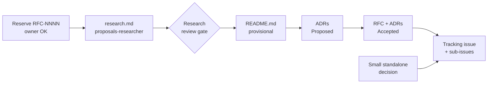

# Homelab proposals (RFC / ADR)

Pick the one artifact it is legal to write next, open the file that owns that
step, and stop at that file's own gate. The lifecycle itself lives in
[`docs/proposals/`](../../../docs/proposals/) — this skill routes, it does not
restate the process, because a second copy of a checklist drifts from the one
reviewers actually enforce.

Read [platform-engineer](../platform-engineer/SKILL.md) first for repo scope,
the `make validate` gate, and API truth. That skill decides *whether* a change
needs a design record; this one decides *which* proposal file to write once it
does.

Three records answer three questions, so they do not merge: **research
explains** how a mechanism works, the **RFC proposes** a target design, the
**ADR decides** one durable choice and its tradeoffs. Keep each in its lane and
none repeats another.

## Find the phase, then open its owner

Look at `docs/proposals/` to see what already exists, match the row, open the
linked file, and do what that file's gate requires before moving down.

| On disk | Next legal step | Open |
|---------|-----------------|------|
| No RFC folder | Owner approves the number (`max + 1`, no backfill), then copy `research.md` only and add an index row at `researching`; the sub-agent below fills the file | [`rfc/README.md`](../../../docs/proposals/rfc/README.md) § Process step 1 |
| Only `research.md`, status `researching` | Delegate to the [`proposals-researcher`](../../agents/proposals-researcher.md) sub-agent (see [Delegate research](#delegate-research)); review its report, keep the index row, get owner **ready for RFC** before copying `README.md` | [`RFC-0000/research.md`](../../../docs/proposals/rfc/RFC-0000/research.md) + its [review gate](../../../docs/proposals/rfc/RFC-0000/research.md#research-review-gate) |
| `README.md` at `provisional` | Fill the RFC from research (do not re-teach the mechanism); split independent decisions into one ADR each at `Proposed` | [`RFC-0000/README.md`](../../../docs/proposals/rfc/RFC-0000/README.md) + [`adr/README.md`](../../../docs/proposals/adr/README.md#process) § Process |
| RFC filled, owner wants an area guide | Optional domain doc `docs/<area>/<topic>/README.md` distilled from research; write it with [homelab-docs](../homelab-docs/SKILL.md) and link it from the RFC | [`rfc/README.md`](../../../docs/proposals/rfc/README.md) § Process step 4 |
| RFC approved | Move RFC and its ADRs to `Accepted`, Adoption `Not started`; link an initiative or independent ADR tracker with verifiable task outcomes | [`adr/README.md`](../../../docs/proposals/adr/README.md#status-and-adoption) + [`.github/ISSUE_TEMPLATE/adr-tracking.yml`](../../../.github/ISSUE_TEMPLATE/adr-tracking.yml) |
| ADR `Accepted`, work landing | Append-only edits only; log unsettled tradeoffs on the tracking issue, not in the ADR | [`adr/README.md`](../../../docs/proposals/adr/README.md#append-only-rules) § Append-only rules + § Working log |
| Small, clear, few alternatives | Skip the RFC; write one standalone ADR | [`adr/README.md`](../../../docs/proposals/adr/README.md#when-to-create-an-adr) § When to create an ADR |

## Delegate research

Research is the Context7-heavy phase, so it runs in its own context: spawn the
[`proposals-researcher`](../../agents/proposals-researcher.md) sub-agent
(`.agents/agents/`, symlinked into `.claude/agents/`) with the owner-approved
number, the topic, the scope and any pointers. It writes or iterates
`RFC-NNNN/research.md` only, runs the Context7 audit, ticks the gate boxes the
file earns and reports the open questions. You keep the index row, the commit,
the PR and the owner's **ready for RFC**; it never runs `git`.

## Track delivery

Use [work tracking](../../../docs/platform/work-tracking.md) when selecting an
initiative, creating tasks, deferring work, or closing adoption. Several ADRs can
share one initiative. Keep accepted decision text intact; update adoption evidence
and link the tracker for current remaining work. Run `make proposals-check` after
changing record or index metadata.

## What the templates and statuses are for

Copy the templates; do not reinvent their headings here.

- RFC: [`RFC-0000/`](../../../docs/proposals/rfc/RFC-0000/) (`research.md` + README v3).
- ADR: [`ADR-0000-template/`](../../../docs/proposals/adr/ADR-0000-template/) (template v2), one decision per file.

A few status facts that an agent trips on, each owned in full by `docs/proposals/`:

- `Implemented` is not an ADR status. Decision status (`Proposed → Accepted →
  Superseded`) and `Adoption` (`Not started → Partial → Complete`) move
  independently.
- A changed decision is a **new** ADR with `Supersedes:`, never a rewrite of the
  accepted one.
- Legacy index rows still reading `implementable` mean `Accepted`; do not
  bulk-rename live folders.
- `docs/api/` sync happens when Adoption is `Complete` (or the RFC is
  `implemented`) — the RFC process step says when, and platform-engineer § API
  truth owns that sync for the implementer.

## Stay out of the wrong workflow

If the problem is still too vague to name a real-world trigger, do not reserve a
number — that is platform-engineer's unclear-ask step, not a proposal yet.

The generic `documentation-and-adrs` and `spec-driven-development` skills default
to `docs/decisions/` and their own templates, and their status vocabulary and
owner gates do not match this repo. When a homelab design record is the goal,
this skill's paths win.
