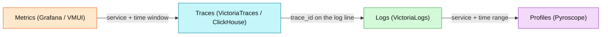

# Evidence correlation

How the four signals connect on this platform, and the pivots that actually
exist here. Source: [observability/README.md § Correlation](../../../../docs/observability/README.md)
and [microservices runbook workflows](../../../../docs/observability/runbooks/microservices/README.md).

## The chain is the failure domain

Alerting is a chain, not an expression:
`target → scrape/OTLP → store → rule → VMAlert → Alertmanager → human`. Debug it
in order. "No notification" does not mean "no problem" — and a firing predicate
does not mean a user is affected. See
[alert-lifecycle-and-runbooks.md](../../../../docs/observability/alerting/alert-lifecycle-and-runbooks.md).

## Signal freshness before threshold

- An **empty vector is not a healthy zero**. Confirm the series exist.
- OTLP relabeling changed `job`/label shapes (RFC-0014); a "missing" series is
  often a stale selector, not a dead target.
- Use absence guards / `KubeStateMetricsAbsent` / scrape-health rules before
  concluding a target vanished — `up == 0` cannot see a target that was never
  scraped.

## The correlation path

Key mechanics specific to this platform:

- **Metrics → Traces**: exemplars are **not available** (VictoriaMetrics
  won't-fix, RFC-0014 D-14). Pivot by **service + time window**, or via the
  `trace_id` field carried on logs.
- **Traces → Logs**: `trace_id` is injected into every structured log line by
  `httpmw.Logging`.
- **Logs → Traces**: **not wired** as a derived field — copy the `trace_id` from
  the log line and search the trace store manually.
- **Traces → Profiles**: Pyroscope labels match the service name for
  time-correlated flame graphs.

## Worked pivots

- **5xx**: error-rate panel → find the request in VictoriaLogs → open its
  `trace_id` in VictoriaTraces → read the errored span → DB span vs downstream
  call vs app code.
- **Slow**: P95/P99 panel → slow request's `trace_id` → slowest span → DB
  query (EXPLAIN / pool / lock) vs GC thrash vs saturation → Pyroscope for a hot
  function.
- **No traffic**: confirm the heartbeat first; endpoints exist?
  (`kubectl get endpoints`) selector vs labels; then upstream health.

The full decision trees live in the
[microservices runbook workflows](../../../../docs/observability/runbooks/microservices/README.md#investigation-workflows) —
link them, do not restate them in a finding.
