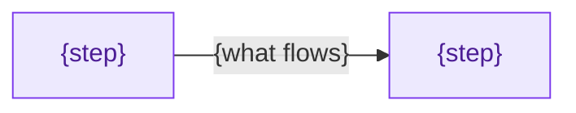

<!--
Explanation template (ADR-083 contract: "Why does the system work this way?").
Copy the file, replace every {placeholder}, and delete all author comments and
the review gate before publishing.

An explanation builds a mental model, then shows the mechanism, the
trade-offs, and the failure behaviour, and ends by pointing at the evidence on
this platform. It is the generic shape; a chapter in a learning series uses
that series' template (docs/databases/fundamentals/_template.md,
docs/observability/clickhouse/internals/_template.md), which adds a live
observation lab and a teach-back list. An architecture guide for a whole
subsystem uses the house shape in AGENTS.md § Docs conventions.
-->

# {Mechanism} — {the question or consequence it decides}

<!--
Hook: connect the mechanism to something the reader has seen — an alert, a
lag value, a query result, a Flux wave stuck NotReady. One or two sentences.
-->

{Why the reader meets this mechanism and what goes wrong when the model is
missing.}

| Quick facts | |
|---|---|
| **Page type** | Explanation |
| **Audience** | {Foundation / Practitioner / Operator / Mastery entry point} |
| **Prerequisites** | {Pages or concepts read first} |
| **Deployment status** | {Deployed / Reference — not deployed / Planned — owning Accepted record} |
| **Evidence context** | {Component version; repository SHA; observation date, or "Repository facts only"} |
| **This page owns** | {The one question this page answers} |
| **Not this page** | {The reference for the exact values; the how-to; the runbook} |
| **Previous / next** | {Previous page} / {Next page} |

## Questions this page answers

<!--
Three to five observable questions. Avoid "understand" or "learn"; write what
the reader can explain or inspect afterwards.
-->

- {What happens when …?}
- {Where is … persisted, and who writes it?}
- {Which evidence distinguishes … from …?}

## Mental model

<!--
The 60-second version first, in the reader's words, before any diagram.
Define each term on first use and link the area glossary when one exists. An
analogy is allowed only when it is precise, and the next sentence names where
it stops matching the real system.
-->

{Plain-language model for a reader who knows Kubernetes and the platform's
service names.}

### Essential terms

| Term | Meaning here |
|---|---|
| `{term}` | {One-sentence definition} |

## How it works

<!--
Start with the invariants (what always holds, what is guaranteed, what is not
guaranteed), then the lifecycle or data path in causal order. One Mermaid
diagram per question, in the AGENTS.md palette; planned nodes carry the word
"planned". Render it. Follow every diagram with "What to notice".
-->

### Invariants

- {Always true during normal operation.}
- {Guaranteed.}
- {Not guaranteed.}

### Lifecycle or data path

{Causal walk-through: what is read, written, acknowledged, retried, or
reclaimed at each step.}

### What to notice

- {The relationship the diagram makes visible.}
- {The tempting but wrong conclusion it does not support.}

## Trade-offs and failure behaviour

<!--
What the design buys and what it costs; what the reader observes when it
fails; which check tells two failure modes apart. Link the runbook that owns
the recovery; do not restate it.
-->

| Behaviour | What you observe | Where it is handled |
|---|---|---|
| {Normal} | {Signal} | — |
| {Failure mode} | {Signal or error text} | [{Runbook}]({link}) |

## On this platform

<!--
Separate the generic mechanism from the deployed facts. One row per fact,
each with the smallest canonical source (a manifest path, a rule, an observed
value with its date). Mark planned and reference claims.
-->

| Upstream mechanism | Homelab setting or behaviour | Evidence | Status |
|---|---|---|---|
| {Generic behaviour} | {Deployed value or explicit absence} | [{path}]({link}) | {deployed / **planned** / **reference — not deployed**} |

## Next steps

- [{Tutorial or how-to}]({link}) — do it once on Kind or local-stack.
- [{Reference}]({link}) — the exact fields and defaults.
- [{Next explanation}]({link}) — the mechanism this one depends on or feeds.

## References

<!-- Official product docs and the owning RFC or ADR only. -->

- [{Official doc}]({url})
- [{ADR-NNN}]({link})

<!--
## Review gate — delete before publishing

- [ ] The mental model comes before the first diagram and uses only the terms
      defined on this page or linked.
- [ ] Every diagram renders and is followed by "What to notice".
- [ ] Every platform claim has a path, rule, or dated observation beside it;
      every not-deployed claim carries its status label and record.
- [ ] Upstream versions, defaults, and limits were checked against Context7 or
      the official docs.
- [ ] No change narration ("no longer", "previously"); the page describes the
      resulting system.
- [ ] `scripts/docs-check.sh <this file>` exits 0.
-->
