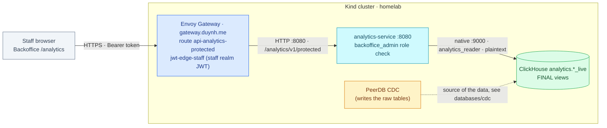

# Commerce analytics API

The analytics service provides one staff-only commerce overview from
ClickHouse serving views. PostgreSQL remains authoritative; this read model is
bounded-eventual and never handles commands.

| Attribute | Value |
|---|---|
| Availability | **Live** — deployed in local-stack and on Kind (namespace `analytics`, route `api-analytics-protected`), consumed by the Backoffice **Analytics** page. On Kind the `analytics.*` tables are fed by real CDC from product-db ([PeerDB, docs/databases/cdc](../databases/cdc/README.md)); local-stack keeps a fixture in PeerDB's table shape |
| Repository | [analytics-service](https://github.com/duynhlab/analytics-service) — release `v0.1.0` (image `0.1.0`, pinned on Kind); local-stack builds the sibling checkout |
| Consumer | [Backoffice portal](./admin.md) `/analytics` (eighth navigation item) |
| Storage access | Native ClickHouse, restricted `analytics_reader`, reviewed `analytics.*_live` views only |
| Design | [RFC-0030](../proposals/rfc/RFC-0030/), [ADR-069](../proposals/adr/ADR-069-serve-commerce-analytics-through-read-only-service/) |
| Verification | compose rows A25 / B11 / C23 ([runbook](../../local-stack/docs/e2e-audit.md)); Kind rows K3.12, K4.12–K4.14, K5.11 ([run 2026-10-23](../platform/kind-e2e-audit.md#2026-10-23--analytics-dark-launch-edge-route-and-admin-page-rfc-0030-phases-89)) |

This diagram answers one question: **which path does a staff read take, and
where does each check happen?** Where the data comes from is a separate
question, owned by [Commerce CDC](../databases/cdc/README.md).



There is no gRPC API, migration runner, source-database access or write endpoint
for this service. The Envoy route and the Admin navigation exist; the data behind
the views is real CDC on Kind and a fixture in local-stack, and every gate row that
reads it says so.

## Request and authorization

```http
GET /analytics/v1/protected/commerce/overview?currency=USD&from=2026-10-01&to=2026-10-03
Authorization: Bearer <staff-access-token>
```

All three parameters are required, each exactly once. Unknown parameters,
unsupported currency, malformed query encoding, invalid dates, empty/reversed
ranges and intervals longer than 90 days return `400`. v1 supports **USD only**;
there is no conversion or all-currencies mode. Dates are `YYYY-MM-DD` and select
UTC `[from, to)`, so the example includes October 1 and 2.

The backend independently verifies an RS256 JWT against the configured
`duynhlab-staff` issuer, audience (default `duynhlab-platform`) and JWKS, then
requires the verified `realm_access.roles` to include `backoffice_admin`.
Customer-realm tokens and forwarded role/user headers do not authorize access.
Responses under the protected prefix carry `Cache-Control: no-store`.

## Response

Every `*_minor` field is a canonical signed base-ten integer **JSON string**:
`"0"`, `"12345"`, or `"-200"`; never a JSON number, decimal or exponent. USD uses
two decimal places. Counts are nonnegative JSON integers at most
`9007199254740991`; an overflow makes the response unavailable rather than lossy.
IDs are strings. Nullable average means no captured orders, not zero revenue.

```json
{
  "filters": { "currency": "USD", "from": "2026-10-01", "to": "2026-10-03" },
  "kpis": {
    "settled_capture_minor": "1000", "refunded_minor": "200",
    "net_captured_minor": "800", "captured_orders": 1,
    "average_captured_order_minor": "1000"
  },
  "trend": [
    { "date": "2026-10-01", "settled_capture_minor": "1000", "refunded_minor": "0", "net_captured_minor": "1000" },
    { "date": "2026-10-02", "settled_capture_minor": "0", "refunded_minor": "200", "net_captured_minor": "-200" }
  ],
  "funnel": { "checkout_started": 2, "order_created": 1, "payment_captured": 1, "order_completed": 1 },
  "top_products": [
    { "product_id": "42", "product_name": "Historical item name", "quantity": 2, "order_count": 1, "item_subtotal_minor": "1000" }
  ],
  "meta": {
    "generated_at": "2026-10-14T10:00:00Z", "data_through": "2026-10-14T09:59:15Z", "stale": false,
    "sources": [
      { "name": "order", "synced_at": "2026-10-14T09:59:30Z", "lag_seconds": 30, "state": "healthy" },
      { "name": "checkout", "synced_at": "2026-10-14T09:59:15Z", "lag_seconds": 45, "state": "healthy" },
      { "name": "payment", "synced_at": "2026-10-14T09:59:20Z", "lag_seconds": 40, "state": "healthy" }
    ]
  }
}
```

`meta.sources[].lag_seconds` is a non-negative JSON number of seconds and
may be fractional; consumers must not require an integer.

### Metric definitions

| Field | Rule |
|---|---|
| Settled capture | Sum capture credits minus reversal debits on the `merchant_revenue` ledger leg, by **transaction event date** in the selected interval and currency |
| Refunded | Sum refund debits on the same leg, by refund event date |
| Net captured | Settled capture minus refunded; can be negative |
| Captured orders | Distinct non-null order IDs whose selected-interval capture-minus-reversal balance is positive; refunds do not remove capture status |
| Average captured order | Interval settled capture divided by captured-order count, rounded to the nearest minor unit (ties away from zero); null for a zero denominator |
| Trend | One row per UTC date in ascending order; successful empty days are zero-filled; totals reconcile to KPI money |
| Funnel | Sessions created in the selected UTC interval/currency; stages count those sessions with an order ID, positive **all-observed** capture-minus-reversal order balance, and current `completed` order status |
| Top products | Items in selected-interval captured orders; group by product ID **and historical name**, sort subtotal descending then ID/name ascending, return at most ten |

A September capture refunded in October contributes to October refunds; it does
not revise September's displayed refunds. Later reversals can make a day's
settled amount negative. Money attached to a null order ID still contributes to
ledger totals but not captured-order count or product joins; consequently the
average is the stated ratio, not an average of a separate order-value sample.

Funnel stages are independent current observations and can progress after `to`.
Completion can exceed positive-capture count after a full reversal. Completion
uses status rather than requiring `completed_at`, preserving migrated orders.
Ledger rows are aggregated per order before item/cohort joins to prevent fanout.

Order item `price` and `subtotal` are already BIGINT minor units after order
migration `000006`; the reader does **not** multiply them by 100. Item subtotal
is not ledger revenue. Source order IDs retain their native types in the current
live views; SQL read projections normalize them to String and preserve NULL.

## Freshness and failure behavior

Read exactly the `order`, `checkout` and `payment` target-observed heartbeat
views before metrics. Re-evaluate those same observed timestamps after the data
queries; a newly observed heartbeat cannot certify earlier query results.
`data_through` is the oldest of the three, not an atomic cross-source watermark.
Each query can observe a different serving snapshot; there is no response cache.

| Observation | Outcome |
|---|---|
| Every source age from 0 through 120 seconds | `200`, healthy |
| Any source above 120 through 300 seconds | `200`, `meta.stale=true`, corresponding source stale |
| Missing/unknown/duplicate/future heartbeat, age above 300 seconds, failed query or invalid numeric/posting data | `503`, no metric payload or fabricated zeros |

The shared error shape is `{ "error": "safe message", "code": "STABLE_CODE" }`.

| HTTP | Code | Meaning |
|---|---|---|
| 400 | `VALIDATION_ERROR` | Invalid request filters |
| 401 | `UNAUTHORIZED` | Missing or invalid staff JWT |
| 403 | `FORBIDDEN` | Verified token lacks the operator role |
| 503 | `AUTH_UNAVAILABLE` | JWKS verification is temporarily unavailable |
| 503 | `ANALYTICS_UNAVAILABLE` | Data freshness, ClickHouse, cancellation, limits or result validation failed |

`GET /health` is process liveness. `GET /ready` performs a serving-view read with
a one-second context budget; it does not certify pipeline freshness. Queries
have a two-second context/server execution budget, 512 MiB memory limit and two
threads; the overview context budget is five seconds. Exceeded limits fail the
whole response rather than returning partial/truncated aggregates. Pool size is
four open / two idle connections. The service connects over native `:9000`
with `CLICKHOUSE_TLS=false` in both local-stack and Kind: the ClickHouse
installation has no TLS listener, so the controls today are the
`analytics_reader` password and the NetworkPolicy fence. TLS to ClickHouse is
**planned** (ADR-069 obligation T1); with the flag set to `true` the client
verifies the endpoint certificate.

## Verification and rollout

Linux runtime qualification on **2026-10-22/23** (main `8e4667fb`, compose and
Kind, fixture-backed serving layer): the ClickHouse integration suite runs in CI
against ClickHouse 26.9; compose A25 asserts the guard chain and the contract
(25 checks), the freshness drill meets the 120 s / 300 s / ≤60 s clocks and the
failure drill fails closed in under a second; B11 shows the page's live, delayed,
unavailable and forbidden states; C23 finds the three gauges, the DB duration
histogram and the ClickHouse client span. On Kind the dark launch (K4.12), the
edge route (K4.13, 25 checks) and the Admin page (K4.14) pass the same rows, and
`analytics_reader` reads exactly the ten views (K3.12). Evidence sits on
[#1332](https://github.com/duynhlab/homelab/issues/1332),
[#1334](https://github.com/duynhlab/homelab/issues/1334) and
[#1335](https://github.com/duynhlab/homelab/issues/1335).

**Read path — accepted known limit (G8.5).** The first million-fact run found
every overview call over the 2 s query budget: each `*_live` view recomputed
`GROUP BY id` + `argMax` over its whole raw table per read, and the ledger
joined on `toString()` keys. Two changes followed. The serving views now read
`FINAL` over PeerDB's `ReplacingMergeTree(_peerdb_version)` tables
([homelab#1366](https://github.com/duynhlab/homelab/pull/1366)), and the reader
joins the ledger on native `Int64` keys and counts completed orders with a
semi-join
([analytics-service#5](https://github.com/duynhlab/analytics-service/pull/5);
released in `v0.1.0`). On one
million ledger facts, two threads, the 90-day medians are 0.23 s (daily),
0.25 s (captured), 0.38 s (products) and 0.55 s (funnel). The funnel stays over
the ≤500 ms bar; the owner accepted that as a known limit on 2026-10-23, and
the daily-rollup option is deferred
([analytics-service#4](https://github.com/duynhlab/analytics-service/issues/4)).

The UI validates string money, formats via exact integer arithmetic, and shows
an exact table when values are too large for safe chart coordinates.
