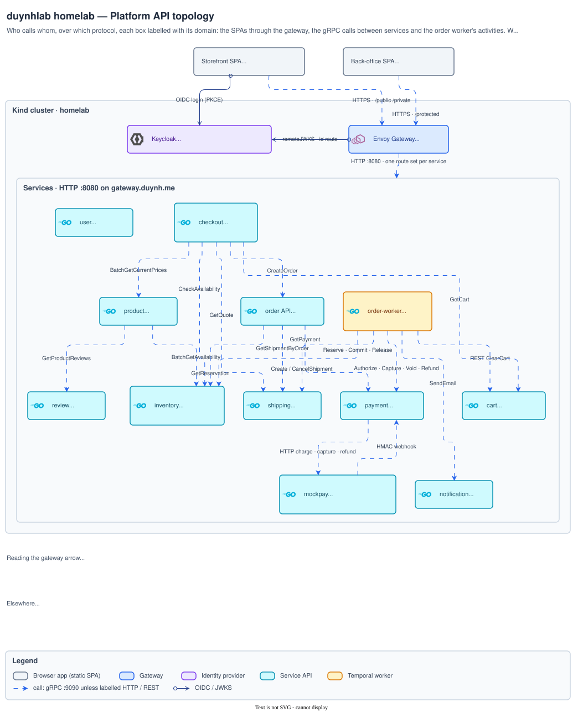

# API architecture diagrams

How the platform's APIs connect: the SPAs, the gateway and the services behind
it.

[Architecture index](../README.md)

## Platform API topology

The SPAs' routes through the gateway, every documented gRPC method between
services, the order worker's activities and the payment ↔ mockpay loop.
Explained in
[`api/api.md` § Platform API Topology](../../api/api.md#platform-api-topology).

Source <a href="platform-api.drawio"><code>platform-api.drawio</code></a> · <a href="img/platform-api.png">PNG</a>

