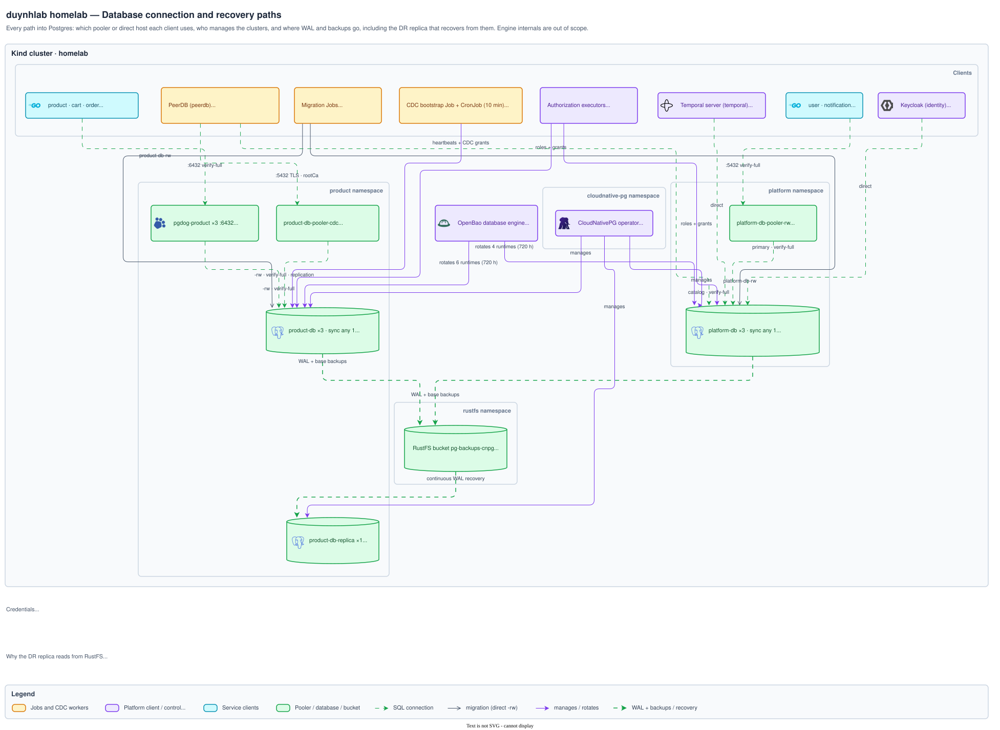
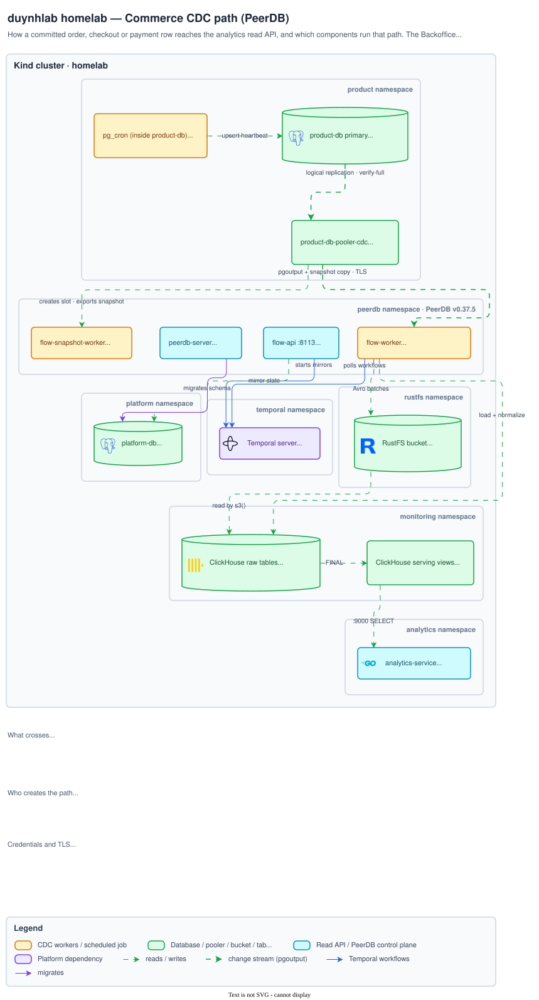

# Database architecture diagrams

How clients reach PostgreSQL, how backups and recovery flow, and how commerce
data reaches analytics.

[Architecture index](../README.md)

## Connection and recovery paths

Which pooler or direct host each client uses, who manages the clusters, and how
WAL and backups reach the DR replica. Explained in
[`databases/architecture.md` § Current topology](../../databases/architecture.md#current-topology).

Source <a href="topology.drawio"><code>topology.drawio</code></a> · <a href="img/topology.png">PNG</a>

## Commerce CDC path

How a committed order, checkout or payment row travels product-db → CDC pooler →
PeerDB → RustFS staging → ClickHouse → analytics-service, and which
control-plane pieces (Temporal, the PeerDB catalog) run it. Explained in
[`databases/cdc/README.md` § Architecture](../../databases/cdc/README.md#architecture).

Source <a href="cdc.drawio"><code>cdc.drawio</code></a> · <a href="img/cdc.png">PNG</a>

