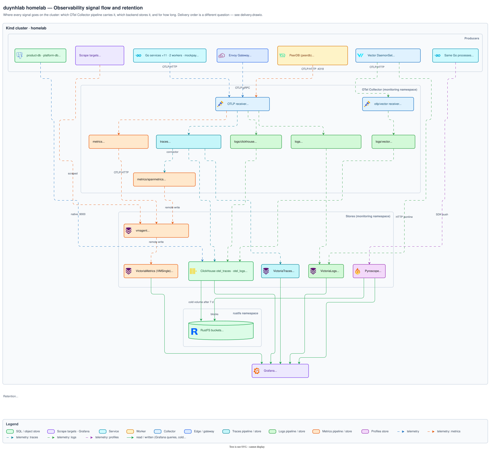
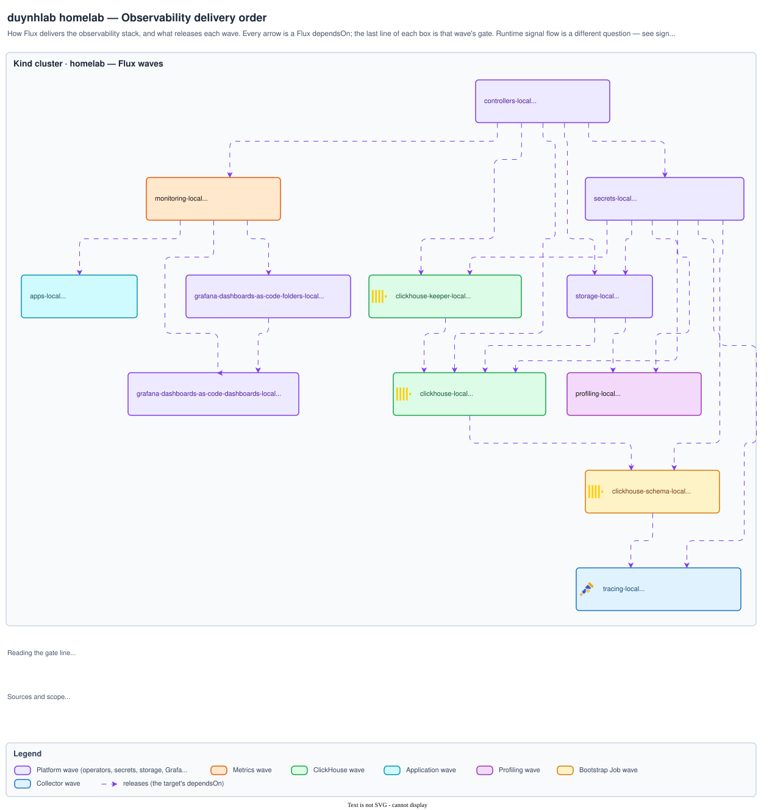
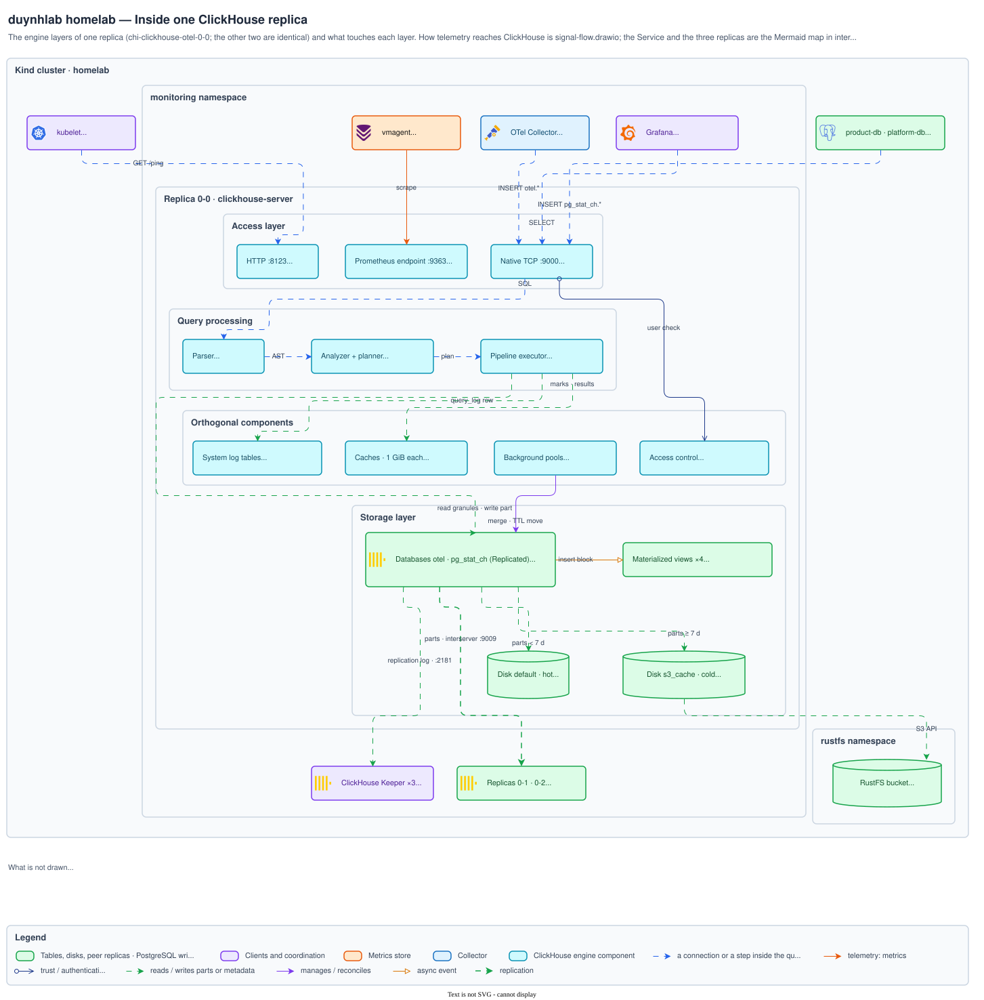

# Observability architecture diagrams

How telemetry flows and is stored, how the stack is delivered, and what runs
inside one ClickHouse replica.

[Architecture index](../README.md)

## Signal flow and retention

Which OTel Collector pipeline carries each signal, which backend stores it and
for how long, and the paths that bypass the collector. Explained in
[`observability/README.md` § Architecture](../../observability/README.md#architecture).

Source <a href="signal-flow.drawio"><code>signal-flow.drawio</code></a> · <a href="img/signal-flow.png">PNG</a>

## Delivery order

How Flux delivers the observability stack and what releases each wave. Explained
in
[`observability/README.md` § Deployment](../../observability/README.md#deployment).

Source <a href="delivery.drawio"><code>delivery.drawio</code></a> · <a href="img/delivery.png">PNG</a>

## Inside one ClickHouse replica

The engine layers (access, query processing, storage, orthogonal components) of
one replica, its disks and RustFS cold tier, and the peer replicas and Keeper it
replicates through. Explained in
[ClickHouse internals ch. 01 § Inside one replica](../../observability/clickhouse/internals/01-architecture.md#inside-one-replica--the-engines-layers).

Source <a href="clickhouse-engine.drawio"><code>clickhouse-engine.drawio</code></a> · <a href="img/clickhouse-engine.png">PNG</a>

