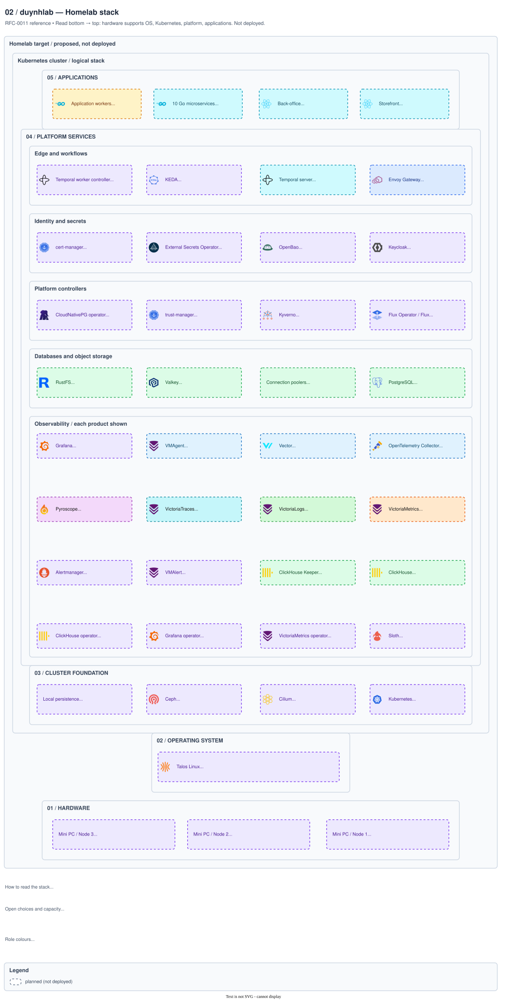
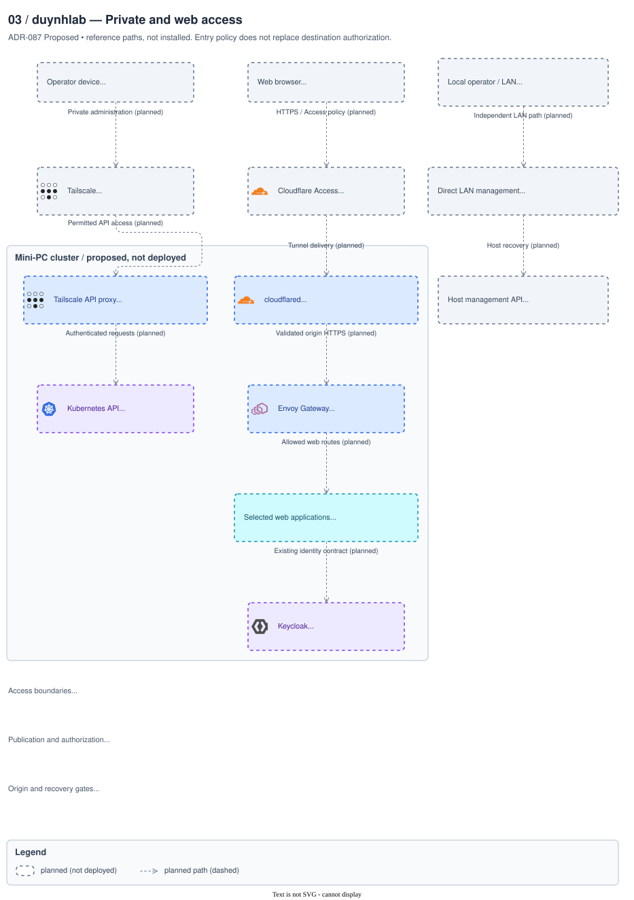
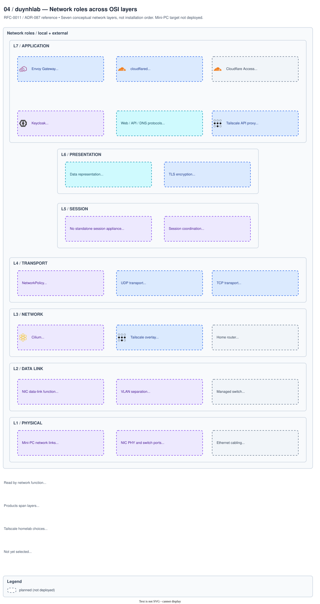

# Platform architecture diagrams

Platform diagram sources and previews, with the RFC-0011 reference designs collected here for review.

[Architecture index](../README.md) · [Current platform topology](topology.drawio)

## RFC-0011 previews

These views illustrate the provisional [mini-PC migration proposal](../../proposals/rfc/RFC-0011/)
and [ADR-087](../../proposals/adr/ADR-087-homelab-private-and-web-access/). They are
**proposed, not approved, and not deployed**. They do not replace the RFC's Mermaid views.

| View | Source | Preview | Question |
|------|--------|---------|----------|
| Physical infrastructure | [Draw.io](rfc0011-infrastructure.drawio) · [IR](rfc0011-infrastructure.ir.yaml) | [SVG](rfc0011-infrastructure.svg) · [PNG](img/rfc0011-infrastructure.png) | Which physical hosts and network links are being considered? |
| Layered homelab stack | [Draw.io](rfc0011-platform-stack.drawio) · [IR](rfc0011-platform-stack.ir.yaml) | [SVG](rfc0011-platform-stack.svg) · [PNG](img/rfc0011-platform-stack.png) | What runs above hardware, OS and Kubernetes? |
| Private and web access | [Draw.io](rfc0011-access.drawio) · [IR](rfc0011-access.ir.yaml) | [SVG](rfc0011-access.svg) · [PNG](img/rfc0011-access.png) | Which boundary admits administration, web access and LAN recovery? |
| Network / OSI layers | [Draw.io](rfc0011-network-osi.drawio) · [IR](rfc0011-network-osi.ir.yaml) | [SVG](rfc0011-network-osi.svg) · [PNG](img/rfc0011-network-osi.png) | Which networking functions belong to OSI L1–L7? |

The stack reads **bottom to top**: hardware → operating system → cluster
foundation → platform services → applications. Node 1 is Phase 1; nodes 2–3
are later expansion. Software cards describe a logical stack, not host placement
or installation order. The observability frame lists individual products.

Source <a href="rfc0011-platform-stack.drawio"><code>platform/rfc0011-platform-stack.drawio</code></a> · <a href="img/rfc0011-platform-stack.png">PNG</a>

The access view separates private administration, selected private web routes
and independent LAN recovery. It does not select an Access identity provider or
imply that Tailscale's Kubernetes proxy provides host recovery.

Source <a href="rfc0011-access.drawio"><code>platform/rfc0011-access.drawio</code></a> · <a href="img/rfc0011-access.png">PNG</a>

The network view maps the proposed components to **all seven OSI layers**.
These are protocol functions, distinct from the stack preview's five hosting
bands. A product can span layers: Tailscale's IP overlay is L3, its Kubernetes
API proxy is L7, and its encrypted traffic needs an underlying transport.

Source <a href="rfc0011-network-osi.drawio"><code>platform/rfc0011-network-osi.drawio</code></a> · <a href="img/rfc0011-network-osi.png">PNG</a>

| OSI layer | Homelab interpretation |
|-----------|------------------------|
| L7 — Application | HTTP routing in Envoy, Access admission, the web Tunnel proxy, Kubernetes API proxy, OIDC and DNS |
| L6 — Presentation | TLS encryption and message encodings as conceptual analogies; modern protocols do not implement a separate OSI appliance |
| L5 — Session | Establishing, maintaining and resuming communication; no dedicated session appliance is proposed |
| L4 — Transport | TCP/UDP, ports and transport policy; Tunnel uses QUIC/UDP or HTTP/2/TCP on outbound port 7844 |
| L3 — Network | Home-router IP forwarding, Tailscale IP overlay/subnet routing and candidate Cilium networking; address plan remains open |
| L2 — Data link | Ethernet frames, MAC forwarding, switch ports and optional VLAN separation; VLAN plan remains open |
| L1 — Physical | Cabling, NIC PHYs, physical ports and link signalling; speed and hardware remain open |

See [ADR-087's deployment roles](../../proposals/adr/ADR-087-homelab-private-and-web-access/#tailscale-homelab-deployment-roles)
for the difference between native clients, subnet routers and API proxies.
The OSI view classifies functions; the physical and access views above explain
connections and request paths.

Validation has no errors. The stack and OSI views intentionally have no packet arrows:
their unconnected-card warnings describe inventories and functional mappings. The access and physical
views retain the generator's dashed-legend warning because its visible caption
is a separate cell. Product icons identify technology, not adoption status.

### Network references

- [OSI network layers](https://developers.cloudflare.com/fundamentals/reference/network-layers/)
- [Tailscale homelab guide](https://tailscale.com/use-cases/homelab)
- [Tailscale and OSI](https://tailscale.com/docs/concepts/tailscale-osi)
- [Tailscale connection types](https://tailscale.com/docs/reference/connection-types)
- [Tailscale subnet routers](https://tailscale.com/docs/features/subnet-routers)
- [Tailscale Operator architecture](https://tailscale.com/docs/kubernetes-operator/concepts/architecture)
- [Cloudflare Tunnel connectivity](https://developers.cloudflare.com/cloudflare-one/networks/connectors/cloudflare-tunnel/troubleshoot-tunnels/connectivity-prechecks/)
- [Cilium policy](https://docs.cilium.io/en/stable/security/policy/intro/)

_Last updated: 2026-10-13_
