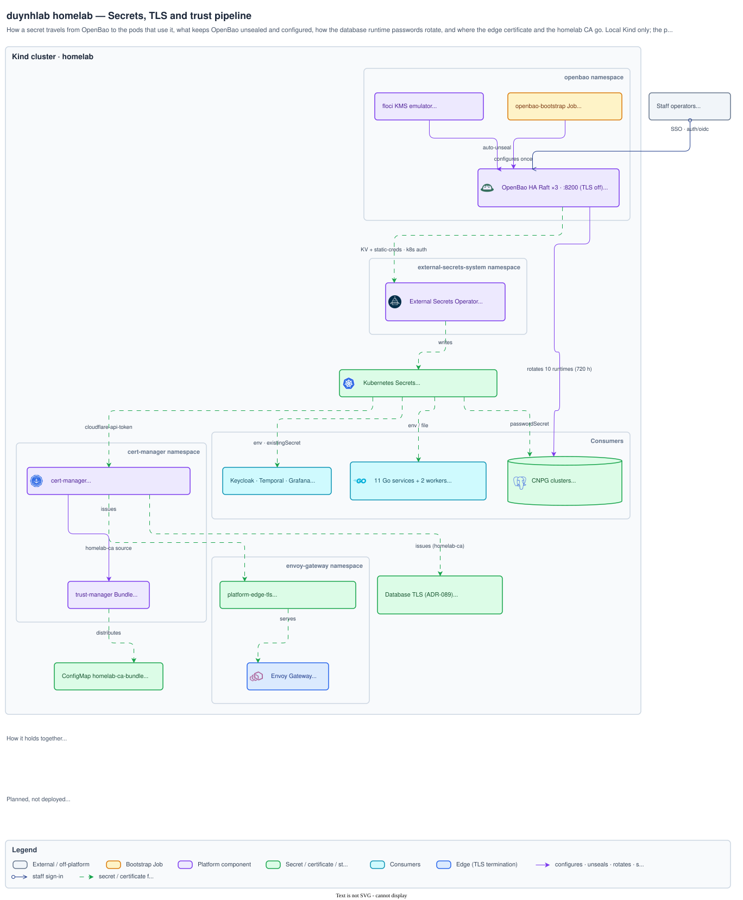

# Secrets architecture diagrams

How secrets, certificates and trust reach the workloads that use them.

[Architecture index](../README.md)

## Secrets, TLS and trust pipeline

OpenBao (floci auto-unseal, bootstrap Job) → ESO → Kubernetes Secrets →
consumers; database runtime-password rotation; database TLS, edge certificate
and CA bundle. Explained in
[`secrets/README.md` § Platform pipeline](../../secrets/README.md#platform-pipeline).

Source <a href="pipeline.drawio"><code>pipeline.drawio</code></a> · <a href="img/pipeline.png">PNG</a>

