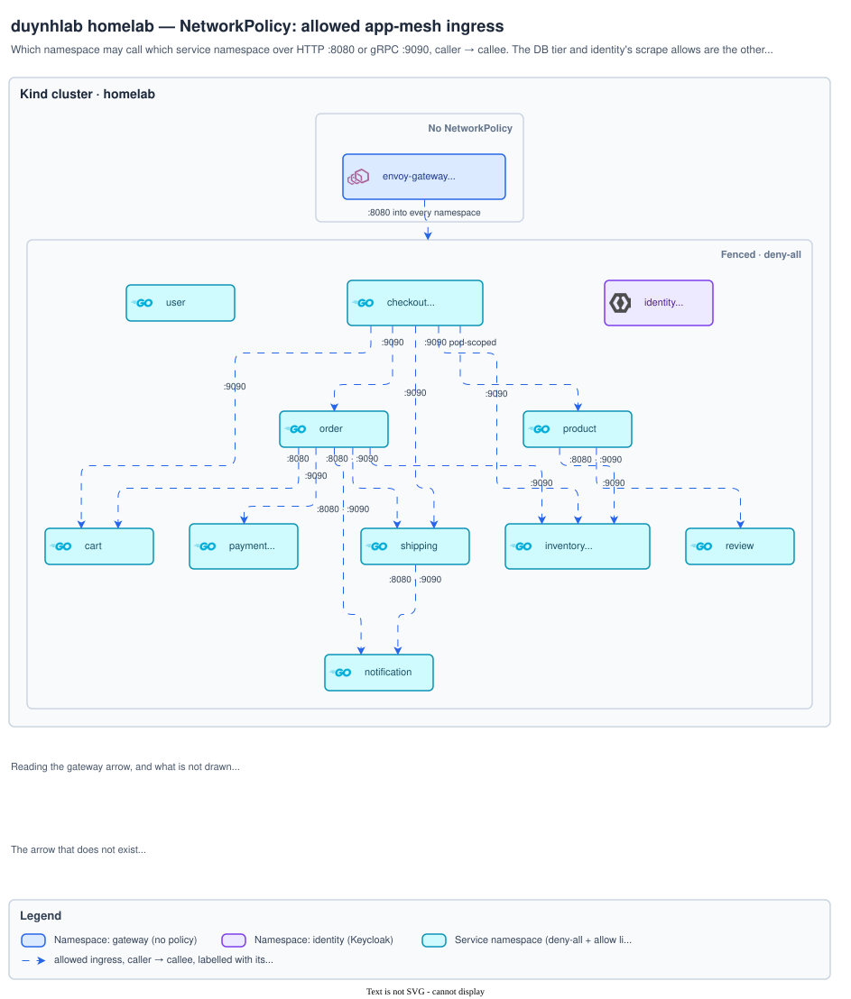
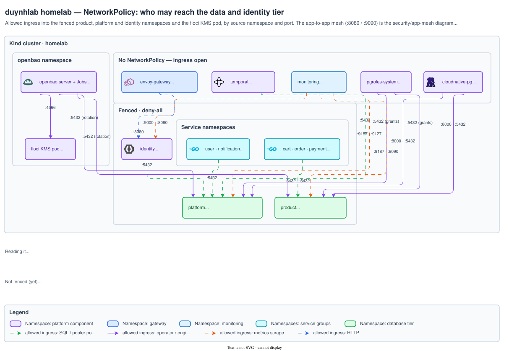
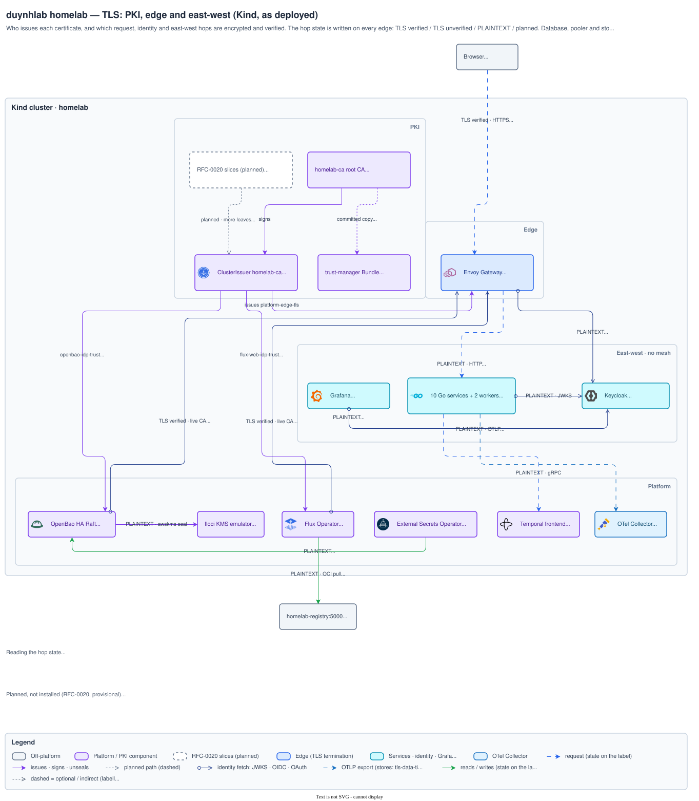
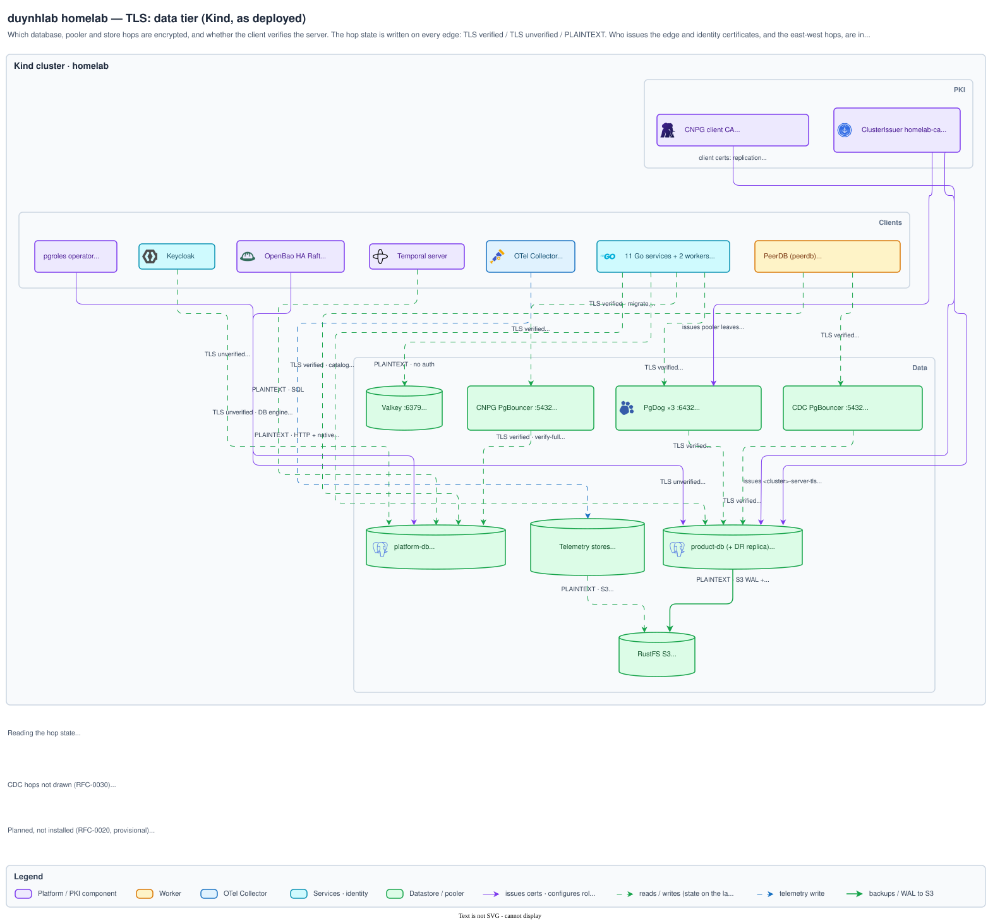

# Security architecture diagrams

Which traffic NetworkPolicy allows, and which hops are encrypted and verified.

[Architecture index](../README.md)

## Allowed app-mesh ingress

Which namespace may call which service over :8080 / :9090, caller → callee; the
gateway's twelve allows drawn as one arrow into the fenced frame. Explained in
[`security/network-policies.md` § 3](../../security/network-policies.md#3-allowed-ingress-topology).

Source <a href="app-mesh.drawio"><code>app-mesh.drawio</code></a> · <a href="img/app-mesh.png">PNG</a>

## Who may reach the data and identity tier

NetworkPolicy allows by source namespace and port. Explained in
[`security/network-policies.md` § DB-tier allows](../../security/network-policies.md#db-tier-allows).

Source <a href="network-policies.drawio"><code>network-policies.drawio</code></a> · <a href="img/network-policies.png">PNG</a>

## TLS: PKI, edge and east-west

Who issues each certificate, and whether each request, identity and east-west
hop is encrypted and verified (`TLS verified` / `TLS unverified` / `PLAINTEXT` /
`planned`), with the RFC-0020 slices drawn as planned. Explained in
[`secrets/cert-manager.md` § 12](../../secrets/cert-manager.md#12-tls-topology--which-hops-are-encrypted-today).

Source <a href="tls-pki-edge.drawio"><code>tls-pki-edge.drawio</code></a> · <a href="img/tls-pki-edge.png">PNG</a>

## TLS: data tier

Every database, pooler and store hop with its TLS state, and which CA issues the
server and pooler certificates. Explained in
[`secrets/cert-manager.md` § 12](../../secrets/cert-manager.md#12-tls-topology--which-hops-are-encrypted-today).

Source <a href="tls-data-tier.drawio"><code>tls-data-tier.drawio</code></a> · <a href="img/tls-data-tier.png">PNG</a>

