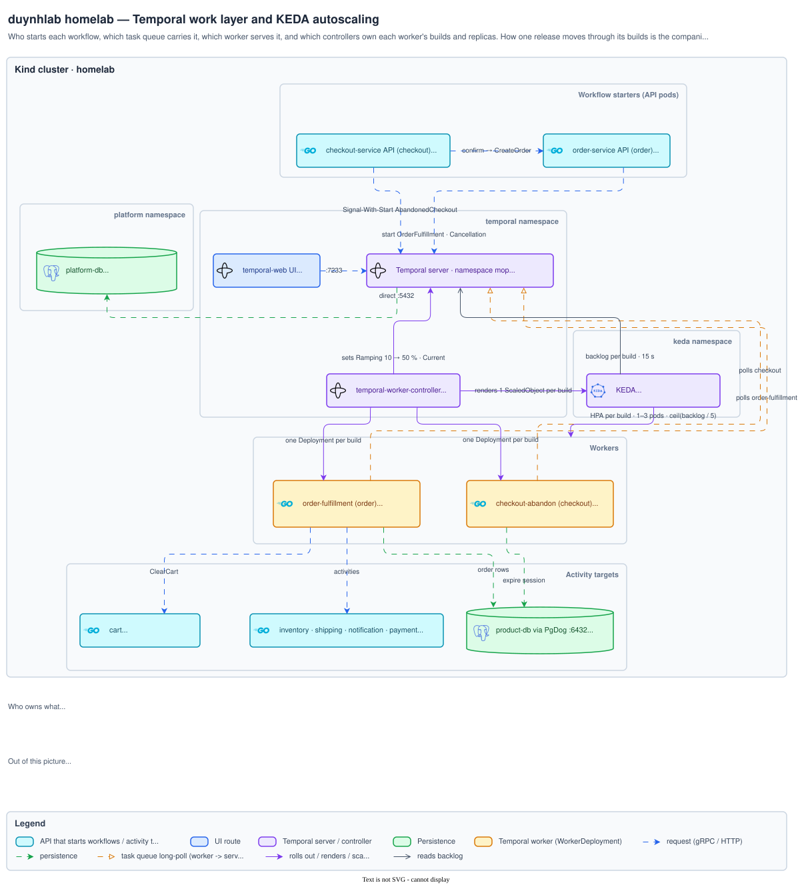
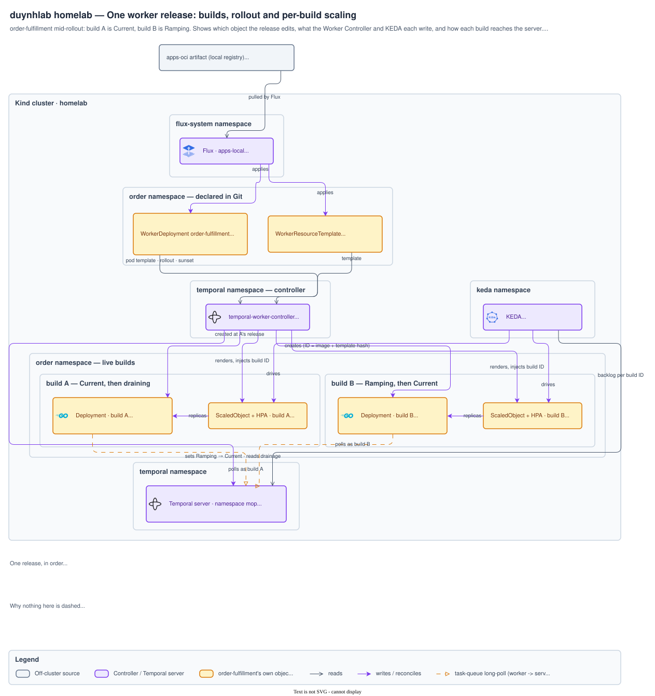

# Workflow architecture diagrams

How Temporal work is started, served and scaled, and how one worker release
rolls out.

[Architecture index](../README.md)

## The Temporal work layer

Who starts each workflow, which queue and worker serve it, and which controllers
own each worker's builds and replicas. Explained in
[`api/workflows.md`](../../api/workflows.md).

Source <a href="temporal-keda.drawio"><code>temporal-keda.drawio</code></a> · <a href="img/temporal-keda.png">PNG</a>

## One worker release

The builds, the Progressive rollout and the per-build KEDA scaling while
order-fulfillment ramps from build A to build B. Explained in
[`api/workflows.md`](../../api/workflows.md) ·
[`api/temporal.md` § Worker Deployment Versioning](../../api/temporal.md#worker-deployment-versioning-as-built).

Source <a href="temporal-worker-versions.drawio"><code>temporal-worker-versions.drawio</code></a> · <a href="img/temporal-worker-versions.png">PNG</a>

