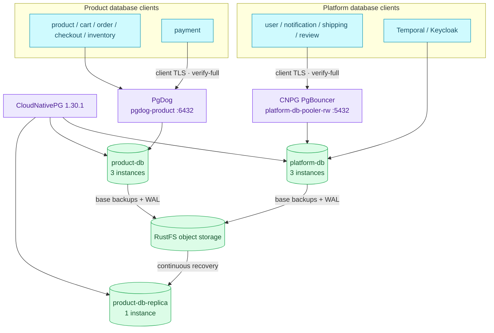

# Database Architecture

Two CloudNativePG clusters serve workloads and one continuously recovering
cluster provides a co-located DR copy of product data.

| Cluster | Namespace | PostgreSQL | Instances | Purpose |
|---|---|---:|---:|---|
| `platform-db` | `platform` | 18.6 | 3 | Platform and supporting-service databases |
| `product-db` | `product` | 18.6 | 3 | Catalog and checkout-domain databases |
| `product-db-replica` | `product` | 18.6 | 1 (3 on promotion) | Object-store-fed recovery copy of `product-db` |

Version inventory comes from repository pins, reviewed at main `d421daf3` on
2026-10-06: CNPG operator **1.30.1**, chart **0.29.0**, PostgreSQL **18.6** and
Barman Cloud plugin chart **0.8.1**. Confirm running versions before operations;
this review did not perform a new live-cluster audit. Historical evidence keeps
the versions measured on its recorded date.

## Current topology

This diagram answers which deployed component owns each database connection and
recovery path. It does not describe PostgreSQL engine internals or the planned
cross-region topology.

The Draw.io view below answers the same question with the detail the Mermaid map
leaves out:
- the exact host each client group connects to;
- the migration Jobs that always target the `-rw` services;
- OpenBao rotating the `notification` password;
- the WAL and base backups in RustFS that the DR replica recovers from.

  

Source <a href="../architecture/databases/topology.drawio"><code>databases/topology.drawio</code></a> · <a href="../architecture/databases/img/topology.png">PNG</a>

## Cluster behavior

Both operational clusters declare synchronous quorum `ANY 1` with
`dataDurability: required`. Each has one primary and two standby instances; CNPG
selects the actual synchronous and asynchronous roles at runtime. Generated
services expose these database roles:

| Service suffix | Routing contract |
|---|---|
| `-rw` | Current primary |
| `-r` | Any instance, including the primary |
| `-ro` | Standby instances only |

`ANY 1` is a commit acknowledgment rule, not an unconditional zero-loss promise
for every promotion. The manifests do not enable `failoverQuorum`; see
[failure behavior and safety boundaries](./cloudnativepg.md#replication-and-failure-behavior).

Applications normally use a pooler or `-rw`. A generated service is stable, but
individual pod identity and replication role are not.

`product-db-replica` follows the `product-db` Barman object store in continuous
recovery. It is neither a fourth in-cluster standby nor independent regional DR:
it shares the same Kubernetes environment and object-storage failure domain.

## Connection paths

- Platform services use the CNPG PgBouncer transaction pooler over client TLS
  and verify it (`sslmode=verify-full`); PgBouncer refuses plaintext. Temporal
  and Keycloak connect directly because their session and prepared-statement
  semantics are outside the pilot.
- Every product-db service uses PgDog as its `<svc>_runtime` login. PgDog
  sends reads and writes to `product-db-rw`; no database lists a replica
  (ADR-089).
- Payment reaches PgDog over client TLS and verifies it (`sslmode=verify-full`
  against `homelab-ca`); the others stay plaintext. Checked on Kind on
  2026-10-17 ([poolers](./poolers.md#tls)).
- Migration jobs connect directly to the primary so schema changes are not
  multiplexed or read-routed.

No application path reads from a replica today. A replica read is not a
consistency guarantee: a read right after a primary commit may observe
replication lag. That is why a replica profile will be an explicit opt-in.

## Database inventory

| Cluster | Databases declared or adopted by current manifests |
|---|---|
| `platform-db` | `user`, `notification`, `shipping`, `review`, `keycloak`, `temporal`, `temporal_visibility` |
| `product-db` | `product`, `cart`, `order`, `payment`, `checkout`, `inventory` |
| `product-db-replica` | Physical recovery copy of `product-db` |

Each service has two Secret projections (runtime and migrator), a runtime
`DatabaseRole`, and a `Database` owned by `<svc>_owner`; the owner and migrator
roles come from the cluster's role catalog Job
([authorization](./authorization.md)).
Database content such as application tables remains owned by migrations and
services, not by the infrastructure manifests.

## Operations

- [CloudNativePG control plane](./cloudnativepg.md)
- [Storage and capacity](./storage-and-capacity.md)
- [Security and access](./security-and-access.md)
- [Maintenance and upgrades](./runbooks/maintenance-and-upgrades.md)
- [Pooler endpoints and behavior](./poolers.md)
- [Declarative database and role ownership](./declarative-role-management.md)
- [Backup policy](./backup-policy.md)
- [Disaster recovery](./disaster-recovery.md)
- [Database runbooks](./runbooks/README.md)

## Manifest evidence

- `kubernetes/infra/controllers/databases/`
- `kubernetes/infra/configs/databases/clusters/`
- `kubernetes/infra/configs/databases-cnpg-dr/`
- `kubernetes/apps/services/`

## References

- [CloudNativePG 1.30 architecture](https://cloudnative-pg.io/docs/1.30/architecture/)
- [CloudNativePG 1.30 service management](https://cloudnative-pg.io/docs/1.30/service_management/)
- [CloudNativePG 1.30 replica clusters](https://cloudnative-pg.io/docs/1.30/replica_cluster/)
