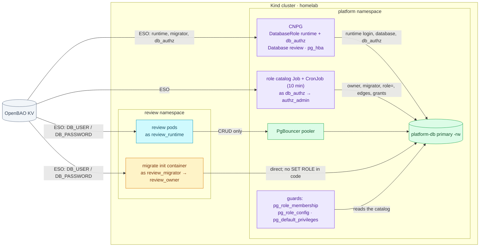

# Database Authorization (owner / migrator / runtime)

Every service database has three roles: one owns the objects, one changes the
schema, and one serves traffic. The platform creates them and decides what each
may do; a service only receives a user name and a password. A compromised
service can read and write its own rows; it cannot change, drop or take
ownership of its own schema.

| | |
|---|---|
| **Status** | **Deployed for `review`**. Every other service still uses one login that owns its database until it is converted |
| **Design records** | [RFC-0029](../proposals/rfc/RFC-0029/) · [ADR-084](../proposals/adr/ADR-084-split-service-database-roles/) (three roles) · [ADR-088](../proposals/adr/ADR-088-platform-owns-database-authorization/) (the platform owns authorization; supersedes ADR-085) · [ADR-086](../proposals/adr/ADR-086-guard-membership-options/) (guard) |
| **Roles per service** | `<svc>_owner` (NOLOGIN) · `<svc>_migrator` (LOGIN, NOINHERIT, `role=<svc>_owner`) · `<svc>_runtime` (LOGIN) |
| **Who applies what** | CNPG: runtime login, database, `pg_hba`, `db_authz` · role catalog Job + CronJob: owner, migrator, memberships, and (Job-owned services) in-database grants · pgroles: in-database grants for the other services (**planned**, D2) |
| **What a service knows** | `DB_USER` / `DB_PASSWORD` for `migrate`/`seed` and for serving. No role name, no `GRANT`, no `SET ROLE` |
| **Drift** | The CronJob re-applies every 10 minutes; `pg_role_membership`, `pg_role_config`, `pg_default_privileges` guards and their alerts; Kind gate rows |
| **Rollout model** | Greenfield: no legacy login, no compatibility window. Rollback is `git revert` + a fresh `make up` |

## Concept

PostgreSQL decides what a session may do from the role it is acting as. Before
this design, one role per service did everything: it logged in for traffic, ran
migrations and owned every table. Whoever held that password could `DROP TABLE`,
`ALTER` a column or change a grant, because the owner can always do that.

The split gives each job its own identity:

| Role | Logs in | Owns | Can do |
|---|---|---|---|
| `<svc>_owner` | never | the database, its schemas and every object | everything on its objects, but nobody holds a password for it |
| `<svc>_migrator` | yes, from the `migrate` init container and the seed | nothing | becomes the owner at login: the platform sets `ALTER ROLE <svc>_migrator SET role = <svc>_owner`, and the membership is `INHERIT FALSE, SET TRUE`. `RESET ROLE` returns to the owner, not to the login |
| `<svc>_runtime` | yes, from the service pods (through the pooler) | nothing | `SELECT/INSERT/UPDATE/DELETE` on tables and `USAGE/SELECT` on sequences, through the owner's default privileges |

Everything that is not "the service's own schema" is platform work. The service
repo creates tables and indexes in its migrations and nothing else:

| Job | Owner |
|---|---|
| Runtime login, its password, the `Database` (`owner: <svc>_owner`), `pg_hba` | CNPG (`DatabaseRole`, `Database`, `instance.yaml`) |
| Owner and migrator roles, the migrator's `role=`, the migrator → owner membership, the migrator's password | Role catalog Job + CronJob (`platform-db/authz/`) |
| In-database grants: `CONNECT`, `USAGE`, the owner's default privileges, grants on existing objects, `REVOKE EXECUTE … FROM PUBLIC` | Role catalog Job for `review`; pgroles `PostgresPolicy` for the others (**planned**) |
| The executor those jobs run as | `authz_admin` (bootstrap SQL) reached by the `db_authz` login (CNPG) |

## Architecture

This diagram answers which component applies which part of one service's
authorization, and which identity each path uses. It shows `review`.



## How it works in this platform

### Naming

| Thing | Convention | Example (`review` on `platform-db`) |
|---|---|---|
| Database | `<svc>` | `review` |
| Roles | `<svc>_owner`, `<svc>_migrator`, `<svc>_runtime` | `review_owner`, `review_migrator`, `review_runtime` |
| Runtime `DatabaseRole` | `<cluster>-role-<svc>-runtime` | `platform-db-role-review-runtime` |
| `Database` object | `<svc>-database`, `spec.owner: <svc>_owner` | `review-database` |
| Secrets (cluster and app namespace, same name) | `<cluster>-<svc>-runtime-secret`, `<cluster>-<svc>-migrator-secret`; the owner has none | `platform-db-review-migrator-secret` |
| OpenBAO KV | `secret/local/databases/<cluster>/<svc>-runtime`, `…/<svc>-migrator` | `secret/local/databases/platform-db/review-runtime` |
| `pg_hba` | `host <svc> <svc>_runtime …`, `host <svc> <svc>_migrator …`, `host <svc> db_authz …`. No line for the owner | — |
| Executor | `authz_admin` (NOLOGIN, CREATEROLE) and `db_authz` (LOGIN, member of `authz_admin`), one pair per CNPG cluster | KV `…/platform-db/db-authz` |

Names considered and not used:

| Name | Why not |
|---|---|
| `_app`, `_rw` | Ambiguous: `_rw` promises a `_ro` sibling that does not exist, and every role is "the app" |
| `_deploy` | Migrations also run in local-stack and in tests, not only at deploy |
| `_ddl` | The migrator also seeds data, which is not DDL |
| `_admin` | Suggests `ADMIN OPTION`, which this role must never have |
| keeping `<svc>` for runtime | A bare service name hides which of the three identities a log line, a connection or an alert refers to |

### The executor: `authz_admin` and `db_authz`

The role catalog runs as a non-superuser. Two roles make that work with CNPG:

- **`authz_admin`** (NOLOGIN, `CREATEROLE`, `INHERIT`) is created once by the
  cluster's bootstrap SQL and is **not** a CNPG `DatabaseRole`. It creates every
  catalog role, so PostgreSQL 16+ gives it `ADMIN` on each one, and the session
  setting `createrole_self_grant = 'set, inherit'` also gives it `SET` and
  `INHERIT`, which `ALTER DEFAULT PRIVILEGES FOR ROLE <svc>_owner` needs.
- **`db_authz`** is the login (a CNPG `DatabaseRole` with `inRoles:
  [authz_admin]`, password random per cluster in OpenBAO). The Job connects with
  `PGOPTIONS='-c role=authz_admin -c createrole_self_grant=set,inherit'`.

Why not one role: CNPG creates a `DatabaseRole` with `CREATE ROLE … IN ROLE
<inRoles>`, so listing the owners there deadlocks a new cluster (the executor
cannot be created before the owners it creates); and leaving them out makes
CNPG revoke the executor's memberships on every reconcile (lab CNPG-08).
`authz_admin` holds those memberships where CNPG never looks.

An existing cluster that predates this design runs the bootstrap line once:

```sql
CREATE ROLE authz_admin NOLOGIN CREATEROLE INHERIT;  -- as postgres, on the primary
```

### The role catalog Job

`platform-db/authz/` holds `apply.sh`, `roles.sql` and `grants.sql`, rendered
into a hashed ConfigMap. Two workloads run the same script:

| Workload | When | Why |
|---|---|---|
| `Job/platform-db-authz` | On every change to the SQL or the service lists (the ConfigMap hash changes; Flux recreates the Job) | A new service gets its roles without waiting |
| `CronJob/platform-db-authz` | Every 10 minutes | Undoes drift. A failed run fires `KubeJobFailed`; job TTL is 1 h so the alert resolves after a fix |

`ROLE_SERVICES` lists the services whose owner and migrator the catalog owns;
`GRANT_SERVICES` lists the services whose in-database grants it owns (the rest
will use pgroles). Per service, `roles.sql`:

1. creates `<svc>_owner` and `<svc>_migrator` if missing and restates
   `LOGIN`/`INHERIT`/`CREATEROLE`/`CONNECTION LIMIT` (`CREATEDB`, `REPLICATION`
   and `BYPASSRLS` default to false and only a superuser can change them);
2. `ALTER ROLE <svc>_migrator RESET ALL` then `SET role = '<svc>_owner'`;
3. `GRANT <svc>_owner TO <svc>_migrator WITH INHERIT FALSE, SET TRUE, ADMIN FALSE`
   (re-issuing it rewrites drifted options);
4. revokes every other membership of the two roles, except `authz_admin`'s
   creator edges, then **fails the run** if anything still differs: a revoke
   PostgreSQL skipped because another grantor (for example `postgres`) holds the
   edge is drift the executor may not repair, and a red Job is how it surfaces.

The migrator's password is set only when the migrator can no longer log in with
the Secret's value, so the verifier is not rewritten every 10 minutes.

`grants.sql`, per Job-owned database, as `authz_admin` inheriting the owner:

```sql
GRANT CONNECT ON DATABASE <svc> TO <svc>_runtime, <svc>_migrator;
GRANT USAGE ON SCHEMA public TO <svc>_runtime;
-- golang-migrate's bookkeeping table, created as the owner before the first
-- migrate (same DDL as migrate's CREATE TABLE IF NOT EXISTS, which adopts it).
SET ROLE <svc>_owner;
CREATE TABLE IF NOT EXISTS public.schema_migrations
  (version bigint NOT NULL PRIMARY KEY, dirty boolean NOT NULL);
RESET ROLE;
ALTER DEFAULT PRIVILEGES FOR ROLE <svc>_owner IN SCHEMA public
  GRANT SELECT, INSERT, UPDATE, DELETE ON TABLES TO <svc>_runtime;
ALTER DEFAULT PRIVILEGES FOR ROLE <svc>_owner IN SCHEMA public
  GRANT USAGE, SELECT ON SEQUENCES TO <svc>_runtime;
-- Global, not IN SCHEMA: only a global entry cancels PUBLIC EXECUTE (PG-05).
ALTER DEFAULT PRIVILEGES FOR ROLE <svc>_owner REVOKE EXECUTE ON FUNCTIONS FROM PUBLIC;
-- then, for every table and sequence the owner already has: REVOKE ALL from
-- the runtime and grant exactly the set above, in one transaction;
-- schema_migrations gets nothing.
```

`schema_migrations` is created by the Job, not by the first migrate. The
owner's default privileges would otherwise hand it to the runtime with
`INSERT`/`DELETE` until the next CronJob run: on the first Kind gate
(2026-10-15) migrate ran at 03:10:04, four seconds after a CronJob run
finished, and K3.8 read the table as `review_runtime`.

### Wiring in the domain ResourceSets

| Container | Host | `DB_USER` / `DB_PASSWORD` |
|---|---|---|
| service | pooler (`db_host`) | `username` / `password` of `inputs.db_runtime_secret` |
| `migrate` | primary `-rw` (`db_migration_host`), never a pooler | `username` / `password` of `inputs.db_migrator_secret` |

That is all a service receives. `role=` is applied by PostgreSQL at login, so
the migrator must reach the primary directly: a transaction-mode pooler would
hand its server connection to other clients. Seeding follows the migration:
`scripts/kind-seed.sh` and the local-stack `<svc>-seed` service use the
migrator's credentials.

Poolers carry only `<svc>_runtime`.

### The migration contract (service repos)

- Migrations create schema objects. They never `GRANT`, `ALTER DEFAULT
  PRIVILEGES`, `SET ROLE` or name a role; `migratex.Run(fsys, dir, dsn)` takes no
  role option (pkg `migratex/v0.39.0`).
- A function the runtime must call is the exception that needs the platform: add
  its `GRANT EXECUTE` to the service's grants (Job or pgroles policy), because
  PUBLIC has no `EXECUTE` by default.

### Detection and gates

| Signal | Where | What it proves |
|---|---|---|
| `CNPGRoleMembershipDrift` (critical) | [runbook](../observability/runbooks/postgresql/CNPGRoleMembershipDrift.md) | Every guarded edge (`vault_rotator → notification`, `review_migrator → review_owner`, `db_authz → authz_admin`) has its specified options |
| `CNPGRoleConfigDrift` (critical, 15 m) | [runbook](../observability/runbooks/postgresql/CNPGRoleConfigDrift.md) | The migrator's `rolconfig` is exactly `role=<svc>_owner` |
| `CNPGDefaultPrivilegesDrift` (critical, 15 m) | [runbook](../observability/runbooks/postgresql/CNPGDefaultPrivilegesDrift.md) | The owner's table, sequence and function defaults are exactly the declared set |
| `KubeJobFailed` | the catalog CronJob | The last run could not converge (drift outside the executor's reach, a missing role, a missing database) |
| Kind gate K3.4 | `scripts/db-isolation-sweep.sh` | Each login reaches only its own database; only `db_authz` reaches `postgres` |
| Kind gate K3.7 | `smoke.js` against VictoriaMetrics | Every guard reports and nothing has drifted |
| Kind gate K3.8 | `scripts/db-authz-check.sh`, as `<svc>_runtime` | The runtime cannot `CREATE`, `ALTER`, `DROP`, become the owner or read `schema_migrations` |
| Kind gate K3.9 | `scripts/db-authz-check.sh`, as `<svc>_migrator` | The migrator is the owner at login and after `RESET ROLE`, its `rolconfig` is `role=<svc>_owner`, and its membership is `f/f/t` |
| Kind gate K3.10 | `kubectl` | The catalog Job completed and the CronJob's last run succeeded |

A PR that converts a service adds its migrator edge, role config and database to
the three guard queries, the `absent()` selectors and `smoke.js` in the same PR.

### local-stack

Compose plays the platform: `local-stack/postgres/init.sql` creates the three
roles and the migrator's `role=`, `review-migrate` and `review-seed` connect as
the migrator with no role variable, and the `review-authz` one-shot service runs
**the cluster's own `grants.sql`** after the migration. One deliberate
difference stays: local-stack revokes `CONNECT` on every database from `PUBLIC`,
because it has no other connection fence; the cluster fences with `pg_hba`
(ADR-015).

### Rollback and existing data

There is no compatibility window and no legacy login. Rolling back is
`git revert` plus a fresh `make up`. A cluster that already holds data would
need a one-time, privileged ownership transfer (`REASSIGN OWNED` or
`ALTER … OWNER TO <svc>_owner`) run by an operator; that path is described for
reference only and is **not exercised here**.

## Evidence

**Runtime test, 2026-10-14**, `postgres:18-alpine` container with the bootstrap
roles CNPG would create (`authz_admin`, `db_authz IN ROLE authz_admin`,
`review_runtime`), `apply.sh` run as `db_authz`, and the real review-service
binary (`d14e06f`, `migratex/v0.39.0`) running `migrate` and `seed` as
`review_migrator` with no role variable:

```text
     role       |     member      |   grantor   | adm | inh | set
-----------------+-----------------+-------------+-----+-----+-----
 authz_admin     | db_authz        | postgres    | f   | t   | t
 review_migrator | authz_admin     | authz_admin | f   | t   | t
 review_migrator | authz_admin     | postgres    | t   | f   | f
 review_owner    | authz_admin     | authz_admin | f   | t   | t
 review_owner    | authz_admin     | postgres    | t   | f   | f
 review_owner    | review_migrator | authz_admin | f   | f   | t

 review_migrator | rolcanlogin t | rolinherit f | {role=review_owner}

 S | public | {review_runtime=rU/review_owner}
 f | -      | {review_owner=X/review_owner}
 r | public | {review_runtime=arwd/review_owner}

 tablename         | tableowner          -- after `migrate` as review_migrator
 reviews           | review_owner
 schema_migrations | review_owner

review_runtime: SELECT count(*) FROM reviews → 12 · CREATE TABLE → permission
denied for schema public · ALTER TABLE reviews → must be owner of table reviews
review_migrator: SELECT current_user → review_owner
```

Drift drill, same container: `RESET role`, `INHERIT`, a new migrator password,
the edge re-granted `INHERIT TRUE`, a removed default `DELETE`, a revoked
`INSERT` and an extra `TRUNCATE` were all restored by the next run; runtime
access to `schema_migrations` was revoked by it. A membership granted by
`postgres` (`GRANT review_owner TO review_runtime`) made the run exit 1 with
`permission denied to revoke privileges granted by role "postgres"`, and the
other steps still ran.

**Kind, fresh bring-up**: pending the D1 gate; the catalog, ACL and gate output
from that cluster replace this note.

## Operations

### Re-run the catalog now

```bash
kubectl -n platform create job --from=cronjob/platform-db-authz authz-manual-$(date +%s)
kubectl -n platform logs -f job/authz-manual-<suffix>
```

### Effective access for one role

Run on the primary as `postgres`:

```sql
-- Who owns what in this database
SELECT n.nspname, c.relname, c.relkind, pg_get_userbyid(c.relowner) AS owner
  FROM pg_class c JOIN pg_namespace n ON n.oid = c.relnamespace
 WHERE n.nspname NOT IN ('pg_catalog', 'information_schema') AND c.relkind IN ('r','S','v','m','f','p')
 ORDER BY owner, 1, 2;

-- What the runtime role can do on each table
SELECT c.relname,
       has_table_privilege('<svc>_runtime', c.oid, 'SELECT') AS sel,
       has_table_privilege('<svc>_runtime', c.oid, 'INSERT') AS ins,
       has_table_privilege('<svc>_runtime', c.oid, 'UPDATE') AS upd,
       has_table_privilege('<svc>_runtime', c.oid, 'DELETE') AS del
  FROM pg_class c JOIN pg_namespace n ON n.oid = c.relnamespace
 WHERE n.nspname = 'public' AND c.relkind = 'r';

-- Default privileges and the migrator's session defaults
SELECT pg_get_userbyid(defaclrole) AS owner, defaclnamespace::regnamespace AS schema,
       defaclobjtype, defaclacl
  FROM pg_default_acl;
SELECT rolname, rolinherit, rolconfig FROM pg_roles WHERE rolname LIKE '%\_migrator';

-- Membership options, every grantor (the guard reads the same catalog)
SELECT pg_get_userbyid(member) AS member, pg_get_userbyid(roleid) AS parent,
       pg_get_userbyid(grantor) AS grantor, admin_option, inherit_option, set_option
  FROM pg_auth_members
 WHERE pg_get_userbyid(roleid) ~ '_(owner|migrator)$' OR pg_get_userbyid(roleid) = 'authz_admin';
```

Expected for a converted service: every object owned by `<svc>_owner`, except
the views extensions install (`pg_stat_statements`), which CNPG creates as
`postgres`; the runtime has the four table rights and nothing else;
`pg_default_acl` has the owner's three rows; the migrator is `rolinherit f` with
`{role=<svc>_owner}`; `<svc>_migrator → <svc>_owner` is `f / f / t`; the only
other members of the owner and migrator are `authz_admin`'s creator edges.

### The lab

`scripts/pg-authz-lab/run.sh` re-runs the experiments this design rests on.
Run it after every PostgreSQL major and every CNPG minor or major upgrade, and
before changing a convention on this page.

```bash
scripts/pg-authz-lab/run.sh pg     # throwaway postgres:18 container, no cluster
scripts/pg-authz-lab/run.sh cnpg   # Kind platform-db; lab_* objects only, removed afterwards
```

| Experiment | Proves | Mode |
|---|---|---|
| PG-01 | Each missing layer (database, schema, table, sequence) refuses at that layer | pg |
| PG-02 | `INHERIT`, `SET` and `ADMIN` behave as the catalog says | pg |
| PG-03 | The owner's default privileges reach objects created after `SET ROLE`; runtime gets CRUD only | pg |
| PG-04 | A NOINHERIT migrator that skips `SET ROLE` creates nothing | pg |
| PG-05 | Only the **global** `REVOKE EXECUTE … FROM PUBLIC` default works | pg |
| PG-06 | Defaults do not reach existing objects; a backfill does (reference only here) | pg |
| PG-07 | RLS `USING` / `WITH CHECK`, owner bypass, `FORCE` (Phase 4 material) | pg |
| PG-08 | A `SECURITY DEFINER` function without a fixed `search_path` can be hijacked | pg |
| CNPG-01 | Adoption resets attributes the spec leaves out | cnpg |
| CNPG-02 | A Secret change reaches the role's password | cnpg |
| CNPG-03 | `spec.name` is immutable | cnpg |
| CNPG-04 | CNPG ignores membership options and recreates an edge with defaults | cnpg |
| CNPG-05 | `retain` keeps the role; `delete` waits while the role owns objects | cnpg |
| CNPG-06 | Manual drift survives until a spec change triggers a reconcile | cnpg |
| CNPG-07 | With `inherit: false` on the member, CNPG creates and recreates the owner edge as `f/f/t` | cnpg |

The ADR-088 lab (2026-10-12, Kind `platform-db`, CNPG 1.30.1, PostgreSQL 18.6,
pgroles 0.13.0) added the rows that chose the executor shape and the
Job / pgroles split; they are recorded in
[ADR-088](../proposals/adr/ADR-088-platform-owns-database-authorization/#evidence)
and were run by hand, not by `run.sh`.

The `pg` mode switches identity with `SET SESSION AUTHORIZATION`, which checks
privileges exactly as a login would but not authentication or `pg_hba`; those
are the Kind gate's job (K3.4, K3.8, K3.9), which connects as the real logins.
PG-04 still holds for a migrator without `role=`; the platform now sets it.
