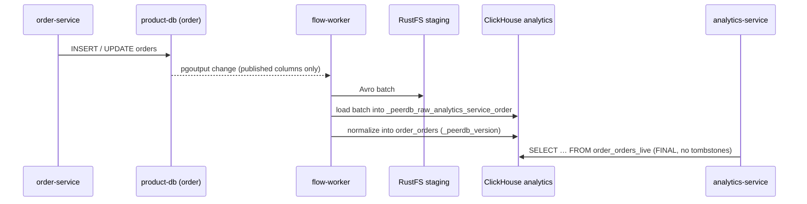

# Commerce CDC (PeerDB)

Orders, checkout sessions and the payment ledger leave product-db as a
continuous change stream and land in ClickHouse, where analytics-service reads
them. The business databases never serve an analytical query, and nothing in
the service code knows the stream exists.

| Fact | Value |
|---|---|
| Engine | PeerDB core **v0.37.5**, upstream chart `peerdb` **0.9.17**, namespace `peerdb`, Flux wave `cdc-local` |
| Sources | `order`, `checkout`, `payment` on product-db, through `product-db-pooler-cdc` (CNPG PgBouncer, session mode, TLS both hops) |
| Mirrors | `analytics_service_order`, `analytics_service_checkout`, `analytics_service_payment` — one replication slot each (`peerflow_slot_analytics_service_<db>`) |
| What crosses | Exactly the ADR-067 allowlist: 7 tables, named columns only, plus one heartbeat table per database |
| Target | ClickHouse database `analytics` (Replicated, 3 replicas), raw tables `<db>_<table>`, serving views `<db>_<table>_live` |
| State | Catalog `peerdb_catalog` on platform-db (verify-full); Temporal namespace `peerdb`; staging bucket `analytics-service-cdc` on RustFS |
| Freshness | pg_cron writes a heartbeat every 30 s in each source; the read API is stale beyond 120 s and unavailable beyond 300 s |
| Design | [RFC-0030](../../proposals/rfc/RFC-0030/), [ADR-066](../../proposals/adr/ADR-066-adopt-peerdb-for-commerce-cdc/) (PeerDB), [ADR-067](../../proposals/adr/ADR-067-constrain-commerce-cdc-source-allowlist/) (allowlist), [ADR-068](../../proposals/adr/ADR-068-schedule-cdc-heartbeats-with-pg-cron/) (heartbeats), [ADR-069](../../proposals/adr/ADR-069-serve-commerce-analytics-through-read-only-service/) (read API) |

## What PeerDB is

PeerDB is a replication engine built for PostgreSQL as the source. It reads
the write-ahead log through logical replication (`pgoutput`) and writes the
changes straight into a destination — ClickHouse here — without a message
broker in between. A **peer** is one end of a connection (a source database or
the ClickHouse target); a **mirror** is one stream from a source peer to a
target peer over one publication and one replication slot.

A mirror runs in two phases. The **initial snapshot** copies every published
table in partitions while holding a consistent snapshot of the source; the
**CDC phase** then reads the slot continuously, groups changes into batches,
stages them as Avro files in S3, and has ClickHouse load them. Each row lands
with three bookkeeping columns: `_peerdb_version` (ordering), `_peerdb_is_deleted`
(a delete is a tombstone, not a removal) and `_peerdb_synced_at`. The target
tables are `ReplacingMergeTree(_peerdb_version)`, so reading with `FINAL`
yields the latest version of every row, deletes included.

On this cluster PeerDB is four workloads plus three dependencies it borrows
from the platform:

| Part | Role |
|---|---|
| `flow-api` | API for peers, mirrors and status (`:8113` HTTP, `:8112` gRPC) |
| `flow-worker` | Temporal worker that runs the CDC workflows |
| `flow-snapshot-worker` | Holds the exported snapshot while the initial copy runs |
| `peerdb-server` | PeerDB's SQL layer (Postgres wire protocol); runs the catalog migrations at start. Peers and mirrors here are created through `flow-api`, not SQL |
| `peerdb_catalog` (platform-db) | Peers, mirrors, schema history, batch progress |
| Temporal (namespace `peerdb`) | Durable scheduling and retries of every mirror step |
| RustFS bucket `analytics-service-cdc` | Avro staging between a batch and its ClickHouse load |

The chart also ships a web UI, its own catalog PostgreSQL, its own Temporal, and
Datadog and Pyroscope hooks. All five are turned off here: the catalog and
Temporal come from the platform, and the control API stays cluster-internal.

### Why Temporal

PeerDB does not run its own loop. Every mirror is a long-running **Temporal
workflow**, and every step of it (pull a batch, stage it, load it, normalize)
is an activity that Temporal records, times out and retries with backoff. That
is what makes a restart harmless: when `flow-worker` dies, another worker
picks the workflow up at the step it reached. On Kind a primary restart
reconnected in about three minutes and a PeerDB restart in about six, with no
manual step. Pause, resume and terminate are signals to the workflow, so a
mirror stops at a safe point instead of mid-batch. A separate scheduled
workflow records slot sizes and metrics every minute.

Temporal is mandatory, not optional. The chart supports three ways to provide
it: its own bundled Temporal (the upstream default), Temporal Cloud, or an
external server. This platform uses the external mode with the server it
already runs for the order and checkout sagas: namespace `peerdb`, task queue
`homelab`, search attribute `MirrorName` (ADR-066, *Dependency isolation*).
The cost is a shared blast radius. If Temporal stops, the mirrors stop but lose
nothing: the slots keep the WAL, and `CDCReplicationSlotInactive` fires long
before the 1 GB cap. Move PeerDB to its own Temporal only if CDC and the sagas
start to contend for the frontend or the history shards.

ClickHouse acquired PeerDB; its managed form is ClickHouse Cloud's ClickPipes
for Postgres. This platform runs it itself: the PeerDB core is AGPL-3.0 and the
upstream Helm chart (`peerdb-enterprise`) is ELv2; the owner accepted both for
internal self-hosting (2026-10-23, on the ADR-066 tracker).

## How it compares

The choice and its reasons live in [ADR-066](../../proposals/adr/ADR-066-adopt-peerdb-for-commerce-cdc/#alternatives-considered)
and the [RFC-0030 research](../../proposals/rfc/RFC-0030/research.md); this
table answers the operator's question — what each option would mean to run.

| | **PeerDB (in use)** | Debezium + Kafka/Redpanda | ClickHouse `MaterializedPostgreSQL` | ClickPipes for Postgres | Home-grown batch | Airbyte |
|---|---|---|---|---|---|---|
| Shape | Continuous CDC straight into the target | CDC into a broker; consumers apply it | ClickHouse replicates by itself | PeerDB as a managed service | Scheduled copies | General ELT with connectors |
| Updates and deletes | Yes (version + tombstone) | Yes, the consumer applies them | Yes | Yes | Platform code owns watermarks and deletes | Yes, connector-dependent |
| What we would operate | PeerDB + catalog + staging, on Temporal we already run | Broker, Connect, schemas, consumers | Almost nothing | Nothing (SaaS) | A job, and all its edge cases | Its own server, workers and database |
| Maturity for this path | Production, purpose-built for Postgres → ClickHouse | Very mature, general purpose | Experimental, DDL limits | GA on ClickHouse Cloud | As good as our code | Mature, not specialised |
| Why not here | — | Disproportionate for one consumer | Below the production bar | Managed only; the platform self-hosts | Moves the hard state machine into our code | Not evaluated in ADR-066; another control plane |

Revisit the choice when several consumers need replayable events (a broker
starts to pay for itself), when the target stops being ClickHouse, or when the
platform moves to ClickHouse Cloud — the triggers ADR-066 records.

## Architecture

The topology answers which components carry a committed row from product-db to
the analytics read API, and what each hop speaks.

<p align="center"><a href="../../architecture/databases/cdc.svg"></a></p>
<p align="center"><sub>Source <a href="../../architecture/databases/cdc.drawio"><code>databases/cdc.drawio</code></a> · <a href="../../architecture/databases/img/cdc.png">PNG</a></sub></p>

A row's path through one mirror:



## Platform behavior

**What crosses is declared, twice.** The column-listed CNPG `Publication`s
(`kubernetes/infra/configs/cdc/source/publications.yaml`)
decide what PostgreSQL emits; each mirror's table mapping excludes every
column outside the same allowlist, so a column added upstream reaches neither
the stream nor the target. The allowlist file exists twice —
`local-stack/analytics/allowlist.json` (Compose prototype) and
`kubernetes/infra/configs/cdc/bootstrap/allowlist.json` (cluster) — and the
publications and `views.sql` are generated from it: change them together.

**Who may read what.** Each `peerdb_<db>` is a CNPG `DatabaseRole` (REPLICATION
is a superuser-only attribute) with SELECT on its published tables only,
granted by `product-db-cdc-bootstrap` (Job, then a CronJob every 10 min): in one
transaction it revokes the role's table privileges and grants SELECT on exactly
the tables in publication `analytics_<db>`, so the publication is the only list.

**Why not pgroles, and why the publications sit in the CDC wave.** The grants
and the publications name app tables, which the service migrations create in
`apps-local`. Inside the service pgroles policies, in `databases-local` (whose
`wait: true` waits on every object it applies), they deadlocked a cold
bring-up: the wave waited on grants for tables that exist only once it is
Ready, and each failed plan also withheld the runtime default privileges.
pgroles allows one policy per database, so a separate CDC policy is refused
(`ConflictingPolicy`). The publications now live in `cdc-local` and converge
once the tables exist; the bootstrap CronJob grants what they publish; and
`peerdb-bootstrap` waits for every published table to be readable as
`peerdb_<db>` before it creates a mirror (cold bring-up, 2026-10-23). product-db's
HBA admits each role to its own database only; PeerDB reaches product-db only
through the CDC pooler, which a NetworkPolicy opens to the `peerdb` namespace
alone. In ClickHouse, `analytics_ingest` owns the `analytics` database and
nothing else; the serving views run as `analytics_view_owner`, which cannot
log in; `analytics_reader` sees the ten views only.

**Why the pooler is PgBouncer.** PgDog, the application pooler, works in
transaction mode, and a replication connection must keep its server
connection for life. The CDC pooler runs PgBouncer in session mode, verifies
the primary (`server_tls_sslmode: verify-full`) and presents a homelab-ca
certificate to PeerDB, which verifies it with the CA in `peerdb-ca-trust`.
Verified on Kind 2026-10-23: `IDENTIFY_SYSTEM` and a temporary `pgoutput` slot
through the pooler succeed; a wrong host name, the wrong CA, plaintext and the
bare primary are refused (`scripts/analytics/cdc-source-check.sh`).

**Heartbeats.** product-db runs the `postgresql-cron` operand (CNPG 18.6 +
pg_cron 1.6.8) through an `ImageCatalog` — CNPG reads the PostgreSQL major from
an image tag, and this image's tag is its own release version. pg_cron lives in
`postgres`; `analytics_heartbeat` schedules one 30-second job per source
database (and a daily cleanup of its own run history) from the
`product-db-cdc-bootstrap` Job. The heartbeat row replicates like any other
row, so the age ClickHouse sees is the end-to-end lag. The scheduler runs on
the primary only and follows a promotion.

**Replicated target.** The ClickHouse peer sets `replicated: true` and no
cluster: the `analytics` database is itself `Replicated`, so PeerDB's DDL
reaches all three replicas without `ON CLUSTER` or `Distributed` tables. PeerDB
names an explicit Keeper path in its `ReplicatedReplacingMergeTree` DDL, which a
Replicated database refuses by default; the `analytics_ingest` profile sets
`database_replicated_allow_replicated_engine_arguments = 2`, so ClickHouse uses
the database's own path instead.

**WAL safety.** `max_slot_wal_keep_size` is 1GB: a mirror that stops consuming
can retain at most that much WAL before PostgreSQL invalidates its slot. An
invalidated slot needs a resync (below) — it never fills the primary's disk.

**Not installed yet:** the analytics and CDC dashboard (a candidate in
[`docs/observability/analytics/`](../../observability/analytics/)) and automatic
credential rotation (manual, 90 days, ADR-089).

## Operations

**Is it healthy?**

```bash
kubectl -n peerdb port-forward svc/flow-api 18113:8113 &
curl -s localhost:18113/v1/mirrors/list            # every mirror STATUS_RUNNING
scripts/analytics/cdc-source-check.sh               # source side: G3.1–G3.4
scripts/analytics/cdc-target-check.sh [--pii]       # slots + mirrors (G6.2); --pii mutates (G6.4)
scripts/db-tls-check.sh                             # includes the cdc-pooler hop (G3.6)
kubectl -n product exec <primary> -c postgres -- psql -d postgres -Atc \
  "SELECT slot_name, active, wal_status FROM pg_replication_slots WHERE slot_type='logical'"
```

The read API's own verdict is the end-to-end check: `/analytics/v1/protected/commerce/overview`
answers `stale=false` while every heartbeat is under 120 s old.

**Alerts** watch the path from both ends: the slots from CNPG's exporter, the
mirrors from PeerDB's own metrics, and freshness from analytics-service
([catalog §4d](../../observability/alerting/alert-catalog.md#4d-cdc-and-analytics-rfc-0030)).
PeerDB exports OTLP metrics to the platform collector with the `peerdb_` prefix.

**Bring-up on a fresh cluster** needs nothing by hand: `cdc-local` installs
PeerDB, `product-db-cdc-bootstrap` creates the heartbeats, `peerdb-bootstrap`
creates the peers and admits the mirrors one source at a time (order, then
checkout, then payment — each waits for its heartbeat and every table's row
count in ClickHouse), and `analytics-views` creates the serving views once the
raw tables exist.

**On a cluster that already exists**, two things never re-run: CNPG's
`postInitSQL` (apply its four pg_cron statements once as the superuser — see
ADR-068) and the OpenBAO bootstrap seeds (write them through a staff OIDC token,
[runbook](../../secrets/runbooks/add-secret-live-cluster.md)).

**Adding a column or a table** is a contract change: update the allowlist (both
copies), regenerate `configs/cdc/source/publications.yaml` and `views.sql`,
then resync the mirror so the snapshot carries the column. The SELECT grant
follows the publication on the next `product-db-cdc-bootstrap` run (10 min).

**A mirror that stopped** (`wal_status = lost`, a failed workflow, a dropped
target table): terminate it and let `peerdb-bootstrap` recreate it with a fresh
snapshot. Terminating drops PeerDB's slot but keeps our publication.

```bash
curl -s -X POST localhost:18113/v1/mirrors/state_change -H 'Content-Type: application/json' \
  -d '{"flowJobName":"analytics_service_order","requestedFlowState":"STATUS_TERMINATING"}'
# drop the mirror's tables in ClickHouse, then re-run the bootstrap Job
kubectl -n peerdb delete job peerdb-bootstrap && flux reconcile kustomization cdc-local -n flux-system
```

**Failover keeps the mirrors.** PeerDB creates its slots with `FAILOVER true`
(`PEERDB_POSTGRES_ENABLE_FAILOVER_SLOTS`), and CNPG syncs failover slots to
every standby (`replicationSlots.highAvailability.synchronizeLogicalDecoding`,
which sets `sync_replication_slots` and `synchronized_standby_slots`). After a
promotion the new primary already holds each slot at a position the old
primary's standbys confirmed, so PeerDB resumes without a resync. Check a
standby with `SELECT slot_name, synced FROM pg_replication_slots`. A slot
created before the setting was on has `failover = false` and no standby copy:
pause its mirror, run the line below as the superuser, then resume.

```bash
psql "dbname=<db> replication=database" -c \
  "ALTER_REPLICATION_SLOT peerflow_slot_analytics_service_<db> (FAILOVER true)"
```

**After every switchover, check the old primary** ([#1377](https://github.com/duynhlab/homelab/issues/1377)). A primary demoted cleanly
(a switchover, which also ends every rolling update) keeps its own copies of
the PeerDB slots. They are not synced, and the slot-sync worker then stops with
`same name slot "…" already exists on the standby`, so that standby has no
valid failover copy and pins old WAL. Drop them on that standby; the worker
recreates them as synced copies within seconds:

```bash
kubectl -n product exec <old-primary> -c postgres -- psql -Atc \
  "SELECT pg_drop_replication_slot(slot_name) FROM pg_replication_slots
   WHERE slot_type = 'logical' AND NOT synced AND pg_is_in_recovery()"
```

The `pg_is_in_recovery()` guard makes it a no-op on the primary, where every
slot reads `synced = false` and dropping one would break its mirror.
`CDCStandbySlotsNotSynced` fires when a standby has held fewer than three
synced copies for 15 minutes (custom query `cdc_standby_slots` in product-db's
monitoring ConfigMap). Automatic dropping was considered and declined: the
alert plus this command is the procedure (#1377).

**Restoring product-db** works on the `postgresql-cron` operand like any other
recovery. `scripts/analytics/pgcron-restore-check.sh` restores a throwaway
cluster from the Barman store and asserts pg_cron is available. A recovery
Cluster must set `min_wal_size`/`max_wal_size` itself: product-db uses 64 MiB
WAL segments, and PostgreSQL refuses a `min_wal_size` below two of them.

**Rolling pg_cron back** has one safe order: drop `pg_cron` from
`shared_preload_libraries` first, then move to the stock operand. The stock
image has no `pg_cron.so`, so the reverse order leaves instances that cannot
start. Heartbeats stop while pg_cron is unloaded, and the read API turns stale
after 120 s. Rolling forward is the mirror image: put `imageCatalogRef` back
and remove `imageName` in one patch, then add the preload. Flux cannot do that
step alone, because it never owned the hand-set `imageName`: server-side apply
keeps the field, and CNPG rejects `imageName` next to `imageCatalogRef`.
`scripts/analytics/pgcron-rollback-drill.sh` rehearses the whole round trip
with Flux suspended.

**Drills** (`scripts/analytics/cdc-drills.sh <drill>`, Kind, 2026-10-23).
Each one writes rows with negative ids and deletes them afterwards. Run them one
at a time:

| Gate | Drill | Result |
|---|---|---|
| G7.1 | insert, update, NULL to value and back, delete on `orders` | each visible in the `_live` view in about 11 s; the delete leaves a tombstone in the raw table |
| G7.2 | heartbeat age sampled for 10 min | max 40 s against the 120 s stale threshold |
| G7.3 | promote a standby (`kubectl cnpg promote`) with writes before and after | 100/100 rows in ClickHouse 36 s later, no duplicates; the synced slots were active on the new primary |
| G7.5 | pause a mirror, write ~1.2 GB of WAL past the 1 GB cap, resync | slot invalidated (`wal_status = lost`), data volume 36 %; resync back to RUNNING with every order in 33 s, the new slot created as a failover slot |
| G7.4 | add and drop a column that is not on the allowlist | the column never reaches ClickHouse; the mirror stays RUNNING |
| G7.8 | pause the pg_cron heartbeats (`GATE=kind scripts/analytics-freshness-drill.sh`) | stale at +126 s, 503 at +301 s, healthy 47 s after resuming |
| G1.3, G2.5 | restore and rollback (`pgcron-*` scripts) | see above |

**Traps learned the hard way (Kind, 2026-10-23):**

- `cron.schedule_in_database(…, username)` from a non-superuser fails even
  when the name is the caller's own (pg_cron 1.6.8) — schedule without it.
- Without `replicated: true` PeerDB creates plain `ReplacingMergeTree` tables
  inside the Replicated database: they live on one replica, and the load
  balancer then answers from the other two with "table does not exist".
- A primary restart drops every mirror's stream: PgBouncer answers
  `server conn crashed? (SQLSTATE 08P01)`. PeerDB reconnected on its own
  about three minutes later. During that gap every mirror still reports
  `STATUS_RUNNING`, so judge health by `pg_replication_slots.active` and
  heartbeat age, never by mirror status (G2.5 run, 2026-10-23).
- The worker logs `relation "dynamic_settings" does not exist` for a few
  seconds after a fresh install, until `peerdb-server` finishes the catalog
  migrations — harmless.

## References

- PeerDB documentation — <https://docs.peerdb.io>
- CloudNativePG — [publications and logical replication](https://cloudnative-pg.io/documentation/current/logical_replication/), [image catalogs](https://cloudnative-pg.io/documentation/current/image_catalog/), [connection pooling](https://cloudnative-pg.io/documentation/current/connection_pooling/)
- ClickHouse — [Replicated database engine](https://clickhouse.com/docs/engines/database-engines/replicated), [ReplacingMergeTree](https://clickhouse.com/docs/engines/table-engines/mergetree-family/replacingmergetree)
- pg_cron — <https://github.com/citusdata/pg_cron>
- In this repository: [`docs/api/analytics.md`](../../api/analytics.md), [`docs/observability/analytics/`](../../observability/analytics/), [`docs/databases/poolers.md`](../poolers.md), [`docs/databases/extensions.md`](../extensions.md)
