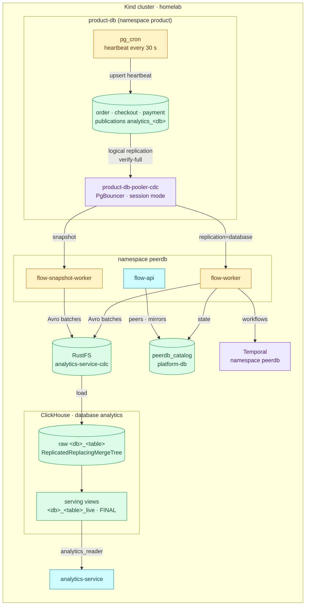
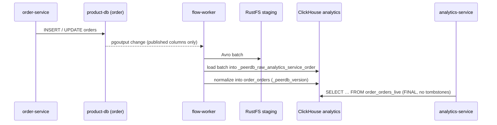

# Commerce CDC (PeerDB)

Orders, checkout sessions and the payment ledger leave product-db as a
continuous change stream and land in ClickHouse, where analytics-service reads
them. The business databases never serve an analytical query, and nothing in
the service code knows the stream exists.

| Fact | Value |
|---|---|
| Engine | PeerDB core **v0.37.5**, upstream chart `peerdb` **0.9.17**, namespace `peerdb`, Flux wave `cdc-local` |
| Sources | `order`, `checkout`, `payment` on product-db, through `product-db-pooler-cdc` (CNPG PgBouncer, session mode, TLS both hops) |
| Mirrors | `analytics_service_order`, `analytics_service_checkout`, `analytics_service_payment` — one replication slot each (`peerflow_slot_analytics_service_<db>`) |
| What crosses | Exactly the ADR-067 allowlist: 7 tables, named columns only, plus one heartbeat table per database |
| Target | ClickHouse database `analytics` (Replicated, 3 replicas), raw tables `<db>_<table>`, serving views `<db>_<table>_live` |
| State | Catalog `peerdb_catalog` on platform-db (verify-full); Temporal namespace `peerdb`; staging bucket `analytics-service-cdc` on RustFS |
| Freshness | pg_cron writes a heartbeat every 30 s in each source; the read API is stale beyond 120 s and unavailable beyond 300 s |
| Design | [RFC-0030](../../proposals/rfc/RFC-0030/), [ADR-066](../../proposals/adr/ADR-066-adopt-peerdb-for-commerce-cdc/) (PeerDB), [ADR-067](../../proposals/adr/ADR-067-constrain-commerce-cdc-source-allowlist/) (allowlist), [ADR-068](../../proposals/adr/ADR-068-schedule-cdc-heartbeats-with-pg-cron/) (heartbeats), [ADR-069](../../proposals/adr/ADR-069-serve-commerce-analytics-through-read-only-service/) (read API) |

## What PeerDB is

PeerDB is a replication engine built for PostgreSQL as the source. It reads
the write-ahead log through logical replication (`pgoutput`) and writes the
changes straight into a destination — ClickHouse here — without a message
broker in between. A **peer** is one end of a connection (a source database or
the ClickHouse target); a **mirror** is one stream from a source peer to a
target peer over one publication and one replication slot.

A mirror runs in two phases. The **initial snapshot** copies every published
table in partitions while holding a consistent snapshot of the source; the
**CDC phase** then reads the slot continuously, groups changes into batches,
stages them as Avro files in S3, and has ClickHouse load them. Each row lands
with three bookkeeping columns: `_peerdb_version` (ordering), `_peerdb_is_deleted`
(a delete is a tombstone, not a removal) and `_peerdb_synced_at`. The target
tables are `ReplacingMergeTree(_peerdb_version)`, so reading with `FINAL`
yields the latest version of every row, deletes included.

On this cluster PeerDB is four workloads plus three dependencies it borrows
from the platform:

| Part | Role |
|---|---|
| `flow-api` | API for peers, mirrors and status (`:8113` HTTP, `:8112` gRPC) |
| `flow-worker` | Temporal worker that runs the CDC workflows |
| `flow-snapshot-worker` | Holds the exported snapshot while the initial copy runs |
| `peerdb-server` | Applies the catalog migrations |
| `peerdb_catalog` (platform-db) | Peers, mirrors, schema history, batch progress |
| Temporal (namespace `peerdb`) | Durable scheduling and retries of every mirror step |
| RustFS bucket `analytics-service-cdc` | Avro staging between a batch and its ClickHouse load |

ClickHouse acquired PeerDB; its managed form is ClickHouse Cloud's ClickPipes
for Postgres. This platform runs the open core itself under its ELv2 licence
(owner decision, 2026-10-23, on the ADR-066 tracker).

## How it compares

The choice and its reasons live in [ADR-066](../../proposals/adr/ADR-066-adopt-peerdb-for-commerce-cdc/#alternatives-considered)
and the [RFC-0030 research](../../proposals/rfc/RFC-0030/research.md); this
table answers the operator's question — what each option would mean to run.

| | **PeerDB (in use)** | Debezium + Kafka/Redpanda | ClickHouse `MaterializedPostgreSQL` | ClickPipes for Postgres | Home-grown batch | Airbyte |
|---|---|---|---|---|---|---|
| Shape | Continuous CDC straight into the target | CDC into a broker; consumers apply it | ClickHouse replicates by itself | PeerDB as a managed service | Scheduled copies | General ELT with connectors |
| Updates and deletes | Yes (version + tombstone) | Yes, the consumer applies them | Yes | Yes | Platform code owns watermarks and deletes | Yes, connector-dependent |
| What we would operate | PeerDB + catalog + staging, on Temporal we already run | Broker, Connect, schemas, consumers | Almost nothing | Nothing (SaaS) | A job, and all its edge cases | Its own server, workers and database |
| Maturity for this path | Production, purpose-built for Postgres → ClickHouse | Very mature, general purpose | Experimental, DDL limits | GA on ClickHouse Cloud | As good as our code | Mature, not specialised |
| Why not here | — | Disproportionate for one consumer | Below the production bar | Managed only; the platform self-hosts | Moves the hard state machine into our code | Not evaluated in ADR-066; another control plane |

Revisit the choice when several consumers need replayable events (a broker
starts to pay for itself), when the target stops being ClickHouse, or when the
platform moves to ClickHouse Cloud — the triggers ADR-066 records.

## Architecture



A row's path through one mirror:



## Platform behavior

**What crosses is declared, twice.** The column-listed CNPG `Publication`s
(`kubernetes/infra/configs/databases/clusters/product-db/cdc/publications.yaml`)
decide what PostgreSQL emits; each mirror's table mapping excludes every
column outside the same allowlist, so a column added upstream reaches neither
the stream nor the target. The allowlist file exists twice —
`local-stack/analytics/allowlist.json` (Compose prototype) and
`kubernetes/infra/configs/cdc/bootstrap/allowlist.json` (cluster) — and the
publications and `views.sql` are generated from it: change them together.

**Who may read what.** Each `peerdb_<db>` is a CNPG `DatabaseRole` (REPLICATION
is a superuser-only attribute) with SELECT on its published tables only,
declared in the pgroles policies, which revoke anything undeclared. product-db's
HBA admits each role to its own database only; PeerDB reaches product-db only
through the CDC pooler, which a NetworkPolicy opens to the `peerdb` namespace
alone. In ClickHouse, `analytics_ingest` owns the `analytics` database and
nothing else; the serving views run as `analytics_view_owner`, which cannot
log in; `analytics_reader` sees the ten views only.

**Why the pooler is PgBouncer.** PgDog, the application pooler, works in
transaction mode, and a replication connection must keep its server
connection for life. The CDC pooler runs PgBouncer in session mode, verifies
the primary (`server_tls_sslmode: verify-full`) and presents a homelab-ca
certificate to PeerDB, which verifies it with the CA in `peerdb-ca-trust`.
Verified on Kind 2026-10-23: `IDENTIFY_SYSTEM` and a temporary `pgoutput` slot
through the pooler succeed; a wrong host name, the wrong CA, plaintext and the
bare primary are refused (`scripts/analytics/cdc-source-check.sh`).

**Heartbeats.** product-db runs the `postgresql-cron` operand (CNPG 18.6 +
pg_cron 1.6.8) through an `ImageCatalog` — CNPG reads the PostgreSQL major from
an image tag, and this image's tag is its own release version. pg_cron lives in
`postgres`; `analytics_heartbeat` schedules one 30-second job per source
database (and a daily cleanup of its own run history) from the
`product-db-cdc-bootstrap` Job. The heartbeat row replicates like any other
row, so the age ClickHouse sees is the end-to-end lag. The scheduler runs on
the primary only and follows a promotion.

**Replicated target.** The ClickHouse peer sets `replicated: true` and no
cluster: the `analytics` database is itself `Replicated`, so PeerDB's DDL
reaches all three replicas without `ON CLUSTER` or `Distributed` tables. PeerDB
names an explicit Keeper path in its `ReplicatedReplacingMergeTree` DDL, which a
Replicated database refuses by default; the `analytics_ingest` profile sets
`database_replicated_allow_replicated_engine_arguments = 2`, so ClickHouse uses
the database's own path instead.

**WAL safety.** `max_slot_wal_keep_size` is 1GB: a mirror that stops consuming
can retain at most that much WAL before PostgreSQL invalidates its slot. An
invalidated slot needs a resync (below) — it never fills the primary's disk.

**Planned, not installed:** the CDC alert rules and dashboard (candidates in
[`docs/observability/analytics/`](../../observability/analytics/)), automatic
credential rotation (manual, 90 days, ADR-089), and the phase-7 drills
(failover through the pooler, schema change, WAL invalidation, outage
recovery) whose results this page will record.

## Operations

**Is it healthy?**

```bash
kubectl -n peerdb port-forward svc/flow-api 18113:8113 &
curl -s localhost:18113/v1/mirrors/list            # every mirror STATUS_RUNNING
scripts/analytics/cdc-source-check.sh               # source side: G3.1–G3.4
kubectl -n product exec <primary> -c postgres -- psql -d postgres -Atc \
  "SELECT slot_name, active, wal_status FROM pg_replication_slots WHERE slot_type='logical'"
```

The read API's own verdict is the end-to-end check: `/analytics/v1/protected/commerce/overview`
answers `stale=false` while every heartbeat is under 120 s old.

**Bring-up on a fresh cluster** needs nothing by hand: `cdc-local` installs
PeerDB, `product-db-cdc-bootstrap` creates the heartbeats, `peerdb-bootstrap`
creates the peers and admits the mirrors one source at a time (order, then
checkout, then payment — each waits for its heartbeat and every table's row
count in ClickHouse), and `analytics-views` creates the serving views once the
raw tables exist.

**On a cluster that already exists**, two things never re-run: CNPG's
`postInitSQL` (apply its four pg_cron statements once as the superuser — see
ADR-068) and the OpenBAO bootstrap seeds (write them through a staff OIDC token,
[runbook](../../secrets/runbooks/add-secret-live-cluster.md)).

**Adding a column or a table** is a contract change: update the allowlist (both
copies), regenerate the publication and `views.sql`, grant the new table in the
pgroles policy, then resync the mirror so the snapshot carries the column.

**A mirror that stopped** (`wal_status = lost`, a failed workflow, a dropped
target table): terminate it and let `peerdb-bootstrap` recreate it with a fresh
snapshot. Terminating drops PeerDB's slot but keeps our publication.

```bash
curl -s -X POST localhost:18113/v1/mirrors/state_change -H 'Content-Type: application/json' \
  -d '{"flowJobName":"analytics_service_order","requestedFlowState":"STATUS_TERMINATING"}'
# drop the mirror's tables in ClickHouse, then re-run the bootstrap Job
kubectl -n peerdb delete job peerdb-bootstrap && flux reconcile kustomization cdc-local -n flux-system
```

**Traps learned the hard way (Kind, 2026-10-23):**

- `cron.schedule_in_database(…, username)` from a non-superuser fails even
  when the name is the caller's own (pg_cron 1.6.8) — schedule without it.
- Without `replicated: true` PeerDB creates plain `ReplacingMergeTree` tables
  inside the Replicated database: they live on one replica, and the load
  balancer then answers from the other two with "table does not exist".
- The worker logs `relation "dynamic_settings" does not exist` for a few
  seconds after a fresh install, until `peerdb-server` finishes the catalog
  migrations — harmless.

## References

- PeerDB documentation — <https://docs.peerdb.io>
- CloudNativePG — [publications and logical replication](https://cloudnative-pg.io/documentation/current/logical_replication/), [image catalogs](https://cloudnative-pg.io/documentation/current/image_catalog/), [connection pooling](https://cloudnative-pg.io/documentation/current/connection_pooling/)
- ClickHouse — [Replicated database engine](https://clickhouse.com/docs/engines/database-engines/replicated), [ReplacingMergeTree](https://clickhouse.com/docs/engines/table-engines/mergetree-family/replacingmergetree)
- pg_cron — <https://github.com/citusdata/pg_cron>
- In this repository: [`docs/api/analytics.md`](../../api/analytics.md), [`docs/observability/analytics/`](../../observability/analytics/), [`docs/databases/poolers.md`](../poolers.md), [`docs/databases/extensions.md`](../extensions.md)
