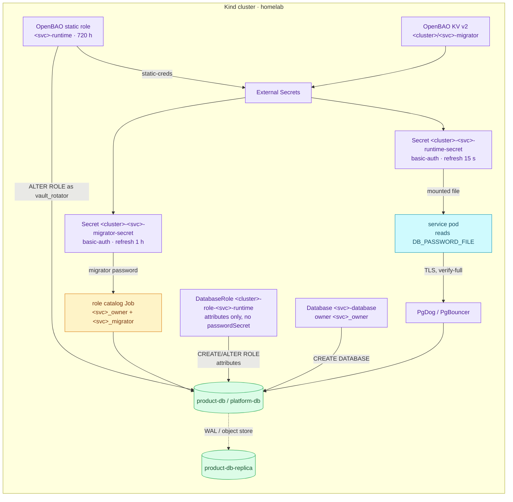

# Declarative Role & Database Management (CNPG)

One file per service groups its `ExternalSecret`, `DatabaseRole`, and
`Database` resources on both operational clusters; no credential appears in a
manifest.

| | |
|---|---|
| **Status** | Current: 12 service files reconcile 13 databases across the two operational clusters |
| **Decision record** | [ADR-013 — per-service database triplet](../proposals/adr/ADR-013-per-service-db-triplet/) |
| **Operator** | CloudNativePG v1.30.1 (`DatabaseRole` CRD since 1.30) |
| **Clusters** | `product-db` and `platform-db`; `product-db-replica` receives roles/databases through recovery, with no service CRs of its own |
| **Triplet locations** | `kubernetes/infra/configs/databases/clusters/{product-db,platform-db}/services/<name>.yaml` |
| **Credential flow** | Runtime: OpenBAO database-engine static role → ESO (`openbao-db`, 15 s) → `kubernetes.io/basic-auth` Secret mounted by the pod. Migrator: OpenBAO KV v2 → ESO (`openbao`, 1 h) → basic-auth Secret |

## Concept

PostgreSQL roles and databases are **cluster-global objects**: they belong to
the platform, not to any one service's migration history (a service migration
cannot create the role it needs to connect with — a bootstrap paradox). Before
CNPG 1.30 the operator could only manage roles *inline* in the shared
`Cluster.spec.managed.roles` stanza, so every service edit went through
platform infrastructure. CNPG 1.30's `DatabaseRole` CRD makes each role its own
namespaced resource with independent lifecycle, status, and RBAC — which is
what allows the per-service file.

Three semantics of `DatabaseRole` drive how we operate it:

1. **Adoption is total.** Creating a `DatabaseRole` for a role that already
   exists *adopts* it: the operator issues `ALTER ROLE` so that **every**
   attribute matches the manifest — including attributes the manifest omits
   (omitted `inRoles` memberships are revoked, an omitted `connectionLimit`
   resets to `-1`, an omitted `validUntil` becomes `infinity`). Consequence:
   our manifests are always written out in full, and every migration PR
   snapshots `pg_authid` before and after.
2. **Inline wins.** If the same role name exists in `managed.roles`, the
   Cluster spec takes precedence and the `DatabaseRole` reports
   `applied: false`. Consequence: migration removes the inline entry in the
   same PR that adds the CR (no unmanaged window either way), and rollback is
   one re-added inline entry.
3. **Reconcile-on-change, not on a timer.** A `DatabaseRole` is applied when
   its spec or its password Secret changes; manual catalog drift (a hand-run
   `ALTER ROLE`) is *not* auto-corrected, unlike inline roles which are
   periodically compared against the catalog. Consequence: Git is the source
   of truth and nobody hand-edits roles; password changes still propagate
   within seconds via the `cnpg.io/reload` Secret label.

Reclaim policies are `retain` on both `DatabaseRole` and `Database`: deleting a
CR never drops the underlying object. Dropping a role or database stays a
deliberate, manual act (`DROP ROLE`, or a temporary inline `ensure: absent`
entry — `DatabaseRole` has no `absent` equivalent).

## Architecture

This diagram answers who writes each part of one service's login and database.
CNPG owns the runtime role's attributes and the database; OpenBAO is the only
writer of the runtime password (ADR-089); the role catalog Job creates the
owner and migrator roles ([authorization](./authorization.md)).



Security notes on the write path: since 1.30 the operator SCRAM-SHA-256-encodes
passwords *before* issuing `CREATE`/`ALTER ROLE` and suppresses statement
logging around them, so cleartext never reaches PostgreSQL logs,
`pg_stat_statements`, or `pgaudit`. That applies to the logins whose password
CNPG still writes from a `passwordSecret` (`db_authz`, `vault_rotator`, the
bootstrap `product` role); a runtime password is set by OpenBAO instead.

## How it works in this platform

The `product-db` files demonstrate the common pattern in this order:

1. **`ExternalSecret`s** — the runtime one renders
   `<cluster>-<svc>-runtime-secret` from `database/static-creds/<svc>-runtime`
   through ClusterSecretStore `openbao-db` every 15 s; the migrator one renders
   `<cluster>-<svc>-migrator-secret` from KV
   `secret/data/local/databases/<cluster>/<svc>-migrator` through `openbao`
   every 1 h. Both are `kubernetes.io/basic-auth`. The service namespace gets
   its own copy of each from the same path (`secrets/`).
2. **`DatabaseRole` `<cluster>-role-<svc>-runtime`** — the `<svc>_runtime`
   login with all attributes explicit; `validUntil` omitted on purpose (the
   operator then manages expiry to `infinity`, correct for app identities);
   `login: true`; everything privileged (`superuser`, `createdb`, `createrole`,
   `replication`, `bypassrls`) explicitly `false`. It has **no
   `passwordSecret`**: OpenBAO's static role sets the password, and a second
   writer would fight it (ADR-089).
3. **`Database` `<svc>-database`** — `owner: <svc>_owner`, the extension list
   (`pgaudit`, `pg_stat_statements`, plus per-service extras), reclaim `retain`.
   Role first in the file: CNPG has no ordering guarantee between the two (a
   `Database` with a missing owner just retries). File order aids reading;
   it does not serialize reconciliation.

The `Cluster` spec (`instance.yaml`) keeps only infrastructure plus a minimal
`bootstrap.initdb` — its `database`/`owner`/`secret` fields are structural
placeholders that the product triplet adopts declaratively (both must point
at the same `product-db-secret`). `postInitSQL` is gone: a from-scratch build
and a backup restore now converge to the same roles and databases.

Replica behavior: roles and databases replicate through WAL to
`product-db-replica`; a `DatabaseRole` pointed at a replica reports `unknown`
(unset `applied`), not an error, and reconciles normally after promotion.

### Current inventory

| Cluster | Service files | Managed databases |
|---|---|---|
| `product-db` | product, cart, order, payment, checkout, inventory | Same six names |
| `platform-db` | user, notification, shipping, review, keycloak, temporal | Same names plus `temporal_visibility` |

### Original migration record (RFC-0012 phases)

| Service | Mechanism today | Target phase |
|---------|-----------------|--------------|
| payment | triplet (`services/payment.yaml`) | **P1 — landed** |
| cart | triplet (`services/cart.yaml`) | **P2 — landed** (live rotation runs at next bring-up) |
| order | triplet (`services/order.yaml`) | **P2 — landed** (live rotation runs at next bring-up) |
| product | triplet (`services/product.yaml`) — also the `bootstrap.initdb` placeholder identity | **P3 — landed** |

## Operations

- **Add a service database:** one new file in `services/` + a migrator KV seed
  + a runtime static role ([add service dynamic credentials](../secrets/runbooks/add-service-dynamic-credentials.md))
  + the app-namespace secret copies + a PgDog `databases` entry (product-db).
  Recipe: [add-service-database](./runbooks/add-service-database.md). Keep
  roles out of `instance.yaml`; adding the matching HBA allow rule there is
  still required before the terminal reject rule.
- **Adopt an existing role (migration):** snapshot first —
  `SELECT rolname, rolsuper, rolinherit, rolcreaterole, rolcreatedb,
  rolcanlogin, rolreplication, rolconnlimit, rolvaliduntil, rolbypassrls FROM
  pg_authid WHERE rolname = '<svc>'` plus memberships from `pg_auth_members` —
  copy any memberships into `inRoles`, merge the CR and the removal of any
  inline entry in the same PR, then diff the snapshot after (`rolpassword`
  changes are expected — `ALTER ROLE` re-salts the SCRAM verifier).
- **Rotate a password:** [runbook](./runbooks/rotate-cnpg-service-password.md). Runtime
  passwords rotate on their own (OpenBAO static role, 720h); to force one,
  `bao write -f database/rotate-role/<svc>-runtime` — no DatabaseRole, pooler
  or pod action follows. Migrators stay a KV write plus a catalog Job run.
- **Watch:** `kubectl get databaseroles,databases -n product` and repeat for
  namespace `platform` — anything
  `applied: false` is a conflict (usually a leftover inline entry) or an error;
  `unknown` on a replica is normal. Existing `cnpg_*` alert set covers the
  cluster itself; a rule for stuck-unapplied CRs is a tracked follow-up.
- **Roll back a migrated role:** re-add the inline `managed.roles` entry — it
  takes precedence immediately; the `DatabaseRole` drops to `applied: false`
  and can be deleted later (`retain` leaves the catalog untouched).
- **Verify connection isolation (P4, [ADR-015](../proposals/adr/ADR-015-pg-hba-connection-isolation/)):**
  the historical P4 example below covers four roles only. The current
  product cluster has six service databases; use `scripts/db-isolation-sweep.sh`
  (Kind gate K3.4) for the current complete matrix. A non-zero client exit can
  also be a network or authentication failure, so inspect the error before
  treating it as proof of HBA isolation:

  ```bash
  for u in product cart order payment; do
    pw=$(kubectl get secret -n product product-db-$([ $u = product ] || echo ${u}-)secret \
      -o jsonpath='{.data.password}' | base64 -d)
    for d in product cart order payment; do
      kubectl run hba-$u-$d --rm --restart=Never -n product --quiet -it \
        --image=ghcr.io/cloudnative-pg/postgresql:18.6-system-trixie -- \
        psql "host=product-db-rw.product user=$u dbname=$d password=$pw connect_timeout=5" \
        -tAc 'select 1' >/dev/null 2>&1 && echo "$u->$d ALLOW" || echo "$u->$d reject"
    done
  done
  ```

  Regression alongside: pgdog e2e, payment direct login, one migration Job
  re-run, `product-db-replica` advancing, PodMonitor scrape, auth-failure watch
  in VictoriaLogs for the first hour.

## References

- [RFC-0012 — Converge CNPG role & database management on declarative CRDs](../proposals/rfc/RFC-0012/)
- [ADR-013 — Per-service database triplet](../proposals/adr/ADR-013-per-service-db-triplet/)
- [002 — Database integration](./architecture.md) · [003.1 — CNPG operator deep dive](./cloudnativepg.md)
- CloudNativePG official docs: *PostgreSQL Role Management* and *Database
  Management* (v1.30)
