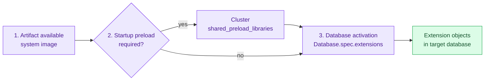

# PostgreSQL Extensions on CloudNativePG

An extension is usable only when its files are available to PostgreSQL, any
startup library is loaded, and its SQL objects are activated in the target
database.

| Item | Current state |
|---|---|
| **Operator / PostgreSQL** | CloudNativePG 1.30.1 / PostgreSQL 18.6 |
| **Operand image** | `ghcr.io/cloudnative-pg/postgresql:18.6-system-trixie` |
| **Artifact delivery** | Extensions packaged in the system operand image, plus one image-volume extension (`pg_stat_ch`) |
| **Startup loading** | `Cluster.spec.postgresql.shared_preload_libraries` |
| **Database activation** | `Database.spec.extensions` |
| **ImageVolume extensions** | Deployed for `pg_stat_ch` on all three clusters (`spec.postgresql.extensions`) |

## Delivery and activation model

PostgreSQL `CREATE EXTENSION` executes the extension's control and SQL files in
one database. It cannot install missing operating-system packages or shared
libraries. Native code must also match the PostgreSQL major version, operating
system, architecture, and required system libraries.

CloudNativePG separates three lifecycle stages:



The diagram answers the order of responsibilities. Package availability,
startup loading, and per-database activation are different states and must not
be treated as synonyms.

## Current cluster preload

Both operational clusters declare the dedicated CNPG list field:

```yaml
spec:
  postgresql:
    extensions:
      - name: pg_stat_ch
        image:
          reference: ghcr.io/duynhlab/images/pg-stat-ch:0.1.0@sha256:…
    shared_preload_libraries:
      - pgaudit
      - pg_stat_statements
      - auto_explain
      - pg_stat_ch
```

Do not place `shared_preload_libraries` under `postgresql.parameters`; CNPG owns
it as a fixed setting. The dedicated field lets the operator manage the final
library list.

`auto_explain` is a preload-only module in this platform. It has no extension
control file, so it must never appear in `Database.spec.extensions`.

`pg_stat_ch` is the one entry that is not in the operand image: the
`extensions` list mounts it as an image volume (next section) and the preload
entry resolves through the `dynamic_library_path` CNPG appends for it. The
`product-db-replica` cluster mounts the same image without preloading it, so
the extension objects that arrive through WAL stay resolvable after a
promotion.

## Current database inventory

CloudNativePG reconciles only extensions listed in each `Database` resource.
Entries omit `ensure`, so the documented default `present` applies.

| Cluster | Databases | Declared extensions |
|---|---|---|
| `product-db` | `product` | `pgaudit`, `pg_stat_statements`, `pgcrypto`, `uuid-ossp`, `pg_stat_ch` |
| `product-db` | `cart`, `order`, `payment`, `checkout`, `inventory` | `pgaudit`, `pg_stat_statements` |
| `platform-db` | `user` | `pgaudit`, `pg_stat_statements`, `pg_stat_ch` |
| `platform-db` | `notification`, `shipping`, `review`, `keycloak` | `pgaudit`, `pg_stat_statements` |
| `platform-db` | `temporal`, `temporal_visibility` | `pg_stat_statements` |

`pg_stat_ch` is activated in one database per cluster on purpose: its hooks
capture every database from the preload, and its SQL surface
(`pg_stat_ch_stats()` and friends) reads cluster-wide shared memory, so the
exporter's `pg_stat_ch` custom query needs it in exactly one place.

The `product-db-replica` resource is a read-only physical recovery cluster. It
does not own a second set of `Database` resources; extension objects arrive as
part of replicated database state, while compatible files must remain available
in its matching operand image.

## Query telemetry extensions compared

The platform answers "which statement is slow?" with `pg_stat_statements`
(exported as `cnpg_pg_stat_statements_*`) and "why?" with `auto_explain` plans
in VictoriaLogs. This table places the other tools in the same space so a
future change picks by the question it must answer, not by novelty. The first
two rows and `pg_stat_ch` are deployed; the rest are reference.

| Tool | How it collects | Keeps history over time? | Best at | Main limitation | Platform status |
|---|---|---|---|---|---|
| `pg_stat_statements` | Aggregates counters per normalised statement (`queryid`) inside PostgreSQL | No per-execution history; cumulative totals, reset on restart or `pg_stat_statements_reset()` | Ranking statements by total time, calls, buffers; cheap and built in | Totals + calls only — no percentiles, no timestamps, so "when did it get slow" is inferred from the exported rate | **Deployed** on `platform-db` and `product-db` (`track: all`, `max: 10000`); top-100 per database exported by the CNPG exporter |
| `auto_explain` | Logs the plan of executions above a duration threshold | Yes, as log lines — 7 days in VictoriaLogs via the Vector pipeline | Explaining a slow execution (plan shape, row estimates) | Only executions ≥ `log_min_duration` (1s here) are seen; fast executions of the same statement are invisible | **Deployed** (`log_analyze: on`, `log_format: json`); preload-only, never in `Database.spec.extensions` |
| `pg_stat_monitor` (Percona) | Aggregates per statement **and per time bucket** in shared memory, with client IP, plan text and histogram buckets | Yes, bounded by the configured number of buckets (hours, not days) | Comparing a statement across recent windows without external storage | Shared-memory ring of buckets, so no long-term store; adds hash-table work on every execution | Reference — not in the operand image |
| `pg_tracing` (DataDog) | Emits OpenTelemetry spans per execution, with child spans for plan nodes, triggers and parallel workers | Depends on the trace backend's retention | Explaining why *one* execution was slow across its plan nodes | Needs a tracing pipeline and sampling; expensive per execution; not a fleet-wide ranking tool | Reference — not in the operand image |
| OTel Collector `postgresql` receiver | Scrapes `pg_stat_*` views on an interval from outside PostgreSQL | Yes, as metrics in the metrics backend | Health trends, dashboards, alerting and SLOs with no extension | Sees only counter deltas between scrapes, never individual executions | Reference — not deployed; CNPG's built-in exporter plus custom queries already covers this ground |
| `pg_stat_ch` (ClickHouse) | Records one fixed-size event per execution into a shared-memory ring; a background worker ships batches to ClickHouse (native `:9000`) or, with `use_otel`, to an OTLP gRPC endpoint | Yes — raw events, bounded only by the ClickHouse TTL (180 days in the upstream schema) | Server-side p50/p95/p99 over time, errors with SQLSTATE, per-app/user load, "what changed between 14:00 and 15:00" | Another store to run; ~2% CPU and up to ~11% TPS on a lock-heavy pgbench; events are dropped, never retried, when the ring overflows or an export fails; query text truncated at 2 KB; no plan capture | **Deployed** (v0.4.0) as an image-volume extension on `platform-db` and `product-db`; guide: [query-telemetry.md](../observability/metrics/postgresql/query-telemetry.md) |

What the table does not say about `pg_stat_ch`, verified against the v0.4.0
release on 2026-10-13: it needs `shared_preload_libraries`, `compute_query_id`
and `track_io_timing` (`track_io_timing` is set `on`; `compute_query_id` is at
its `auto` default, which is on because `pg_stat_statements` is preloaded); it
supports PostgreSQL 16–18; its release binary links `libstdc++`, `libssl.so.3`
and glibc ≥ 2.34, all present in `postgresql:18.6-system-trixie` and proven by
an `ldd` check inside that image when `duynhlab/images` builds the extension
image. The upstream ClickHouse schema is plain `MergeTree`, so the platform
ships its own DDL for the `pg_stat_ch` database in the `clickhouse-ddl` image
(same column contract, replicated engines, the `otel` retention).

## Change workflow

1. Establish the workload need and extension owner.
2. Verify the artifact is present in `pg_available_extensions` on the exact
   PostgreSQL image and architecture.
3. Review provenance, native-code dependencies, privileges, trusted status,
   schemas, upgrade scripts, and supported PostgreSQL versions.
4. Determine whether a library belongs in `shared_preload_libraries`. A preload
   change restarts PostgreSQL pods through the operator-managed rollout.
5. Add the extension to the owning service's `Database` manifest. Pin `version`
   or `schema` only when the lifecycle requires an explicit desired value.
6. Confirm `status.applied`, `status.observedGeneration`, `pg_extension`, and
   extension-specific configuration.
7. Restore a backup with the same artifacts before relying on the extension in
   production data.

CloudNativePG reconciles `CREATE EXTENSION`, `DROP EXTENSION`, and supported
`ALTER EXTENSION` operations for declared entries. Removing an entry from the
manifest does not mean “drop it”: unspecified existing extensions are left
unchanged. Use `ensure: absent` only as an explicitly reviewed destructive
schema change.

## ImageVolume extensions — deployed for pg_stat_ch

CloudNativePG 1.30 mounts immutable extension OCI images through
`spec.postgresql.extensions`: each image lands read-only at
`/extensions/<name>`, and the operator appends its `share/` to
`extension_control_path` and its `lib/` to `dynamic_library_path`, which is
also enough for `shared_preload_libraries` to find a preload library (the
CNPG catalog ships `pgaudit` and `timescaledb` this way). Requirements —
PostgreSQL 18, an ImageVolume-capable runtime, Kubernetes 1.35 — are all met
here: the operand is 18.6 and the Kind baseline is 1.35.8
([RFC-0032](../proposals/rfc/RFC-0032/)), where `ImageVolume` is enabled and
already carries the ClickHouse DDL (ADR-077).

The platform uses it for exactly one extension, `pg_stat_ch`, built by
`duynhlab/images` as `ghcr.io/duynhlab/images/pg-stat-ch` with the layout the
operator expects (`/lib/pg_stat_ch.so`, `/share/extension/*`) and no path
overrides. The image is built inside the pinned operand image and `ldd`-checked
there, so operand and extension move together: a new operand digest means a
new extension image, pinned on `product-db`, `platform-db` and
`product-db-replica` in the same change. Changing the reference replaces the
pods (a CNPG rolling restart), so it follows the change workflow above and is
proven on Kind first. Not in use: an extension-aware `ImageCatalog` /
`ClusterImageCatalog` and a `minimal` operand image — the `system` image stays
because `pgaudit`, `pg_stat_statements` and `auto_explain` come from it.

## Operations

```bash
# Desired Kubernetes state
kubectl get databases.postgresql.cnpg.io -A
kubectl get database -n product product-database -o yaml

# Runtime availability and activation
kubectl exec -n product product-db-1 -c postgres -- \
  psql -d product -c "SELECT name, default_version, installed_version FROM pg_available_extensions ORDER BY name;"
kubectl exec -n product product-db-1 -c postgres -- \
  psql -d product -c "SELECT extname, extversion FROM pg_extension ORDER BY extname;"
kubectl exec -n product product-db-1 -c postgres -- \
  psql -d product -c "SHOW shared_preload_libraries;"
```

Use the current primary pod name rather than assuming `product-db-1` is primary.
A failed `Database` reconciliation is visible through `status.applied: false`
and `status.message`.

## Manifest evidence

- `kubernetes/infra/configs/databases/clusters/{platform-db,product-db}/instance.yaml`
- `kubernetes/infra/configs/databases/clusters/{platform-db,product-db}/services/*.yaml`
- `kubernetes/infra/configs/databases/clusters/product-db-replica/instance.yaml`

## References

- [PostgreSQL 18 extension packaging](https://www.postgresql.org/docs/18/extend-extensions.html)
- [PostgreSQL 18 `CREATE EXTENSION`](https://www.postgresql.org/docs/18/sql-createextension.html)
- [CloudNativePG 1.30 declarative database management](https://cloudnative-pg.io/docs/1.30/declarative_database_management/)
- [CloudNativePG 1.30 ImageVolume extensions](https://cloudnative-pg.io/docs/1.30/imagevolume_extensions/)
- [PostgreSQL 18 `pg_stat_statements`](https://www.postgresql.org/docs/18/pgstatstatements.html)
- [PostgreSQL 18 `auto_explain`](https://www.postgresql.org/docs/18/auto-explain.html)
- [pg_stat_monitor](https://github.com/percona/pg_stat_monitor)
- [pg_tracing](https://github.com/DataDog/pg_tracing)
- [OpenTelemetry Collector `postgresql` receiver](https://github.com/open-telemetry/opentelemetry-collector-contrib/blob/main/receiver/postgresqlreceiver/README.md)
- [pg_stat_ch](https://github.com/ClickHouse/pg_stat_ch)
