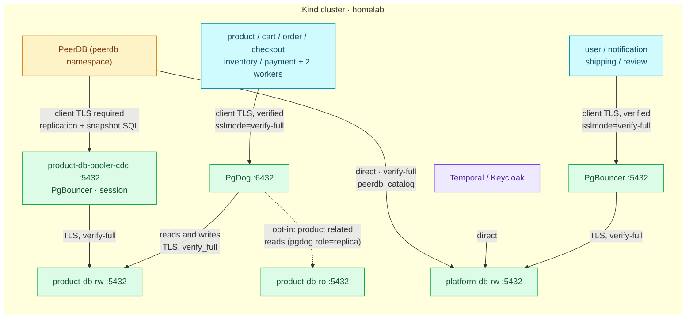

# PostgreSQL Poolers

Connection pooling protects PostgreSQL from unbounded backend concurrency, but
pool mode determines which session behaviors remain safe.

| Cluster | Pooler | Replicas | Endpoint | Mode | Routing |
|---|---|---:|---|---|---|
| `platform-db` | CNPG PgBouncer `Pooler` | 2 | `platform-db-pooler-rw.platform.svc:5432` | transaction | Primary only |
| `product-db` | PgDog chart v0.92 (PgDog v0.1.61) | 3 | `pgdog-product.product.svc:6432` | transaction | Primary (`-rw`); opt-in replica reads for `product` (`-ro`) |

## Why pooling exists

PostgreSQL normally assigns a backend process to each connection. Idle or bursty
application pools can therefore consume memory, process slots, and authentication
work without increasing useful database throughput. A pooler shares a bounded
set of server connections and queues excess demand; it does not add database
capacity.

## Pool modes and compatibility

| Mode | Server connection lifetime | Multiplexing | Main compatibility boundary |
|---|---|---|---|
| Session | Entire client session | Low | Preserves session state |
| Transaction | One transaction | High | Session state must not leak across transactions |
| Statement | One statement | Highest | Not suitable for general multi-statement transactions |

Transaction pooling needs explicit testing for session-level `SET`, temporary
tables, advisory locks, `LISTEN/NOTIFY`, cursors, and prepared statements.
Application-side connection pools still need bounded sizes; stacking pools does
not make concurrency free.

## Current connection ownership

The diagram answers which clients use each deployed connection path. ADR-089
makes the primary the default, because a replica read right after a commit can
miss it. PgDog runs `read_write_split = "prefer_primary"`: every query goes to
the primary unless the connection opts in with the startup option
`-c pgdog.role=replica` (the dotted line). Only the `product` database lists a
replica (`product-db-ro`), and only product-service's related-products pool
opts in (`DB_READ_REPLICA=true`, #1304); listing and detail reads stay on the
primary because they fill the product cache, where a stale read racing an
invalidation would stay until the TTL.

The lag tolerance is 2 s: PgDog measures replica lag every 5 s
(`lsn_check_interval`) and bans a replica past `ban_replica_lag = 2000`, and a
banned replica's reads fall back to the primary. Verified on Kind
(2026-10-22): 40 detail requests ran the related-products query 40 times on a
replica and 0 on the primary; pausing WAL replay on both replicas banned them
within 5 s, the endpoint kept answering 200, the queries ran on the primary,
and the ban cleared after replay resumed. `pgdog_total_query_count` carries a
`role` label but does not split by role; count on the instances
(`pg_stat_statements`) to see where reads land.

PgDog declares the six product-cluster databases and no users. With
`passthrough_auth = "enabled_allow_change"` (ADR-025) it asks each client for
its password over TLS, checks it against `product-db` at the first login,
caches it, and replaces the cache when a later login brings a password that
Postgres accepts, so a rotation needs no reconcile or rollout. A wrong password
is refused without touching the cache, after PgDog's `checkout_timeout` (5 s)
while it tries the password on Postgres. Each replica keeps its own cache, and
a cached password is not re-checked: after `ALTER ROLE`, the old password keeps
working on a replica until the first login there with the new one (measured
on Kind, 2026-10-18). This is what makes OpenBAO rotation (ADR-025) work with
no pooler step: the service's next login with the rotated password updates the
cache on the replica it lands on. Every login is the service's
`<svc>_runtime` login (RFC-0029 three-role split); migrators never go through
PgDog, and every `migrate` init container connects to `product-db-rw:5432`
directly. The order and checkout workers use their service's runtime login.

**CDC pooler.** `product-db-pooler-cdc` is a third pooler with one job: carry
PeerDB's logical-replication and snapshot connections to product-db. It is a
CNPG PgBouncer in **session** mode (a replication connection keeps its server
connection for life, which PgDog's transaction mode cannot), TLS on both hops,
admitting only the `peerdb` namespace — see [Commerce CDC](./cdc/README.md).

## TLS

PgDog terminates client TLS with the cert-manager `Certificate`
`pgdog-product-tls` (ClusterIssuer `homelab-ca`, ECDSA P-256, 90 days, renewed
15 days before expiry; DNS names `pgdog-product.product.svc` and
`pgdog-product.product.svc.cluster.local`), mounted at `/etc/pgdog-tls`.

| Client | To PgDog | Notes |
|---|---|---|
| Every product-db runtime and both workers | TLS, `sslmode=verify-full` | Checks the chain against `homelab-ca` and the host name. The CA comes from `product-db-ca-trust` in the client's namespace at `/etc/db/ca/ca.crt` (`PGSSLROOTCERT`) |
| Any plaintext client | refused | `tls_client_required = true`: PgDog answers `only TLS connections are allowed` before authentication |
| `migrate`, seed | direct to `product-db-rw:5432`, `sslmode=verify-full` | Same `product-db-ca-trust` CA: the cluster serves `product-db-server-tls` from `homelab-ca`. Every product-db allow line in `pg_hba` is `hostssl` |
| PgDog → PostgreSQL | `tls_verify = verify_full` | Verifies `product-db-rw.product.svc.cluster.local` against `product-db-ca-trust`, mounted at `/etc/pgdog-server-ca` |

Verified on Kind on 2026-10-16 (RFC-0029 wave 2, ADR-089): PgDog presents
`CN=pgdog-product.product.svc` issued by `homelab-ca` with both DNS names, every
`payment_runtime` server session originates from a PgDog pod, and payment's
session advisory lease (reconciler) acquires and releases through PgDog.
local-stack has no pooler and keeps payment direct to PostgreSQL without TLS.

**Every client verifies PgDog.** The CA comes from `product-db-ca-trust`, a
Certificate in each client namespace (product, inventory, cart, order,
checkout, payment) issued by the live `homelab-ca` ClusterIssuer, read only
for its `ca.crt`. The trust-manager bundle is not used because it holds a
static CA copy that a rebuilt cluster no longer matches. The template mounts
it and sets `PGSSLROOTCERT` on the service container and on `migrate`, which
verifies the primary with the same CA.
Verified on Kind on 2026-10-17 with `psql` from the `payment` namespace
(`sslmode=verify-full`): both DNS names connect as `payment_runtime`, the
Service IP fails with `server certificate ... does not match host name`, and
the system CA bundle fails with `certificate verify failed`. A renewal of
`pgdog-product-tls` rolled PgDog in about 80 s while payment stayed Ready with
no TLS error, since the CA does not change. Since every client speaks TLS,
PgDog sets `tls_client_required`, so a client that drops TLS is refused.
`make db-tls` (`scripts/db-tls-check.sh`) re-runs the positive case, the
host-name and CA negatives and the plaintext refusal for each pooled hop.

**A renewal does not roll PgDog.** cert-manager renews the Secret on schedule,
kubelet updates the mounted file, and the `tls-reload` sidecar sends PgDog
`SIGHUP`, which re-reads the certificate in place; open sessions keep theirs
([pooler operations](./runbooks/pooler-operations.md#rotate-the-client-tls-certificate)).

### PgBouncer (platform-db)

The CNPG `Pooler` terminates client TLS with `platform-db-pooler-tls`
(`homelab-ca`, ECDSA P-256, 90 days, renewed 15 days before expiry; DNS names
`platform-db-pooler-rw.platform.svc` and `.svc.cluster.local`) through
`spec.pgbouncer.clientTLSSecret`. Without it the pooler serves the cluster's
certificate, which carries no pooler name. `client_tls_sslmode: require`
refuses plaintext: every client of this pooler speaks TLS, while Temporal,
Keycloak and OpenBao go direct. `server_tls_sslmode: verify-full` checks
`platform-db-rw` against the cluster's server CA, which is `homelab-ca`
(`platform-db-server-tls`).

| Client | To PgBouncer | Notes |
|---|---|---|
| user, notification, shipping, review runtime | TLS, `sslmode=verify-full` | CA from `platform-db-ca-trust` in each namespace at `/etc/db/ca/ca.crt` (`PGSSLROOTCERT`) |
| their `migrate` and seed | direct to `platform-db-rw:5432`, `sslmode=verify-full` | Same CA; the cluster serves `platform-db-server-tls` from `homelab-ca` |

Verified on Kind on 2026-10-17 with `psql` from the `user` namespace: both DNS
names connect as `user_runtime` with TLS on the server session too
(`pg_stat_ssl`), the Service IP fails with `does not match host name`, the
system CA bundle fails with `certificate verify failed`, and `sslmode=disable`
fails with `FATAL: SSL required`. **A renewal needs no roll:** after
`cmctl renew platform-db-pooler-tls` both pods served the new serial within
about 50 s with no restart (CNPG reloads PgBouncer), and the four services
stayed Ready.

CNPG generates PgBouncer authentication support through `auth_query`; it does
not store a second application password set. Temporal and Keycloak bypass the
transaction pooler because their connection and prepared-statement behavior is
outside the PgBouncer pilot.

## Failure and change behavior

- CNPG PgBouncer follows the `platform-db-rw` service during failover. Password
  rotation is visible through live `auth_query` and needs no pooler reconcile.
- PgDog lists backends, not users: with passthrough auth (ADR-025) a rotated
  password reaches it with the client's next login, so a rotation needs no
  reconcile or rollout. Each replica keeps accepting the old password until
  that login; after a leak, roll PgDog
  ([emergency rotation](./runbooks/rotate-cnpg-service-password.md#emergency-rotation-credential-exposed)).
- Pooler restarts can cut in-flight transactions. PDBs and replica counts reduce
  availability risk but do not preserve a transaction owned by a terminating
  pod. PgDog rolls without dropping requests: clients recycle every pooled
  connection within about 60 s (`DB_POOL_MAX_CONN_LIFETIME` 45 s, health check
  10 s), inside PgDog's 70 s `preStop`, so no idle client is left when it gets
  `SIGINT` ([rolling restarts](./runbooks/pooler-operations.md#rolling-restarts-drain)).
  The CNPG PgBouncer Pooler has no drain configured.

## Operations

Use [pooler operations](./runbooks/pooler-operations.md) for status checks,
credential rotation, adding backends, metrics, and incident response. Confirm
the owning service contract and deployment manifest before changing a DSN.

## Manifest evidence

- `kubernetes/infra/configs/databases/clusters/product-db/poolers/helmrelease.yaml`
- `kubernetes/infra/configs/databases/clusters/product-db/poolers/certificate.yaml`
- `kubernetes/infra/configs/databases/clusters/platform-db/poolers/pooler.yaml`
- `kubernetes/apps/services/*.yaml`

## References

- [CloudNativePG 1.30 connection pooling](https://cloudnative-pg.io/docs/1.30/connection_pooling/)
- [PgBouncer features](https://www.pgbouncer.org/features.html)
- [PgDog documentation](https://docs.pgdog.dev/)
