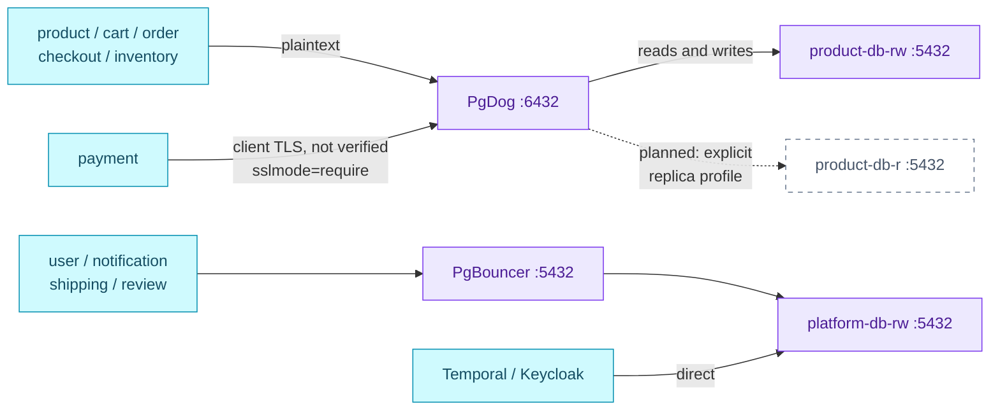

# PostgreSQL Poolers

Connection pooling protects PostgreSQL from unbounded backend concurrency, but
pool mode determines which session behaviors remain safe.

| Cluster | Pooler | Replicas | Endpoint | Mode | Routing |
|---|---|---:|---|---|---|
| `platform-db` | CNPG PgBouncer `Pooler` | 2 | `platform-db-pooler-rw.platform.svc:5432` | transaction | Primary only |
| `product-db` | PgDog chart v0.90 (PgDog v0.1.60) | 3 | `pgdog-product.product.svc:6432` | transaction | Primary only (`-rw`) |

## Why pooling exists

PostgreSQL normally assigns a backend process to each connection. Idle or bursty
application pools can therefore consume memory, process slots, and authentication
work without increasing useful database throughput. A pooler shares a bounded
set of server connections and queues excess demand; it does not add database
capacity.

## Pool modes and compatibility

| Mode | Server connection lifetime | Multiplexing | Main compatibility boundary |
|---|---|---|---|
| Session | Entire client session | Low | Preserves session state |
| Transaction | One transaction | High | Session state must not leak across transactions |
| Statement | One statement | Highest | Not suitable for general multi-statement transactions |

Transaction pooling needs explicit testing for session-level `SET`, temporary
tables, advisory locks, `LISTEN/NOTIFY`, cursors, and prepared statements.
Application-side connection pools still need bounded sizes; stacking pools does
not make concurrency free.

## Current connection ownership

The diagram answers which clients use each deployed connection path. Both
poolers send every query to the primary. PgDog used to send `SELECT`s outside a
transaction to `product-db-r`. ADR-089 makes the primary the default, because a
replica read right after a commit can miss it, so no PgDog database lists a
replica any more. A flow that tolerates stale reads will opt in through a
separate replica profile with a stated lag tolerance (**planned**, RFC-0029).

PgDog declares the six product-cluster database/user pairs and receives their
passwords through Flux `valuesFrom`. Every pair is the service's
`<svc>_runtime` login (RFC-0029 three-role split); migrators never go through
PgDog, and every `migrate` init container connects to `product-db-rw:5432`
directly. The order and checkout workers use their service's runtime login.

## TLS

PgDog terminates client TLS with the cert-manager `Certificate`
`pgdog-product-tls` (ClusterIssuer `homelab-ca`, ECDSA P-256, 90 days, renewed
15 days before expiry; DNS names `pgdog-product.product.svc` and
`pgdog-product.product.svc.cluster.local`), mounted at `/etc/pgdog-tls`.

| Client | To PgDog | Notes |
|---|---|---|
| payment runtime | TLS, `sslmode=require` | Encrypted, but the client does not check the certificate. payment's config refuses cleartext in production |
| product, cart, order, checkout, inventory, workers | plaintext, `sslmode=disable` | TLS is optional at PgDog |
| payment `migrate` | direct to `product-db-rw:5432`, `sslmode=require` | CNPG's own certificate; `pg_hba` admits `payment_runtime` and `payment_migrator` on `hostssl` lines only |

Verified on Kind on 2026-10-16 (RFC-0029 wave 2, ADR-089): PgDog presents
`CN=pgdog-product.product.svc` issued by `homelab-ca` with both DNS names, every
`payment_runtime` server session originates from a PgDog pod, and payment's
session advisory lease (reconciler) acquires and releases through PgDog. `verify-full` against `homelab-ca` is a follow-up
(ADR-089, RFC-0020). local-stack has no pooler and keeps payment direct to
PostgreSQL without TLS.

**Rotation needs a restart.** PgDog reads the certificate files when it starts.
cert-manager renews the Secret on schedule, but PgDog keeps serving the old
certificate until its pods restart; restart the Deployment inside the 15-day
renewal window
([pooler operations](./runbooks/pooler-operations.md)). Automating that restart
is an ADR-089 follow-up.

CNPG generates PgBouncer authentication support through `auth_query`; it does
not store a second application password set. Temporal and Keycloak bypass the
transaction pooler because their connection and prepared-statement behavior is
outside the PgBouncer pilot.

## Failure and change behavior

- CNPG PgBouncer follows the `platform-db-rw` service during failover. Password
  rotation is visible through live `auth_query` and needs no pooler reconcile.
- PgDog has an explicit backend list and reads Secret values at Helm reconcile
  time. Rotate the database role first, refresh the Secret, then reconcile the
  HelmRelease so new clients do not use a stale pooler password.
- Pooler restarts can cut in-flight transactions. PDBs and replica counts reduce
  availability risk but do not preserve a transaction owned by a terminating
  pod.

## Operations

Use [pooler operations](./runbooks/pooler-operations.md) for status checks,
credential rotation, adding backends, metrics, and incident response. Confirm
the owning service contract and deployment manifest before changing a DSN.

## Manifest evidence

- `kubernetes/infra/configs/databases/clusters/product-db/poolers/helmrelease.yaml`
- `kubernetes/infra/configs/databases/clusters/product-db/poolers/certificate.yaml`
- `kubernetes/infra/configs/databases/clusters/platform-db/poolers/pooler.yaml`
- `kubernetes/apps/services/*.yaml`

## References

- [CloudNativePG 1.30 connection pooling](https://cloudnative-pg.io/docs/1.30/connection_pooling/)
- [PgBouncer features](https://www.pgbouncer.org/features.html)
- [PgDog documentation](https://docs.pgdog.dev/)
