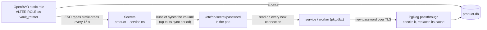

# Runbook: Rotate a product-db Service Password

Runtime passwords on `product-db` rotate on their own: each `<svc>_runtime`
login is an OpenBAO database-engine static role (`rotation_period=720h`,
ADR-025, ADR-089), and nothing else writes it. This runbook covers forcing a
rotation ahead of schedule, what to watch while it propagates, and the manual
[migrator rotation](#rotate-a-migrator-password), which stays a KV write.

| | |
|---|---|
| **Scope** | `product`, `cart`, `order`, `payment`, `checkout`, `inventory` on `product-db`; platform-db follows the same flow with its own Job and `vault_rotator` |
| **Source of truth (runtime)** | OpenBAO `database/static-creds/<svc>-runtime` (rotated by `vault_rotator` through `database/config/product-db`) |
| **Source of truth (migrator)** | OpenBAO `secret/local/databases/product-db/<svc>-migrator` (KV v2) |
| **Consumers** | ESO (`refreshInterval: 15s`, store `openbao-db`) → Secret in `product` and the service namespace → the pod's mounted file (`DB_PASSWORD_FILE`, read on every new connection). The `DatabaseRole` has no `passwordSecret`; PgDog holds no copy (passthrough) |
| **Design record** | [ADR-025](../../proposals/adr/ADR-025-pgdog-passthrough-dynamic-db-creds/) · [ADR-089](../../proposals/adr/ADR-089-postgresql-access-contract/) |

## How a rotation propagates



Open connections survive the change; a **new** connection fails
authentication only in the window between the `ALTER ROLE` and the pod's file
catching up (measured 19–47 s after rotation on platform-db, 2026-10-19). The
pool keeps its connections for up to 30 minutes (`MaxConnLifetime`), so under
normal load that window is not hit.

## Force a rotation

1. Rotate the role from a pod bound to the configurator ServiceAccount (the
   same Kubernetes auth role the Job uses; it can rotate, but cannot read the
   credential):

   ```bash
   kubectl run bao-rotate --rm -i --restart=Never -n product \
     --image=openbao/openbao:2.7.1 \
     --overrides='{"spec":{"serviceAccountName":"openbao-db-configurator"}}' \
     --env BAO_ADDR=http://openbao-active.openbao.svc.cluster.local:8200 -- sh -c '
       JWT=$(cat /var/run/secrets/kubernetes.io/serviceaccount/token)
       export BAO_TOKEN=$(bao write -field=token auth/kubernetes/login role=db-configurator jwt="$JWT")
       bao write -f database/rotate-role/<svc>-runtime'
   ```

2. Watch it land, by hash only (never print the value):

   ```bash
   for ns in product <svc>; do
     kubectl get secret -n $ns product-db-<svc>-runtime-secret -o jsonpath='{.data.password}' | sha256sum
   done
   kubectl exec -n <svc> deploy/<svc> -c <svc> -- cat /etc/db/secret/password | sha256sum
   ```

   The Secrets change within 15 s, the file within the kubelet sync period.
   `product` has no second copy. Order and checkout also run a worker that
   mounts the same Secret; check its file the same way.

3. **Nothing to do on PgDog or the DatabaseRole.** PgDog checks the next login
   against Postgres and replaces its cached copy; each replica does so at the
   first login it receives with the new password. The `DatabaseRole` carries
   no password, so CNPG never writes one back.

4. **Verify** — the old password fails, the new one works, e2e smoke green:

   ```bash
   kubectl run psql-check --rm -it --restart=Never -n product \
     --image=ghcr.io/cloudnative-pg/postgresql:18.6-system-trixie -- \
     psql -W "host=pgdog-product.product port=6432 user=<svc>_runtime dbname=<svc> sslmode=require" -c 'select 1'
   ```

   No pod restart is needed or expected. A restart is only the recovery path
   when a pod's file never changes (ESO or the mount is broken).

## Rotate a migrator password

`<svc>_migrator` has no `DatabaseRole`: the role catalog Job sets its password
when the migrator can no longer log in with the Secret's value. No pooler is
involved, and the `migrate` init container reads the Secret at its next start.

1. Write `secret/local/databases/product-db/<svc>-migrator` as in step 1
   (`username` stays `<svc>_migrator`).
2. Force-sync `product-db-<svc>-migrator-secret` in `product` and in `<svc>`.
3. Run the catalog now instead of waiting up to 10 minutes:

   ```bash
   kubectl -n product create job --from=cronjob/product-db-authz authz-manual-$(date +%s)
   ```

4. Verify the migrator logs in with the new value (same `psql` check as step 6
   with `user=<svc>_migrator`).

## One-time migration note (Opaque → basic-auth)

Secret `type` is immutable. The pre-RFC-0012 `product-db-secret`,
`product-db-cart-secret`, and `product-db-order-secret` (namespace `product`) were
`Opaque`; the triplet manifests re-template them as `kubernetes.io/basic-auth`.
On a cluster that still has the Opaque versions, delete them once so ESO
recreates with the new type (`deletionPolicy: Retain` governs ExternalSecret
deletion, not this):

```bash
kubectl delete secret -n product product-db-secret product-db-cart-secret product-db-order-secret
# then force-sync as in step 2
```

A fresh `make up` needs none of this — Secrets are born basic-auth.

## Rollback

- Password itself: `bao kv rollback -version=<n>` on the OpenBAO path, then
  re-run steps 2–5. Old cleartext values that once lived in Git history are
  **not** a rollback path — they are burned.
- Manifest changes: revert the PR; Flux converges.
