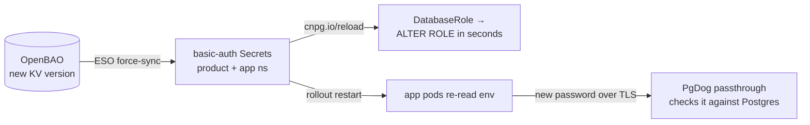

# Runbook: Rotate a product-db Service Password

Rotate one (or all) service runtime passwords on `product-db` with a
new-connection interruption while consumers converge; measure its duration.
Both consumers —
the `DatabaseRole` and the app pod — read the same OpenBAO entry through
ESO; PgDog keeps no copy (passthrough auth), and nothing else holds the value. Each service has a
`<svc>_runtime` and a `<svc>_migrator` login (RFC-0029,
[authorization](../authorization.md)); the migrator is covered in
[Rotate a migrator password](#rotate-a-migrator-password).

| | |
|---|---|
| **Scope** | `product`, `cart`, `order`, `payment`, `checkout`, `inventory` on `product-db` |
| **Source of truth** | OpenBAO `secret/local/databases/product-db/<svc>-runtime` and `…/<svc>-migrator` (KV v2 — old versions retained) |
| **Consumers** | `DatabaseRole` (`cnpg.io/reload`) and app pods (env `secretKeyRef` via the app-namespace ESO copy). PgDog holds no copy: it checks each client password against Postgres (passthrough auth) |
| **Design record** | [RFC-0012](../../proposals/rfc/RFC-0012/) · [ADR-013](../../proposals/adr/ADR-013-per-service-db-triplet/) · [ADR-025](../../proposals/adr/ADR-025-pgdog-passthrough-dynamic-db-creds/) |

## How a rotation propagates



Existing PostgreSQL sessions survive a password change — only **new**
connections authenticate against the new value. The blip window is between
the `ALTER ROLE` (step 3) and the pooler + app catching up (steps 4–5), so
run the steps as one block.

## Steps

Run everything in one sitting. `<svc>` below is the service being rotated.
Finish and verify one service before starting the next; inventory all consumers,
including workers, before changing its credential.

1. **New password into OpenBAO.**
   Use the normal staff OIDC login (`infra-team`) and KV write path in
   [Add a secret to a live cluster](../../secrets/runbooks/add-secret-live-cluster.md)
   for `secret/local/databases/product-db/<svc>-runtime`, preserving `username` and
   replacing `password`. Record the prior KV version without recording its
   value. After login, the following Bash snippet prompts without echo and
   passes the password on stdin, not in the command arguments:

   ```bash
   read -r -p 'Service to rotate: ' db_service
   case "$db_service" in
     product|cart|order|payment|checkout|inventory)
       read -r -s -p 'New database password: ' db_next_password
       printf '\n'
       if [ -n "$db_next_password" ]; then
         printf '%s' "$db_next_password" | bao kv put \
           "secret/local/databases/product-db/$db_service-runtime" \
           username="${db_service}_runtime" password=-
       else
         printf 'Empty password: no write performed.\n'
       fi
       unset db_next_password
       ;;
     *) printf 'Unknown service: no write performed.\n' ;;
   esac
   ```

   Keep shell tracing disabled, verify the write succeeded before proceeding,
   and revoke the OIDC token when finished. Do not put the password in Git,
   shell history, diagnostics or captured terminal output.

   The bootstrap Job is not a day-2 rotation mechanism: it revokes its root
   token and exits as already bootstrapped on later runs. Do not read a presumed
   persisted root token or delete the Job to rotate a credential.

   KV rollback restores a prior value, but consumers still require steps 2–5;
   it is not an atomic end-to-end undo.

2. **Force ESO to sync now** (default `refreshInterval` is 1h) — both the
   product-namespace Secret and the app-namespace copy:

   ```bash
   kubectl annotate externalsecret -n product product-db-<svc>-runtime-secret \
     force-sync=$(date +%s) --overwrite
   kubectl annotate externalsecret -n <svc> product-db-<svc>-runtime-secret \
     force-sync=$(date +%s) --overwrite
   ```

   (`product` runs in namespace `product` and has no second copy.)

3. **CNPG applies `ALTER ROLE` automatically** — the `cnpg.io/reload` label
   on the product-namespace Secret triggers it within seconds. Verify:

   ```bash
   kubectl get databaserole -n product product-db-role-<svc>-runtime \
     -o jsonpath='{.status.applied}{" "}{.status.conditions}'
   ```

4. **Nothing to do on either pooler.**

   **`product-db` (PgDog, passthrough auth, ADR-025).** PgDog holds no
   password list. Each client sends its password over TLS; PgDog compares it
   with the copy it cached at the last successful login and, when it differs,
   checks the new one against Postgres and replaces the cache
   (`passthrough_auth = "enabled_allow_change"`). The `ALTER ROLE` from step 3
   is live for PgDog at the first new connection: no HelmRelease reconcile and
   no rollout. Each PgDog replica accepts the old password until a client
   brings the new one there, because a cached password is not re-checked;
   after that the old one is refused (in about 5 s, PgDog's
   `checkout_timeout`). Restarting the app in step 5 is what moves every
   replica to the new password.

   **`platform-db` (CNPG PgBouncer `Pooler`, ADR-026).** Do **nothing** here.
   The pooler holds no passwords: CNPG configures PgBouncer with `auth_query`,
   so it looks each credential up in `pg_shadow` at connect time and
   authenticates itself to Postgres with a TLS client certificate. The
   `ALTER ROLE` from step 3 is therefore live for the pooler the moment it
   lands — there is no config to reconcile and no Deployment to roll. (There
   is no `pgdog-platform`; it was removed with the pilot.)

   Both poolers now follow a password change on their own, so neither can
   serve a stale one.

5. **Restart the app** so env-injected credentials refresh:

   ```bash
   kubectl rollout restart deploy -n <svc> -l app.kubernetes.io/component=api
   ```

   Order and checkout also have Temporal-managed workers. Inspect their
   `WorkerDeployment` and child Deployments, identify every Secret consumer,
   and follow the [worker lifecycle](../../api/temporal.md) before restarting
   a child workload. Do not assume the old `component=worker` selector reaches
   the current controller-managed deployments.

6. **Verify** — old password must fail, new must work, e2e smoke green:

   ```bash
   kubectl run psql-check --rm -it --restart=Never -n product \
     --image=ghcr.io/cloudnative-pg/postgresql:18.6-system-trixie -- \
     psql -W "host=product-db-rw.product user=<svc>_runtime dbname=<svc>" -c 'select 1'
   ```

   (Every login is `hostssl`: add `sslmode=require` to the connection string.)

## Rotate a migrator password

`<svc>_migrator` has no `DatabaseRole`: the role catalog Job sets its password
when the migrator can no longer log in with the Secret's value. No pooler is
involved, and the `migrate` init container reads the Secret at its next start.

1. Write `secret/local/databases/product-db/<svc>-migrator` as in step 1
   (`username` stays `<svc>_migrator`).
2. Force-sync `product-db-<svc>-migrator-secret` in `product` and in `<svc>`.
3. Run the catalog now instead of waiting up to 10 minutes:

   ```bash
   kubectl -n product create job --from=cronjob/product-db-authz authz-manual-$(date +%s)
   ```

4. Verify the migrator logs in with the new value (same `psql` check as step 6
   with `user=<svc>_migrator`).

## One-time migration note (Opaque → basic-auth)

Secret `type` is immutable. The pre-RFC-0012 `product-db-secret`,
`product-db-cart-secret`, and `product-db-order-secret` (namespace `product`) were
`Opaque`; the triplet manifests re-template them as `kubernetes.io/basic-auth`.
On a cluster that still has the Opaque versions, delete them once so ESO
recreates with the new type (`deletionPolicy: Retain` governs ExternalSecret
deletion, not this):

```bash
kubectl delete secret -n product product-db-secret product-db-cart-secret product-db-order-secret
# then force-sync as in step 2
```

A fresh `make up` needs none of this — Secrets are born basic-auth.

## Rollback

- Password itself: `bao kv rollback -version=<n>` on the OpenBAO path, then
  re-run steps 2–5. Old cleartext values that once lived in Git history are
  **not** a rollback path — they are burned.
- Manifest changes: revert the PR; Flux converges.
