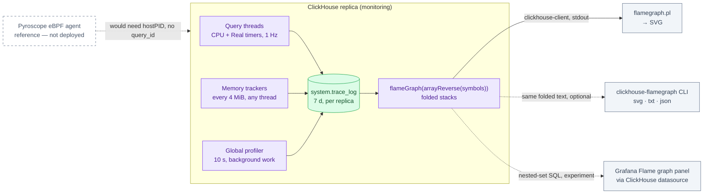

# Profiling ClickHouse — reading `system.trace_log`

ClickHouse has been profiling itself since the first boot of this cluster. Every
query thread is sampled once a second, every 4 MiB of allocation by any thread
captures a stack, and the result sits in `system.trace_log` for seven days. This
guide explains what that table contains, how to turn it into a flame graph with
nothing but SQL and `flamegraph.pl`, and why the Pyroscope stack is the wrong
tool for this particular binary.

| Quick facts | |
|---|---|
| **Status** | Deployed data. Every query in this guide was run on Kind on 2026-10-29 against ClickHouse 26.10.3.7 ([results](#verify-it-on-the-live-cluster)) |
| **Server** | `clickhouse/clickhouse-server:26.10`, one shard × three replicas, namespace `monitoring` |
| **Where samples land** | `system.trace_log` — plain local `MergeTree` on each replica, **not replicated** |
| **Retention** | 7 days, daily partitions, `ttl_only_drop_parts = 1` — repo override of the operator's 30 days ([why](README.md#trace_log-the-biggest-table-and-it-is-not-query-traffic)) |
| **Sampling** | Upstream defaults: CPU and wall-clock timers at 1 Hz per query thread, memory profiler every 4 MiB, random allocation sampling off |
| **Symbolization** | On (upstream default since 25.4): the `symbols` column holds demangled function names. `flameGraph()` is still gated as an introspection function, so every query adds `SETTINGS allow_introspection_functions = 1` |
| **Viewer** | `flameGraph()` → `flamegraph.pl` → SVG. No Grafana panel and no Pyroscope ingestion exist for this data |
| **Not this** | Pyroscope profiles the Go services ([Continuous Profiling](../profiling/README.md)); it does not and should not profile ClickHouse |

## Overview

The platform pays for two profilers and reads one. Pyroscope receives pprof
pushes from every Go service and is queried in Grafana. ClickHouse's built-in
sampling profiler writes to `system.trace_log`, costs roughly 1.7 GiB per
replica at the current retention, and nothing on the platform reads it. The
override that cut its retention from 30 to 7 days kept the profiler on because
memory samples explain `MEMORY_LIMIT_EXCEEDED` events on a server with a 1.8 GiB
self-cap. This guide closes that gap: the samples are useful only if someone
knows how to turn them into a picture.

> **In plain terms.** ClickHouse keeps a diary of "what was every thread doing"
> once a second and "who asked for memory" every 4 MiB. A flame graph is just
> that diary grouped by call stack and drawn as stacked bars. You do not need a
> profiler agent, a sidecar, or an extra database; you need one `SELECT`.

## What the profiler captures

ClickHouse has three independent sample sources. They all write rows of the
same shape into `system.trace_log`; the `trace_type` column says which one
fired.

| Source | Setting (scope) | Upstream default | Rows it writes |
|---|---|---|---|
| **Query profiler, wall-clock timer** | `query_profiler_real_time_period_ns` (session) | 1 000 000 000 ns = 1 Hz, on | `Real` — one per running query thread per tick, including threads waiting on IO or locks |
| **Query profiler, CPU timer** | `query_profiler_cpu_time_period_ns` (session) | 1 Hz, on | `CPU` — same, but the clock only advances while the thread burns CPU, so idle waits do not appear |
| **Global profiler** | `global_profiler_real_time_period_ns`, `global_profiler_cpu_time_period_ns` (server) | 10 s | `Real` / `CPU` rows with an empty `query_id` — merges, fetches, housekeeping |
| **Memory profiler, step** | `memory_profiler_step` (session, applied to every memory tracker) | 4 MiB | `Memory` — the allocating stack each time a tracker crosses the next 4 MiB boundary; `MemoryPeak` on each new peak |
| **Memory profiler, sampling** | `memory_profiler_sample_probability` (session) | 0, off | `MemorySample` — a random fraction of every allocation **and** deallocation, with `size` negative on free |

Two facts follow from this table and both were measured on this cluster
(2026-09-06, [platform hub](README.md#trace_log-the-biggest-table-and-it-is-not-query-traffic)):

1. **Most rows are not query traffic.** In a ten-minute window `Memory` and
   `MemoryPeak` were 95 % of the table while `query_log` saw a handful of
   queries. The memory step fires for merges and inserts too, and an idle
   ClickHouse still allocates.
2. **Every query slower than a second already has samples.** At 1 Hz a
   five-second query leaves about five `CPU` rows and five `Real` rows per
   thread. That is enough to see which operator dominated, and it is sitting
   in the table for the last seven days without anyone having asked for it.

The settings in the "session" rows can be changed **per query** with a
`SETTINGS` clause. That is the only way this guide changes them; the
`ClickHouseInstallation` profile stays at upstream defaults, see
[Platform behaviour](#platform-behaviour).

### The row

```text
event_time        when the sample was taken
trace_type        Real | CPU | Memory | MemorySample | MemoryPeak | …
query_id          the query the thread belonged to, '' for background work
thread_id, thread_name
trace             Array(UInt64) — raw frame addresses, leaf first
symbols           Array(LowCardinality(String)) — demangled function per frame, leaf first
lines             Array(LowCardinality(String)) — file:line per frame, best effort
size              bytes for the memory trace types, 0 otherwise; negative on free
ptr               allocation address for MemorySample, 0 otherwise
```

`symbols` is the column that makes this guide short. Before 25.4 a flame graph
needed `addressToSymbol()` and `demangle()` on every frame. Since 25.4 the
server resolves frames at collection time when `<symbolize>` under
`<trace_log>` is true, which is the upstream default and is on here. That
removes the address resolution, not the gate: `flameGraph()` itself is classed
as an introspection function and fails with `FUNCTION_NOT_ALLOWED` (code 446)
unless the query sets `allow_introspection_functions = 1`. Every query below
sets it in its own `SETTINGS` clause, which changes nothing for the other
clients of the `default` profile. The `lines` column needs debug info that the
official image does not ship, so expect it to be sparse; function names are
enough for a flame graph.

## How a flame graph is built



Solid arrows are the path this guide uses. Dotted arrows are alternatives that
read the same folded text. The eBPF node is drawn only to say why it is absent:
it would need a privileged, `hostPID` DaemonSet that PSS baseline forbids, it
collects CPU only, and it cannot attribute a sample to a `query_id`. The
built-in profiler answers the two questions this cluster actually asks, "which
query" and "whose memory", at no extra cost.

`flameGraph()` is an aggregate function. It takes a stack per row, counts how
often each root-to-leaf prefix occurs, and returns one string per unique stack
in the `a;b;c count` format that Brendan Gregg's `flamegraph.pl` consumes.
ClickHouse stores stacks leaf first, so `arrayReverse` is required; without it
the graph is drawn upside down with `main` at the tip of every tower. For the
memory trace types pass `size` as the second argument so the bar width is bytes
rather than samples.

## Platform behaviour

What is deployed, and why the defaults were kept, lives in the
`ClickHouseInstallation` and the platform hub. The short version:

| Item | Deployed | Source |
|---|---|---|
| `trace_log` engine | `MergeTree PARTITION BY event_date ORDER BY event_time TTL event_date + INTERVAL 7 DAY SETTINGS ttl_only_drop_parts = 1`, flushed every 7.5 s | `kubernetes/infra/configs/clickhouse/clickhouseinstallation.yaml`, file `02-system-log-retention.xml` |
| Why 7 days and not off | 6.3 M rows in 14 hours projected to 7.3 GiB per replica at 30 days; memory samples were judged worth a week on a server that had already refused admin queries at its self-cap | [platform hub](README.md#trace_log-the-biggest-table-and-it-is-not-query-traffic) |
| Profiler settings | None set in the CHI; the `default` profile carries upstream defaults | `spec.configuration.users` |
| `query_thread_log` | Removed by the operator; per-thread query stats are not available, `trace_log` is the per-thread view | [platform hub](README.md#the-engines-own-log-tables) |
| Users | Six: `default` (shared by the Collector, the schema Job and Grafana, no memory ceiling), plus the scoped `pg_stat_ch`, `analytics_ingest`, `analytics_reader`, `analytics_view_owner` and `clickhouse_operator` | `spec.configuration.users` |
| Grafana | ClickHouse datasource plugin 4.23.3 has no flame-graph query format; the Pyroscope datasource reads Pyroscope only | [Grafana chapter](README.md#grafana) |

Three consequences for anyone running the procedures below:

- **Sorting key is `event_time`, not `query_id`.** A filter on `query_id`
  alone scans seven days of the largest `system.*` table on that replica.
  Always bound the time range too.
- **The table is per replica.** A flame graph built on `chi-clickhouse-otel-0-0-0`
  shows only the threads that ran there. The round-robin Service will not say
  which replica answered a Grafana query, so pick the pod deliberately and run
  the query on each replica you need. `clusterAllReplicas()` does not help: the
  cluster definition carries no inter-replica credentials, so a distributed
  query as `default` fails with `AUTHENTICATION_FAILED` on the other replicas.
- **The single `default` user has no memory or time ceiling.** A
  `flameGraph()` over ten minutes of `Memory` rows is itself a query that
  allocates; start with one or two minutes, or one `query_id`, before widening.
  Splitting that user into ingest, read-only and DDL users is tracked in
  [#1460](https://github.com/duynhlab/homelab/issues/1460).

## Operations

### Prerequisites

- A shell with `clickhouse-client` reachable: the
  [secure client pattern](operations.md#secure-client-pattern) with
  `kubectl exec` into one replica, or a `port-forward` of `svc/clickhouse-clickhouse`
  to `8123`/`9000` and the password prompted, never pasted into a command line.
- `flamegraph.pl` from the FlameGraph repository on the same machine. It is a
  single Perl script; `git clone https://github.com/brendangregg/FlameGraph` is
  the whole install.
- Nothing on the cluster changes. Every setting below is a per-query
  `SETTINGS` clause or a per-session `SET`.

### CPU flame graph of one query

1. Run the query you want to understand with a fixed `query_id` and a denser
   sampling rate. The ClickHouse docs recommend 100 Hz for a single query; the
   default 1 Hz is tuned for fleet-wide always-on sampling.

   ```sql
   -- replace the SELECT with the panel query you are investigating
   SELECT ServiceName, count()
   FROM otel.otel_traces
   WHERE Timestamp > now() - INTERVAL 1 DAY
   GROUP BY ServiceName
   SETTINGS query_profiler_cpu_time_period_ns = 10000000,
            query_profiler_real_time_period_ns = 10000000;
   ```

   Pass `--query_id=probe-1` to `clickhouse-client`, or read the generated id
   back from `system.query_log`. Then force the buffered samples to disk:

   ```sql
   SYSTEM FLUSH LOGS;
   ```

2. Fold the stacks and render. The `arrayReverse` puts the root at the bottom;
   the date filter keeps the scan to today's partition.

   ```bash
   clickhouse-client --user="$CH_USER" --ask-password -q "
     SELECT arrayJoin(flameGraph(arrayReverse(symbols)))
     FROM system.trace_log
     WHERE trace_type = 'CPU'
       AND query_id = 'probe-1'
       AND event_date >= today() - 1
     FORMAT TSVRaw
     SETTINGS allow_introspection_functions = 1" \
     | ./FlameGraph/flamegraph.pl --title 'probe-1 CPU' > probe-1-cpu.svg
   ```

   `FORMAT TSVRaw` matters: plain `TSV` escapes the `'` in C++ names such as
   `'lambda'`, which splits one frame into two labels.

   Swap `'CPU'` for `'Real'` to include time spent waiting: a graph that is
   wide in `Real` and narrow in `CPU` is a query bound by IO, locks, or the
   cold tier, not by computation.

3. Read the SVG in a browser. Width is sample count. The widest towers under
   `DB::executeQuery` name the pipeline step; a tower rooted in
   `MergeTreeReadPool` or `S3` frames points at reading, one under
   `Aggregator` at the `GROUP BY`.

A query that already ran, for example a slow Grafana panel reported an hour
ago, has samples at 1 Hz. Skip step 1, take its `query_id` from
`system.query_log` ([query pipeline chapter](internals/02-query-pipeline.md)),
and run step 2 with a time range around `event_time`. Five seconds of query
gives five samples per thread; coarse, but enough to see which stage dominated.

### Memory flame graph: who allocated during merges and inserts

The `Memory` rows need no setup; they are already there for every thread. The
bar width is bytes because `size` is passed as the second argument.

```bash
clickhouse-client --user="$CH_USER" --ask-password -q "
  SELECT arrayJoin(flameGraph(arrayReverse(symbols), size))
  FROM system.trace_log
  WHERE trace_type = 'Memory'
    AND event_time > now() - INTERVAL 2 MINUTE
  FORMAT TSVRaw
  SETTINGS allow_introspection_functions = 1" \
  | ./FlameGraph/flamegraph.pl --countname=bytes --colors=mem \
      --title 'allocations, last 2 min, this replica' > mem-2min.svg
```

Widen the window only after the two-minute graph renders comfortably. To look
at one query instead of the whole server, add `AND query_id = '…'`; to see
only allocations that were never freed, re-run the query with
`memory_profiler_sample_probability = 1` and use the three-argument form
`flameGraph(arrayReverse(symbols), size, ptr)` on the `MemorySample` rows, as
the ClickHouse sampling-profiler guide describes. That mode writes one row per
allocation and deallocation, so keep it to a single short query.

### Fallback when `symbols` is empty

If the `symbols` column comes back as empty arrays, symbolization is off on
that server (it is on here: verified 2026-10-29). The raw addresses in `trace`
can still be resolved on the fly with `addressToSymbol()` and `demangle()`,
under the same session-only setting:

```sql
SET allow_introspection_functions = 1;
SELECT arrayJoin(flameGraph(arrayReverse(arrayMap(x -> demangle(addressToSymbol(x)), trace))))
FROM system.trace_log
WHERE trace_type = 'CPU' AND query_id = 'probe-1' AND event_date >= today() - 1;
```

Do not put `allow_introspection_functions` into the `default` profile, even
though every procedure here needs it: that profile is shared by the Collector
and Grafana, and the introspection functions are deliberately gated. If the column is empty on this cluster the right fix is
an explicit `<symbolize>true</symbolize>` in the `trace_log` override, as a
focused manifest change.

### Optional tooling that reads the same table

- **`clickhouse-flamegraph`** (Slach, Go CLI, MIT) queries `system.trace_log`
  over HTTP with `--date-from/--date-to`, `--query-ids`, `--query-regexp` and
  `--trace-types`, groups by normalised query text, and writes SVG, folded text
  or d3-flame-graph JSON per query. It still needs `flamegraph.pl` on the path
  and `allow_introspection_functions=1` in its DSN, because it resolves
  addresses itself rather than reading `symbols`. Its README suggests a server
  `profiling.xml` with 25 Hz sampling for every query, 1 % memory sampling and
  a 10 Hz global profiler; **do not copy that into the CHI.** On this cluster
  `trace_log` is already the largest system table at the defaults.
- **Grafana's Flame graph panel** renders any data frame in its nested-set
  shape (`level`, `value`, `self`, `label`, depth-first order). The ClickHouse
  datasource has no flame-graph format, but a Table-format query that produces
  those four columns from `flameGraph()` output would render in the panel. This
  is unverified on the platform and listed as an experiment, not a procedure.
- **Pyroscope's `/ingest` endpoint** accepts exactly the folded-stack text that
  `flameGraph()` emits, so a CronJob could push ClickHouse profiles into the
  existing Pyroscope and gain its timeline and diff views without an eBPF
  agent. It would add a third profile producer outside the
  [ADR-074](../../proposals/adr/ADR-074-continuous-profiling-contract/README.md)
  label contract and is not planned.

### Cost of the knobs

| Change | Effect | Rule |
|---|---|---|
| Per-query `query_profiler_*` at 100 Hz | About 100× the rows of that query only; a 10-thread, 5-second query writes about 5 000 rows per timer | Fine for an investigation; never in the profile |
| Per-query `memory_profiler_sample_probability = 1` | One row per allocation and free; a heavy query can write millions | Only for the "not freed" question, on one short query |
| Server-wide `global_profiler_*` faster than 10 s | Every background thread sampled, cluster-wide, needs a restart | Not done; the table is already the largest |
| `allow_introspection_functions` in a profile | Opens the introspection functions to every client using that profile | Per query or per session only; every `flameGraph()` needs it |
| Unbounded `trace_log` scan | Seven days × tens of millions of rows per replica, inside a 1.8 GiB self-cap | Always filter `event_date` or `event_time` |

### Verify it on the live cluster

Read-only checks, in the order a fresh reader would want them. Record the
output in [audits](audits/README.md) with the date and ClickHouse version, the
way the internals chapters do.

```sql
-- 1. the profiler settings actually in force
SELECT name, value, changed FROM system.settings
WHERE match(name, 'profiler|introspection|untracked') ORDER BY name;
SELECT name, value FROM system.server_settings WHERE name LIKE '%profiler%';

-- 2. symbolization is on: symbols must not be empty
SELECT trace_type, length(symbols), symbols[1:3]
FROM system.trace_log
WHERE event_date = today() AND trace_type = 'CPU' LIMIT 3;

-- 3. the trace_type mix, to compare with the 2026-09-06 measurement
SELECT trace_type, count() FROM system.trace_log
WHERE event_time > now() - INTERVAL 10 MINUTE GROUP BY trace_type;

-- 4. flameGraph works on the symbols column
SELECT length(flameGraph(arrayReverse(symbols))) FROM system.trace_log
WHERE event_time > now() - INTERVAL 2 MINUTE AND trace_type = 'Memory'
SETTINGS allow_introspection_functions = 1;
```

```bash
# 5. the per-replica reminder, made visible: one exec per pod, since
#    clusterAllReplicas() fails authentication as `default`
for r in 0 1 2; do
  kubectl -n monitoring exec -it chi-clickhouse-otel-0-$r-0 -c clickhouse -- \
    clickhouse-client --user="$CH_USER" --ask-password -q \
    "SELECT hostName(), count() FROM system.trace_log WHERE event_date = today()"
done
```

**Recorded run: Kind, 2026-10-29, ClickHouse 26.10.3.7, replica
`chi-clickhouse-otel-0-0-0`.** The query side was run; `flamegraph.pl` was not.

| Check | Result |
|---|---|
| 1. Settings | Upstream defaults, none changed: `query_profiler_cpu/real_time_period_ns` 1 000 000 000, `memory_profiler_step` 4 194 304, `memory_profiler_sample_probability` 0, `allow_introspection_functions` 0. Server: `global_profiler_*` 10 s, `max_server_memory_usage` 1 931 787 878 |
| 2. Symbolization | `symbols` populated (25 frames on a `Memory` row, leaf `MemoryTracker::commitAllocation`) |
| 3. Mix, 10 min | `Real` 15 803, `Memory` 14 128, `MemoryPeak` 14 101, `CPU` 428. Memory rows are 64 % now, `Real` rows most of the rest |
| 4. `flameGraph()` | Fails with code 446 without the setting; 132 folded stacks with it |
| 5. Per replica | 839 645 / 994 173 / 771 319 rows today on replicas 0/1/2. `clusterAllReplicas` fails with `AUTHENTICATION_FAILED` |
| CPU procedure | A 375 ms query at 100 Hz left 9 `CPU` and 57 `Real` samples; 9 folded stacks |
| Memory procedure | 171 folded stacks for 2 minutes, all in valid `stack count` form |

The SVG step was not part of this run: render the folded text with
`flamegraph.pl` on a workstation. The ClickHouse behaviour itself rests on the
upstream docs listed below.

## Related

- [Slow query or memory failure → flame graph](../runbooks/clickhouse/slow-query-flame-graph.md)
  is the on-call workflow built on this guide: find the `query_id`, export,
  draw, and map the widest bar to a fix.
- [ClickHouse platform hub — the engine's own log tables](README.md#the-engines-own-log-tables)
  owns the retention table and the `trace_log` size story.
- [Query pipeline](internals/02-query-pipeline.md) owns `system.query_log` and
  how to find a `query_id`.
- [Scaling decisions](internals/12-scaling.md) owns the bottleneck table; a
  flame graph is how to confirm which row of it applies.
- [Continuous Profiling (Pyroscope)](../profiling/README.md) owns application
  profiling; [ADR-074](../../proposals/adr/ADR-074-continuous-profiling-contract/README.md)
  owns its label contract.
- [ClickHouse operations](operations.md) owns the secure client pattern and
  the day-2 triage order.

## References

- ClickHouse docs — Sampling query profiler (`query_profiler_*`, `flameGraph`,
  CPU and memory flame graph recipes)
- ClickHouse docs — `system.trace_log` (columns, `trace_type` values,
  symbolization)
- ClickHouse docs — `flameGraph` aggregate function
- ClickHouse docs — Memory profiler settings (`memory_profiler_step`,
  `memory_profiler_sample_probability`, `max_untracked_memory`)
- ClickHouse docs — Server settings: `global_profiler_*`, `total_memory_*`
- Grafana docs — Flame graph panel data format
- Grafana Alloy docs — `pyroscope.ebpf` required privileges
- FlameGraph (Brendan Gregg) — `flamegraph.pl` folded-stack input and options
