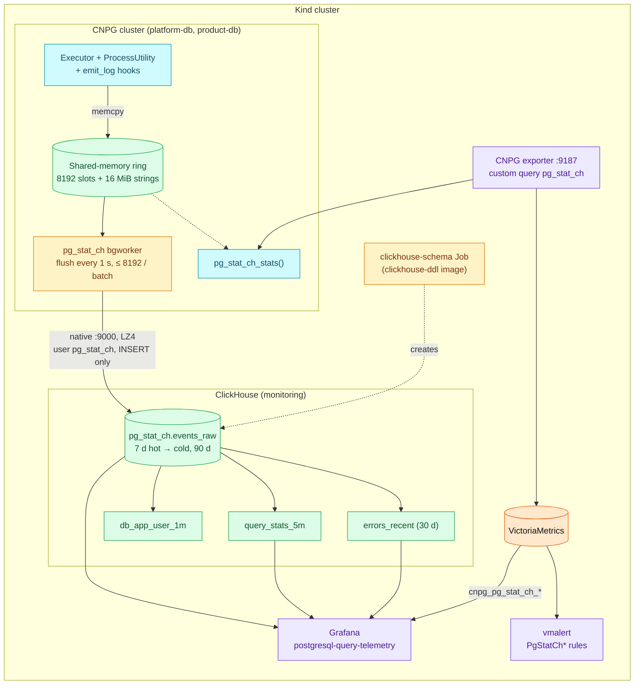
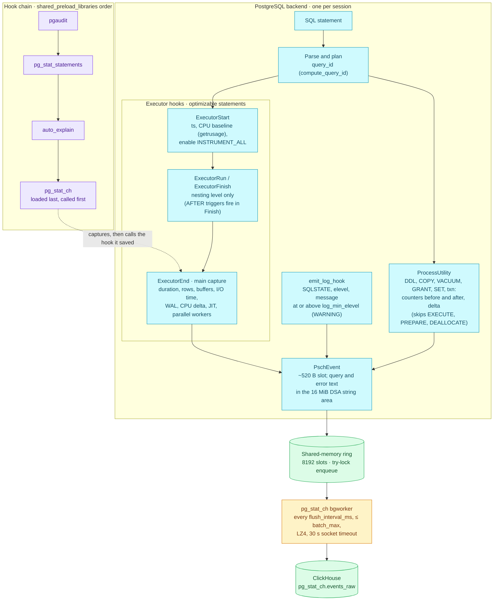

# PostgreSQL query telemetry — pg_stat_ch into ClickHouse

`pg_stat_statements` tells you which statement is expensive in total;
`auto_explain` tells you why one slow execution was slow. Neither can say
*when p99 moved from 8 ms to 80 ms, for which application, and whether the
fast executions changed too*. **pg_stat_ch** records one event per statement
execution inside PostgreSQL and ships it to ClickHouse, where the platform
already keeps 90 days of logs and traces. This page is the signal's guide:
what is captured, how it flows, what it costs, and how to operate it.

| Quick facts | |
|---|---|
| Extension | `pg_stat_ch` 0.4.0 (ClickHouse, Apache-2.0), PostgreSQL 16–18 |
| Delivery | CNPG image-volume extension `ghcr.io/duynhlab/images/pg-stat-ch` (`/extensions/pg_stat_ch`), preloaded on `platform-db` and `product-db`; mounted but not preloaded on `product-db-replica` |
| Transport | Native ClickHouse protocol, LZ4, `clickhouse-clickhouse.monitoring.svc:9000` without TLS (in-cluster), user `pg_stat_ch` (INSERT-only, its own settings profile pins the LZ4 codec) |
| Store | ClickHouse database `pg_stat_ch` (DDL image `clickhouse-ddl` ≥ 1.2.1): `events_raw` 7 days hot → RustFS cold, 90 days; rollups `query_stats_5m`, `db_app_user_1m`, `errors_recent` (30 days) |
| Loss model | ClickHouse unreachable: events **wait in the ring** and are dropped once it is full (8192 slots ≈ 7–15 min of Kind traffic). ClickHouse reachable but rejecting the insert: that batch is **lost**. Never retried by the server, never back-pressure on PostgreSQL |
| Cost on PostgreSQL | ~2 % CPU in the extension; up to ~11 % TPS on a lock-heavy pgbench (upstream, 32 clients); shared memory ≈ `queue_capacity` × ~520 B + `string_area_size`, i.e. 20 MB per instance here (`pg_shmem_allocations`) |
| Health | `cnpg_pg_stat_ch_*` (custom query) → `PgStatChExportFailing`, `PgStatChDroppingEvents`, `PgStatChNotExporting` |
| Dashboard | `postgresql-query-telemetry` (Databases folder) — Go in `duynhlab/grafana-dashboards`, delivered by the as-code OCI artifact (≥ 0.6.0), the first board on the logical `clickhouse` datasource |
| Not covered | plan capture (use auto_explain), statements on the DR replica, local-stack (its Postgres is Alpine/musl; the release binary is glibc) |

## What one event holds

Every statement — DML, DDL, utility, and statements that *failed* — becomes a
fixed set of 44 columns: start time and duration, `db_name`, `db_user`, `app`
(`application_name`), `client_addr`, `pid`, the `query_id` fingerprint that
`pg_stat_statements` and the auto_explain plans stream also carry
(`compute_query_id`), the normalised text (literals → `$N`, cut at 2 KB),
rows, shared/local/temp buffer counters, block read/write wait
(`track_io_timing`), WAL records/FPI/bytes, CPU user/sys from `getrusage`, JIT
timings, parallel workers planned vs launched, and on failure the SQLSTATE,
elevel and message. `db_name` is the cluster key on this platform because
every database name is unique across `platform-db` and `product-db`; the
extension's own instance columns are only filled on its Arrow/OTel path.

## How it flows



The diagram answers *where an execution goes and who can lose it*. The hot
path is a `memcpy` into the ring under a try-lock; a full ring drops the event
and bumps `dropped_events`. The background worker owns the only network
connection, and what a failure costs depends on where it happens:

- **No connection** (ClickHouse down, rolling, unreachable): the worker
  counts a `send_failures`, leaves the events in the ring and tries again on
  the next tick. Nothing is lost until the ring is full; when ClickHouse
  returns, the backlog drains with its original timestamps. Measured on Kind
  (2026-10-15, ClickHouse scaled to 0 for 18 min): the ring filled after
  ~7 min on `platform-db` and ~15 min on `product-db`, `events_raw` kept every
  minute up to those points, and both rings drained within 40 s of the
  restart.
- **Connected, insert rejected** (schema, grant, codec, a view that cannot be
  written): the batch is dequeued and lost, `send_failures` increments and
  `dropped_events` does **not**. The only measure of that loss is
  `enqueued_events − exported_events − queue_size` (a dropped event never entered the ring, so it is not in `enqueued_events`).

Standbys run their own worker and export the reads they serve; the counters
are per instance.

Both counters are what the exporter query scrapes and the three alerts watch.

### Where each field is captured

The diagram above follows an event out of PostgreSQL. This one answers the
question one level down: *which hook produces which columns, and how
pg_stat_ch sits among the other preloaded libraries*.



Optimizable statements (SELECT, INSERT, UPDATE, DELETE, MERGE) are measured
by the executor hooks: `ExecutorStart` takes the baselines and switches on
instrumentation, `ExecutorRun`/`ExecutorFinish` only track nesting so a
trigger's or function's inner statements do not bleed into the outer one, and
`ExecutorEnd` builds the event before `standard_ExecutorEnd` frees the
executor state. Utility statements never reach the executor, so
`ProcessUtility` snapshots the counters around them; `EXECUTE` is skipped
there because the executor hooks already count the prepared statement.
Statements that fail before or during execution reach only `emit_log_hook`,
which is why a syntax error or a permission denial still appears with its
SQLSTATE. Parallel workers are skipped; the leader reports their totals.

Each library saves the hook value it finds when it loads and calls it after
its own work, so the order of `shared_preload_libraries`
(`pgaudit, pg_stat_statements, auto_explain, pg_stat_ch`) decides the call
order: pg_stat_ch loads last and runs first. All of them see the same
`query_id`, because `compute_query_id` is left at `auto` and the
`pg_stat_statements` preload switches it on; that shared fingerprint is what
joins an event to `pg_stat_statements` and to an auto_explain plan.

## Why the pieces are shaped this way

- **Image volume, not a custom operand image.** CloudNativePG mounts the
  extension image read-only and appends its `lib/` and `share/` to
  `dynamic_library_path` / `extension_control_path`, which is enough for
  `shared_preload_libraries` to find it — the CNPG catalog ships `pgaudit` and
  `timescaledb` the same way. The image is built *inside* the pinned operand
  image and `ldd`-checked there, so a library mismatch fails the image build,
  not a pod start. It also leaves the operand image free for other work
  (RFC-0030's `pg_cron` image can coexist).
- **Own DDL, upstream columns.** The extension's `INSERT INTO events_raw
  (<44 columns>)` is the contract; `events_raw` keeps upstream's column names
  and types. Everything else is the platform's: `ReplicatedMergeTree` inside a
  `Replicated` database created per replica by the `clickhouse-schema` Job
  (the same bootstrap rule as `otel`, ADR-065), `ORDER BY (db_name, ts)`, the
  `hot_cold` policy and the 7/90-day TTL that `otel_logs` uses. Upstream's
  plain `MergeTree` with a 180-day TTL fits neither the three-replica store nor
  its retention.
- **An INSERT-only writer.** The CHI defines user `pg_stat_ch` with
  `GRANT INSERT ON pg_stat_ch.*` and nothing else, so the credential that sits
  in every PostgreSQL pod cannot read telemetry or touch `otel`. Grafana keeps
  reading as `default`. Two consequences: the rollup views run as their
  definer (`DEFINER = default SQL SECURITY DEFINER`, DDL 1.2.1), because
  ClickHouse otherwise checks `SELECT` on `events_raw` against the inserting
  user; and the user's profile pins `network_compression_method: LZ4`, because
  ClickHouse 26 answers in ZSTD by default and the extension's client only
  decodes LZ4.
- **The password reaches PostgreSQL through Flux, not git.** The extension
  takes its password only as a postmaster GUC, and CNPG only takes GUCs as
  literals in `Cluster.spec.postgresql.parameters`. The manifests therefore
  carry `${PG_STAT_CH_CLICKHOUSE_PASSWORD}`, and `databases-local` substitutes
  it at apply time (`postBuild.substituteFrom`) from the Secret ESO lands in
  `flux-system` — one OpenBAO path (`secret/local/infra/clickhouse/pg_stat_ch`)
  feeds both that Secret and the CHI's. Substitution covers every object the
  wave renders, so anything carrying shell `${...}` must opt out: the
  `platform-db-authz` ConfigMap (`apply.sh`) is generated with
  `kustomize.toolkit.fluxcd.io/substitute: disabled`, and a new script in
  `configs/databases` needs the same annotation.
- **Sized for 1 Gi pods.** Upstream defaults (131072 slots, 64 MiB string
  area) are for tens of thousands of statements per second. The clusters run
  `queue_capacity: 8192`, `string_area_size: 16`, `flush_interval_ms: 1000`,
  `batch_max: 8192`: a one-second burst of ~8000 statements per instance fits,
  anything beyond is counted as dropped rather than buffered.
- **No new Flux edge.** `databases-local` does not wait for the ClickHouse
  waves: the extension tolerates an absent ClickHouse by dropping and
  counting, which the alerts surface, and the first successful flush needs no
  restart.

## Reading the data

The dashboard covers the routine questions. For ad-hoc work the two
rollups are cheap over long ranges and `events_raw` is the drill-down:

```sql
-- Which statements carried the last 24 h, with percentiles
SELECT query_id, db_name,
       countMerge(calls_state) AS calls,
       round(sumMerge(duration_sum_state) / 1e6, 1) AS total_s,
       round(arrayElement(quantilesTDigestMerge(0.5, 0.95, 0.99)(duration_q_state), 2) / 1000, 2) AS p95_ms,
       anyMerge(query_text_state) AS sample
FROM pg_stat_ch.query_stats_5m
WHERE bucket > now() - INTERVAL 24 HOUR
GROUP BY query_id, db_name
ORDER BY total_s DESC LIMIT 20;

-- What changed for one fingerprint between two moments
SELECT toStartOfFiveMinutes(ts) AS t, count() AS calls,
       quantile(0.95)(duration_us) / 1000 AS p95_ms,
       avg(shared_blks_read) AS avg_reads
FROM pg_stat_ch.events_raw
WHERE query_id = 123456789 AND ts BETWEEN '2026-10-13 13:00:00' AND '2026-10-13 16:00:00'
GROUP BY t ORDER BY t;
```

`query_id` joins to `cnpg_pg_stat_statements_*{queryid=…}` in VictoriaMetrics
and to the auto_explain plans stream in VictoriaLogs (`query_id` stream field),
which is how the
[plan-regression workflow](../../runbooks/postgresql/plan-regression-investigation.md)
now finds the *onset* below the 1 s auto_explain threshold.

## Operations

```bash
# Is the extension loaded and exporting? (database that owns the objects:
# product on product-db, user on platform-db)
kubectl exec -n product product-db-1 -c postgres -- psql -d product -c "SELECT * FROM pg_stat_ch_stats();"
kubectl exec -n product product-db-1 -c postgres -- psql -c "SHOW shared_preload_libraries;"

# Is the store receiving? (any replica; default user)
PW=$(kubectl -n monitoring get secret clickhouse-credentials -o jsonpath='{.data.password}' | base64 -d)
kubectl -n monitoring exec chi-clickhouse-otel-0-0-0 -c clickhouse -- clickhouse-client --password "$PW" -q \
  "SELECT db_name, count(), max(ts) FROM pg_stat_ch.events_raw WHERE ts > now() - INTERVAL 10 MINUTE GROUP BY db_name"

# Pause capture without a restart (reload-only GUC), then reconcile
#   pg_stat_ch.enabled: "off"   in the Cluster parameters
```

One-line health per instance (upstream's check). `last_error_text` is never
cleared, so compare `last_error_ts` with `last_success_ts` before reading it:

```sql
SELECT s.enqueued_events, s.exported_events, s.dropped_events, s.send_failures,
       s.enqueued_events - s.exported_events - s.queue_size AS lost_in_export,
       round(s.queue_usage_pct::numeric, 1) AS queue_pct, s.last_success_ts, s.last_error_ts,
       CASE WHEN s.last_error_ts > s.last_success_ts THEN 'EXPORT FAILING'
            WHEN s.queue_usage_pct > 80 THEN 'QUEUE PRESSURE'
            WHEN s.enqueued_events = 0 THEN 'NO EVENTS'
            ELSE 'OK' END AS status
FROM pg_stat_ch_stats() s;
```

`SELECT pg_stat_ch_flush();` wakes the worker for an immediate drain (after
a fix, or before checking ClickHouse); `SELECT pg_stat_ch_reset();` zeroes the
counters, for a clean baseline before a load test. Both act on the instance
you run them on.

| Change | Effect | How |
|---|---|---|
| `pg_stat_ch.enabled`, `min_duration_us`, `sample_rate`, `flush_interval_ms`, `batch_max` | reload | edit `instance.yaml` parameters; CNPG reloads |
| `queue_capacity`, `string_area_size`, connection parameters | PostgreSQL restart | CNPG rolling restart (standbys first, then switchover) |
| extension image reference | pod replacement | move `extensions[].image.reference` on both clusters and the replica together with the operand digest the image was built against |
| new extension version | new image + possibly new DDL | `duynhlab/images` release, then the pins here; `events_raw` columns are the compatibility line |

Removing the extension is the reverse: drop `pg_stat_ch` from
`shared_preload_libraries` and the parameters (restart), remove the
`Database.spec.extensions` entry with `ensure: absent`, and only then the image
volume. The ClickHouse database stays until its TTL drains it.

Verification: repository review 2026-10-13 against pg_stat_ch v0.4.0 sources
and the CNPG 1.30 image-volume documentation. Runtime test on a fresh Kind
2026-10-15 (Kubernetes 1.35.8, CNPG 1.30.1, PostgreSQL 18.6, ClickHouse
26.9.19): all six instances export, both clusters land in `events_raw` and
the rollups, a forced `42P01` reaches `errors_recent` within a second, the
writer is refused `SELECT` (Code 497), and an 18-minute ClickHouse outage
fired `PgStatChExportFailing` and `PgStatChDroppingEvents` without slowing
PostgreSQL. Evidence: issue #1265.

## References

- [pg_stat_ch](https://github.com/ClickHouse/pg_stat_ch) — README, `docs/reference/configuration.mdx`, `docs/reference/events-schema.mdx`
- [CloudNativePG 1.30 image-volume extensions](https://cloudnative-pg.io/docs/1.30/imagevolume_extensions/)
- [Flux post-build variable substitution](https://fluxcd.io/flux/components/kustomize/kustomizations/#post-build-variable-substitution)
- [ClickHouse `users.xml` grants](https://clickhouse.com/docs/operations/settings/settings-users#grants)
- [Extensions on CloudNativePG](../../../databases/extensions.md) — delivery model and the telemetry-extension comparison
- [Custom metrics reference](custom-metrics.md) — the `pg_stat_ch` exporter query
- Runbooks: [PgStatChExportFailing](../../runbooks/postgresql/PgStatChExportFailing.md), [PgStatChDroppingEvents](../../runbooks/postgresql/PgStatChDroppingEvents.md), [PgStatChNotExporting](../../runbooks/postgresql/PgStatChNotExporting.md)
