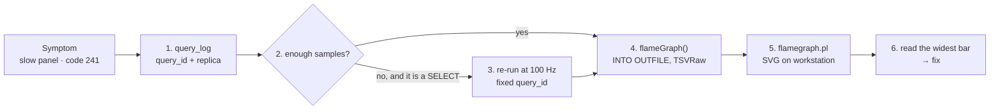

# Slow query or memory failure → flame graph

| | |
|---|---|
| **Type** | Investigation workflow, not a per-alert runbook |
| **Entry points** | A Grafana panel on the ClickHouse datasource that is slow or times out · a query failing with `MEMORY_LIMIT_EXCEEDED` (code 241) · [`ClickHouseInsertsFailing`](ClickHouseInsertsFailing.md) with code 241 · someone saying "dashboard chậm" |
| **Signals used** | `system.query_log` (which query, how long, how much memory) · `system.trace_log` (where its threads spent CPU, time and memory) |
| **Window** | 7 days for `trace_log` and 30 days for `query_log`, **per replica**: neither table is replicated |
| **Output** | A folded-stack file and an SVG flame graph, made on your workstation; nothing is written to the cluster except one temporary file under `/tmp` in the pod |
| **Concepts** | [Profiling ClickHouse](../../clickhouse/profiling.md) explains what the profiler records and what the knobs cost |
| **Verified** | Every command, Kind, 2026-10-29, ClickHouse 26.10.3.7 |

## What problem this solves

`system.query_log` tells you **that** a query was slow or ran out of memory.
`system.trace_log` tells you **where**: ClickHouse samples every query thread
once a second (CPU and wall-clock time) and records the call stack each time a
thread allocates another 4 MiB. A flame graph draws those stacks side by side,
so the widest bar is where the time or the memory went.

The data is already there for every query of the last seven days. This
workflow finds the query, checks it has enough samples, exports them, draws
them, and maps the picture to a fix.



## Before you start

- **Pick the client pattern.** Use the
  [secure client pattern](../../clickhouse/operations.md#secure-client-pattern):
  an interactive `clickhouse-client` inside one replica, password typed at the
  prompt. Never put the password on a command line. That is also why step 4
  writes to a file **inside the pod**: `--ask-password` needs a terminal, so
  the output cannot be redirected to your machine directly.

  ```bash
  CH_USER="$(kubectl -n monitoring get secret clickhouse-credentials \
    -o jsonpath='{.data.username}' | base64 -d)"
  POD=chi-clickhouse-otel-0-0-0     # changed in step 1 if needed
  kubectl -n monitoring exec -it "$POD" -c clickhouse -- \
    clickhouse-client --user="$CH_USER" --ask-password
  ```

- **Get `flamegraph.pl` on your workstation.** It is one Perl script from
  Brendan Gregg's FlameGraph repository; `git clone` the repository once.
- **Know the rule for this whole workflow.** Every query below reads only
  `system.*`. The one exception is step 3, which re-runs a `SELECT`. Never
  re-run an `INSERT`, `ALTER` or DDL statement to profile it.

## 1. Find the query and the replica it ran on

`query_log` is per replica, and the `clickhouse-clickhouse` Service sends each
query to any of the three. Run this on each replica until you find the query
(replicas `0-0-0`, `0-1-0`, `0-2-0`):

```sql
-- Slow SELECTs in the last 2 hours on this replica
SELECT event_time, query_id, user,
       query_duration_ms AS ms,
       formatReadableSize(memory_usage) AS mem,
       read_rows,
       substring(normalizeQuery(query), 1, 70) AS q
FROM system.query_log
WHERE type = 'QueryFinish'
  AND query_kind = 'Select'
  AND event_time > now() - INTERVAL 2 HOUR
ORDER BY query_duration_ms DESC
LIMIT 10;
```

For a memory failure, look for the failed run instead:

```sql
SELECT event_time, query_id, user, exception_code,
       substring(exception, 1, 120) AS error
FROM system.query_log
WHERE type IN ('ExceptionBeforeStart', 'ExceptionWhileProcessing')
  AND exception_code = 241
  AND event_time > now() - INTERVAL 1 DAY
ORDER BY event_time DESC
LIMIT 10;
```

Write down the `query_id` and the pod. Grafana queries run as `default`. The
other users (`pg_stat_ch`, `analytics_ingest`, `analytics_reader`) are the
pg_stat_ch export, the PeerDB sink and analytics-service.

`read_rows` is the first clue. On 2026-10-29, a `GROUP BY` over the whole of
`otel_logs` read 7 040 120 rows in 29 239 ms, while the next-slowest queries
read fewer than 300.

## 2. Check there are enough samples

```sql
SELECT trace_type, count() AS samples, uniqExact(thread_id) AS threads
FROM system.trace_log
WHERE query_id = '<query_id>'
  AND event_date >= today() - 1      -- widen to cover the query's date
GROUP BY trace_type;
```

| Result | Meaning | Next |
|---|---|---|
| No rows | Wrong replica, or the query ran more than 7 days ago | Repeat step 1 on the other replicas |
| Under ~20 `CPU` samples | At the default 1 Hz a 2-second query leaves about 2 samples per thread: too coarse | Step 3 |
| Hundreds or more | Enough | Step 4 |
| Only `Memory`/`MemoryPeak` rows | Normal for a memory investigation | Step 4, memory variant |

Compare `Real` with `CPU` now; it already says something. `Real` counts a
thread whether it works or waits, `CPU` only while it computes. For the query
above: `Real` 5 753, `CPU` 1 664 over 19 threads, so the threads spent about
70 % of their time waiting, mostly on reading from disk.

## 3. Re-run a SELECT at 100 Hz (only if step 2 was thin)

Copy the query text from `query_log` (`SELECT query FROM system.query_log
WHERE query_id = '<query_id>' LIMIT 1`), replace the Grafana macros with real
values, and run it once with a fixed id and 100 Hz sampling:

```bash
kubectl -n monitoring exec -it "$POD" -c clickhouse -- \
  clickhouse-client --user="$CH_USER" --ask-password \
  --query_id=flame-1 --format=Null -q "
  <the SELECT>
  SETTINGS query_profiler_cpu_time_period_ns = 10000000,
           query_profiler_real_time_period_ns = 10000000"
```

Then, in the interactive client, run `SYSTEM FLUSH LOGS` so the samples are
queryable, and use `flame-1` as the `query_id` below. Sampling at 100 Hz writes
about 100 times the rows for this one query only. It is fine once; do not
leave it in a profile.

## 4. Export the folded stacks

In the interactive client on that pod. The settings are per query, and nothing
changes for other clients:

```sql
-- CPU: where the query computed
SELECT arrayJoin(flameGraph(arrayReverse(symbols)))
FROM system.trace_log
WHERE trace_type = 'CPU'
  AND query_id = '<query_id>'
  AND event_date >= today() - 1
INTO OUTFILE '/tmp/flame.cpu.folded' TRUNCATE
FORMAT TSVRaw
SETTINGS allow_introspection_functions = 1;
```

| Variant | Change |
|---|---|
| Waiting included | `trace_type = 'Real'`, file `/tmp/flame.real.folded` |
| Memory of one query | `trace_type = 'Memory'`, `flameGraph(arrayReverse(symbols), size)`, file `/tmp/flame.mem.folded` |
| Memory of the whole server (merges, inserts) | `trace_type = 'Memory'`, the `size` argument, drop `query_id`, add `AND event_time > now() - INTERVAL 2 MINUTE`; widen only after this renders |

Three details matter:
- `allow_introspection_functions = 1` is required. Without it, `flameGraph()`
  fails with code 446 `FUNCTION_NOT_ALLOWED`.
- `FORMAT TSVRaw` is required. Plain `TSV` escapes the `'` in C++ names such
  as `'lambda'` to `\'`, which splits one frame into two different labels.
- `arrayReverse` puts the root at the bottom. ClickHouse stores stacks leaf
  first.

Copy the file to your workstation and remove it from the pod:

```bash
kubectl -n monitoring exec "$POD" -c clickhouse -- cat /tmp/flame.cpu.folded > flame.cpu.folded
kubectl -n monitoring exec "$POD" -c clickhouse -- rm -f /tmp/flame.cpu.folded
wc -l flame.cpu.folded      # one line per distinct stack: "frame;frame;frame <count>"
```

## 5. Draw it

```bash
./FlameGraph/flamegraph.pl --title 'flame-1 CPU' flame.cpu.folded > flame-1-cpu.svg
# memory: bar width is bytes
./FlameGraph/flamegraph.pl --countname=bytes --colors=mem \
  --title 'flame-1 memory' flame.mem.folded > flame-1-mem.svg
```

Open the SVG in a browser. Hovering a bar shows its full name and share, and
clicking zooms into it.

## 6. Read it and act

Read from the bottom up. The bottom is the thread entry point; each bar above
is a function called by the one below it. **Width is the share of samples**,
and the left-to-right order means nothing (it is alphabetical). Look for the
widest bar that is still specific, usually two to six levels under
`DB::PipelineExecutor`.

| Widest specific bar | What the query is doing | First fix on this platform |
|---|---|---|
| `MergeTreeReaderWide::readSegmentFromDisk` → `CompressionCodecZSTD` / `ZSTD_decompress…` | Reading and decompressing columns. **IO and decompression bound.** On 2026-10-29 this was almost all of the `otel_logs` query above | Read fewer rows and columns: see the table below |
| `MergeTreeRangeReader`, `MergeTreeSelectProcessor` with many granules | Scanning instead of skipping: the filter does not match the sorting key or an index | Filter on the sorting key (below); `EXPLAIN indexes = 1 <query>` shows granules read vs total |
| `DB::Aggregator`, `AggregatingTransform` | The `GROUP BY` itself: many distinct keys or heavy aggregate functions | Fewer or coarser keys; `uniq` instead of `uniqExact`; pre-aggregate over a shorter window |
| `HashJoin`, `JoinedTables` | A join building a large hash table | Put the smaller table on the right; filter both sides first |
| `MergeSortingTransform`, `SortingTransform` | `ORDER BY` over many rows | `LIMIT` with an `ORDER BY` that follows the sorting key, or sort fewer rows |
| `ReadBufferFromS3`, S3 frames, wide in `Real` but narrow in `CPU` | Reading parts from the RustFS cold tier | Keep the time range inside the hot window, or accept the cost for historical queries |
| `MemoryTracker::allocImpl` under any of the above (memory graph) | That operator holds the memory | The same fix as its row; for a one-off, add `SETTINGS max_bytes_before_external_group_by = …` to spill to disk |

### Fixes that match the `otel` schema

| Table | Sorting key | Filter that skips data |
|---|---|---|
| `otel_logs` | `toStartOfFiveMinutes(Timestamp), ServiceName, Timestamp` | A `Timestamp` range always; then `ServiceName`. Text indexes on `Body` (lower-case), `TraceId` and attribute keys and values |
| `otel_traces` | `ServiceName, SpanName, toDateTime(Timestamp)` | `ServiceName` and `SpanName` first, then time. Bloom filters on `TraceId` and the attribute maps |
| `otel_traces_trace_id_ts` | `TraceId, Start` | Look up a trace's time range here first, then read `otel_traces` for that range only |

The cheapest wins, in order:
1. **Bound the time range.** Use Grafana's `$__timeFilter(Timestamp)`.
   Partitions are daily, so a range prunes whole days.
2. **Do not read columns you do not need.** `Body` is 200 MiB of the 281 MiB
   compressed `otel_logs` (2026-10-29). Two `GROUP BY ServiceName` queries
   measured that day: with `max(length(Body))`, 7.0 M rows, 2.04 GiB read,
   29.2 s. Without `Body`, 8.8 M rows, 75.6 MiB read, 6.3 s.
3. **Filter on the sorting key prefix** (table above) before other columns.
4. **Use the index the table has** instead of `LIKE '%…%'` on unindexed text.

## Verify the fix

Run the changed query, then compare the two runs in `query_log` on the same
replica:

```sql
SELECT query_id, query_duration_ms, read_rows,
       formatReadableSize(read_bytes) AS read,
       formatReadableSize(memory_usage) AS mem
FROM system.query_log
WHERE type = 'QueryFinish'
  AND query_id IN ('<old_query_id>', '<new_query_id>');
```

`read_rows` and `read_bytes` should drop first; duration follows. Draw the new
flame graph if the widest bar has not changed.

## Escalation & related

- When the server itself is out of memory (many queries failing with 241,
  merges failing), this is not one query: follow
  [Merge memory pressure](README.md#merge-memory-pressure) and the
  [`ClickHouseInsertsFailing`](ClickHouseInsertsFailing.md) code table.
- A query that is slow on one replica only points at that replica (disk, a
  stuck merge, replication): check
  [`ClickHouseReplicationLag`](ClickHouseReplicationLag.md) and the
  [health ladder](../../clickhouse/operations.md#health-ladder).
- Background: [Profiling ClickHouse](../../clickhouse/profiling.md) covers the
  sample sources, symbolization and the cost of each knob, and
  [Query pipeline](../../clickhouse/internals/02-query-pipeline.md) covers how a
  query becomes the operators in the graph.
