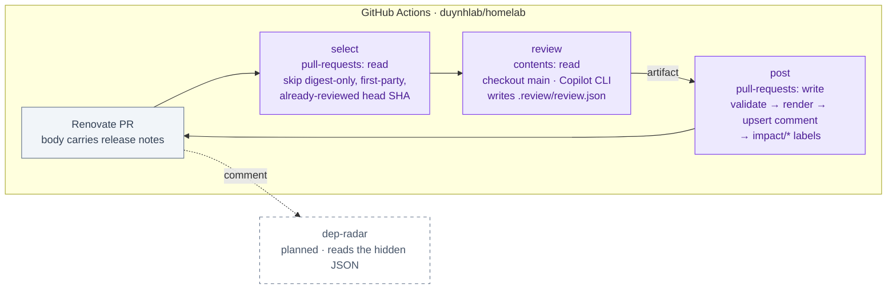

# Dependency review (AI-read release notes for Renovate PRs)

Every Renovate pull request in this repository gets one structured review
comment: what changed upstream, which of it matters for the way this
repository uses the dependency, and what to verify before merging. The review
is produced by GitHub Copilot CLI running headless in a GitHub Actions job,
validated against a JSON schema, and mirrored by the `dep-radar` site. It
replaces the hand-written compatibility audits such as issue #1262.

| | |
|---|---|
| **Workflow** | [`.github/workflows/dependency-review.yml`](../../.github/workflows/dependency-review.yml) — `pull_request` from `renovate[bot]` and `workflow_dispatch` |
| **Prompt** | [`.github/dependency-review/prompt.md`](../../.github/dependency-review/prompt.md), `PROMPT_VERSION` 1 |
| **Contract** | [`.github/dependency-review/schema.json`](../../.github/dependency-review/schema.json) — one JSON document per review |
| **Record** | A PR comment whose first line is `<!-- dep-radar:v1 {json} -->`; one per PR, replaced on every push |
| **Labels** | `impact/none` · `impact/minor` · `impact/breaking` · `ai/needs-verification` (declared in `.github/labels.yaml`) |
| **AI runtime** | Copilot CLI (`@github/copilot`), authenticated with the `COPILOT_PAT` secret (fine-grained PAT, *Copilot Requests* only) |
| **Rules** | [Review rules](#review-rules) below — owner-authored, the prompt treats them as authoritative |
| **Write side** | Comment and labels only. **Nothing merges automatically.** `pull_request` events run in dry-run until `PULL_REQUEST_DRY_RUN` is flipped |
| **Mirror** | `dep-radar` (planned) reads the hidden JSON from the comments and renders the inbox |

---

## Overview

Renovate already fetches the release notes between the pinned and the proposed
version into the PR body (`fetchChangeLogs: pr`, the default). What it cannot
do is read them against this repository: whether the removed Helm value is one
we set, whether the changed default touches a dashboard, whether the chart bump
also moves an embedded image. A maintainer did that by hand for 58 PRs in
#1262 and the result was a table with four columns that this workflow now
produces per PR:

| #1262 column | Review field |
|---|---|
| Review decision (`Safe (static)` / `Hold: <reason>`) | `verdict`, `hold_reason`, `impact` |
| Affected surface / changed files | `affected_files[]` |
| Findings | `breaking[]` with `relevant` and `why`, `features[]` |
| Changes or verification needed | `verification[]` |
| Upstream evidence | `evidence[]` |
| Rollout relationships | `related_prs[]` |

The review is commentary. It does not replace reading the notes for a major
bump, and it never claims a running system was tested: a `safe-static` verdict
lists the static checks it covered and nothing more.

## Architecture

The three jobs exist because release notes are third-party text that the AI
reads with `--allow-all-tools`. The job that runs the AI has `contents: read`,
checks out `main` (never the PR branch), carries a token with no repository
write scope, and is denied `gh pr`, `gh api`, `gh issue`, `git push`, `curl`
and `wget`. The only artifact it can produce is `review.json`. The `post` job
is the only one with `pull-requests: write`; it runs no AI and refuses any file
that fails the schema or the invariants in `post.mjs`.

### What the prompt does

1. Reads the [review rules](#review-rules) and `.renovaterc.json5` (pins, holds, groups).
2. Parses the Renovate table: dependency, manager, update type, `from → to`,
   whether the body was truncated.
3. Reads every intermediate version's notes and lists breaking changes,
   renamed or removed configuration, changed defaults, migrations, RBAC and
   subchart jumps.
4. Greps `main` for the dependency across `kubernetes/`, `local-stack/`,
   `terraform/`, `scripts/`, `docs/` and marks each finding `relevant` only
   when a file it found actually sets or relies on the changed thing.
5. Pairs the PR with open siblings (chart ↔ image, same family, ordering).
6. Decides `verdict`, `impact` and a verification checklist, then writes the
   JSON. Phase details and the exact enums are in the prompt and the schema.

### Verdict and impact vocabulary

| `verdict` | Meaning |
|---|---|
| `safe-static` | No relevant breaking item; the files read keep working as configured. The static checks are listed in `verification[]`. |
| `safe-for-repo-use` | A relevant change exists, but this repository does not exercise it (feature off, mode unused); the summary names the file that proves it. |
| `hold` | Something relevant cannot be settled by reading. `hold_reason` names the family (the #1262 vocabulary): behavior/migration verification, hidden dependency or version alignment, secret-output validation, image-level bootstrap proof, existing-state migration proof, telemetry behavior verification, persistent-state migration or rollback, query behavior and operations docs, confirmed repo breaking change, other. |

| `impact` | Meaning | Label |
|---|---|---|
| `none` | No breaking item is relevant | `impact/none` |
| `minor` | Relevant but additive or config-compatible; nothing to edit here | `impact/minor` |
| `breaking` | A relevant item needs a change, a migration or a coordinated rollout | `impact/breaking` |

A `hold` verdict adds `ai/needs-verification`. Labels are the AI's output, so
they are not declared in `.renovaterc.json5` (Renovate would re-assert its own
label set on every rebase).

## Operations

### Secrets and variables

| Name | Kind | Scope |
|---|---|---|
| `COPILOT_PAT` | repository secret | Fine-grained PAT for the account that holds the Copilot subscription. Permissions: **Copilot Requests** plus public-repository read. No `contents` or `pull-requests` write. Rotate on a calendar reminder. |
| `DEPENDENCY_REVIEW_MODEL` | repository variable, optional | Passed as `--model`; leave unset for the CLI default. |

### Running it

- **Automatic:** every `opened`, `synchronize` and `reopened` event on a PR
  authored by `renovate[bot]`. A push mid-review cancels the stale run
  (`cancel-in-progress`). While `PULL_REQUEST_DRY_RUN` is `"true"` in the
  workflow `env`, these runs print the comment in the job log and post nothing.
- **Backfill:** Actions → *Dependency review* → *Run workflow* with
  `pr=all`, `max=10`, `dry_run=false`. Repeat until the log reports
  `selected 0`. `force=true` re-reviews a head SHA that already has a comment
  (for example after a prompt change).
- **One PR:** the same dispatch with `pr=<number>`.

The `select` job explains every skip in its log: first-party images
(`ghcr.io/duynhlab/*` have their own changelog and CI), digest-only bumps
(nothing to read), and PRs whose current head SHA already carries a review.

### Reading a review

The comment is the record; the hidden JSON on its first line is what
`dep-radar` and any script should parse. Everything below it is rendered from
that JSON by `post.mjs`:

- **Verdict / Impact** line, the reviewed head SHA, prompt version and model.
- **Relevant changes** with a one-clause reason and an upstream link; changes
  found not relevant are folded under a disclosure so the reasoning stays
  auditable.
- **Affected in this repository**: files on `main` with their role.
- **Verify before merge**: a checklist tagged `static`, `runtime` or `docs`.
  The site is read-only; tick it in your head or in the PR.
- **Lands with**: sibling PRs and the relationship (`chart-of`, `image-of`,
  `must-land-together`, `order-after`, `same-family`).

### When it is wrong

- A false positive that repeats across reviews belongs in the
  [review rules](#review-rules), not in a comment reply. The next run reads
  the rules; comment replies are never read.
- A wrong verdict on one PR: fix nothing, merge or hold on your own judgement.
  The review is commentary.
- A failed `review` job (red run, artifact present, no comment): open the
  artifact, read `copilot.stderr` and the validator output. The usual causes
  are an expired `COPILOT_PAT` (startup auth error), a model that ignored the
  schema twice (the validator output is in the step log), or a PR body with
  no release-notes table.
- Quota: each reviewed PR is one Copilot session, plus one more when the
  validator asks for a fix. Backfills are capped by `max`.

### Changing the prompt or the schema

Bump `PROMPT_VERSION` in the prompt when the questions change, and
`schema_version` only when the JSON shape changes incompatibly (dep-radar
parses by version). `post.mjs` reads `schema.json` at run time, so a schema
change needs no code change unless it adds a construct the small validator
does not know (`type`, `enum`, `const`, `required`, `properties`,
`additionalProperties`, `items`, `pattern`, `minLength`, `maxLength`,
`minimum`, `format: uri|date-time`).

## Review rules

The prompt reads this section as authoritative on every run and never edits
it. Keep entries short and dated when they come from an incident or an audit;
link the owning ADR/RFC instead of restating its reasoning.

### Pinned by decision

- `grafana/tempo` stays `<3` — Tempo 3.0 removed the `ingester` and
  `compactor` modules; the raw install is scheduled for deletion by ADR-040
  phase 2. Treat any Tempo 3.x note as not applicable until that phase lands.
- `kindest/node` takes patch and digest bumps only — a Kubernetes minor is a
  cluster recreation with its own gate (RFC-0032).
- `grafana/clickhouse-datasource`, `VictoriaMetrics/victoriametrics-datasource`
  and `VictoriaMetrics/victorialogs-datasource` move with their dashboard URL
  or `GrafanaDatasource` pin in one grouped PR; a review of one must list the
  paired file as `affected_files`.

### Known false positives

- A Helm chart bump that leaves `image:`/`tag:` pinned in `values:` is not a
  runtime upgrade of that component; review the chart templates, not the
  component's release notes, unless the chart also moves `appVersion` into use.
- A `local-stack/compose.yaml` pin and a cluster manifest pin are separate
  consumers. Reviewing a compose bump must not claim the cluster upgraded, and
  vice versa.
- `values.schema.json`-style strictness notes from upstream only matter when
  the chart's own `values.schema.json` is present and `additionalProperties`
  is `false` for the keys this repository sets.
- Renovate's `[!NOTE]` truncation banner is about the PR body, not the
  upstream release; mark `notes_truncated` and say what was not visible.

### Always verify

- **Keycloak** (`quay.io/keycloak/keycloak`): refresh-token expiry and reuse,
  PKCE login, logout, audience and role claims, the `duynhlab-staff` realm,
  OpenBAO and Flux web SSO. Database backup before the upgrade; rollback must
  account for schema changes (#1262, #1256).
- **External Secrets** (`external-secrets` chart): typed Secret outputs and
  templated payloads under the new pre-write validation; CRD upgrade with
  `CreateReplace`; OpenBAO store reconciliation and webhook readiness (#1252).
- **OpenTelemetry Collector contrib** (`otel/opentelemetry-collector-contrib`):
  Prometheus label sanitization defaults against the recording rules and RED
  dashboards; `logs_insert.sql` / `traces_insert.sql` templates (#1239).
- **Floci** (`floci/floci`): the KMS envelope format and legacy ciphertext
  decryption; OpenBAO auto-unseal after restart; a coordinated restore
  rollback, never a re-initialised CMK (#1225).
- **VictoriaTraces** (`victoriametrics/victoria-traces`): UI changes and the
  recent-data latency offset against the tracing guide; POST-only maintenance
  endpoints (#1222).
- **Flux bootstrap module** (`flux-operator-bootstrap/kubernetes`): run the
  drift plan against existing state (`make tf-plan`) and confirm no namespace
  or bootstrap Job replacement before applying (#1240).
- **Pyroscope chart**: the chart carries Alloy and config-reloader subcharts;
  a chart bump can jump Alloy several minors while the server image stays
  pinned (#1254).
- **Weaver** (`otel/weaver`): `make e2e-conformance` depends on the `/stop`
  and `/report` HTTP contract (#1219).

### Family map (PRs that travel together)

- VictoriaMetrics: `victoria-metrics` → `vmagent` → `vmalert` (backend first;
  compose pins only, the cluster runs the operator stack).
- Envoy Gateway: `docker.io/envoyproxy/gateway-helm` (chart) and
  `envoyproxy/gateway` (image) land as one reviewed version.
- Vector: `vector` chart and `timberio/vector` compose image use different
  variants of the same version family.
- Temporal: `temporalio/admin-tools` → `temporalio/server`, then `temporalio/ui`.
- OpenBAO: `openbao` chart patches the server; `openbao/openbao` CLI image does not.
- Pyroscope: `pyroscope` chart and `grafana/pyroscope` image; RustFS likewise
  (`rustfs` chart and `rustfs/rustfs` image).
- Grafana: `grafana/grafana` with the datasource plugin pins only when a
  plugin's minimum Grafana version moves.

### Vocabulary the reviewer must keep

- "Safe (static)" means no incompatible use was found in the files read and
  the listed static checks passed. It never means the upstream release has no
  breaking changes, or that a running cluster was tested.
- "Hold" distinguishes missing evidence from a confirmed incompatibility; only
  `confirmed-repo-breaking-change` asserts the latter.

## References

- [`cicd.md` § Supply-chain automation](cicd.md#9-supply-chain-automation) — where Renovate and Dependabot split
- [`.renovaterc.json5`](../../.renovaterc.json5) — managers, custom regex managers, pins and holds with their reasons
- Issue #1262 — the manual audit this workflow replaces; its held rows seeded the rules above
- GitHub Copilot CLI documentation (programmatic mode, tool permissions, PAT authentication)
