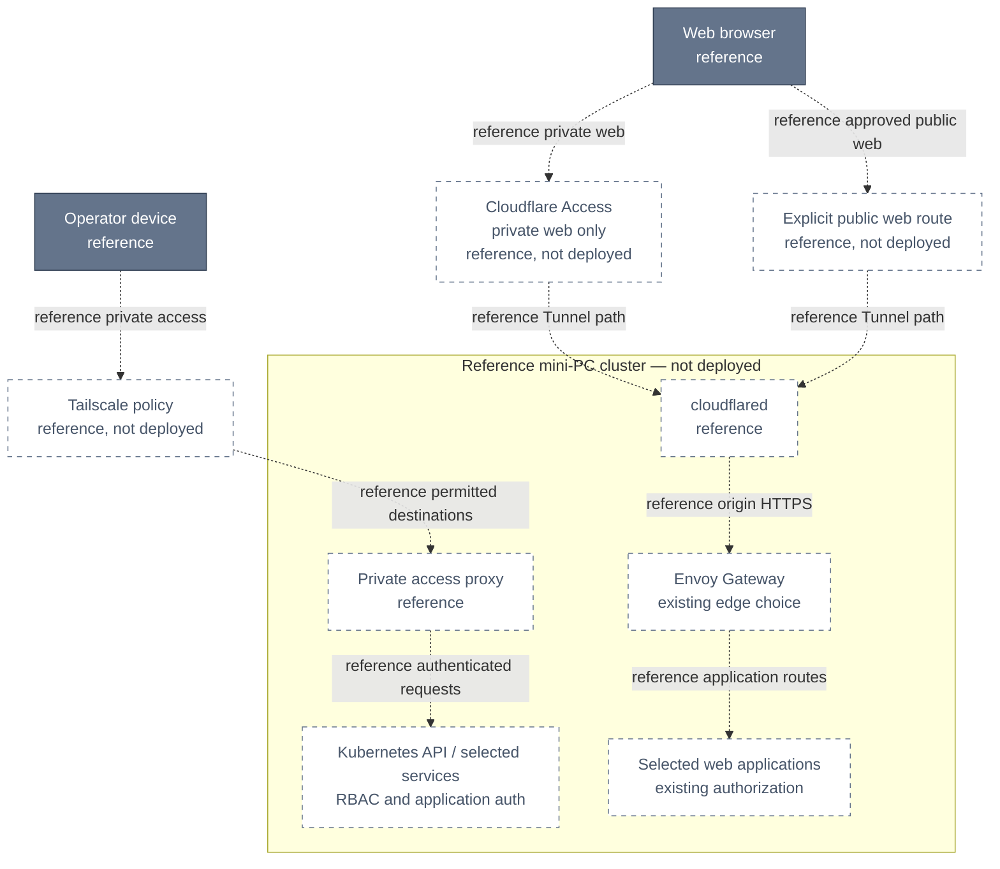

# ADR-087: Separate Private Administration from Published Web Access

> **Decision summary:** We propose Tailscale for private administration and
> Cloudflare Tunnel + Access for selected browser applications, with Envoy Gateway
> remaining the platform edge. We accept two access-policy surfaces in exchange
> for private management protocols and browser access without a VPN client.

| Attribute | Value |
|-----------|-------|
| **Status** | Proposed |
| **Decision date** | — |
| **Owners** | `duynhne` |
| **Deciders** | `duynhne` |
| **Scope** | Remote-access boundaries for the proposed mini-PC homelab |
| **Affected components** | Tailscale connectivity, Cloudflare Tunnel/Access, Envoy Gateway and selected web tools |
| **Related RFC** | [RFC-0011](../../rfc/RFC-0011/) — provisional hardware migration |
| **Related research** | —; existing RFC-0011 predates the research-first workflow |
| **Supersedes** | — |
| **Superseded by** | — |
| **Implementation tracking** | [RFC-0011 rollout gates](../../rfc/RFC-0011/#rollout-and-rollback-gates) |
| **Adoption** | Not started |

## Context

RFC-0011 previously treated Tailscale and public exposure as an either/or choice.
The needs are different: operators need management protocols, while selected web
users need browser access. The repository already uses Envoy Gateway (ADR-044),
Keycloak browser authentication (ADR-043) and staff-group authorization for infra
tools (ADR-062). Remote access must preserve those boundaries.

Repository review at `eea44b97` on 2026-10-12 found no Tailscale or cloudflared
installation in the Kubernetes declarations. All connector paths below are
**reference architecture, not deployed**. Neither a tunnel nor tailnet membership
alone is application authorization.

## Scope

### In scope

- Separate private management from selected published web routes.
- Define authorization ownership, origin protection and failure behavior.
- Require independent emergency management and access validation before rollout.

### Out of scope

- Hardware, OS, storage, backup technology and OpenBAO unseal selection.
- Replacing Envoy Gateway, Keycloak, application tokens or tool permissions.
- WARP/Gateway Internet filtering, exit-node routing or client VPN coexistence in Phase 1.
- Publishing any concrete hostname or installing connector manifests in this change.

## Decision drivers

| Priority | Driver | Why it matters |
|---------:|--------|----------------|
| 1 | Private management | Kubernetes, host management and data services should not acquire public routes |
| 2 | Existing authorization | Remote transport must not bypass application checks or staff-group permissions |
| 3 | Browser usability | Selected web users should not need to join the tailnet or install WARP |
| 4 | Recovery | Losing Kubernetes, the in-cluster IdP or a connector must not remove local management |

## Decision

We will use Tailscale for private administration and Cloudflare Tunnel for
explicitly selected web applications. Private published applications will require
Cloudflare Access. Published traffic will pass through Envoy Gateway before its
application, preserving the existing routing and authentication owners.

This is a proposal for review, not an accepted rollout. The deployment inventory
must select actual hostnames, subjects, origin routes and credentials before any
publication. Cloudflare One is a product suite; choosing Tunnel and Access does
not imply installing WARP on clients.

### Decision rules

| Rule | Required behavior |
|------|-------------------|
| **Private administration** | Tailnet permissions restrict identities to required destinations/ports; Kubernetes RBAC and application authentication still apply. No public Tunnel routes for Kubernetes API, Talos API or databases |
| **Management route** | The Kubernetes API proxy can provide `kubectl` access. Talos/LAN reachability needs an explicitly configured separate route; do not assume the Operator exposes host management |
| **Web publication** | Only an explicit hostname/path allowlist reaches Envoy. Private web routes require Access; public application routes must be identified separately and retain existing app authentication |
| **Identity ownership** | Access gates entry. Keycloak and applications retain token validation and permissions. Access assertions or email headers must not be substituted for application bearer tokens |
| **Origin protection** | Private Tunnel routes validate Access tokens at cloudflared or the origin; prevent an alternate public origin path from bypassing Access. Preserve Host/SNI and validate origin TLS |
| **Client address** | Review Envoy client-IP/forwarded-header trust and existing admin CIDR policies for both connectors. An internal proxy source IP is not proof that the remote user is trusted; never broaden the CIDR allowlist merely to make a route work |
| **Independent paths** | Access policies do not cover Tailscale traffic. A private route to the same application requires its own tailnet restriction and unchanged application permissions |
| **Failure behavior** | A failed connector or identity check must not broaden access, enable anonymous fallback or publish another route automatically |
| **Recovery** | Direct LAN management and independently stored emergency credentials must work without the in-cluster Operator or Keycloak. Remote rescue needs a separately designed dependency-independent route |
| **Secrets** | Connector credentials and recovery material stay out of plaintext Git; bootstrap and rotation must not depend solely on the unavailable component being restored |
| **Compatibility** | No change to the browser OIDC or service API contracts in ADR-043, Envoy ownership in ADR-044, or staff authorization in ADR-062 |

### Decision view

This reference diagram answers **which boundary admits each kind of remote
request**. Every dotted path is proposed under ADR-087 and is not installed.
It does not represent node networking or a complete identity flow.

Dashed nodes denote the uninstalled reference topology. Envoy and application
authorization are existing platform choices reused in that future topology.
The direct-LAN recovery path is a separate prerequisite, not the proxy above.

## Alternatives considered

| Option | Benefits | Costs / risks | Result |
|--------|----------|---------------|--------|
| Tailscale only | One remote-access policy surface; private endpoints | Every ordinary web user needs tailnet connectivity | Valid simpler alternative if browser sharing is dropped |
| Cloudflare only | One provider for published and private access | Private management requires additional client/routing design; remote paths depend on that provider | Not proposed for this split of users and protocols |
| Tailscale + Tunnel/Access | Private administration plus clientless web access | Two policy surfaces, DNS/TLS coordination and separate revocation checks | Proposed |

### Why the selected option won

The split matches the two access needs without changing application identity or
requiring a browser user to join the administration network.

### Why the closest alternative lost

Tailscale-only is simpler and remains credible. The reason to add Cloudflare is
clientless web access; if no selected application needs that, defer the Tunnel
rather than install it merely because this ADR exists.

## Consequences

### Positive consequences

- Management APIs remain private while selected web applications can be shared.
- Envoy routing and application authorization retain their current owners.
- A tested LAN recovery path avoids dependence on in-cluster SSO for repair.

### Negative consequences and accepted trade-offs

- Operators must maintain and test both tailnet and Access policies.
- Cloudflare publication adds an external availability dependency; Tailscale is
  also an external dependency, not a guaranteed offline management solution.
- A browser may encounter both Access and application login. Federation or
  session simplification must not silently remove application permissions.
- A shared in-cluster IdP or connector host can couple failures across both paths;
  two products do not establish independent disaster recovery by themselves.

### Neutral consequences

- Existing Keycloak groups and application roles remain unchanged.
- No service API, schema or manifests change with this proposed record.

## Implementation obligations

All rows are outstanding and owned by `duynhne`, tracked through RFC-0011 gates.

| Obligation | Completion signal |
|------------|-------------------|
| Inventory | Each selected hostname has public/private classification, user/device subjects, ports, origin target, owner and explicit approval |
| Identity and routing | Access IdP, callback/token/JWKS reachability, Tailscale API proxy mode and RBAC, DNS/Host/SNI and TLS trust are documented and tested; no authentication redirect loop |
| Origin and credentials | Token validation and network restrictions prevent public bypass; scoped credentials, revocation and rotation are tested |
| Emergency management | LAN addresses, credentials and procedure are available independently of the cluster; remote rescue, if needed, has a separate design |
| Operations | Connector health, reachability and authorization-failure monitoring, log retention and outage runbooks exist |
| As-built documentation | After implementation, update platform access/runbooks and link the unchanged canonical identity contracts; record runtime evidence before marking Adoption Complete |

## Validation and compliance

These are future acceptance scenarios, **not tests executed by this docs change**.

| Scenario | Required result |
|----------|-----------------|
| Allowed operator uses `kubectl` | Approved destination reachable; Kubernetes permissions remain limited to intended roles |
| Unapproved tailnet user/device | Management and restricted services denied |
| Allowed browser user opens private web | Access admits the user; application still enforces its own login and permissions |
| User lacks Access permission | Private web denied before application access |
| User has Access but lacks application permission | Application denies the privileged operation |
| Direct/public alternate origin or forged Access assertion | No bypass into a private published route |
| Spoofed forwarded headers / connector source IP | Client-IP handling and admin CIDR rules do not turn an unauthorized remote request into trusted internal access |
| Tailnet route reaches the same tool | Tailnet and application policies apply independently; no assumption that Access protected this route |
| Public application request | Only approved public routes work; protected API operations still require valid application authorization |
| Cloudflare or cloudflared unavailable | Published route fails; no automatic policy bypass. Exercise private management separately and record remaining dependencies |
| Keycloak unavailable | New application login/refresh cannot be assumed to work; existing sessions follow their normal expiry policy. Emergency management does not require Keycloak |
| Operator or cluster unavailable | Operator-hosted proxies may fail; direct LAN/Talos management works using independently stored credentials |
| Account/credential revoked | Both relevant access paths enforce their documented session and revocation behavior |

## Revisit triggers

- All web users can use Tailscale and clientless access is no longer needed.
- A WARP/Gateway requirement introduces competing device routes or DNS ownership.
- New applications need non-HTTP publication or machine authentication.
- Provider outages, identity coupling or policy drift violate accepted access goals.
- Remote recovery is required while the cluster or its network is unavailable.

## References

- [RFC-0011](../../rfc/RFC-0011/)
- [ADR-043 — browser and workload trust](../ADR-043-oidc-browser-workload-trust/)
- [ADR-044 — Envoy Gateway](../ADR-044-envoy-gateway-platform-edge/)
- [ADR-062 — staff authorization](../ADR-062-staff-groups-sso/)
- [Identity contract](../../../api/identity.md)
- [Existing Envoy admin CIDR policies](../../../../kubernetes/infra/configs/envoy-gateway/policies/security-admin-cidr.yaml)
- [Tailscale Kubernetes API proxy](https://tailscale.com/docs/kubernetes-operator/api-server-access)
- [Cloudflare published applications](https://developers.cloudflare.com/cloudflare-one/networks/connectors/cloudflare-tunnel/routing-to-tunnel/)
- [Cloudflare Access and origin token validation](https://developers.cloudflare.com/cloudflare-one/access-controls/applications/http-apps/self-hosted-public-app/)
- [Cloudflare client coexistence with other VPNs](https://developers.cloudflare.com/cloudflare-one/team-and-resources/devices/cloudflare-one-client/deployment/vpn/)

## History

| Date | Status / adoption | Change |
|------|-------------------|--------|
| 2026-10-12 | Proposed / Not started | Separate private administration and selected web access under provisional RFC-0011; no installation |

_Last updated: 2026-10-12_
