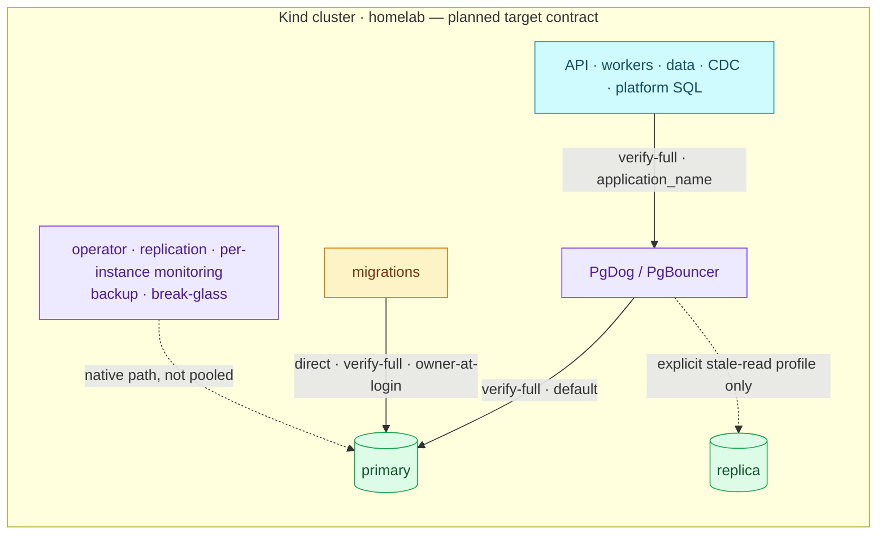

# ADR-089: Define the PostgreSQL Access Contract Between Applications and the Platform

> **Decision summary:** We will give every PostgreSQL consumer one contract:
> migrations connect directly to the primary, application and other SQL
> consumers go through PgDog or PgBouncer to the primary by default, both
> pooled hops verify the server certificate and hostname, every connection
> carries a stable `application_name`, and each role has one password writer
> on a declared cadence. Operator, replication, per-instance monitoring,
> backup and break-glass keep their native paths. We accept TLS issuance and
> reload work, a per-version pooler compatibility matrix and turning off
> PgDog's automatic read split, in exchange for connections that are
> encrypted, attributable and predictable in their consistency.

| Attribute | Value |
|-----------|-------|
| **Status** | Accepted |
| **Decision date** | 2026-10-15 |
| **Owners** | `platform` |
| **Deciders** | `owner (duynhlab)` |
| **Scope** | Every connection to the CNPG clusters `platform-db` and `product-db` |
| **Affected components** | domain ResourceSets and workers (`PGAPPNAME`, endpoints, sslmode), CNPG Pooler `platform-db-pooler-rw`, PgDog `pgdog-product`, certificates (RFC-0020), OpenBAO/ESO credential delivery, local-stack |
| **Related RFC** | [RFC-0029](../../rfc/RFC-0029/) |
| **Related research** | [research.md](../../rfc/RFC-0029/research.md) |
| **Supersedes** | — |
| **Superseded by** | — |
| **Implementation tracking** | [#1283](https://github.com/duynhlab/homelab/issues/1283) (issue type `ADR`; #1269 and #1280 hold the RFC-0029 refactor and close history) |
| **Adoption** | Partial: application `application_name` (2026-10-16), PgDog primary-only (2026-10-16) |

## Context

[ADR-088](../ADR-088-platform-owns-database-authorization/) settled who owns
roles and grants. It did not settle how consumers reach the database. On
`main` (repository review, 2026-10-15):

- Nine of ten services connect with `sslmode=disable`; payment uses `require`
  directly against the primary, without verification.
- No workload sets `application_name`. In query telemetry, platform-db events
  have an empty `app` and product-db events read `PgDog`.
- PgDog sends every `SELECT` outside a transaction to the replicas, so a read
  that follows a committed write can be stale.
- Migrations already connect directly to the primary.

The RFC holds the details: the current baseline, connection matrix, pooler
evidence and naming table.

## Decision drivers

1. A credential or packet in transit is not readable or spoofable inside the cluster.
2. Every query in telemetry names the workload that sent it.
3. A service gets connection details and never discovers primaries or manages pooler internals.
4. Reads are fresh unless a flow opts into staleness.
5. A password change reaches every consumer through one writer, without a competing reconciler.

## Decision

All of it is the target. Today's routes are drawn in the
[RFC](../../rfc/RFC-0029/#architecture--diagrams).

| Topic | Decision |
|---|---|
| Migration | Direct primary (`-rw`), never pooled; the migrator acts as the owner at login (ADR-088); one backend for each advisory-lock lifetime |
| Other consumers | API, workers, data robots, CDC and platform SQL use a compatible pooler profile; payment, Keycloak, Temporal and OpenBAO move from their direct paths through gated cutovers |
| Native paths | CNPG operator, streaming replication, the per-instance exporter, `pg_stat_ch`, Barman and break-glass are not pooled |
| Poolers | Keep PgDog and CNPG PgBouncer; compatibility is verified per deployed version |
| TLS | `verify-full` on client → pooler and pooler → PostgreSQL, and on the direct migration hop; no plaintext or no-verify fallback. CA rotation: trust old and new, reload, switch the certificate, verify, remove the old trust |
| Attribution | `application_name` is required: the workload name (`order`, `order-worker`), `<name>-migrate` for migrations, no environment suffix; delivered as `PGAPPNAME` |
| Consistency | Primary by default; a replica only through an explicit stale-read profile with a declared lag tolerance; PgDog's automatic read split is turned off; no blind replay of an ambiguous write |
| Credentials | Fixed usernames; one writer per password; runtime and data automatic 30 days, migrator and authz manual 30 days, monitoring automatic 90 days, CDC manual 90 days with a monthly review; break-glass rotates after use |

## Alternatives considered

| Option | Benefits | Costs / risks | Result |
|---|---|---|---|
| Migrations through the pooler | One endpoint per service | A transaction pooler moves session advisory locks between backends; DDL would depend on pooler availability | Rejected |
| Monitoring through the pooler | Uniform routing | A pooler reaches one primary and hides the replicas; the exporter already runs inside each instance | Rejected |
| `require` without verification | No certificate work | Encrypts but does not authenticate the server | Rejected |
| Keep PgDog's automatic read split | Offloads reads from the primary | Read-after-write is stale outside a transaction, with no opt-in per flow | Rejected; becomes an explicit profile |
| Replace one of the two poolers | One compatibility matrix | No measured reason to migrate either | Rejected |

## Consequences

### Positive

- A leaked packet or a spoofed endpoint no longer exposes a credential.
- Query telemetry can filter by workload on both clusters.
- Fresh reads are the default and staleness is visible in configuration.

### Negative and accepted trade-offs

- Certificates for each pooler Service, and reload paths for clients and poolers.
- One extra `SET` whenever PgDog hands a backend to a client with a different name.
- The primary carries the read load PgDog moves to replicas today.
- PgDog authenticates by passthrough (ADR-025) instead of a static user list: a wrong password costs `checkout_timeout` (5 s), and each replica accepts the old password until the first login there with the new one.

## Implementation obligations

- Set `PGAPPNAME` per the naming table in the RFC, application workloads first.
- Pooler profiles: a CNPG Pooler `clientTLSSecret` and `server_tls_sslmode: verify-full`; PgDog `tls_verify = verify_full` with its server CA, and no automatic read split.
- Confirm each pooler setting on the deployed version, and again after a pooler bump.
- Set the CA overlap, renewal thresholds and error budget before the first certificate switch.

## Validation and compliance

| Requirement | Verification |
|---|---|
| Attribution | `SHOW application_name` per workload; interleaved clients through each pooler stay correctly labelled in `pg_stat_ch` |
| TLS | Correct CA and hostname pass; a wrong CA, a wrong hostname and plaintext each fail, on every hop |
| Consistency | Read-after-write through the default pool returns the write |
| Rotation | Fresh client and backend authentication after a change, consumer reload, recovery from a mismatch |

## Revisit triggers

- A pooler version drops a capability this contract relies on.
- CDC cannot pass its replication gate through a pooler.
- A measured read load needs replicas by default.

## References

- [RFC-0029](../../rfc/RFC-0029/) — baseline, connection matrix, pooler evidence, naming table, rollout
- [ADR-088](../ADR-088-platform-owns-database-authorization/), [ADR-084](../ADR-084-split-service-database-roles/), [ADR-014](../ADR-014-pooler-credentials-valuesfrom/), [ADR-015](../ADR-015-pg-hba-connection-isolation/), [ADR-025](../ADR-025-pgdog-passthrough-dynamic-db-creds/), [ADR-026](../ADR-026-platform-db-pgbouncer-pilot/)
- [RFC-0020](../../rfc/RFC-0020/) — internal TLS ownership

## History

- 2026-10-15 — Accepted with the RFC-0029 access-contract refactor; adoption not started.
- 2026-10-16 — Partial: application workloads set `application_name` (#1272), and PgDog's automatic read split is off; product-db pools reach the primary only.
- 2026-10-16 — Partial (RFC-0029 product-db wave 2, verified on Kind): payment's runtime leaves its direct path and reaches PgDog over client TLS from `pgdog-product-tls` (`homelab-ca`) with `sslmode=require`, which encrypts but does not verify; its migration stays direct over `hostssl`. Two follow-ups stay open: `verify-full` on that hop, and certificate rotation, which needs a PgDog restart because PgDog reads the files only at start.
- 2026-10-16 — RFC-0029 `Implemented`; this ADR stays Partial. The remaining obligations (verify-full on both poolers, PgDog certificate renewal needs a restart, `passthrough_auth`, rotation delivery gate, replica and CDC profiles, pgroles `application_name`, `substituteFrom`, PgDog restart drain) are tracked in [#1283](https://github.com/duynhlab/homelab/issues/1283).
- 2026-10-17 — Partial: PgDog drains on restart (`preStop` 10 s, grace 75 s) and rolls itself on a certificate renewal (watch label + `tls.crt` pod annotation), verified on Kind; #1283 row 2 done. Row 10 is narrowed, not closed: idle pooled client connections still get `57P01` during a roll (5 of 1993 requests failed closed with 503), and the client-side retry is duynhlab/pkg#124.
- 2026-10-17 — Partial: payment → PgDog is `verify-full`, with the CA from a Certificate on the live `homelab-ca` (`payment-db-ca-trust`) and `PGSSLROOTCERT` on the service container only; verified on Kind (both DNS names connect, the Service IP and a foreign CA are refused, a PgDog renewal keeps payment connected); #1283 row 1 done for payment. PgDog still accepts plaintext until every product-db client speaks TLS; the platform-db PgBouncer hop is next.
- 2026-10-17 — Partial: the four platform-db services reach PgBouncer with `verify-full` (CA from `platform-db-ca-trust` per namespace), PgBouncer serves `platform-db-pooler-tls` through `clientTLSSecret`, refuses plaintext (`client_tls_sslmode: require`) and verifies `platform-db-rw` (`server_tls_sslmode: verify-full`); verified on Kind (wrong host name, foreign CA and plaintext refused; a renewal reloads in place with no roll). #1283 row 1 is done for both pooler client hops; PgDog still accepts plaintext and migrations stay `require`.
- 2026-10-18 — Partial: every product-db client (product, inventory, cart, order, checkout, payment and both workers) reaches PgDog with `verify-full` (CA from `product-db-ca-trust` per namespace), and PgDog sets `tls_client_required`; verified on Kind with `make db-tls` (`scripts/db-tls-check.sh`): on PgDog and PgBouncer the right host and CA reach authentication, the Service IP and the system CA fail the handshake, and plaintext is refused. #1283 row 1 is done for every client → pooler hop; migrations and PgDog → PostgreSQL stay unverified. Keycloak, Temporal and OpenBAO are deferred to [#1296](https://github.com/duynhlab/homelab/issues/1296).
- 2026-10-18 — Partial: both clusters serve a server certificate from `homelab-ca` (`<cluster>-server-tls` through `spec.certificates`), so `migrate`, the seed Job, the authz Jobs and PgDog's upstream (`tls_verify = verify_full`) verify the primary with the `*-db-ca-trust` CA, and every service, migrator and `db_authz` line in `pg_hba` is `hostssl`. Verified on Kind: `make db-tls` 16/16 across PgDog, PgBouncer and both primaries; replication on TLS; a renewal of `product-db-server-tls` was served within about 15 s with no instance restart. #1283 row 1 is done except pgroles (`sslMode: require`, no root-certificate field) and the #1296 clients.
- 2026-10-18 — Partial: PgDog runs chart v0.92 (v0.1.61) with `passthrough_auth = "enabled_allow_change"` and holds no password list (ADR-025; ADR-014 superseded); #1283 row 4 done. Verified on Kind: a rotated `cart_runtime` password was accepted on all three replicas at its first login and the old one refused afterwards, with no PgDog reload or roll; 40/40 good logins succeeded beside 10 concurrent wrong ones; e2e 26/26 after a full PgDog roll. Two properties carry into the rotation phases: a wrong password is refused only after `checkout_timeout` (5 s), and a replica accepts the old password until the first login there with the new one.
- 2026-10-18 — Partial: the DR cluster `product-db-replica` serves a `homelab-ca` certificate and the same `pg_hba` as product-db (guarded by `make validate`), so a promoted replica keeps `verify-full` and connection isolation (#1307).
- 2026-10-19 — Partial: OpenBAO rotates all four platform-db runtime passwords (#1309). Measured on Kind for user, shipping and review: after `rotate-role`, the Secret changed in 8–14 s (ESO refresh 15s) and the mounted file in 19–47 s (kubelet sync); the old password was refused through PgBouncer, no pod restarted, no authentication error was logged, and e2e run across the window passed 26/26 because the pools kept their open connections.
