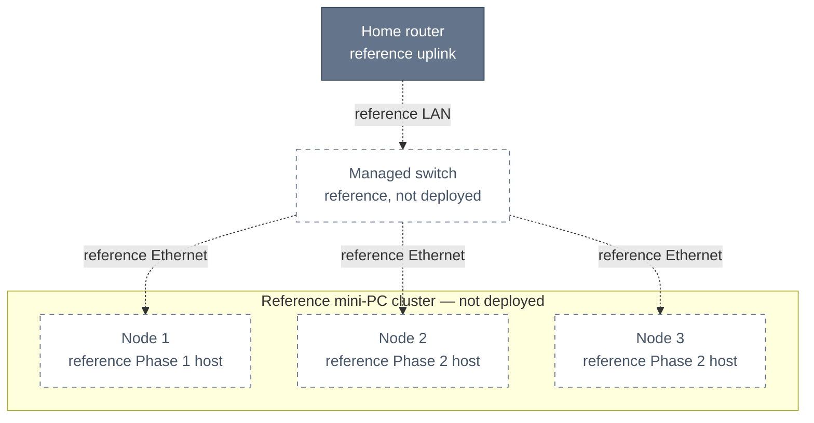

# RFC-0011: Homelab migration — Kind to mini PCs (1 → 3 node HA)

Move the platform onto durable hardware with verified recovery before migrating state.

| Status | Scope | Created | Review evidence |
|--------|-------|---------|-----------------|
| provisional | infra | 2026-07-04 | Repository and official-documentation review, 2026-10-12; no hardware or runtime qualification |

> **Not deployed.** No hardware has been purchased for this proposal. Talos,
> Cilium and Rook-Ceph remain candidates, not approved installations. The access
> direction is recorded in [ADR-087](../../adr/ADR-087-homelab-private-and-web-access/)
> at **Proposed / Not started**. This RFC is not a purchase order or a deployment runbook.

## Summary

Replace the disposable Kind substrate with a persistent mini-PC cluster, starting
with one physical node and evaluating expansion to three physical nodes. Preserve
platform behavior and GitOps ownership while qualifying hardware, storage,
recovery and access. Talos is the leading OS candidate, with Ubuntu + k3s still an
alternative. The proposed access split is Tailscale for private administration and
Cloudflare Tunnel + Access for selected web applications, through Envoy Gateway.

The cost is hardware, electricity and operating physical machines. The benefit is
persistent state and a platform on which to test host failures. One node remains
one failure domain regardless of how many replicas run on it.

## Motivation

Kind is useful for reproducible integration gates, but rebuilding its local state
is not a durable-hardware recovery strategy. This proposal originated in a May
2026 planning discussion about OpenBAO PVC loss and repeated secret bootstrap
(formerly `docs/platform/homelab-migration-plan.md`). That history explains the
problem; it does not describe the current secrets implementation.

### Goals

- Operate a persistent homelab with explicit availability and recovery targets.
- Prove restoration before entrusting the cluster with data that must survive.
- Provide private administration and selected browser access without exposing
  the Kubernetes or Talos management APIs publicly.
- Define a tested migration from one physical failure domain to three.

### Non-Goals

- Buying hardware or approving a final bill of materials in this revision.
- Replacing Envoy Gateway, Keycloak, service authentication or the GitOps model.
- Installing Tailscale, Cloudflare connectors, an OS, a CNI or a storage system.
- Requiring WARP on user devices in Phase 1.
- Reducing existing security controls or replica counts without a separate decision.

## Current repository baseline

Reviewed against `eea44b97` on 2026-10-12. This is a **repository review**, not a live
cluster audit. Historical runtime evidence remains in the linked records.

| Area | Baseline to preserve | Source of truth |
|------|----------------------|-----------------|
| Delivery | Kind, OpenTofu bootstrap, Flux Operator + OCI + Kustomize | [Setup](../../../platform/setup.md), [local Flux graph](../../../../kubernetes/clusters/local/kustomization.yaml) |
| Edge and identity | Envoy Gateway, Keycloak; application authorization remains in its existing owners | [ADR-044](../../adr/ADR-044-envoy-gateway-platform-edge/), [identity contract](../../../api/identity.md) |
| Workloads | 10 service InputProviders, storefront, back-office portal, Temporal and workers | [Service declarations](../../../../kubernetes/apps/services/), [workflow registry](../../../api/workflows.md) |
| Observability | VictoriaMetrics, VictoriaLogs, VictoriaTraces, ClickHouse/Keeper, Grafana, Vector, OTel Collector and Pyroscope | [Observability hub](../../../observability/README.md), [ADR-059](../../adr/ADR-059-retire-tempo/), [ADR-065](../../adr/ADR-065-clickhouse-replicated-topology/) |
| Data | CNPG `platform-db` and `product-db` (three instances each), separate DR configuration, PgDog, Barman backup integration, RustFS and Valkey | [Database architecture](../../../databases/architecture.md), [database declarations](../../../../kubernetes/infra/configs/databases/kustomization.yaml), [storage wave](../../../../kubernetes/clusters/local/storage.yaml) |
| Secrets and trust | OpenBAO Raft, Kind-specific floci auto-unseal, ESO, cert-manager and CA consumers | [Secrets hub](../../../secrets/README.md), [ADR-024](../../adr/ADR-024-floci-kms-emulator-auto-unseal/), [certificate declarations](../../../../kubernetes/infra/configs/cert-manager/) |
| Human authorization | Staff-realm groups mapped to tool permissions | [ADR-062](../../adr/ADR-062-staff-groups-sso/) |

The old Kong, Tempo and eight-service baseline is historical. Do not carry it into
hardware sizing. The repository already contains backup mechanisms; this migration
must qualify their recovery on the new substrate rather than assume there are none.

## Proposal

### Hardware candidate and purchase gate

A used Lenovo ThinkCentre M720q Tiny is a **reference candidate**, not a selected
purchase. Lenovo's M720 Tiny specification lists one M.2 SSD slot, one M.2 WLAN
slot and a 2.5-inch SATA bay. The WLAN slot is not a second supported SSD slot.
The SATA bay and PCIe card are mutually exclusive in the documented layout;
verify the actual SKU and accessories before planning NIC or disk expansion.
The specification lists DDR4-2666 and multiple adapter options (65W/90W/135W),
so the old DDR4-3200 shopping line is not an operating-speed guarantee and a
90W adapter is not a universal requirement. Match memory and power to the SKU.

| Item | Candidate / requirement | Evidence required before purchase |
|------|-------------------------|-----------------------------------|
| Compute | Used M720q-class mini PC; exact model and CPU undecided | Seller SKU, CPU, firmware/virtualization support, thermals and condition |
| Memory | 32GB was the original candidate, not demonstrated capacity | Peak workload, backup and upgrade headroom; supported DIMMs for the exact machine |
| OS and data disks | M.2 NVMe and/or SATA 2.5-inch SSD as supported by the SKU | Separate OS/etcd, workload and OSD allocation; caddy/cable availability, disk health and endurance |
| Network | Managed switch; speed and port count undecided | LAN plan, required VLANs, Ceph/recovery traffic and upgrade options |
| Power | Suitable adapter and a measured UPS decision | Sustained wall power, outage frequency, shutdown integration and vendor runtime curve |

**Historical estimate only:** the May plan budgeted approximately 7.0 million VND
for Phase 1 and 21.2 million VND cumulatively for three nodes. Those figures relied
on an incorrect second-M.2 purchase and unverified sizing. They are not current
quotes or an approved budget. Obtain a fresh BOM after the capacity and disk-layout
gates; do not infer UPS runtime from its VA rating alone.

### Capacity and storage qualification

There is no verified memory or disk budget yet. Replace the old “~21GB, comfortably
fits 32GB” and “no disk pressure for two years” claims with measurements:

| Question | Required evidence |
|----------|-------------------|
| Does the full stack fit? | Rendered resource requests/limits plus measured memory/CPU during representative traffic, backups, restarts and upgrades; include Keycloak, Temporal/workers, ClickHouse/Keeper, RustFS and all services |
| Which bytes belong to which layer? | Disk/partition map for OS, etcd, images, OSDs, PVCs and staging; every allocation counted once |
| Is Ceph appropriate on one node? | Compare its operational cost with local persistent storage and a later migration; qualify the chosen Talos/kernel/CSI versions if Talos is selected |
| What is usable storage? | Actual OSD capacity, replication policy, failure-domain placement, free-space reserve, snapshots and backup staging |
| How does storage expand? | A tested one-to-three-node procedure, including any StorageClass/PVC migration and rebalance behavior |
| What happens to existing object storage? | Decide how Ceph would coexist with RustFS; no implicit replacement or nested replication assumption |

Rook's raw OSD path needs eligible unformatted devices or partitions; an OS
filesystem is not an OSD. Do not count an entire OS disk as available Ceph capacity.
Do not reserve an entire 500GB disk for an OSD and also assign another 50GB on that
same disk to staging. The old **4.5TB raw / 1.5TB usable** estimate is withdrawn
until the actual allocation and replication design are verified.

Keep the existing OpenBAO and ClickHouse decisions as the baseline. A Phase 1
single-replica exception requires its own decision and consequences. Three pods
on one host do not establish physical HA. Retention changes also require explicit
acceptance of which operational evidence will be lost.

### Access direction

[ADR-087](../../adr/ADR-087-homelab-private-and-web-access/) owns the access boundary:

| Use | Proposed path | Deployment prerequisite |
|-----|---------------|-------------------------|
| Kubernetes administration and internal debugging | Tailscale, with explicit tailnet permissions and Kubernetes/application authorization | Select exposed services and API proxy authentication mode; test denied users |
| Talos or LAN administration | Separate private management route or direct LAN access | Select and verify that route; Kubernetes Operator alone does not supply it |
| Selected private web tools | Browser → Cloudflare Access → Tunnel → Envoy Gateway → application | Hostname/identity allowlist, origin protection, working existing application login |
| Explicitly public web applications | Browser → Tunnel → Envoy Gateway → application | Separate publication approval and preserved application authentication |
| Recovery when cluster or SSO is unavailable | Direct LAN management and independently stored emergency credentials | Restore procedure tested without the in-cluster IdP or Operator |

Cloudflare One does not require WARP for the selected browser path. WARP/Gateway
Internet filtering is outside Phase 1. Tool publication, Access IdP, hostnames,
DNS/TLS details, forwarded-header/client-IP trust at Envoy and any external subnet
router remain deployment prerequisites. Existing admin CIDR policies must be
reviewed against connector traffic, not bypassed by treating a proxy IP as a user.
No hostname becomes public because it appears as an example in this proposal.

### Recovery before migration

Before moving data that must be retained, specify the maximum acceptable data loss
(**RPO**) and time to restore service (**RTO**) for each data class, then measure
both in a restore drill. Hardware-specific recovery objectives are not accepted yet. Start from the existing
[database reliability targets](../../../databases/reliability-targets.md) and
record which targets the new substrate can actually meet; do not erase prior
Kind drill evidence or treat it as a hardware result.

| Data class | Required recovery design |
|------------|--------------------------|
| PostgreSQL, including identity and workflow databases | Application-consistent database backup/WAL strategy using the existing CNPG/Barman design as the starting point; restore and verify representative records |
| OpenBAO | Raft snapshot procedure, compatible seal material and offline recovery credentials; demonstrate restored secrets can be read by their consumers |
| RustFS / object data | Inventory buckets and dependent services; recover data and credentials independently of the failed cluster |
| Observability and cache state | Classify retained evidence versus rebuildable state; define ClickHouse and telemetry-store restore or explicitly accepted data loss. Decide cache recovery per workload rather than treating every PVC as equally critical |
| Other persistent volumes | Choose application-consistent backup or documented quiescing; VolSync/Kopia is a candidate, not universal proof of consistency |
| Cluster bootstrap | Recover GitOps access, machine configuration, trust material and secrets needed before OpenBAO/ESO can run |

An off-site store such as R2 remains a candidate. Size it from retained data,
change rate, retention and operations; do not assume a free tier covers recovery.
Keep restoration credentials outside the cluster they restore. Auto-unseal and
bootstrap-secret choices for physical hardware require a separate decision;
ADR-024's Kind emulator is not automatically the durable-hardware answer.

## Alternatives and decision outcome

| Question | Candidates | Current disposition |
|----------|------------|---------------------|
| OS | Talos; Ubuntu + k3s | Talos remains the leading candidate; not approved |
| CNI | Cilium; another policy-enforcing CNI | Cilium is the review preference; qualify networking, required privileges and both allowed/denied traffic before choosing |
| Storage | Ceph from Phase 1; local persistence followed by a deliberate HA migration | Open pending disk layout, capacity and recovery evidence |
| Access | Tailscale-only; Cloudflare-only; split private administration and web access | Split model proposed in ADR-087; not installed |
| Substrate | Keep Kind; migrate to physical nodes | Kind remains the reproducible integration environment; hardware migration awaits gates |

**Decision outcome:** migration is provisional. Only the access direction is
specified for review; the ADR remains Proposed. No hardware, storage, OS or unseal
decision is accepted by this document revision.

## Architecture

This reference topology answers **which physical failure domains a future
three-node cluster would have**. It is not deployed; exact hardware, control-plane
placement and networking are undecided. Access ownership lives in ADR-087's
separate diagram, not in these physical links.

Dashed nodes and labelled dotted links denote uninstalled reference elements.
No disk layout is drawn until the storage allocation is decided.

## Rollout and rollback gates

| Gate | Required result before moving on |
|------|----------------------------------|
| 0 — Design and purchase | Verify SKU/BOM, capacity, OS/CNI/storage choices, power and LAN plan; approve required ADRs |
| 1 — Bootstrap | Bring up a disposable test installation; establish direct management access, trust, admission controls and reproducible Flux bootstrap |
| 2 — Recovery | Accept per-data-class RPO/RTO; restore onto a clean target with independent credentials before migrating retained data |
| 3 — Access and migration | Pass ADR-087 access tests, preserve application auth, plan a write cutover and demonstrate data restoration/rollback |
| 4 — Stable single node | Run representative traffic, backup and upgrade cycles; record resource peaks, disk growth, alerts and measured recovery |
| 5 — Three physical nodes | Validate control-plane/etcd quorum, stable management endpoint, replica placement, storage migration/rebalance and a physical node-loss drill |

Keep Kind's bring-up intact. Shared GitOps does not by itself guarantee that new
storage classes or networking work on Kind. Rollback needs a compatible target,
a tested data restore and a defined write freeze/cutover; restarting `make up`
is not a lossless reversal of writes made on the physical cluster.

## Security, observability and verification

Preserve the Kyverno controller, its configured Audit/Enforce modes, NetworkPolicy
declarations and certificate trust consumers. The current Kind CNI is kindnet,
which does not enforce NetworkPolicy; a policy-enforcing hardware CNI changes
actual connectivity and requires both allow and deny tests. See the
[policy catalog](../../../security/policy-catalog.md) and
[network policy guide](../../../security/network-policies.md).
“No internal mTLS” does not justify removing the CA. Any privileges required by a
new CNI, CSI or connector must use the repository's scoped exception process;
do not weaken global admission policies to make the installation pass.

Before rollout, assign alerts/runbooks for storage health, backup freshness and
restore failures, node resource pressure and remote-access failures. Define
availability expectations for one physical node and shared power/network failures;
three nodes alone do not remove those shared dependencies.

The following are **future acceptance tests, not results from this documentation review**:

- Rebuild a clean target and restore each retained data class; measure RPO/RTO.
- Prove authorized and denied access on both remote paths using ADR-087's matrix.
- With Cloudflare, Keycloak or the Kubernetes Operator unavailable, verify the
  documented failure behavior and independent LAN recovery path.
- Restart the single node after a verified backup, checking storage, secrets and
  Flux convergence. Plan any abrupt-power test separately with recoverable data.
- At three nodes, stop one physical host and verify quorum, workload availability,
  PVC access and recovery against the accepted availability target.

## Open decisions — reviewed 2026-10-12

This review distinguishes existing decisions from recommendations and missing
qualification. **Recommendations are not approvals.** `duynhne` owns closing the
remaining gates. This section replaces the original five-question list rather
than carrying its stale choices forward.

### Original questions

| Original question | Review outcome and recommendation | Evidence / closure condition |
|-------------------|-----------------------------------|------------------------------|
| Talos or Ubuntu + k3s? | **Open; prefer qualifying Talos first.** Its API-managed operation fits the GitOps learning goal. Ubuntu + k3s remains the fallback if required hardware/storage support or recovery is impractical; neither is installed by this RFC | Test install, direct `talosctl` recovery, CNI/CSI prerequisites, upgrade and workload scheduling on the chosen SKU; accept an OS/topology decision before purchase commitment |
| One or three OpenBAO replicas on one host? | **Open exception, not a new default.** ADR-005 remains the three-replica baseline. A single-replica Phase 1 profile is worth evaluating for measured capacity savings, accepting secret-service downtime during restarts; three replicas on one host tolerate some pod failures but not host loss | Measure both profiles, specify outage/recovery behavior and accept a scoped exception before changing replica counts. Keep Raft and native snapshot recovery |
| SOPS + age or a local secrets file? | **Open; prefer a minimal encrypted bootstrap bundle**, with offline recovery of the decryption material; keep application secrets in OpenBAO + ESO. SOPS + age is a candidate, not an existing integration. A local file alone is not a recovery plan | Inventory the credentials needed before OpenBAO/ESO and Flux can start; prove clean bootstrap from an independently recoverable copy. Do not put the only key in the failed cluster or one laptop |
| Tailscale-only or add cloudflared? | **Reviewed into ADR-087 Proposed.** Use private administration plus selected web access when clientless sharing is required; a Tunnel does not mean every app is public | Accept ADR-087 and close its hostname, identity, origin and recovery obligations before enabling routes; no WARP requirement |
| Keep MCP servers or drop them? | **Resolved for the baseline: keep disabled.** The local Flux list already disables `mcp-local` because these servers were unused and consumed idle memory | [Local kustomization](../../../../kubernetes/clusters/local/kustomization.yaml) is the evidence. Re-enable only for a concrete consumer with measured resource cost; no hardware-specific change needed now |

### Additional gates uncovered by the review

| Topic | Recommendation and rationale | What closes the gate |
|-------|------------------------------|----------------------|
| Hardware and budget | Treat M720q as one candidate; do not buy from the old BOM or reduce RAM merely to match its price | Correct SKU/disk compatibility, measured capacity and current quotes; approved budget including power/network accessories |
| Control plane and CNI | Evaluate one schedulable control-plane node initially and three physical control-plane nodes for HA; prefer a policy-enforcing CNI such as Cilium | Pin compatible versions, define the stable API endpoint, prove bootstrap/upgrade, scheduling, policy enforcement and one-to-three-node migration |
| Ceph timing and disk layout | Compare dedicated-data-disk Ceph with local persistence plus an explicit later migration. **Do not select Ceph solely to obtain snapshots**, and do not count replication on one host as HA | Eligible disk map, current RustFS relationship, CSI backup compatibility, steady/peak resource measurements and accepted migration procedure |
| Database and ClickHouse footprint | Preserve the CNPG/Barman and ADR-065 baseline while measuring; no silent conversion to single replicas to fit a 32GB target | Application/database load and maintenance measurements. Any intentional replica reduction needs its own decision, data migration and restore evidence |
| Physical-hardware unseal | Prefer evaluating a durable external KMS for unattended restart, consistent with RFC-0008. Keep manually operated Shamir as an alternative if external dependency/cost is unacceptable; do not promote floci by default | Choose provider/authentication or manual ceremony, credential custody, outage behavior and full restore with the original seal material. Recovery keys alone cannot replace an unavailable auto-unseal key |
| Backup destination and retention | Retain application-native recovery mechanisms; evaluate R2 as an off-site destination. VolSync/Kopia may complement them for suitable PVCs | Inventory data, independent credentials, retention/cost, accepted RPO/RTO and clean-target restore; losing local RustFS must not also lose the only recovery copy |
| UPS and power | Evaluate protection in Phase 1 rather than assuming an immutable OS makes power loss harmless | Measure load and acceptable downtime; select a compatible UPS/shutdown procedure or explicitly accept the power-loss risk |
| Upgrade automation and optional services | Start with documented manual upgrades. Defer automatic OS upgrades, self-hosted CI and an image mirror until their benefit is demonstrated | Upgrade/rollback rehearsal first; add a component only for a measured need and sufficient capacity |

### Existing decisions that are not reopened

- **Envoy Gateway is the current edge**, replacing Kong under ADR-044. There is
  no gateway selection left for this migration.
- **Keycloak and application authorization remain authoritative** under ADR-043
  and ADR-062. Access is an additional entry policy, not a replacement IdP decision.
- **CA consumers remain supported.** Gateway and OIDC-related certificate
  declarations exist; review certificate issuers/renewal for hardware rather than
  deleting trust-manager because internal mTLS is not yet universal.
- **Kyverno remains installed.** Keeping policy YAML without its controller does
  not retain audit behavior. New component privileges need scoped exceptions.

### Inherited recovery obligations

[RFC-0007](../RFC-0007/) already records successful Kind drills and assigns ongoing
cadence. Durable hardware must activate the deferred DR promotion and platform-db
restore work (Drills C/D), repeat applicable drills on the new substrate and keep
records in the existing [drill evidence log](../../../databases/runbooks/restore-and-failover-drills.md).
A successful one-time migration does not replace that recurring program.

## References

- [Platform hub](../../../platform/README.md)
- [Secrets and recovery](../../../secrets/openbao.md)
- [Certificate management](../../../secrets/cert-manager.md)
- [Lenovo ThinkCentre M720 Tiny specifications](https://psrefstuff.lenovo.com/syspool/Sys/PDF/ThinkCentre/ThinkCentre_M720_Tiny/ThinkCentre_M720_Tiny_Spec.pdf)
- [Rook Ceph prerequisites](https://www.rook.io/docs/rook/latest/Getting-Started/Prerequisites/prerequisites/)
- [Talos machine configuration (scheduling on control-plane nodes)](https://docs.siderolabs.com/talos/v1.9/reference/configuration/v1alpha1/config) — mechanism reference, not a selected Talos version
- [OpenBao seal and recovery-key limitations](https://openbao.org/docs/2.5.x/concepts/seal/)
- [OpenBao integrated storage and snapshot workflow](https://openbao.org/docs/concepts/integrated-storage/)

## Implementation History

- 2026-07-04 — Created from the May planning discussion; no hardware rollout recorded.
- 2026-08-11 — RFC-0024 / ADR-044 reversed the original Kong choice; Envoy Gateway owns the edge.
- 2026-10-12 — Provisional scope corrected against repository baseline `eea44b97`;
  hardware/capacity assumptions withdrawn and ADR-087 proposed. Hardware purchase,
  architecture acceptance and implementation remain outstanding.

_Last updated: 2026-10-12_
