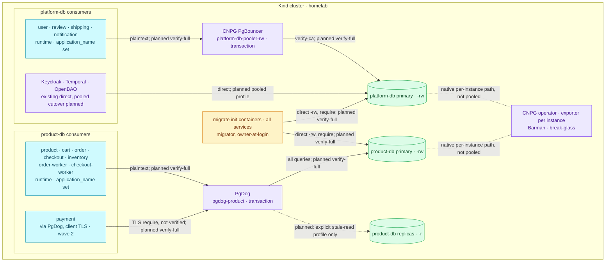

# RFC-0029 PostgreSQL authorization and access governance

| Status | Scope | Research | Created | Last updated |
|--------|-------|----------|---------|--------------|
| Implemented | platform-wide | [./research.md](./research.md) — gate passed 2026-10-06 | 2026-10-06 | 2026-10-16 |

> **Don't forget: every decision is a tradeoff.** The cost of the leading
> direction is more Secrets, more HBA pairs and a coordinated consumer cutover
> per service; § Design Details → drawbacks and § Rollout & rollback spell it out.

## Prerequisites

- [x] [`research.md`](./research.md) merged; [research review gate](./research.md#research-review-gate) passed (11/11)
- [x] Context7 audit complete; the source-tree, live-CRD and pgroles checks are in the research log
- [x] Owner approved **ready for RFC** on 2026-10-06
- [x] This RFC summarizes the target and links the mechanism deep dive instead of repeating it
- [x] Status **`Accepted`** 2026-10-06: ADR-084, ADR-085 and ADR-086 created (§ Resulting decisions). `docs/api/` is N/A: no service route or RPC changes; service code does not manage authorization

## Summary

Implementation tracking: [issue #1269](https://github.com/duynhlab/homelab/issues/1269).
Merging the documentation refactor does not complete the rollout checklist.

The platform owns database roles, memberships and object grants. Applications
receive a stable connection contract: endpoint, database, fixed username,
password delivery, TLS trust and `application_name`. Schema migrations remain
service-owned; authorization does not belong in those migrations.

[ADR-088](../../adr/ADR-088-platform-owns-database-authorization/) supersedes the
original service-owned authorization design. Its catalog Job creates owner and
migrator roles and sets owner-at-login; the Job or pgroles applies grants, with
one controller per concern. Services call `migratex.Run` without role options.

**Adoption:** complete for authorization. All ten services on `platform-db`
and `product-db` run on the owner / migrator / runtime split with the platform
applying roles and grants (ADR-084, ADR-086 and ADR-088 are `Complete`); the
fleet gate of 2026-10-16 is in Implementation History. The access contract
[ADR-089](../../adr/ADR-089-postgresql-access-contract/) stays `Partial`:
`application_name`, primary-only pooling and payment's TLS hop to PgDog are
deployed; verified TLS, certificate renewal, `passthrough_auth`, rotation
delivery and the replica and CDC profiles are tracked in
[#1283](https://github.com/duynhlab/homelab/issues/1283).

## Motivation

The original audit found runtime logins owning 147/147 application tables and
no declared object privileges. Splitting identities prevents runtime access
from carrying schema ownership. Moving grants to the platform removes role
knowledge from service code and gives each authorization object one owner.

The next boundary is connection management: services should not discover
primaries, configure pooler internals or coordinate independent password
writers. A connection contract must also state which paths bypass pooling,
what TLS verifies and when a read can be stale.

Historical measurements and experiments remain in [research.md](./research.md).
They describe their recorded environment, not a fresh audit of the whole fleet.

### Goals

1. Runtime owns no objects and cannot acquire owner/migrator privileges.
2. Migrations create objects as the NOLOGIN owner; platform default privileges
   and grants make those objects usable without service-authored authorization SQL.
3. The platform reconciles roles/grants and monitors membership-option drift.
4. Consumers receive a stable contract, verified TLS and workload attribution.
5. Adoption is gated per service with positive and negative evidence.

### Non-Goals

- Deploying the access changes as part of this documentation refactor.
- Replacing either PgDog or PgBouncer, or moving to the EC2 reference topology.
- A complete human-access system, cloud IAM or dynamic per-session credentials.
- RLS or SECURITY DEFINER patterns without a concrete use case.
- Claiming Keycloak, Temporal, payment or CDC already satisfy the target paths;
  existing direct consumers need integration work before cutover.
- A broad rotation audit.

## Decision outcome

Owner decisions recorded 2026-10-15, as
[ADR-089](../../adr/ADR-089-postgresql-access-contract/):

| Topic | Decision | Adoption / remaining work |
|---|---|---|
| Authorization | Platform-owned; retain owner/migrator/runtime split | ADR-088, D1/D2 evidence; remaining services pending |
| Migration | Direct primary endpoint, bypass pooler | Preserve direct access; verify owner-at-login and locks |
| Other consumers | Runtime, data, CDC and other SQL consumers use poolers | Planned; select compatible profiles before cutover |
| Internal operations | Operator, node replication, per-instance monitoring and backup/recovery retain native/direct paths | Preserve tool requirements; do not force through app pools |
| Break-glass | Controlled direct access for recovery | Explicit exception, scoped access and revocation procedure |
| Pooler implementation | Keep PgDog and PgBouncer | Compatibility verified per deployed version and profile |
| TLS | Applications support TLS; verify-full on both pooled hops | Planned; direct migration verifies its single hop |
| User/password | Fixed usernames; both automatic and manual password policies | Per-role policy/cadence accepted below; delivery implementation pending |
| Role model | NOLOGIN owner; separate migration/runtime; data/CDC/monitoring/platform templates | Templates below; new consumers not yet provisioned |
| Attribution | application_name is required | Workload-only naming accepted; implementation and telemetry gate pending |
| Consistency/retry | Primary by default; replica reads explicit; no blind replay of ambiguous writes | PgDog's automatic read split turned off 2026-10-16; replica profile planned |

## Proposal

### App/platform contract

| Application receives / implements | Platform owns |
|---|---|
| Logical endpoint, port, database and connection profile | Primary discovery, failover, pooler configuration and capacity |
| Fixed login and password delivery/reload contract | Roles, grants, secret storage, rotation writer and distribution |
| TLS verification, trusted CA bundle and expected hostname | Certificate issuance/renewal, SANs and CA lifecycle |
| Stable application_name on every new connection | Naming inventory and config injection |
| Transaction boundaries, timeouts, safe retry and consistency intent | Routing profile, connection budgets and observability |

No password, CA private key or full credential-bearing DSN belongs in Git,
logs or issue evidence. Endpoint abstraction does not hide consistency semantics
or remove application responsibility for safe transaction retry.

### Current baseline

Repository review of `main` on 2026-10-15 (manifests, not a runtime audit):

| Consumer | Route today | TLS today | `application_name` today |
|---|---|---|---|
| user, review, shipping, notification | CNPG PgBouncer `platform-db-pooler-rw` → primary | `sslmode=disable` | not set |
| product, cart, order, checkout, inventory, order-worker, checkout-worker | PgDog `pgdog-product` → primary for writes and transactions, `product-db-r` for other `SELECT`s | `sslmode=disable` | not set; PgDog reports `PgDog` |
| payment | direct `product-db-rw` | `require` (no verification) | not set |
| Migrations (all ten services) | direct `-rw` | `require` (no verification) | not set |
| Keycloak, Temporal | direct `platform-db-rw` | JDBC / plugin defaults | driver defaults |
| OpenBAO database engine | direct `platform-db-rw` | `sslmode=disable` | not set |
| Monitoring | CNPG exporter inside each instance (:9187), pooler metrics, `pg_stat_ch` in-server | n/a (local) | `cnpg_metrics_exporter` and similar |

Migrations already take the target path. Runtime TLS, attribution and the
PgDog read split are the gaps the contract closes.

### Connection matrix

All target changes below are **planned** unless backed by the existing adoption
record. Native/direct does not mean unencrypted or unauthenticated.

| Consumer | Target route | Constraint |
|---|---|---|
| API / workers | Pooler → primary by default | Runtime identity; explicit replica profile only when stale reads are acceptable. PgDog's automatic read split is off since 2026-10-16 |
| Migration | Direct primary (`-rw`), no pooler | Migrator identity; owner-at-login; stable backend during lock lifetime |
| Data robot / reporting | Pooler → primary or explicit replica profile | Dataset-scoped SELECT; timeout and connection budget |
| CDC | Replication-compatible pooler → source primary | Snapshot, replication protocol, reconnect and slot recovery must pass before adoption |
| Monitoring | Native, per instance: CNPG exporter, `pg_stat_ch`, pooler metrics | A pooler reaches one primary and would hide replicas; a future database-scoped SQL monitor gets its own pooled profile |
| Platform SQL jobs | Compatible pooler profile (authz Job, pgroles and OpenBAO connect direct today) | Preserve required session settings and permissions; not automatically transaction mode |
| CNPG operator / node replication | Native/operator path | Operator-managed lifecycle; not an application-pool migration |
| Backup / recovery | Tool-native path, including object storage | Do not reinterpret restore/WAL transfer as pooled application SQL |
| Break-glass | Controlled direct path | Recovery when access layer fails; scoped credentials, record use, revoke afterwards |

CDC is not authorized to silently bypass pooling if its gate fails: keep rollout
blocked for that consumer and bring a proposed exception back to the owner.
Existing direct integrations remain current reality until their gated cutover.

### Roles and ownership

| Role template | Login / authority | Connection / lifecycle |
|---|---|---|
| `<svc>_owner` | NOLOGIN; owns database, schema and objects | No password or workload Secret |
| `<svc>_migrator` | LOGIN; owner membership INHERIT FALSE, SET TRUE, ADMIN FALSE | Direct primary; platform sets owner-at-login; separate migration Secret |
| `<svc>_runtime` | LOGIN; no ownership or privileged membership; object grants | Pooled API/worker access |
| `<svc>_reader_data` | Separate robot login; SELECT on approved datasets/views | Pooled; no blanket PII access; one accountable consumer |
| `<svc>_cdc_<consumer>` | Separate login; snapshot/replication rights required by connector | Pooled after compatibility gate; separate from data reader |
| Monitoring | Minimum observation privileges needed by exporter | Native per-instance path (CNPG-managed); no business DML |
| Platform authz / rotation | Separate functional identities, narrowly scoped elevated rights | One writer per role/grant/password concern; recovery procedure |
| Support / break-glass | Individual, scoped access; no shared application login | Human-access implementation deferred; controlled direct recovery exception |

Templates specify intended privileges, not ready-to-apply SQL. CDC grants,
curated datasets and human issuance need their own consumer-specific review.

| Managed concern | Authority |
|---|---|
| Owner/migrator creation, membership options, owner-at-login and migrator password | ADR-088 role catalog Job/CronJob |
| Object grants/default privileges | Catalog Job or pgroles, exactly one per database |
| Runtime identity, Database owner, HBA and db_authz | CNPG objects; password ownership must respect the engine pilot exception |
| Notification runtime password pilot | OpenBAO database engine; no competing CNPG passwordSecret writer |
| Secrets distribution | OpenBAO / ESO and consumer reload/rollout |
| Schema changes | Service migrations only; no service GRANT/SET ROLE plumbing |

The executor remains privileged infrastructure, not a superuser exemption.
D2's pgroles wildcard limitation for `schema_migrations` remains an explicitly
accepted exception in the evidence; this refactor does not claim it was removed.

## Architecture & Diagrams

This diagram answers which path each consumer takes to PostgreSQL, today and
under the contract. Solid edges are routes that exist now; each label names
today's TLS and, after "planned", the target. Dotted edges are exceptions or
planned-only changes. Authorization ownership is in ADR-088, the as-built
topology in [database architecture](../../../databases/architecture.md).

Legend: cyan = application consumer, amber = migration, purple = platform
component or exception, green = PostgreSQL. CDC and data robots are not
deployed and have no box; their target is in the connection matrix.

## Design Details

### Direct migration and session locks

The runner logs into the primary as the migrator; the platform-configured role
setting makes its effective role the owner. Service code does not call
`WithSetRole` or ship authorization SQL. This is ADR-088's chosen mechanism.

Session advisory locks belong to a PostgreSQL backend session, not a username.
Transaction pooling can move successive statements between backends; an unlock
on a different backend does not release the original lock. The selected direct
path removes that pooler-affinity problem. The runner must still hold the same
connection for lock/work/unlock. COMMIT does not release a session lock.

Test concurrent runners and cleanup after success, failure and process death.
On failover, abort and inspect migration version/dirty state before recovery;
do not blindly replay DDL. Session pooling was considered but is not the chosen
migration route (PostgreSQL advisory locks: see Related).

### TLS and CA lifecycle

**Accepted target:** client → pooler and pooler → PostgreSQL each verify the
peer certificate chain and expected hostname (`verify-full` semantics). Direct
migration verifies the primary endpoint in one hop. Keeping TLS on one hop
does not secure the other. Configure the equivalent behavior for each pooler;
do not assume both products expose the same setting names.

**Accepted lifecycle:** platform issues certificates with endpoint SANs and
supplies trust bundles. For CA replacement, distribute a bundle trusting old
and new CAs first, reload clients/poolers, switch server certificates, verify
new connections, then remove old trust after the agreed overlap. Workloads
must actually reload trust; updating a mounted file alone is insufficient.
No fallback to plaintext or disabled hostname verification on failure.

The lifecycle is decided. Set the CA overlap duration, renewal thresholds,
component reload mechanisms and error budget during implementation planning.
Reuse [RFC-0020](../RFC-0020/) for internal TLS ownership; this RFC defines
the database consumer boundary.

**Pooler support** (upstream source read 2026-10-15, not yet exercised here):

| Pooler | Hop 1: client → pooler | Hop 2: pooler → PostgreSQL |
|---|---|---|
| CNPG PgBouncer (CNPG 1.30) | Operator default `client_tls_sslmode=prefer`, serving the cluster's certificate, whose SANs do not name the pooler Service. Verify-full needs a `clientTLSSecret` issued for `platform-db-pooler-rw` | Operator default `server_tls_sslmode=verify-ca`; the Pooler webhook allows overriding it to `verify-full` (CNPG's own e2e fixture does) |
| PgDog 0.1.26 (chart `v0.39`) | `tls_certificate` / `tls_private_key`, with `tls_client_required` to refuse plaintext | `tls_verify = verify_full` with `tls_server_ca_certificate` |

Confirm the chart value names before rollout, and again after any PgDog bump.

### application_name and telemetry

**Accepted naming:** every consumer sets `application_name` to its stable
workload name: `order`, `order-worker`, `checkout-worker`, `order-migrate`.
No environment suffix: observability storage is separated by environment.
If environments are aggregated later, preserve environment as a separate
telemetry dimension rather than changing the workload name.

Keep existing service/worker names and `OTEL_SERVICE_NAME` unchanged. Migration
uses the service name plus `-migrate`, even when it shares the service image.

**Delivery:** the platform sets the standard libpq variable `PGAPPNAME`; no
custom variable is introduced. pgx reads `PGAPPNAME` when the DSN carries no
`application_name`, and both `dbx.NewPool` (`pgxpool.ParseConfig`) and
`migratex` (golang-migrate's pgx/v5 driver) parse through pgx, so service code
does not change. Confirm with `SHOW application_name` from a pod at rollout.

| Workload | Declared in | Mechanism | Value |
|---|---|---|---|
| API of each service | domain ResourceSet, main container | `PGAPPNAME: << inputs.name >>` | `user`, `review`, `shipping`, `notification`, `product`, `cart`, `order`, `checkout`, `inventory`, `payment` |
| Migration of each service | domain ResourceSet, `migrate` init container | `PGAPPNAME: << inputs.name >>-migrate` | `user-migrate` … `payment-migrate` |
| Workers | `order-worker.yaml`, `checkout-worker.yaml` | `PGAPPNAME` | `order-worker`, `checkout-worker` |
| Demo seed of each service | `local-stack/compose.yaml` `*-seed`, `scripts/kind-seed.sh` | `PGAPPNAME` | `<name>-seed` |
| Local-stack | `local-stack/compose.yaml`, per service | `PGAPPNAME` | same values as the cluster |
| Role catalog Job and CronJob | `platform-db/authz/job.yaml` | `PGAPPNAME` (psql) | `db-authz` |
| Authorization check script | `scripts/db-authz-check.sh` conninfo | `application_name` parameter | `db-authz-check` |
| Keycloak | Keycloak Deployment `KC_DB_URL` (and local-stack) | JDBC URL property `ApplicationName` | `keycloak` |
| Temporal | Temporal HelmRelease persistence, both datastores (chart 1.7.0 copies the datastore config as is); local-stack `PGAPPNAME`, because the image's config template has no postgres12 `connectAttributes` variable | SQL `connectAttributes` | `temporal` |
| OpenBAO database engine | `connection_url` in `openbao-db-config.yaml` | `application_name` parameter | `openbao` |
| pgroles | — | **Gap:** `PostgresPolicy.spec.connection.params` has no `application_name` field in 0.13.0 or 0.14.0. Its sessions show an empty name under `authz_admin`; revisit on a pgroles release that adds it | (`pgroles`) |
| CNPG internals, Barman, `pg_stat_ch` exporter, PgDog's own connections | set by the operator or the tool | unchanged | e.g. `cnpg_metrics_exporter`, `PgDog` |

The application rows shipped first (#1272) and the platform rows followed; only
pgroles is still unnamed.

Use lowercase ASCII letters/digits/hyphens and at most 63 bytes for a standard
PostgreSQL build; reject rather than silently truncate. No pod UID, release
SHA, request ID or secret in this label. The label is client-supplied
observability metadata, never authorization.

Repository inspection on 2026-10-15 found no `application_name`/`PGAPPNAME`
wiring in the manifests or the shared client. The #1265 Kind audit matched it:
`pg_stat_ch.app` was empty on platform-db and `PgDog` on product-db.

**Through the poolers** (upstream source read 2026-10-15):

- PgDog opens server connections as `PgDog`. On each checkout,
  `Server::link_client` replays the client's startup parameters, including
  `application_name`, with `SET`, and resets them when the connection returns
  to the pool (present in 0.1.26 and current main). The cost is one extra
  `SET` whenever a backend changes hands between clients with different names.
- PgBouncer tracks `application_name` as a client parameter in transaction
  mode; confirm on the deployed version.
- `pg_stat_ch` reads the live `application_name` setting at capture time, so
  a value set by the pooler is what lands in ClickHouse.
- Behind a pooler, `client_addr` is the pooler's address. `application_name`
  is the only per-workload dimension in query telemetry.

Since clickhouse-ddl 2.0.0 the
[query telemetry](../../../observability/metrics/postgresql/query-telemetry.md)
store names the column `application_name` too. The extension still inserts it
as upstream's `app`, an `EPHEMERAL` column that is never stored, and the
dashboard filters on `application_name`. The rename was fresh-only, with no
compatibility for queries that read `app`.
After implementation, verify client → pooler → PostgreSQL → ClickHouse →
dashboard, then update guide examples and
[DBClientQueryP95High](../../../observability/runbooks/microservices/DBClientQueryP95High.md).
Align client workload labels and server-side `application_name` (for example
`order`); verify worker and migration attribution separately rather than
assuming all producers already use matching labels. Do not invent attribution
for records written before the rollout.

### Password rotation and delivery

Fixed username does not mean fixed password. Automatic and operator-triggered
rotation share the same delivery problem: PostgreSQL, pooler authentication
and the consuming process must agree on the credential version. ESO refresh
is distribution, not rotation; an updated Secret does not refresh an existing
process environment. Existing sessions succeeding does not prove new login works.

Exactly one writer changes a role's password. The notification static-role
pilot declares `720h` in the repository; other roles do not inherit that policy
by implication. Do not let CNPG/catalog overwrite an engine-managed password.
An OpenBAO static-role creation can rotate immediately; manual rotate-role
invocation does not disable its automatic schedule (OpenBAO database API:
see Related).

The following trigger/cadence mapping is **accepted for operation**; rollout
is still planned:

| Role category | Accepted trigger / cadence | Adoption condition |
|---|---|---|
| NOLOGIN owner | None | No password exists |
| Runtime / data robots | Automatic, 30 days | Fresh authentication and consumer reload proven |
| Migrator | Manual workflow, 30 days | No concurrent migration; separate delivery/recovery |
| CDC | Manual, 90 days initially; review monthly | Temporary exception until reconnect/slot/offset recovery permits automatic 30 days |
| Monitoring (SQL login, if one is added) | Automatic, 90 days | Minimum privileges; shorten if sensitive/wide access. The native CNPG exporter has no password |
| Authz / rotation management | Manual workflow, 30 days | Scoped identity and independent recovery path |
| Pooler lookup: CNPG PgBouncer | Certificate lifecycle, not a password | The operator authenticates `cnpg_pooler_pgbouncer` with a TLS client certificate |
| Pooler lookup: PgDog | Follows each runtime password today | PgDog's user list is static (`valuesFrom`, ADR-014) and needs a reconcile after every rotation; `passthrough_auth` (ADR-025) removes that copy before automatic 30-day runtime rotation on product-db |
| Break-glass | After use; access review every 90 days | Review frequency is not a password rotation schedule |
| Operator-managed internals / humans | Separate lifecycle | Do not impose application machine-password policy |

These are accepted homelab defaults, not universal security requirements.
Suspected compromise or revocation requires immediate handling regardless of
a periodic schedule.

**Accelerated audit only:** use a 3-hour rotation-period override in an
isolated audit environment; extend to 5 hours or 1–2 days if observation needs
more time. Do not change the operational 30/90-day policy. For automatic roles,
observe a scheduler-triggered rotation, not only a manual API invocation. For
manual roles, exercise the operator-triggered workflow without adding an
automatic schedule. Check fresh frontend/backend authentication, consumer reload
and mismatch recovery; record the override and restore/remove it after the audit.
A short audit proves that exercised delivery path, not long-term reliability.

**Minimum delivery gate, not a broad audit:** inventory writer and consumers;
prepare versioned secret/recovery; coordinate the actual DB writer, pooler
refresh and workload reload; test a new client and a newly authenticated
backend; confirm recovery on mismatch. Record version metadata and outcome,
never secret values. The two delivery branches are not atomic, so establish
an acceptable error window before enabling unattended rotation. Do not count
an incomplete consumer rollout as successful rotation.

If a write times out, inspect state before retrying. Do not roll back to a
compromised credential. Changing a password alone does not terminate already
authenticated sessions; incident revocation must consider those sessions too.
Manual means a person triggers a repeatable workflow, not ad-hoc SQL competing
with a reconciler.

### Consistency and retry

- Default reads and writes to primary. Replica access is explicit per flow,
  with a lag tolerance; it is not an automatic optimization for every SELECT.
- **Closed 2026-10-16:** PgDog used to send every `SELECT` outside a
  transaction to `product-db-r` for all six product-db databases, so a read
  right after a committed write could be stale. The default PgDog pools now
  route to the primary only (no database lists a replica). A flow that accepts
  stale reads will opt into a separate replica profile (for example a dedicated
  database alias) with a declared lag tolerance; that profile is still planned.
- Read-after-write stays on primary for the relevant workflow. Existing
  transaction/snapshot semantics still apply; primary routing is not a promise
  of a globally fresh snapshot inside an older transaction.
- Bound retry by deadline/backoff and operation semantics. Retry a whole
  transaction only for classified transient failures and replay-safe work.
- Unknown commit outcome requires reconciliation or an idempotency mechanism;
  never blindly reissue a write or duplicate external side effects.
- Migration and CDC recovery follow their own state/version/offset procedures.

### Alternatives and tradeoffs

The three-role model is retained. Service-owned authorization (ADR-085) was
superseded by ADR-088; pgroles is adopted for selected in-database grants, not
for role ownership. Forcing migration or native recovery through an application
pool would add compatibility and failure dependencies; those paths remain direct.
Keeping both poolers costs a per-version compatibility matrix but avoids an
unjustified replacement. Verified TLS and fixed-user rotation require coordinated
reloads; neither is declared zero-downtime without evidence.

## Security considerations

The platform executor, rotation writer and auth lookup credentials are privileged
infrastructure and require scoped rights and recovery. Runtime may not inherit
those powers. Retain ADR-015 HBA isolation and the existing PUBLIC CONNECT
choice; this refactor does not silently change admission policy. TLS secures
transport; it does not replace SQL authorization or secret revocation.

## Observability & SLO impact

Retain membership drift alerts and existing authorization gate evidence. For
access rollout, observe authentication failures, new-connection recovery,
consumer errors/backlog and CDC lag. Attribution must be validated through the
pooler before updating dashboard/runbook claims. Rotation needs outcome and
last-success visibility, not secret values in logs or unbounded metric labels.
No new numerical SLO or mandatory fleet-wide rotation audit is approved here.

## Rollout & rollback

| Stage | Status / exit |
|---|---|
| Phase 0–2, ADR-088 redesign, D1/D2 | Historical evidence below; do not reclassify as new access-contract validation |
| Access-contract documentation | Record accepted decisions and implementation prerequisites; no runtime mutation |
| Implementation planning | Inventory workloads; implement accepted naming, profiles, CA/reload/error budget and per-role password ownership |
| Canary access contract | Migration direct, runtime pooled; TLS negatives, attribution and minimum rotation delivery gate |
| Remaining fleet / data / CDC | Consumer-by-consumer evidence; local-stack parity and Linux/Kind gates before qualified rollout |

**Authorization rollout still open** (ADR-088), by domain and never all
databases at once:

| Wave | Consumers | Notes |
|---|---|---|
| product-db, catalog (wave 1) | product, inventory | **Merged** (#1279, 2026-10-16). First authz policies on product-db: FQDN host `product-db-rw.product.svc` from `pgroles-system`; PgDog user list remapped to `<svc>_runtime` (ADR-014). The bootstrap database keeps its name `product`; its initdb role `product` becomes NOLOGIN with no `pg_hba` line |
| product-db, checkout (wave 2) | cart, order, checkout, payment, order-worker, checkout-worker | **Merged** (#1282, 2026-10-16). Workers share their service's runtime role. payment's runtime moves behind PgDog with client TLS (`pgdog-product-tls`, `homelab-ca`, `sslmode=require`, not verified); its migrate stays direct over `hostssl` (ADR-089) |
| Close | — | **Done 2026-10-16**: fleet gate passed, ADR-084/086/088 adoption `Complete`, RFC `Implemented`; ADR-089 obligations in #1283 |

Carried into the next fresh bring-up from the #1265 audit: re-run the
`pg_stat_ch` rows for the schema Job, both clusters filling the rollups and
the INSERT-only writer, with no hand-run `ALTER`. The databases wave
substitutes `${...}` in everything it renders, so every new authz script needs
the `kustomize.toolkit.fluxcd.io/substitute: disabled` opt-out until that
substitution is narrowed to the CNPG `Cluster` manifests.

Preserve data during access changes: restore a known-good endpoint/config and
compatible trust/credential state, then verify new connections. Recreating a
cluster was the historical disposable-lab cutover approach, not a rollback
procedure for a populated database. Existing-data ownership transfer remains
operator-run and was not exercised by the greenfield evidence; see
[authorization guide](../../../databases/authorization.md#rollback-and-existing-data).
Never restore a compromised or revoked password as a rollback target.

## Testing / verification

- Documentation PR: render diagrams, check links/fences and run `make validate`.
- Re-run the 14 PG18/CNPG experiments in [research](./research.md) on every
  CNPG minor or major upgrade (CNPG-04 in particular).
- Runtime implementation: positive CRUD/migration, negative DDL/grants/SET ROLE,
  catalog ownership/default ACLs/membership options; retain D2 exceptions explicitly.
- Two direct migrators: serialization, same backend per lock lifetime, cleanup
  after success/failure/death; failover recovery checks migration state.
- TLS: correct CA/hostname passes; wrong CA/hostname and prohibited plaintext
  fail on each hop independently, including direct migration.
- Attribution: interleave clients through the actual pooler/version; verify
  PostgreSQL application_name and ClickHouse/dashboard values are not misassigned.
- Rotation: correct writer, fresh client/backend authentication, consumer
  reload and controlled recovery from mismatch. No exhaustive audit required.
- CDC: snapshot/streaming, reconnect, offsets/slots and retained-WAL impact;
  do not delete slots as a password-recovery shortcut.
- Consistency: explicit replica flow tolerance, primary read-after-write and
  no duplicated effects under retry/ambiguous commit.

## Implementation prerequisites & gates

The architecture directions and rotation defaults are decided. The following
are implementation tasks, not unapproved alternatives or completed deployment:

| Workstream | Accepted direction | Required before rollout |
|---|---|---|
| application_name | Stable workload only; migration suffix -migrate; `PGAPPNAME` per the naming table | `SHOW application_name` from each workload, interleaved clients through each pooler, end-to-end telemetry evidence |
| CA lifecycle | Trust overlap → verified reload → cert switch → new-connection checks → remove old trust | Durations, renewal settings, component reload support and failure budget |
| Rotation | Accepted per-role 30/90-day table and lifecycle exceptions | Single writer, owner, consumer reload and recovery; isolated 3-hour audit override |
| Pooler profiles | Keep both products; compatible profile per consumer | Versioned TLS/session/replication matrix, particularly CDC and platform jobs; CNPG Pooler `clientTLSSecret` for the pooler Service; PgDog chart TLS values confirmed; failed gate blocks cutover |
| Replica reads | Primary default; explicit stale-read flows only | PgDog's automatic read split off (2026-10-16, Kind gate); per-flow lag tolerance and fallback defined before enabling replica access |
| PgDog version | Chart `v0.90` (PgDog v0.1.60); the features above exist since 0.1.26 | Re-check the chart value names on every bump |

The former service `WithSetRole` design is superseded by ADR-088. Exact
data/CDC grants must be scoped to their datasets and connector requirements
before provisioning. Accepted direction does not waive compatibility gates.

## Historical decisions

Resolved before the access contract and still in force unless noted:

- **Canary** — `review` (2026-10-06).
- **Drift collector** — CNPG monitoring query plus alert (ADR-086).
- **Ownership transfer** — new clusters need none; existing data moves once
  per service by an operator runbook (ADR-084).
- **Local-stack** — mirrors the three roles for every converted service.
- **Compatibility window** — none. Greenfield: the legacy login is never
  created (2026-10-06).
- **Chart Secret inputs** — no `duynh` chart change; the domain ResourceSets
  carry separate runtime and migration Secret inputs.
- **`PUBLIC CONNECT`** — kept on the cluster because `pg_hba` is the fence
  (ADR-015); local-stack revokes it because it has no other fence. A
  deliberate difference, recorded in the authorization guide.
- **Alert and gate** — both: `CNPGRoleMembershipDrift` pages, and the Kind
  gate asserts no drift and runs negative rows as the real logins.
- **How migrations reach the owner** — `migratex.WithSetRole` (2026-10-06),
  superseded by ADR-088's owner-at-login (2026-10-12).

## Resulting decisions

| Decision | Record | Status |
|---|---|---|
| Three-role identity split | [ADR-084](../../adr/ADR-084-split-service-database-roles/) | Accepted; implementation ownership amended by ADR-088 |
| Service-owned authorization | [ADR-085](../../adr/ADR-085-service-migrations-own-authorization/) | Historical; superseded by ADR-088 |
| Membership-option guard | [ADR-086](../../adr/ADR-086-guard-membership-options/) | Accepted |
| Platform-owned authorization | [ADR-088](../../adr/ADR-088-platform-owns-database-authorization/) | Accepted; partial adoption |
| Access paths, verified TLS, required attribution, rotation defaults | [ADR-089](../../adr/ADR-089-postgresql-access-contract/) | Accepted; partial adoption |

## Implementation History

- 2026-09-03 — research opened (`researching`).
- 2026-10-05 — Phase 0 remediation merged (#989) and executed on Kind; research
  refreshed (#1227) and the run recorded (#1228).
- 2026-10-06 — owner approved **ready for RFC**; this README authored at
  `provisional` (#1229).
- 2026-10-06 — **Accepted**; ADR-084, ADR-085 and ADR-086 created at
  `Accepted`, Adoption `Not started`.
- 2026-10-06 — Phase 0 step 6: the membership guard for `vault_rotator →
  notification` shipped and was exercised on Kind (flip and revoke both fired
  and resolved); ADR-086 Adoption `Partial`.
- 2026-10-06 — Phase 1 conventions authored
  ([`authorization.md`](../../../databases/authorization.md)); the open questions
  resolved as greenfield, `migratex.WithSetRole`, alert plus gate.
- 2026-10-08 — Phase 2: `review` converted (homelab #1245, review-service
  `v2.5.0`). Fresh Kind: sweep 84/84, K3.7 2/2, K3.8–K3.9 10/10, `make e2e`
  146/146, drift drill on the new edge; local-stack audit A1–A23, B1–B10,
  C0–C22 PASS.
- 2026-10-09 — Phase 3 wave 1 paused by the owner before merge (user, shipping,
  notification PRs closed later): role knowledge does not belong in services.
- 2026-10-12 — Redesign accepted after a Kind lab (pgroles 0.13.0, CNPG 1.30.1):
  ADR-088 supersedes ADR-085. pkg `migratex/v0.39.0` removes `WithSetRole`;
  review-service #208 drops `DB_MIGRATION_ROLE` and `000004_authorization`.
- 2026-10-14 — D1 opened: `authz_admin` + `db_authz` executor (CNPG creates a
  role with `IN ROLE`, so one CNPG-managed executor would deadlock a new
  cluster), role catalog Job + CronJob, review moved onto it, guard extended.
- 2026-10-15 — D1 merged (#1267): review `2.6.0` tagged after a full
  local-stack audit; fresh Kind K3.4 99/99, K3.7–K3.10 green, drift drill. The
  first bring-up failed K3.8, so the Job now creates `schema_migrations`.
- 2026-10-15 — D2: user, shipping and notification on the catalog Job plus
  pgroles policies. PGR-10: pgroles cannot leave `schema_migrations` out of a
  table wildcard; the owner accepted that those runtimes hold it. Fresh
  Kind: K3.4 105/105, K3.8 48/48, three policies Ready, drift drill green.
- 2026-10-16 — product-db wave 1 merged (#1279, product-service `v1.16.2`
  after migration 000006 read the table ACL) and wave 2 merged (#1282): cart,
  order, checkout and payment on the split, both workers on their service's
  runtime login, payment's runtime behind PgDog with client TLS (`require`,
  not verified). All ten services are converted.
- 2026-10-16 — **Implemented.** Fleet gate on Kind at the merged manifests
  (`fe508871`): 31/31 Kustomizations Ready, `db-authz-check` 120/120,
  isolation sweep PASS, both role catalog Jobs `authz applied`, 9 pgroles
  policies Ready with every plan Applied, no guard alert firing, a revoked
  grant restored in 26 s, `pg_stat_ch` names every service, worker, migrate
  and seed under the expected role, e2e saga 9/9, staff 59/59, operator
  26/26, smoke 54/55 (K5.8, the DR replica's HA alert). Local-stack on the
  same tree: k6 17/17, A23 for all ten, A24. ADR-084, ADR-086 and ADR-088
  Adoption `Complete`; ADR-089 stays `Partial` with its obligations in
  [#1283](https://github.com/duynhlab/homelab/issues/1283).

## Related

- [Research](./research.md) — experiments and historical evidence, including superseded designs
- [Authorization guide](../../../databases/authorization.md) — current ownership and operational evidence
- [Database architecture](../../../databases/architecture.md) — as-built paths, including existing direct consumers
- [RFC-0020](../RFC-0020/) — internal TLS ownership
- [RFC-0030](../RFC-0030/) — CDC/analytics integration and downstream contract
- [Rotate vault_rotator](../../../databases/runbooks/rotate-vault-rotator-credential.md)
- [PostgreSQL advisory locks](https://www.postgresql.org/docs/18/explicit-locking.html#ADVISORY-LOCKS), [OpenBAO database secrets API](https://openbao.org/docs/api/secret/databases/) — official references
- [ADR-013](../../adr/ADR-013-per-service-db-triplet/), [ADR-014](../../adr/ADR-014-pooler-credentials-valuesfrom/), [ADR-015](../../adr/ADR-015-pg-hba-connection-isolation/), [ADR-025](../../adr/ADR-025-pgdog-passthrough-dynamic-db-creds/) — related identity, admission and credential records
