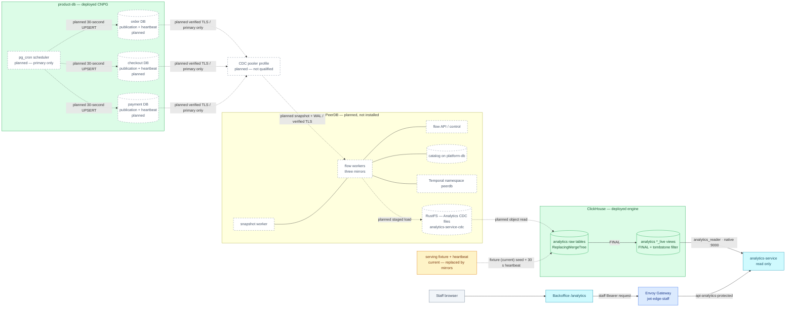
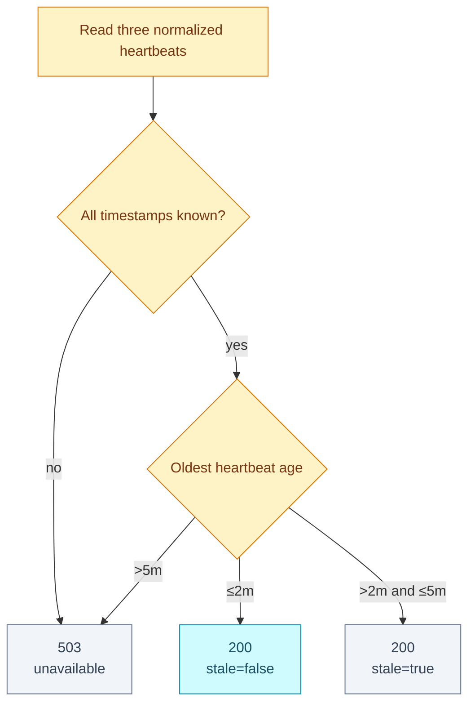

# RFC-0030 Backoffice commerce analytics on ClickHouse

| Status | Scope | Research | Created | Last updated |
|--------|-------|----------|---------|--------------|
| Accepted | platform-wide | [./research.md](./research.md) — PeerDB + `pg_cron` direction audited 2026-09-08 | 2026-09-07 | 2026-10-23 |

> **Accepted target architecture; consumer half deployed on a fixture.**
> `analytics-service`, the `api-analytics-protected` route and the Backoffice
> `/analytics` page (phases 8–10) run in local-stack and on Kind against a
> fixture-backed serving layer (ADR-069 Adoption Partial). The CDC half —
> pooled source access, PeerDB, mirrors and `pg_cron` heartbeats (phases 1–7)
> — is **planned** and not deployed; PeerDB has only an opt-in Compose
> prototype. PostgreSQL stays authoritative; ClickHouse is a rebuildable,
> bounded-eventual read model.

Qualification runbook: [Phase 0](./phase0.md). Results and remaining work:
[Linux handoff issue](https://github.com/duynhlab/homelab/issues/1266).

## Prerequisites

- [x] Research gate passed and the owner approved **ready for RFC**.
- [x] The owner replaced the earlier batch-first direction with PeerDB-first
      CDC before acceptance; this RFC and its research were rewritten together.
- [x] Context7 findings were cross-checked against versioned official sources.
- [x] Current source migrations and platform manifests were audited.
- [x] The owner selected a custom CNPG system image and `pg_cron` for the
      source heartbeat; its artifact, preload, activation, restore, and
      failover lifecycle is now an independent resulting decision.
- [x] The owner accepted RFC-0030 and ADR-066 through ADR-069 on 2026-09-09.
- [ ] Phase 0 implementation must close the release/chart, licence, freshness,
      column-publication, schema-evolution, restore, and CNPG failover gates
      before any component rollout.
- [x] Acceptance installed no component. Since 2026-10-23 ADR-069 is at
      Adoption `Partial`; ADR-066 through ADR-068 remain `Not started`.

## Summary

Self-host PeerDB to continuously replicate an explicit PostgreSQL base-table
and column allowlist from the `order`, `checkout`, and `payment` databases
into an isolated ClickHouse `analytics` database. Three database-local mirrors
feed versioned raw tables; serving views read the latest version with `FINAL`
and remove tombstones. A thin read-only `analytics-service` exposes one staff endpoint,
and the Admin Portal consumes it from a lazy `/analytics` page.

The freshness objective is **two minutes end to end**, not a two-minute batch
schedule. `pg_cron` updates one heartbeat row in each source database every 30
seconds, proving the complete source → WAL → PeerDB → staging → ClickHouse path
even when business traffic is idle. A small reconciliation command checks
correctness; it is not a second ingestion engine.

## Motivation

The Backoffice answers live operational questions but cannot safely answer
historical questions about settled capture, refunds, checkout conversion, and
top products. Browser fan-out cannot establish one honest cross-domain
watermark, and repeated 90-day scans would couple review traffic to OLTP.

The platform already runs PostgreSQL 18 on CloudNativePG, ClickHouse 26.9,
Temporal, and RustFS. PeerDB is a narrower fit than building and operating a
custom extractor because it owns the PostgreSQL snapshot/WAL/checkpoint path.
It does not replace the semantic API, authorization, reconciliation, or
operational ownership described here. Detailed evidence and limitations are in
[research](./research.md).

The heartbeat deliberately uses a PostgreSQL-native scheduler instead of adding
another long-running workload. That saves an external credential and network
path, but makes the `pg_cron` artifact, preload restart, extension activation,
backup restore, and DR-image compatibility part of the database platform's
owned lifecycle.

### Goals

- Continuously ingest the seven selected base tables with target-observed
  freshness at or below two minutes.
- Serve one staff-only overview for settled money, funnel, trend, and top
  product aggregates over 7, 30, or 90 days.
- Keep analytics failures and ClickHouse outside every transactional request
  path.
- Preserve payment-ledger authority, checkout cohorts, historical order-item
  values, UTC boundaries, and per-currency isolation.
- Make per-source lag, stale data, unknown progress, and unavailability
  explicit to the API consumer and on-call.
- Keep source replication, heartbeat execution, PeerDB control, ClickHouse
  ingest, and ClickHouse read privileges separate.
- Prove snapshots, updates, deletes, failover, replay, and PII exclusion before
  acceptance.

### Non-goals

- General BI, ad hoc SQL, arbitrary dimensions, or database credentials in the
  browser.
- Revenue recognition, FX conversion, customer cohorts, or item allocation of
  refunds, tax, discount, and shipping.
- A global transaction or common LSN across three PostgreSQL databases.
- Replacing service APIs or moving transactional authority to ClickHouse.
- Kafka/Redpanda, Debezium, a custom `pgoutput` consumer, or a parallel batch
  ingestion pipeline.
- Installing `pg_duckdb`, `pg_mooncake`, TimescaleDB, Citus, or a columnar
  PostgreSQL extension in v1.
- Promising transparent schema evolution or zero-resnapshot CNPG failover
  before the prototype proves those properties.
- Replacing the operational Home dashboard.

## Proposal

1. Declare one CNPG `Publication` resource with explicit table/column objects
   and reclaim policy `retain` for each source database. Grant a dedicated
   PeerDB login `LOGIN`, `REPLICATION`, and `SELECT` only on the selected
   tables. Connect through a replication-compatible CDC pooler profile to
   the source primary, with verify-full semantics on both hops, as required
   by RFC-0029. Never use a replica or silently fall back to direct access.
2. Run three PeerDB mirrors—one per database, publication, and slot. Reuse
   existing Temporal through a dedicated `peerdb` namespace, RustFS through a
   dedicated `analytics-service-cdc` bucket/identity, and `platform-db` through a
   dedicated PeerDB catalog database/role.
3. Package `postgresql-18-cron` in a digest-pinned custom CNPG system image,
   deploy that compatible image to `product-db` and `product-db-replica`, then
   preload and activate `pg_cron` only after artifact and restore validation.
   Install its metadata in the `postgres` database and use one narrow
   `analytics_heartbeat` execution role, background workers, and three
   `cron.schedule_in_database()` jobs to update one technical row per source
   every 30 seconds with `clock_timestamp()`. Measure freshness only when that
   timestamp is visible in ClickHouse after normalization.
4. Write versioned raw rows with `_peerdb_version`, `_peerdb_is_deleted`, and
   sync metadata into `ReplacingMergeTree(_peerdb_version)` tables. Serving
   views read them with `FINAL` to select the latest version, then discard
   tombstones.
5. Normalize the inconsistent source `order_id` types to `String` in the
   serving model without modifying transactional schemas.
6. Let `analytics-service` query only serving objects, enforce the staff issuer
   plus `backoffice_admin`, and return one bounded overview.
7. Run nightly 7-day and weekly 90-day checksum reconciliation from a separate
   command/job. It detects or repairs bounded slices but never transports the
   primary change stream.

### User stories

- As operations staff, I can distinguish current data, bounded staleness, and
  an unavailable pipeline from a genuine zero.
- As product staff, I can compare settled capture, refunds, conversion, and top
  products for one currency and bounded interval.
- As finance-aware staff, I see ledger-derived money rather than amounts
  inferred from order state.
- As on-call, I can identify the lagging source and stop the consumer without
  affecting checkout or payment processing.
- As a source owner, I can review the exact tables and columns leaving my
  database.

## Decision outcome

**Chosen option:** self-hosted PeerDB PostgreSQL → ClickHouse CDC, explicit
source allowlists, `pg_cron` source heartbeats, an isolated commerce model, and
a thin read-only `analytics-service`, as accepted in ADR-066 through ADR-069.
Implementation starts with the mandatory Phase 0 qualification gates below.

This replaces the earlier 15-minute batch proposal before acceptance. PeerDB
removes a bespoke snapshot/checkpoint/retry transport and provides continuous
update/delete capture. The cost is a real control plane, logical slots and WAL
risk, broad-read credentials on selected tables, full initial snapshots, an
owned custom PostgreSQL image/preload lifecycle, and several upstream behaviors
that the acceptance prototype must verify.


## Resource naming

Resources use the `analytics-service` workload name; commerce remains the
business domain and API route. The `analytics` database and `analytics_reader`
are deployed (the database seeded by the fixture); the CDC names describe the
planned cluster contract and the opt-in Compose implementation.

| Resource | Name |
|---|---|
| RustFS bucket and CDC identity | `analytics-service-cdc` |
| Compose RustFS service and volume | `analytics-service-cdc-storage` |
| Compose bucket bootstrap | `analytics-service-cdc-bootstrap` |
| PeerDB destination peer | `analytics_service` |
| PeerDB mirrors | `analytics_service_order`, `analytics_service_checkout`, `analytics_service_payment` |
| ClickHouse database | `analytics` |
| ClickHouse ingest / API reader | `analytics_ingest` / `analytics_reader` |
| Non-login serving-view owner | `analytics_view_owner` |

PeerDB v0.37.5 requires lowercase letters, digits and underscores for
[mirror names](https://github.com/PeerDB-io/peerdb/blob/v0.37.5/ui/app/mirrors/create/schema.ts)
and [peer names](https://github.com/PeerDB-io/peerdb/blob/v0.37.5/ui/app/peers/create/%5BpeerType%5D/schema.ts).
The underscore spelling is the protocol-compatible form of the workload name.
The source publications stay `analytics_order`, `analytics_checkout` and
`analytics_payment`. New mirrors generate slots named
`peerflow_slot_analytics_service_<source>`; this does not rename existing slots.
The `peerdb` Temporal namespace and catalog identity remain unchanged.

RustFS holds intermediate CDC files written by PeerDB and read by ClickHouse.
The API reader has no bucket credentials. “Staging” remains the upstream term
for this mechanism, not an environment designation or a backup guarantee.
See the [qualification runbook](./phase0.md#resource-naming-and-existing-projects)
for the fresh-project requirement and historical-evidence boundary.


## Architecture

This diagram answers one question: **what is the trust and data path, and
which part of it is deployed?** The staff page, edge route, `analytics-service`
and the ClickHouse `analytics` tables and serving views are current; a fixture
seeds the tables today. Every PeerDB, CDC, commerce-publication and
`pg_cron` heartbeat object is planned and not installed.



**Legend** — grey: human client · blue: deployed edge · cyan: deployed service
or page · green: deployed data · amber: the fixture that stands in for CDC today
(dotted edge, labelled) · dashed border/dotted edge with `planned`: not
installed.

### Bounded-eventual response states

Each source heartbeat is independent. `data_through` is the oldest timestamp
actually observed in ClickHouse, not a global transaction boundary.



| Condition | HTTP | Contract |
|-----------|------|----------|
| Every source lag ≤2m | `200` | `stale=false`; return per-source lag |
| Any source lag >2m and ≤5m | `200` | `stale=true`; keep bounded last-known result |
| Any source lag >5m, state unknown, or freshness query unavailable | `503` | Do not present analytics as current |

PeerDB `RUNNING`, a small slot, the newest business row, and CDC batch end time
are not accepted freshness authorities. Idle sources require the heartbeat.

## Source contract

The business allowlist is fixed for v1. Publications and PeerDB mappings must
name every allowed column; a schema addition is excluded until reviewed.

| Database | Table | Allowed columns |
|----------|-------|-----------------|
| `order` | `orders` | `id`, `status`, `version`, `created_at`, `updated_at`, `completed_at` |
| `order` | `order_items` | `id`, `order_id`, `product_id`, `product_name`, `quantity`, `price`, `subtotal`, `created_at` |
| `checkout` | `checkout_sessions` | `id`, `status`, `order_id`, `currency`, `created_at`, `updated_at` |
| `payment` | `payments` | `id`, `order_id`, `currency`, `created_at`, `updated_at` |
| `payment` | `ledger_transactions` | `id`, `payment_id`, `kind`, `created_at` |
| `payment` | `ledger_entries` | `id`, `transaction_id`, `account_id`, `direction`, `amount_minor` |
| `payment` | `ledger_accounts` | `id`, `name`, `type` |

Each database also owns `analytics_cdc_heartbeat(id, emitted_at)`, with one
fixed primary-key row updated every 30 seconds with `clock_timestamp()`. One
`pg_cron` installation in the cluster's `postgres` database schedules the three
database-local jobs with `cron.schedule_in_database()`. Replica-identity columns
are mandatory in every publication column list. All selected tables currently
have primary keys; the ledger tables are append-only by trigger.

Forbidden data includes `user_id`, address JSON, shipping method, promo data,
payment method/token, provider identifiers, `external_ref`, decline/reason
text, idempotency material, workflow IDs, and audit actor/note data.

The PeerDB replication credential receives table-level `SELECT` on these
selected base tables because the initial snapshot requires it. That means it
can query forbidden columns in PostgreSQL even though publication columns and
PeerDB exclusions prevent those columns from reaching ClickHouse. This is an
explicitly accepted security drawback, bounded by exact-table grants, HBA,
NetworkPolicy, Secret isolation, audit, and no `BYPASSRLS`. It must never gain
`SELECT ON ALL TABLES IN SCHEMA`.

### Source access contract

**Accepted direction:** PeerDB → platform-owned CDC pooler profile → source
primary. This follows [RFC-0029](../RFC-0029/) and
[ADR-089](https://github.com/duynhlab/homelab/blob/main/docs/proposals/adr/ADR-089-postgresql-access-contract/README.md).
The application receives the logical endpoint, database, credentials and CA;
platform owns backend discovery, routing, authentication and pooler settings.
Both metadata/snapshot SQL and the replication connection use this access
contract. Migration and native CNPG replication exceptions do not grant PeerDB
a direct-access exception.

**Not yet qualified:** product, version, endpoint and concrete settings for the
CDC profile. Preserve both PgDog and PgBouncer in the platform. PgBouncer is a
qualification candidate with upstream replication-connection support; PgDog
must separately prove external-client replication forwarding. Neither product's
ordinary runtime profile is automatically approved for CDC. Start qualification
with session affinity for snapshot SQL and a dedicated backend for each
replication connection; do not multiplex an active WAL stream. A session-mode
setting alone does not prove replication-protocol compatibility.

The profile must be primary-only, preserve snapshot/transaction state and startup
parameters, isolate CDC connection capacity from runtime traffic, and keep
streaming connections alive under declared timeout/drain settings. Failover
requires connector reconnect and verified slot/offset recovery; it does not
transparently move an established stream or an exported snapshot to another
backend. A failed gate blocks rollout; there is no automatic direct fallback.

Require verify-full semantics on client → pooler and pooler → PostgreSQL.
For pinned PeerDB v0.37.5, supply the pooler's DNS hostname and trusted `rootCa`,
set `disableTls=false` and `skipCertVerification=false`, and verify that the
certificate SAN matches the hostname (`tlsHost`, if used, must name the intended
server). Do not substitute an IP without an explicit verified TLS hostname:
this build's IP path can verify the chain without verifying the hostname.
The literal `sslmode=require` in its generated URI is not proof of the final
TLS behavior: its custom TLS configuration must also be inspected and tested.

Source roles, exact database HBA rules, workload attribution and credential
rotation follow RFC-0029. Preserve PeerDB's own `peerdb` application-name prefix
until a tested connector mapping is recorded; do not claim it already emits
`analytics-service`. CDC starts with manual 90-day rotation and monthly review;
automatic rotation requires the reconnect/recovery gate.

[Issue #1305](https://github.com/duynhlab/homelab/issues/1305) owns profile
qualification and [#1266](https://github.com/duynhlab/homelab/issues/1266) owns the
RFC-0030 integration handoff. The direct, plaintext disposable Compose prototype
is a historical baseline, not an implementation or approval of this target.
Switch the prototype only together with a concrete pooler/TLS profile and its
gates; changing a hostname alone is insufficient. Source review and versioned
references are in [research](./research.md#pooled-source-access-review).

## Data model and metric semantics

- Payment ledger transactions and their `merchant_revenue` leg own capture,
  reversal, refund, and net-captured values.
- Checkout sessions own cohort membership and checkout/order conversion.
- Orders own completion state; order items preserve point-in-time product
  name, quantity, price, and subtotal.
- Money remains integer minor units and is never summed across currencies.
  The draft v1 contract supports USD only and serializes all money as canonical
  decimal integer JSON strings; counts fail above JavaScript's safe integer bound.
- Capture, reversal and refund use ledger transaction event dates. A September
  capture refunded in October contributes to October refunds, so net may be
  negative. Funnel membership instead uses checkout-created dates with current
  observed stage state, which can progress after the interval ends.
- Item price/subtotal already use BIGINT minor units after order migration
  `000006`; no extra multiplication by 100 is permitted.
- `from` is inclusive, `to` exclusive, and every boundary is UTC.
- Raw tables retain `_peerdb_version`, `_peerdb_is_deleted`, and a sync
  timestamp. Serving views take the latest version, then filter deleted rows.
- Source `order_id` values (`integer`, `text`, and `bigint`) normalize to
  `String` in the reader's ClickHouse SQL projections, preserving NULL.
  Current live views retain the source types; no source schema is changed.
- API history is capped at 90 days. Physical raw retention and full-snapshot
  capacity are set only after measurement; PeerDB cannot pretend its initial
  snapshot was filtered to 90 days.

## API and Admin Portal

The only read operation is:

```text
GET /analytics/v1/protected/commerce/overview?currency=USD&from=YYYY-MM-DD&to=YYYY-MM-DD
```

It returns the existing overview dimensions plus:

```json
{
  "meta": {
    "generated_at": "2026-09-07T10:00:30Z",
    "data_through": "2026-09-07T10:00:00Z",
    "stale": false,
    "sources": [
      {
        "name": "order",
        "synced_at": "2026-09-07T10:00:00Z",
        "lag_seconds": 30,
        "state": "healthy"
      }
    ]
  }
}
```

`sources` contains exactly `order`, `checkout`, and `payment`; state is
`healthy`, `stale`, or `unavailable`. The service rejects unbounded
intervals, arbitrary SQL/columns, non-staff issuers, and callers without
`backoffice_admin`. The [draft canonical contract](../../../api/analytics.md)
now owns exact payloads and the selected money/window semantics. Go code and the
isolated UI preview are under review; neither is deployed or Linux-qualified.

The Admin Portal adds a lazy `/_authenticated/analytics` route and leaves Home
unchanged. It uses the existing TanStack/shadcn/Tailwind patterns, one query,
visible UTC/freshness labels, and accessible table equivalents for charts.

## Security considerations

- CNPG `Publication` resources reconcile the three publications as GitOps;
  an idempotent source DDL step creates the heartbeat objects, exact ACLs, and
  named cron jobs. PeerDB does not receive DDL or ownership.
- Use one non-owning PeerDB login per source database and one cluster-wide,
  non-owning `analytics_heartbeat` role that can modify only the three technical
  heartbeat tables. Background-worker execution removes the external heartbeat
  password, HBA rule, network path, and workload. CNPG `DatabaseRole` manages
  role attributes; DDL owns the table grants and cron schedules.
- Use a digest-pinned custom image derived from the deployed PostgreSQL 18.6
  system image. The artifact must exist before adding `pg_cron` to
  `shared_preload_libraries`; a missing library prevents PostgreSQL startup.
- Install `pg_cron` only in `postgres`, use UTC and background workers, cap its
  concurrent jobs, and retain seven days of `cron.job_run_details`.
- Route PeerDB snapshot, metadata SQL and logical replication through the
  platform-owned CDC pooler profile to the source primary. Require verified
  CA and hostname on both hops; deny plaintext and direct fallback.
  Pooler/version qualification is pending; see [source access](#source-access-contract).
- Separate PeerDB control, catalog, staging, ClickHouse ingest, ClickHouse read,
  and the heartbeat execution role. OpenBAO/ESO delivers credentials that still
  require Secrets; background-worker heartbeats require none.
- Keep PeerDB UI and administrative APIs cluster-internal. The public API gets
  no source, staging, catalog, Temporal, or ClickHouse-write credentials.
- NetworkPolicy allows only the exact workload-to-service paths. New workloads
  require resources, probes, and the repository's Kyverno baseline.
- Inspect ClickHouse raw columns and staged objects for forbidden data before
  enabling any API route.
- PeerDB core is AGPL-3.0; the official enterprise chart repository uses ELv2.
  License and chart use require an explicit pre-acceptance review.

## Observability and SLO

The transactional services gain no analytics dependency or shared error
budget. Before exposure, instrument and dashboard:

- target-observed heartbeat lag for each source;
- `pg_cron` job success, failure, duration, last completion, scheduler state,
  run-history growth, and background-worker headroom;
- PostgreSQL, PeerDB, ClickHouse, and API host clock skew;
- slot active state, retained WAL bytes/time, invalidation, and restart LSN;
- snapshot/catch-up progress, rows, commit lag, retries, and errors per mirror;
- PeerDB worker, flow API, catalog, Temporal namespace, and staging health;
- staging object age/cleanup and RustFS/ClickHouse reachability;
- raw/serving row counts, tombstones, schema drift, and reconciliation deltas;
- ClickHouse query duration/memory/errors; and
- analytics API request duration, errors, and response freshness state.

Alert at two minutes (warning) and five minutes or unknown (critical). The
runbook must distinguish a stopped or failed `pg_cron` job, exhausted background
workers, a lagging logical slot, a stalled PeerDB flow, staging failure,
ClickHouse normalization lag, and a freshness query failure. Cron success is a
diagnostic signal; only the timestamp observed in ClickHouse proves freshness.

## Rollout and rollback

Roll out in dependency order, with each phase blocked on its evidence:

1. **Prototype:** pin PeerDB core and chart/image digests; review AGPL/ELv2;
   prove the chart/image combination and resource floor. Build the custom CNPG
   system image with `postgresql-18-cron`, pin its digest, scan it, verify the
   library/control/SQL files and `pg_available_extensions`, and restore a backup
   with that exact artifact before any preload change.
2. **Extension safety:** place the compatible custom image on
   `product-db-replica` first, then roll `product-db`; add `pg_cron` and the same
   cron parameters to both Cluster resources only after the artifact gate.
   Configure the `postgres` metadata database, UTC, no superuser jobs,
   background-worker execution, and bounded concurrency. Prove restart,
   switchover, promotion, and worker headroom.
3. **Source safety:** size `max_replication_slots`, `max_wal_senders`,
   `max_slot_wal_keep_size`, connections, and WAL storage. Create roles, exact
   qualified CDC pooler routing and two-hop TLS, HBA/NetworkPolicy, heartbeat
   tables, CNPG column-list `Publication`
   resources with reclaim `retain`, named 30-second cron jobs, a daily
   seven-day run-history cleanup job, and mirror exclusions. Require
   `status.applied=true` at the observed generation before creating a mirror.
4. **Isolated dependencies:** create the `peerdb` Temporal namespace,
   `analytics-service-cdc` RustFS bucket/identity, and dedicated PeerDB catalog
   database/role in `platform-db`.
5. **Analytical storage:** create least-privilege ClickHouse identities and
   replicated raw/serving objects through a dedicated schema wave.
6. **Mirrors:** start and validate order, then checkout, then payment. Observe
   full snapshot source/WAL/ClickHouse load and catch-up before adding the next.
7. **Correctness gate:** prove insert/update/delete/tombstone behavior, column
   exclusion, 30-second `pg_cron` heartbeats, ≤2-minute freshness,
   reconciliation, schema-change recovery, CNPG switchover/failover, and
   WAL-cap resync.
8. **Dark launch:** deploy the read API without gateway or Admin navigation;
   run metric, authorization, failure, and performance tests.
9. **Consumer:** add the protected route, then the Admin page only after the
   previous gates pass.
10. **Close-out:** run the full release audit; update `docs/api/`, platform docs,
   runbooks, ADR Adoption, RFC history, and CHANGELOG.

Rollback removes Admin navigation and gateway reachability first, then stops
the API and pauses mirrors. Keep raw data and logical slots while deciding
resume versus resync. Dropping a mirror can drop its slot; never remove a slot
until retained-WAL impact and recovery intent are explicit. Cleanup of source
publications, heartbeat objects, catalog, and staging is a later reviewed step.
Disable new cron launches first with `cron.launch_active_jobs=off`; preserve the
image, preload, extension, and job history during diagnosis. Removing the
extension or preload is a separate reviewed rollout because it requires another
restart. No rollback writes transactional business data.

## Testing and acceptance

- Snapshot under concurrent writes; then verify insert, update, delete,
  tombstone, duplicate delivery, PeerDB restart, and large transaction behavior.
- Inspect publication, PeerDB mapping, staging files, raw tables, serving views,
  logs, and traces to prove forbidden columns never leave PostgreSQL.
- Stop each of ClickHouse, RustFS, PeerDB worker/API/catalog, Temporal, and each
  network path; verify recovery and bounded WAL.
- Rotate every credential and prove least privilege with positive and negative
  connection tests.
- Verify the custom image on every primary/standby and restored cluster, then
  prove missing-library admission is caught before rollout. Inspect
  `cron.job_run_details`, background-worker capacity, overlap behavior, history
  cleanup, scheduler disable/enable, restart, and promotion.
- Exercise CNPG switchover and unplanned failover. Acceptance requires no gap,
  or an explicit resync/runbook decision if PeerDB slots cannot resume safely.
- Exercise additive, dropped, and type-changing source columns. Do not claim
  automatic ClickHouse schema evolution unless the pinned version proves it.
- In idle and busy traffic, verify each target heartbeat remains ≤2 minutes;
  verify `200 stale=true` through five minutes and `503` beyond five minutes
  or when the authority is unavailable.
- Reconcile nightly 7-day and weekly 90-day source/target checksums.
- Load at least one million representative facts and prove correct 7/30/90-day
  output, serving query p95 ≤500 ms, peak query memory ≤512 MiB, and no
  ClickHouse pod restart. (The 90-day funnel query misses the 500 ms bar at
  ~0.55 s median; the owner accepted that as a known limit on 2026-10-23 —
  see the implementation history.)
- Test API validation/auth/errors and Admin loading, empty, stale, unavailable,
  keyboard, reduced-motion, and responsive states.
- Run `make validate`, compose/Kind k6 gates, and the complete local-stack A/B/C
  audit before tagging any affected service or frontend release.

Implementation cannot advance beyond Phase 0 until qualification proves:

1. a compatible released chart/image combination;
2. PostgreSQL publication column lists plus PeerDB exclusions across snapshot
   and CDC;
3. a target-observed heartbeat rather than status-derived freshness;
4. the custom image, preload, activation, restore, rollback, and `pg_cron`
   promotion lifecycle;
5. exact schema-evolution recovery on the pinned build; and
6. CNPG logical-slot behavior through switchover and failover.

## Alternatives

| Option | Why not selected for v1 |
|--------|-------------------------|
| Custom 15-minute batch sync | Simpler infrastructure, but makes the team own snapshot boundaries, watermarks, overlap, retry, delete capture, and a second transport implementation; retained only as fallback if the PeerDB prototype fails |
| Service export APIs | Adds three bulk contracts and repeated serialization/application load for a warehouse-shaped path |
| Direct PostgreSQL analytics or materialized views | Keeps interactive OLAP and cross-database orchestration on transactional infrastructure |
| `pg_duckdb`, `pg_mooncake`, TimescaleDB, Citus/columnar extensions | Adds operand packaging/preload/upgrade/DR duties and does not remove the three-database semantic boundary |
| External heartbeat command/workload | Avoids a PostgreSQL extension, but adds an image command, Deployment/CronJob lifecycle, credential, HBA and network path solely to update three technical rows |
| Debezium plus Kafka/Redpanda | Strong general event backbone, but broker, Connect, topics, schemas, replay, and ordering exceed one analytical consumer |
| ClickHouse `MaterializedPostgreSQL` | Experimental/maturity and DDL constraints do not meet the default production bar |
| Custom `pgoutput` consumer | Permanently transfers snapshot, checkpoint, type mapping, retry, DDL, and support ownership to the platform |
| Browser/Grafana direct to ClickHouse | Violates the consumer trust boundary and does not provide the product/API semantics |

## Resulting decisions

Architecture review split these choices into one accepted ADR each.
Acceptance records the direction; each row's Adoption reflects what is
deployed, not the decision.

| Decision | ADR | Status |
|----------|-----|--------|
| Adopt self-hosted PeerDB PostgreSQL → ClickHouse CDC with isolated reuse of Temporal, RustFS, and `platform-db` | [ADR-066](../../adr/ADR-066-adopt-peerdb-for-commerce-cdc/) | Accepted / Not started |
| Manage allowlisted base-table columns through CNPG `Publication` resources and accept table-wide source `SELECT` for the replication credential | [ADR-067](../../adr/ADR-067-constrain-commerce-cdc-source-allowlist/) | Accepted / Not started |
| Package and operate `pg_cron` in a custom CNPG system image for target-observed heartbeat scheduling | [ADR-068](../../adr/ADR-068-schedule-cdc-heartbeats-with-pg-cron/) | Accepted / Not started |
| Add a thin read-only `analytics-service` as the ADR-048 aggregation escape hatch | [ADR-069](../../adr/ADR-069-serve-commerce-analytics-through-read-only-service/) | Accepted / Partial |

The as-built contract is [`docs/api/analytics.md`](../../../api/analytics.md);
the service rollup, Admin consumer index, cross-service topology and feature
ownership in `docs/api/` carry the deployed service.

## Implementation tracking

Start with the [Linux handoff index #1266](https://github.com/duynhlab/homelab/issues/1266).
Each accepted ADR has its own tracking issue; native Task sub-issues own gates
and blocked-by relationships. Historical Mac evidence stays in #1266 and does
not qualify later commits or a pooled-source deployment.

| Decision | Tracking |
|---|---|
| ADR-066 | [#1313](https://github.com/duynhlab/homelab/issues/1313) |
| ADR-067 | [#1319](https://github.com/duynhlab/homelab/issues/1319) |
| ADR-068 | [#1325](https://github.com/duynhlab/homelab/issues/1325) |
| ADR-069 | [#1331](https://github.com/duynhlab/homelab/issues/1331) |

[CDC access #1305](https://github.com/duynhlab/homelab/issues/1305) remains owned
by ADR-089; dependent RFC-0030 tasks reuse its access/rotation evidence.

## Implementation history

- 2026-10-23 — Phases 1–6 on Kind (#1368, #1369 and this change): pg_cron operand
  `postgresql-cron` 1.0.0 via an `ImageCatalog`, PeerDB 0.9.17 (core v0.37.5) from
  the upstream chart, column-listed publications and `peerdb_<db>` roles, the
  session-mode PgBouncer CDC pooler (replication through it verified, U1), and
  three mirrors into a Replicated `analytics` database. The Kind fixture is
  retired; local-stack keeps its own. Phase 7 (drills, alerts, dashboard)
  remains. Operations: [docs/databases/cdc](../../../databases/cdc/README.md).

- 2026-10-23 — Read-path follow-up: the serving views read `FINAL` over
  `ReplacingMergeTree(_peerdb_version)` instead of a per-call `argMax`
  (homelab#1366), and the reader joins the ledger on typed keys with an order
  semi-join (analytics-service#5). On one million ledger facts, two threads,
  the 90-day medians are 0.23 s daily, 0.25 s captured, 0.38 s products and
  0.55 s funnel. The owner accepted the funnel's miss of the 500 ms bar as a
  known limit and deferred the daily rollup (analytics-service#4); that no
  longer holds the first service tag.

- 2026-10-23 — Phases 8–10 (the consumer half) landed on a **fixture-backed
  serving layer**: analytics-service `8e4667fb` reads `analytics.*_live` as
  `analytics_reader` in local-stack and on Kind, the `api-analytics-protected`
  route sits under `jwt-edge-staff`, and the Backoffice `/analytics` page is the
  eighth navigation item (homelab#1361, #1360; admin-service `bae236db`). The
  compose rows A25/B11/C23 and the Kind rows K3.12, K4.12–K4.14, K5.11 pass;
  C22 reports zero registry violations. The one-million-fact performance bar
  (G8.5) **fails** — the views' per-call `argMax` and the reader's `toString()`
  joins — and holds the first service tag (analytics-service#4). Phases 1–7
  (pooled CDC, PeerDB, mirrors) remain unstarted; the fixture is replaced by the
  mirrors when they land.

- 2026-10-18 — Owner aligned the source-access target with RFC-0029: snapshot
  SQL and replication use a qualified pooler profile with verified TLS on both
  hops. The direct Compose baseline remains unqualified for this path; issue
  #1305 owns the compatibility and recovery gates.

- 2026-10-14 — Draft Go reader and isolated UI align on USD-only v1, exact money
  strings, event-date ledger totals and checkout-created cohorts. The
  [canonical contract](../../../api/analytics.md) records these choices;
  Linux qualification and deployment remain pending.

- 2026-10-13 — Added the opt-in Compose CDC qualification prototype and
  [Linux handoff gates](./phase0.md). Cluster adoption and API/UI implementation
  remain pending; Compose evidence does not close the CNPG gates.

- 2026-09-09 — Owner accepted RFC-0030 and ADR-066 through ADR-069. Adoption
  remains `Not started`; the former acceptance blockers are mandatory Phase 0
  qualification gates before rollout.
- 2026-09-09 — Architecture review split the proposal into ADR-066 through
  ADR-069 at `Proposed / Not started`; RFC acceptance and implementation remain
  blocked on the prototype gates.
- 2026-09-08 — RFC selected a custom CNPG image plus `pg_cron` for the
  target-observed heartbeat; no implementation or ADR created.
- 2026-09-08 — RFC rewritten around PeerDB before acceptance; no implementation
  or ADR created.
- 2026-09-07 — Earlier batch-first RFC published as `provisional`.

## Related

- [Research and Context7 audit](./research.md)
- [RFC-0019 — observability architecture and original optional facts sketch](../RFC-0019/)
- [RFC-0023 — Backoffice portal](../RFC-0023/)
- [RFC-0028 — ClickHouse replicated topology](../RFC-0028/)
- [ADR-048 — Admin Portal has no BFF by default](../../adr/ADR-048-admin-portal-no-bff/)
- [ADR-066 — Adopt PeerDB for Commerce CDC](../../adr/ADR-066-adopt-peerdb-for-commerce-cdc/)
- [ADR-067 — Constrain Commerce CDC to an Explicit Source Allowlist](../../adr/ADR-067-constrain-commerce-cdc-source-allowlist/)
- [ADR-068 — Schedule CDC Freshness Heartbeats with pg_cron](../../adr/ADR-068-schedule-cdc-heartbeats-with-pg-cron/)
- [ADR-069 — Serve Commerce Analytics through a Read-Only Service](../../adr/ADR-069-serve-commerce-analytics-through-read-only-service/)
- [Admin consumer contract](../../../api/admin.md)
- [PostgreSQL extension policy and inventory](../../../databases/extensions.md)
- [`pg_cron` scheduler and operations](https://github.com/citusdata/pg_cron)
- [CNPG shared preload configuration](https://cloudnative-pg.io/docs/1.30/postgresql_conf/#shared-preload-libraries)
- [ClickHouse platform guide](../../../observability/clickhouse/README.md)

## Analytics telemetry qualification

The [ADR-069 telemetry decision](../../adr/ADR-069-serve-commerce-analytics-through-read-only-service/)
and [operations guide](../../../observability/analytics/) define the deployed
idle sampler, standard DB instrumentation, bounded diagnostics and C22/G8/G10
checks. Source review is recorded in the [telemetry audit](../../../observability/analytics/audit.md).
Implementation evidence does not complete Adoption or the Linux runtime gates.
