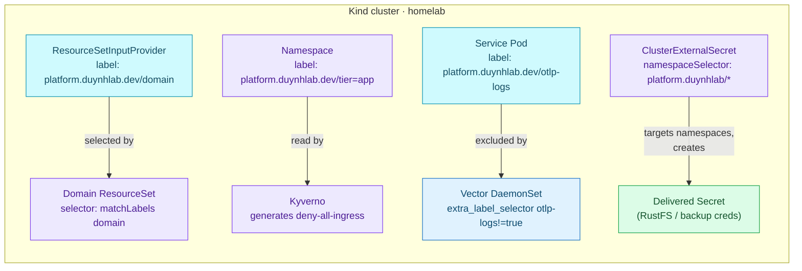
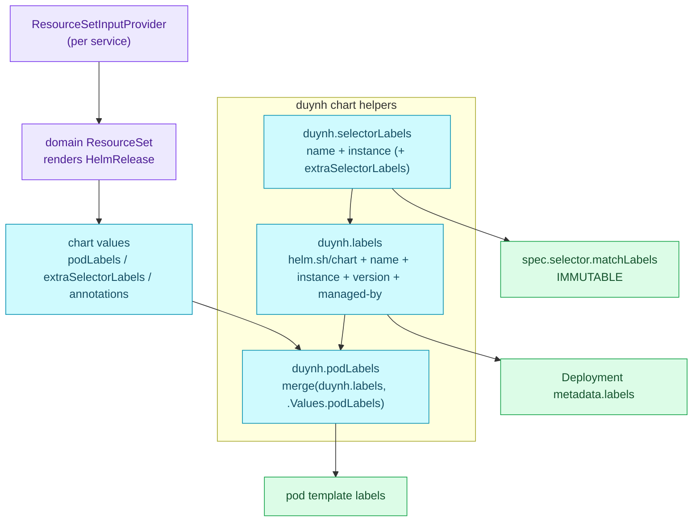
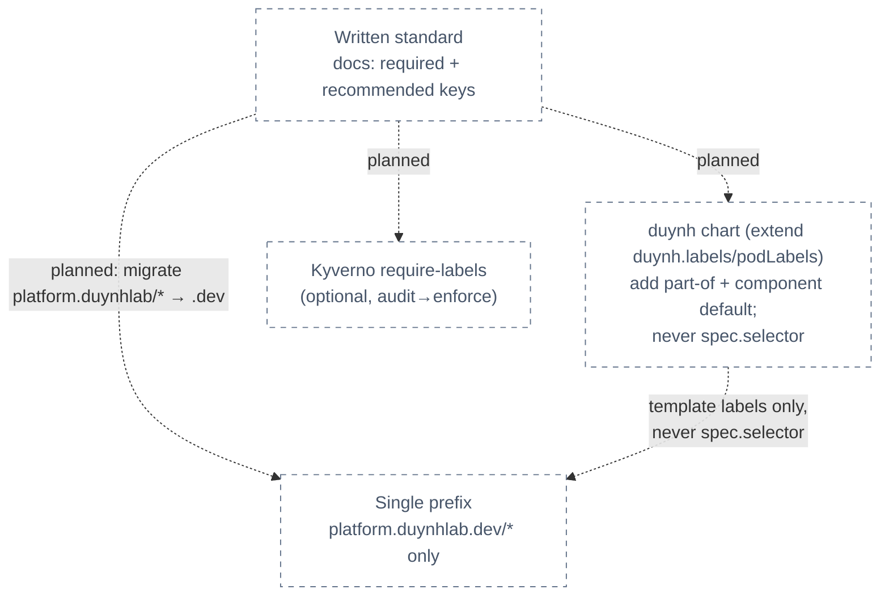

# RFC-0034 — Research: Kubernetes labels and annotations standard

| | |
|---|---|
| **RFC** | RFC-0034 |
| **Status** | researching |
| **Scope** | platform-wide |
| **Created** | 2026-10-27 |
| **Last updated** | 2026-10-28 |

> **Research only.** Nothing described here is applied to the cluster or the `duynh`
> chart. This document inventories how Homelab labels and annotates objects today,
> explains the Kubernetes mechanics behind those keys, and compares options for a
> written standard — it does **not** decide one. No manifest changes belong in this file.

---

## Table of contents

1. [Problem statement](#problem-statement)
2. [Reading path](#reading-path)
3. [What labels and annotations are](#what-labels-and-annotations-are)
4. [Core components](#core-components)
5. [Core mechanism](#core-mechanism)
6. [Glossary](#glossary)
7. [Worked examples](#worked-examples)
8. [vs platform as-built](#vs-platform-as-built)
9. [Integration paths](#integration-paths)
10. [Alternatives](#alternatives)
11. [Open questions](#open-questions)
12. [FAQ](#faq)
13. [References](#references)
14. [Context7 audit log](#context7-audit-log)
15. [Research review gate](#research-review-gate)

---

## Problem statement

### Real-world trigger

| | |
|---|---|
| **Situation** | Homelab labels objects with two different custom prefixes — `platform.duynhlab.dev/*` (e.g. `domain`, `tier`, `otlp-logs`) and, separately, `platform.duynhlab/*` **without** the `.dev` (e.g. `backup`, `clickhouse`, `s3-pyroscope`, `s3-peerdb`) — alongside the Kubernetes-recommended `app.kubernetes.io/*` set that mostly arrives from upstream charts and is applied unevenly on homelab-authored objects. There is no written contract saying which key goes on what, which prefix is canonical, or which labels are load-bearing. |
| **Who feels it** | Platform/on-call first (selectors that silently match nothing; no reliable per-app or per-domain `kubectl get` rollup), then anyone adding a service, a secret, or an alert rule and guessing the labels. |
| **Why now** | The fleet is large enough to feel it: 10 services rendered by one `duynh` chart, per-domain Flux ResourceSets, namespace-scoped NetworkPolicy and ClusterExternalSecret selectors, and a Vector log pipeline that keys off a pod label. Several of these keys are already load-bearing, so the inconsistency is a latent incident, not a cosmetic one. |
| **If we do nothing** | Label typos keep selecting nothing and failing open (a `platform.duynhlab/*` vs `platform.duynhlab.dev/*` slip is one character and silent); provenance stays scattered; admission cannot require the labels operators rely on; and every new object re-litigates the convention from memory. |

> **In plain terms:** we use labels and annotations heavily and some of them steer real
> behavior, but the rules live in people's heads and in scattered manifest comments.
> This research asks what a single written standard should look like before we decide one.

**Concrete triggers already in the tree:**

- **Near-miss / incident:** losing `platform.duynhlab.dev/tier: app` off a namespace once
  made Kyverno delete that namespace's generated deny-all-ingress NetworkPolicy
  (recorded 2026-09-29 in [`namespaces.yaml`](../../../../kubernetes/infra/controllers/namespaces.yaml)) — a label drives a security control.
- **Two-prefix hazard:** `platform.duynhlab/backup: "cnpg"` and friends select namespaces
  for `ClusterExternalSecret` credential delivery; a writer who reaches for the more common
  `platform.duynhlab.dev/` prefix by habit produces a selector that matches nothing and
  fails silently.
- **Design review:** adding a service means hand-copying `platform.duynhlab.dev/domain`
  onto its `ResourceSetInputProvider` so the domain ResourceSet discovers it — undocumented
  outside AGENTS.md prose.
- **Ops rollup:** `kubectl get all -l app.kubernetes.io/part-of=…` does not reliably return
  a whole application because the recommended set is applied inconsistently.

### What homelab practice would prove

- Whether a single canonical prefix and a documented required/recommended split can cover
  every axis in use today (routing, tier, telemetry opt-out, secret delivery, provenance)
  without breaking the load-bearing selectors.
- Whether the recommended `app.kubernetes.io/*` set can be rendered fleet-wide by the
  `duynh` chart **without** touching immutable Deployment selectors.
- Whether admission (Kyverno) should *require* the mandatory subset, and on which objects.

---

## Reading path

1. [What labels and annotations are](#what-labels-and-annotations-are) → [Core mechanism](#core-mechanism)
2. [vs platform as-built](#vs-platform-as-built) → [Alternatives](#alternatives)
3. [Open questions](#open-questions) → [Research review gate](#research-review-gate)

---

## What labels and annotations are

Both live under an object's `metadata`, both are string key/value pairs, and both can be
changed at any time. The difference is **who reads them**:

- **Labels** identify and *select* objects. The Kubernetes core evaluates them: a Service
  finds its Pods, a Deployment adopts its ReplicaSets, a NetworkPolicy picks its targets,
  and the scheduler picks nodes — all through label selectors. They are small and
  constrained so they can be indexed.
- **Annotations** carry non-identifying metadata that nothing selects on: build info,
  ownership, descriptions, and controller configuration (an Ingress/Gateway controller,
  cert-manager, Prometheus discovery). Values may be large and arbitrary.

> **In plain terms:** if you will ever filter or select by it, it is a label; if it is pure
> information for a human or a tool, it is an annotation.

The decisive practical rule: a label value is capped at 63 characters with a restricted
character set, while all annotations on one object together may total up to 256 KiB.

---

## Core components

| Component | Role in this topic |
|-----------|--------------------|
| **Label key** | Optional DNS-subdomain *prefix* (≤253 chars) + name (≤63 chars). `kubernetes.io/` and `k8s.io/` are reserved; unprefixed keys are "private" to the user. |
| **Label value** | ≤63 chars, alphanumeric plus `-`, `_`, `.`, starting/ending alphanumeric (may be empty). |
| **Label selector** | Equality (`=`, `!=`) or set-based (`in`, `notin`, existence); multiple requirements are AND. Used by `kubectl -l`, Services, controllers, NetworkPolicy. |
| **`app.kubernetes.io/*`** | Kubernetes' recommended shared label set: `name`, `instance`, `version`, `component`, `part-of`, `managed-by`. |
| **Annotation** | Non-selectable metadata, ≤256 KiB total per object, arbitrary characters. |
| **Admission policy** | Kyverno or a `ValidatingAdmissionPolicy` can *require* or *restrict* labels at write time (the only reliable enforcement). |

---

## Core mechanism

**Mechanism — how a label becomes behavior.** A label on an object does nothing on its
own; it becomes meaningful when some selector reads it. Homelab already relies on this at
four layers.



> **In plain terms:** four separate controllers each pick objects by a label. Get the key
> or prefix wrong and the selector quietly matches nothing — the object is simply left out,
> with no error. That silent-failure mode is why the two-prefix inconsistency matters.

---

## Glossary

| Term | In plain English |
|------|------------------|
| **Recommended labels** | The `app.kubernetes.io/*` keys Kubernetes suggests so tools can describe apps the same way. Not required by the core. |
| **Prefix / namespace of a key** | The DNS-subdomain before the `/`. Ours *should* be one domain; today there are two (`platform.duynhlab.dev` and `platform.duynhlab`). |
| **Load-bearing label** | A label some controller selects on, so changing/removing it changes behavior (e.g. `tier`, `otlp-logs`, the `platform.duynhlab/*` secret selectors). |
| **Selector immutability** | `spec.selector.matchLabels` on a Deployment/StatefulSet cannot change after creation — so a label standard must not require editing it in place. |
| **Private (unprefixed) label** | A key with no prefix (e.g. `environment: local`). Allowed, but collision-prone across tools. |

---

## Worked examples

> **Not deployed** — syntax and mechanism only.

Recommended set on a workload (what the `duynh` chart could render fleet-wide):

```yaml
metadata:
  labels:
    app.kubernetes.io/name: product
    app.kubernetes.io/instance: product
    app.kubernetes.io/version: "1.16.7"
    app.kubernetes.io/component: api
    app.kubernetes.io/part-of: duynhlab
    app.kubernetes.io/managed-by: Helm
    platform.duynhlab.dev/domain: catalog
```

Selector immutability trap — only template labels may be added to an existing Deployment:

```bash
# Safe: add informational labels to the pod template (triggers a normal rollout)
# Unsafe: editing spec.selector.matchLabels is rejected by the API server
kubectl get all -l app.kubernetes.io/part-of=duynhlab   # the payoff: one-command rollup
```

---

## vs platform as-built

Cross-checked against the manifests on 2026-10-27. "Reads it" names the consumer that makes
the key load-bearing (or "informational" when nothing selects on it).

### Custom prefix `platform.duynhlab.dev/*` (the canonical-looking one)

| Key | Set on | Reads it / effect |
|-----|--------|-------------------|
| `domain` | `ResourceSetInputProvider` ([`kubernetes/apps/services/*.yaml`](../../../../kubernetes/apps/services)), domain `ResourceSet` selector ([`domains/*-rs.yaml`](../../../../kubernetes/apps/domains)) | Flux ResourceSet discovery — routes a service into its domain. **Load-bearing.** |
| `tier: app` | app namespaces ([`namespaces.yaml`](../../../../kubernetes/infra/controllers/namespaces.yaml)) | Vector / NetworkPolicy / Kyverno. **Load-bearing** (drove deny-all-ingress generation, 2026-09-29). |
| `otlp-logs` | service pods via `duynh` chart `podLabels` ([`fulfillment-rs.yaml`](../../../../kubernetes/apps/domains/fulfillment-rs.yaml)) | Vector `extra_label_selector: otlp-logs!=true` ([`vector.yaml`](../../../../kubernetes/infra/controllers/logging/vector/vector.yaml)) — double-ingest guard. **Load-bearing.** |
| `needs-trust` | namespace (e.g. profiling) | ClusterExternalSecret trust distribution. **Load-bearing.** |
| `owner`, `expires-at` | Kyverno `PolicyException` objects | Humans + exception hygiene ([`docs/security/policy-exceptions.md`](../../../security/policy-exceptions.md)). Informational. |
| `rfc`, `adr` | scalers/workers ([`order-fulfillment-scaler.yaml`](../../../../kubernetes/apps/order-fulfillment-scaler.yaml)) | Change provenance. Informational. |
| `source`, `chart-version` | PrometheusRule objects | Alert-rule provenance (homelab-authored vs chart). Informational. |

### Custom prefix `platform.duynhlab/*` — **no `.dev`** (the inconsistency)

| Key | Set on | Reads it / effect |
|-----|--------|-------------------|
| `backup: cnpg` | namespaces | `ClusterExternalSecret` namespaceSelector → pg backup creds. **Load-bearing.** |
| `clickhouse: "true"` | monitoring namespace | ClickHouse RustFS creds delivery. **Load-bearing.** |
| `s3-pyroscope`, `s3-peerdb`, `s3` | namespaces | RustFS S3 credential delivery per consumer. **Load-bearing.** |

> These keys use a *different DNS subdomain* than every other platform key. They work, but a
> one-character habit (`…dev/`) produces a silent no-match. This is the sharpest concrete
> defect the standard would resolve.

### Recommended set `app.kubernetes.io/*` and unprefixed

The `duynh` chart ([`helm-charts/charts/duynh`](https://github.com/duynhlab/helm-charts/tree/main/charts/duynh)),
which renders every one of the 10 services + the two SPAs, already emits a solid
`app.kubernetes.io/*` subset through its `duynh.labels` helper. The gaps below are relative
to *that* baseline, not to a blank slate.

| Key | On `duynh`-chart workloads | On infra/operator objects | Gap |
|-----|---------------------------|---------------------------|-----|
| `name` | **Rendered** (`duynh.selectorLabels` → `app.kubernetes.io/name`) | Upstream charts (CNPG, ESO) consistently | — reliable for chart + operator objects |
| `instance` | **Rendered** (`duynh.selectorLabels` → `.Release.Name`) | Upstream charts | — |
| `version` | **Rendered** (`duynh.labels`, from `.Chart.AppVersion`) | Upstream charts | Rare on homelab-authored loose manifests |
| `managed-by` | **Rendered** (`duynh.labels` → `.Release.Service` = `Helm`) | Upstream charts | — |
| `component` | **Not a chart default** — only set per-service via `podLabels` override ([`fulfillment-rs.yaml`](../../../../kubernetes/apps/domains/fulfillment-rs.yaml) sets `component: api`) | Partial (CNPG, ESO) | No fleet-wide guarantee; value chosen per ResourceSet, not by the chart |
| `part-of` | **Never rendered** by the chart | Partial (`rsip-product` `part-of: backend-services`, some PrometheusRules) | `-l app.kubernetes.io/part-of` rollup is unreliable; values disagree (`backend-services` vs none) |
| `environment: local` (unprefixed) | Set on namespaces, not chart workloads | Every namespace | Private key, collision-prone; environment axis not under a platform prefix |

> **The chart is already most of the way there.** `name`, `instance`, `version` and
> `managed-by` are rendered on every service by `duynh.labels`; the two keys the standard
> would still have to add are `part-of` (never rendered) and a chart-level default for
> `component` (today only a per-ResourceSet `podLabels` override). `helm.sh/chart` is also
> rendered but is a Helm bookkeeping key, not part of the recommended set.

### The `duynh` chart render path

How a label reaches a running service object today — and why the chart can safely *add*
labels but must not touch the selector. `duynh.labels` feeds both the object `metadata` and
(via `duynh.podLabels`, which merges `duynh.labels` with `.Values.podLabels`) the pod
template; `duynh.selectorLabels` — `name` + `instance` only — feeds `spec.selector.matchLabels`,
which is **immutable** after creation.



> **In plain terms:** the chart already stamps the `app.kubernetes.io/*` baseline onto every
> object's `metadata` and pod template. A standard that adds `part-of` and a `component`
> default extends `duynh.labels`/`podLabels` only — it must never widen `duynh.selectorLabels`,
> because that line is welded into the immutable selector of the running Deployments.

### Annotations in use

| Source | Examples | Nature |
|--------|----------|--------|
| Flux | `kustomize.toolkit.fluxcd.io/*`, image-policy marker comments | Controller config |
| cert-manager | `cert-manager.io/cluster-issuer` | Controller config |
| Kubernetes core | `kubectl.kubernetes.io/last-applied-configuration`, `deployment.kubernetes.io/revision` | Core bookkeeping |
| `duynh` chart | `deploymentAnnotations`, `podAnnotations` (default `{}`) | Opt-in passthrough — the chart adds no annotations of its own |

---

## Integration paths

**Target state (planned) — one prefix, recommended set rendered by the chart, optional
admission gate.** All dashed/`planned` until an RFC decides it.



> **In plain terms:** write the contract once, let the chart apply the recommended set to
> every service, collapse onto one prefix, and *optionally* have admission require the
> mandatory subset — introduced in `Audit` before `Enforce`.

---

## Alternatives

Decision stays open — these are the shapes an RFC would choose between.

| Option | Pros | Cons |
|--------|------|------|
| **A — Recommended set fleet-wide + one consolidated prefix** (adopt `app.kubernetes.io/*` via the chart; move every `platform.duynhlab/*` to `platform.duynhlab.dev/*`; reserve the prefix for platform-only axes) | Interoperable with Helm/dashboards/tools; reliable `-l` rollups; removes the two-prefix hazard; keeps platform axes explicit | Cross-repo work (`helm-charts` `duynh` chart + service repos); careful migration of load-bearing `platform.duynhlab/*` selectors; must avoid immutable-selector edits |
| **B — Custom-prefix-only taxonomy** (standardize everything under `platform.duynhlab.dev/*`; do not invest in `app.kubernetes.io/*`) | Fewer keys; one mental model; no chart dependency on upstream conventions | Loses tool interoperability (Helm/ArgoCD/dashboards expect `app.kubernetes.io/*`); swims against the ecosystem |
| **C — Document-only, enforce nothing** (write the convention; fix the prefix; no admission) | Smallest change; no admission risk; immediate clarity | Nothing stops drift; the near-miss class of defect can recur |

**Enforcement sub-axis (orthogonal to A/B/C):**

| Enforcement | Note |
|-------------|------|
| **Kyverno `require-labels`** | Fits the existing Kyverno catalog; supports `Audit`→`Enforce`. No such policy exists today. |
| **`ValidatingAdmissionPolicy`** | Core, no controller; CEL rules. New pattern for this repo. |
| **None** | Convention by documentation + review only. |

---

## Open questions

- [ ] Which keys are **mandatory** vs **recommended**? (Candidate mandatory: `app.kubernetes.io/name`, `app.kubernetes.io/managed-by`, `app.kubernetes.io/part-of`, `platform.duynhlab.dev/domain` on services; `platform.duynhlab.dev/tier` on app namespaces.)
- [ ] Collapse the **two prefixes** onto `platform.duynhlab.dev/*`? If yes, the `platform.duynhlab/*` secret selectors and the namespace labels must migrate together (load-bearing, coordinated change) — or do we keep both and just document them?
- [ ] **Enforce** at admission (Kyverno `require-labels`, Audit first) or document-only?
- [ ] Close the chart gaps through the **`duynh` chart** in `helm-charts` (cross-repo): extend `duynh.labels`/`duynh.podLabels` to render `app.kubernetes.io/part-of` and a chart-level `component` default (today only a per-ResourceSet `podLabels` override), while leaving `duynh.selectorLabels` (`name` + `instance`) untouched so `spec.selector.matchLabels` stays immutable on the running Deployments?
- [ ] Are **cost/team** labels meaningful for a single-tenant homelab, or out of scope (Non-Goal)?
- [ ] Likely **ADR split**: (1) label/annotation taxonomy + canonical prefix; (2) enforcement mechanism; (3) chart render + migration of `platform.duynhlab/*`.
- [ ] Is a **domain reference doc** (`docs/platform/labels.md`) wanted as the durable home for the catalog?

---

## FAQ

**Why not just add more labels everywhere?**
Every label should answer a question actually asked (rollup by app, route by domain, opt a
pod out of Vector). Unused labels are etcd weight and noise.

**Can we fix the taxonomy by editing Deployment selectors?**
No — `spec.selector.matchLabels` is immutable after creation. A standard must add only
*template/metadata* labels to existing workloads; selector changes require recreation.

**Are labels a security control?**
No. A NetworkPolicy selects by label, but anyone with write access can relabel an object.
RBAC and admission are the trust boundary — which is exactly why *requiring* labels is an
admission concern, not a label concern.

**Is this API-touching?**
No. It governs manifest metadata and chart rendering. `docs/api/` is unaffected; this is an
infra/platform standard (platform-wide only because the `duynh` chart spans service repos).

---

## References

Official documentation only (synthesized in-house; no third-party tutorials embedded):

- Kubernetes — Recommended Labels: <https://kubernetes.io/docs/concepts/overview/working-with-objects/common-labels/>
- Kubernetes — Labels and Selectors: <https://kubernetes.io/docs/concepts/overview/working-with-objects/labels/>
- Kubernetes — Annotations: <https://kubernetes.io/docs/concepts/overview/working-with-objects/annotations/>
- Kubernetes — Well-Known Labels, Annotations and Taints: <https://kubernetes.io/docs/reference/labels-annotations-taints/>
- Homelab admission rules: [`AGENTS.md`](../../../../AGENTS.md) · [`docs/security/policy-catalog.md`](../../../security/policy-catalog.md)
- `duynh` chart label helpers: [`helm-charts/charts/duynh/templates/_helpers.tpl`](https://github.com/duynhlab/helm-charts/blob/main/charts/duynh/templates/_helpers.tpl) (`duynh.labels`, `duynh.selectorLabels`, `duynh.podLabels`)

---

## Context7 audit log

Verification used the official Kubernetes documentation pages listed in References
(versions current as of 2026-10-28); Homelab claims cross-checked against the cited
manifests in the same worktree, and `duynh` chart claims against the `helm-charts` sibling
repository.

| Claim / section | Source checked | Result |
|-----------------|----------------|--------|
| Recommended set is `name, instance, version, component, part-of, managed-by`; shared prefix `app.kubernetes.io` | K8s Recommended Labels | confirmed |
| Label value ≤63 chars (restricted charset); prefix is a DNS subdomain ≤253 chars; `kubernetes.io/`,`k8s.io/` reserved | K8s Labels and Selectors | confirmed |
| Annotations total ≤256 KiB per object; arbitrary characters; not selectable | K8s Annotations | confirmed |
| `spec.selector.matchLabels` immutable on Deployments/StatefulSets | K8s Labels and Selectors / Deployment API | confirmed |
| Two prefixes in use (`platform.duynhlab.dev/*` and `platform.duynhlab/*`) | Repo grep of `kubernetes/**` (2026-10-27) | confirmed |
| `otlp-logs` / `tier` / `domain` / `platform.duynhlab/*` are load-bearing selectors | `vector.yaml`, `namespaces.yaml`, `domains/*-rs.yaml`, cluster-external-secrets | confirmed |
| `duynh` chart renders `name`+`instance`+`version`+`managed-by`+`helm.sh/chart`; selector = `name`+`instance`; `part-of` never rendered, `component` only via `podLabels` override | `helm-charts/charts/duynh` `_helpers.tpl`, `deployment.yaml`, `values.yaml` (sibling repo, 2026-10-28) | confirmed |

---

## Research review gate

<!-- All boxes ticked by the owner before copying RFC-0000/README.md → RFC-0034/README.md. -->

- [ ] Answers a **real-world problem** recognizable at work (near-miss, design review, ops rollup)
- [ ] **Problem statement** names situation, who feels it, and cost of doing nothing
- [ ] At least **two alternatives** documented with tradeoffs
- [ ] **Platform as-built** section filled from manifests (not boilerplate)
- [ ] Primary use-case direction stated (may remain "undecided")
- [ ] **Context7 / official-doc audit** complete; scope, sources and verification date recorded
- [ ] At least **one Mermaid** diagram; labels match deployed vs **planned** reality
- [ ] No Kubernetes manifest changes smuggled into this research file
- [ ] Owner sign-off: **ready for RFC**

---

_Last verified: 2026-10-28 (official Kubernetes docs + homelab manifest cross-check; `duynh` chart helpers cross-checked against the `helm-charts` sibling repo)._
