# OpenBAO Architecture

> **Status**: Migration target — replacing HashiCorp Vault (Dev Mode) with OpenBAO HA
>
> **Scope**: OpenBAO internals, current local Kind behavior, and production-target learning notes.

> ### ⚠ Current deployment state vs. planned
>
> Much of this guide describes the **production target**. What the local Kind
> cluster **actually runs today**:
>
> | Capability | Deployed now (local Kind) | Planned for prod |
> |---|---|---|
> | Storage / HA | ✅ OpenBAO HA, 3-node Raft, PVC | same |
> | App secret delivery | ✅ ESO + **KV v2 static** secrets (`refreshInterval: 1h`); **all ten service runtime DB passwords are DB-engine static roles** read via the `openbao-db` store (`refreshInterval: 15s`) | per-request dynamic DB creds |
> | Auth (ESO) | ✅ Kubernetes auth, least-privilege `eso-read` policy | same |
> | Auth (humans) | ✅ **OIDC via the `duynhlab-staff` realm** ([ADR-062](../proposals/adr/ADR-062-staff-groups-sso/)): UI button + `bao login -method=oidc`; groups → external groups → team policies (`infra-team`, `sre-team`) | same, real IdP hostname |
> | Audit | ✅ declarative `audit "file" "to-stdout"` (active node only) → Vector → VictoriaLogs **and** ClickHouse `otel_logs`; still stdout-only, no durable `auditStorage` | durable, fail-closed |
> | **Database secrets engine** | ✅ **enabled — pattern A** ([ADR-025](../proposals/adr/ADR-025-pgdog-passthrough-dynamic-db-creds/), [ADR-089](../proposals/adr/ADR-089-postgresql-access-contract/)): one static role per runtime login, four on `platform-db` and six on `product-db` (`rotation_period` 720h), each cluster with its own `vault_rotator` and configurator Job, read through the dedicated `openbao-db` ClusterSecretStore. Per-request dynamic roles: §5.2, §6, §10 — still *planned* | per-request dynamic roles; migrators, `db_authz`, Temporal, Keycloak |
> | Unseal | ⚠️ **awskms auto-unseal via the floci KMS emulator** (RFC-0008 / ADR-024) — pods self-unseal at boot; `openbao-init-keys` holds only a break-glass recovery key; **root token revoked**. floci is a zero-auth emulator: since floci 2.1 the wrapped key is real AES-GCM under a backing key that floci stores in plaintext on its own PVC, so losing `floci-data` (or re-creating the key) makes the cluster unrecoverable without the recovery key ([ADR-024 amendment 2026-10-29](../proposals/adr/ADR-024-floci-kms-emulator-auto-unseal/README.md#amendment-2026-10-29--floci-2x-encrypts-for-real)) | Real cloud KMS (`awskms`/`gcpckms`, IRSA/Workload Identity) |
> | TLS | ❌ disabled (`tlsDisable: true`; plaintext HTTP in-cluster) | TLS via cert-manager — planned, [RFC-0020](../proposals/rfc/RFC-0020/) Slice 1 |
> | Credentials | ⚠️ database passwords are random per cluster (none in Git); infra dev passwords (RustFS, ClickHouse, Keycloak admin, `pg_stat_ch`) are still **seeded from Git** (e.g. `*-K1nd-2026!`) | generated / dynamic, none in Git |
> | Root token | ✅ **revoked** after bootstrap (verified by exit code, node-pinned); inert copy left in `openbao-init-keys` (BusyBox `wget` can't PATCH it out). Break-glass **recovery key** remains = full admin via `generate-root`, so a Secret read is still high-value. **Human access no longer depends on it** — OIDC login is live (ADR-062) | revoked; OIDC / AppRole; recovery key sharded offline |
>
> **These local-only choices are unsafe for production.** The hardening path and a
> local-vs-prod parity/testing matrix live in [RFC-0008](../proposals/rfc/RFC-0008/).
> The database engine's **static roles are deployed** for every runtime login (§5.2); any section below
> describing *per-request dynamic* credentials or leases is **planned**, not deployed;
> **OIDC is deployed** for staff since [ADR-062](../proposals/adr/ADR-062-staff-groups-sso/).

---

## 1. What Is OpenBAO?

**OpenBAO** is an open-source fork of HashiCorp Vault, created after the BSL license change in 2023. It is:

- **Apache 2.0 licensed** — truly open-source, no enterprise licensing concerns
- **API-compatible with Vault** — ESO, Kubernetes auth, all existing patterns carry over unchanged
- **CNCF Sandbox project** under the OpenSSF
- **Drop-in replacement** — rename `vault` CLI to `bao`, same REST API paths (`/v1/...`)
- **Actively maintained** — this repo currently deploys OpenBAO 2.7.0 via the OpenBAO Helm chart (pinned at 0.30.0)

### Why Migrate from Vault Dev Mode

| Problem | Vault Dev Mode | OpenBAO Production |
|---------|---------------|-------------------|
| Data persistence | ❌ In-memory, lost on restart | ✅ Raft PVC, survives reboots |
| Unseal | ❌ Always unsealed with root token | ✅ Auto-unseal via KMS / Transit |
| TLS | ❌ HTTP only | ✅ TLS everywhere |
| High availability | ❌ Single node | ✅ 3-node Raft cluster |
| Root token | ❌ Static `root` in Git | ✅ Revoked after init, operator access via OIDC |
| DB credentials | ❌ Static `postgres/postgres` | ✅ Dynamic, TTL-based, per-service |
| Multi-environment | ❌ One flat namespace | ✅ Namespaces: `local/`, `staging/`, `prod/` |
| License | ❌ BSL (non-OSS) | ✅ Apache 2.0 |

> This table is the canonical **Vault → OpenBAO** comparison (the legacy
> `vault.md` dev-mode doc has been retired). The decision and the rejected
> alternatives are recorded in
> [ADR-005](../proposals/adr/ADR-005-openbao-ha-raft/); the dev-vs-prod
> seal/TLS/credential tradeoffs and how to close them are in
> [RFC-0008](../proposals/rfc/RFC-0008/) and the current-state banner above.

---

## 2. OpenBAO Runtime Architecture

This diagram answers one question: **how a secret gets from OpenBAO into a
workload, and how the HA store stays available.** Three Raft peers (PVC-backed)
form the quorum behind the in-cluster service; External Secrets Operator (ESO)
logs in with a Kubernetes service account, reads the KV engine, and materializes
Kubernetes Secrets that pods consume. **Auto-unseal is deployed on Kind via the floci
KMS emulator** (RFC-0008 / ADR-024) — pods self-unseal at boot. The database engine
is live with one **static role per service runtime login** (ten, both clusters — ADR-025, ADR-089). **OIDC is live** — staff log in through the
`duynhlab-staff` realm and group membership maps to team policies (ADR-062).
Dashed **(planned)** nodes/edges are designed but not yet deployed (per-request
dynamic DB creds, AppRole, real cloud KMS); everything else is live on local Kind.

### High-Level Overview

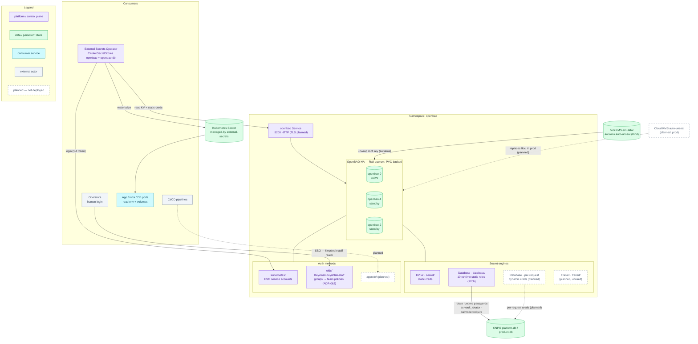

### Raft Cluster Internals

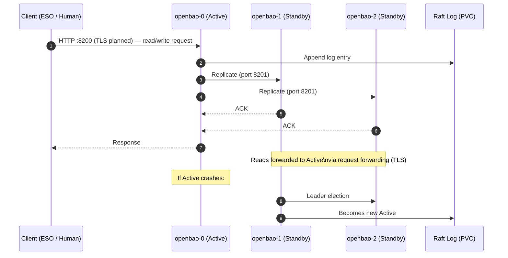

---

## 3. Seal / Unseal Architecture

Unsealing is the process of decrypting the root key so OpenBAO can serve requests. OpenBAO always starts **sealed**.

### Shamir vs Auto-Unseal

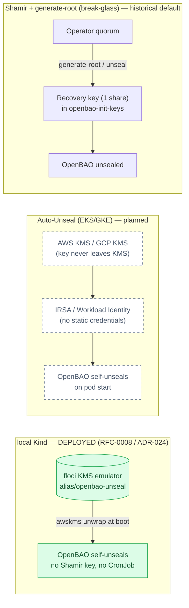

> On this platform OpenBAO no longer uses the Shamir + unsealer-CronJob path: pods
> **self-unseal at boot** via `seal "awskms"` pointed at the floci emulator
> (`alias/openbao-unseal`). Shamir survives only as the **recovery-key break-glass**
> (`bao operator generate-root`). Production swaps floci's `endpoint` for a real cloud KMS.

### The awskms seal is a plugin (OpenBAO 2.7+)

OpenBAO 2.7 removed the provider seals (`awskms`, `gcpckms`, `azurekeyvault`, …)
from its binary; they ship as external **KMS plugins** in the `openbao-plugins`
collection. The server config therefore declares the plugin next to the seal, and
the two names must match:

```hcl
plugin_directory     = "/openbao/data/plugins"
plugin_auto_download = true

plugin "kms" "awskms" {
  image = "ghcr.io/openbao/openbao-plugin-kms-aws:v0.1.0@sha256:fe9fb948…"
}

seal "awskms" { … unchanged, still pointing at floci … }
```

How it behaves, as measured on Kind on 2026-09-29:

- **First start:** each server downloads the plugin from GHCR *before* it unseals
  and logs `Auto Seal: awskms (builtin: false, …)`. A failed download fails startup
  (`plugin_download_behavior` defaults to `fail`), so a registry outage shows up as
  a crash rather than a sealed server that looks healthy.
- **Restart:** the binary is cached on the Raft PVC (`/openbao/data/plugins`), so a
  restarted pod logs `plugin is cached on disk, skipping download` and unseals with
  no network call to GHCR.
- **Pinning:** the image is pinned by its multi-arch index digest. `sha256sum` is
  deliberately unset because it is a per-architecture binary checksum and would break
  an arm64 host.
- **Upgrading the plugin** means changing the digest. Upgrading OpenBAO is changing
  the chart pin in `helmrelease.yaml`, which is no longer a floating range.

### Init Ceremony (auto-unseal → recovery keys)

With auto-unseal, `operator init` issues **recovery keys** (break-glass) instead of
Shamir unseal keys — the KMS wraps/unwraps the root key, so nodes self-unseal at boot.
Recovery keys are still split with PGP so no single operator holds the full key:

```bash
# Production: KMS auto-unseal, recovery key split across operators' PGP keys
bao operator init \
  -recovery-shares=5 \
  -recovery-threshold=3 \
  -pgp-keys="keybase:devops1,keybase:devops2,keybase:devops3,keybase:devops4,keybase:devops5" \
  -root-token-pgp-key="keybase:devops-lead"

# Local Kind (this platform, floci awskms): single recovery key, stored in openbao-init-keys
bao operator init -recovery-shares=1 -recovery-threshold=1
```

> **Deployed here (RFC-0008 / ADR-024):** the bootstrap Job runs the local form above,
> configures OpenBAO, then **revokes the root token** (its copy in `openbao-init-keys`
> becomes inert). Day-2 admin uses `bao operator generate-root` from the recovery key.

### How the floci KMS alias is provisioned (and two gotchas)

`seal "awskms"` resolves `alias/openbao-unseal` via `DescribeKey` **at OpenBAO server
startup** — so the alias must already exist in floci, or every OpenBAO pod crashes with
`Error configuring seal "awskms": Alias not found`. Two non-obvious consequences:

1. **Chicken-and-egg → a Job in OpenBAO's own Flux wave.** The alias **cannot** be
   created by the `openbao-bootstrap` Job's main script, because that first waits for
   OpenBAO `:8200` — which never comes up without the alias. A dedicated **`floci-kms-init`
   Job** (`kubernetes/infra/controllers/secrets/floci/floci-kms-init.yaml`) creates the
   KMS key + alias, talking **only to floci** (unsigned AWS-JSON over `wget`; floci is
   zero-auth). **Its placement is load-bearing:** it lives in the `floci` overlay of the
   **`controllers-local`** wave, next to the floci Deployment and the OpenBAO HelmRelease.
   If it instead lived in `secrets-local` (which `dependsOn: controllers-local`,
   `wait: true`) it could only run *after* the OpenBAO HR is Ready — which never happens
   without the alias → a hard deadlock on a clean boot. Co-located, the Job creates the
   alias (~10s once floci is up) while OpenBAO crash-retries, so both converge in one
   wave (on a clean `make down && make up`, OpenBAO then boots with **0 restarts**).
   `controllers-local` `wait: true` is satisfied meanwhile because OpenBAO's readiness
   probe is deliberately permissive (`sealedcode=200&uninitcode=200` → a running-but-sealed
   pod counts Ready).
2. **`enableServiceLinks: false` on floci.** The floci pod carries this because
   Kubernetes otherwise injects a `FLOCI_PORT=tcp://<clusterIP>:4566` service-link env
   (from the same-named Service) that floci's Quarkus config reads as its port and
   crashes ("expected an integer, got tcp://…").

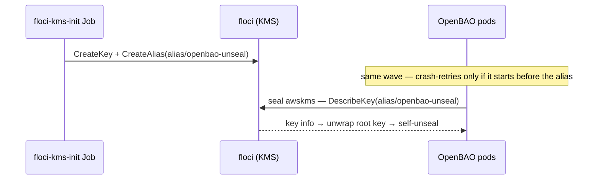

---

## 4. Authentication Methods

### Overview

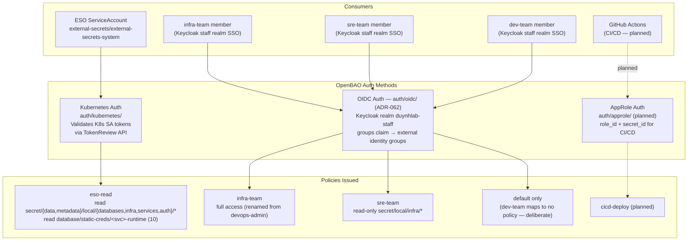

### Kubernetes Auth — ESO Integration

ESO authenticates to OpenBAO using its Kubernetes ServiceAccount token. OpenBAO validates the token against the Kubernetes TokenReview API.

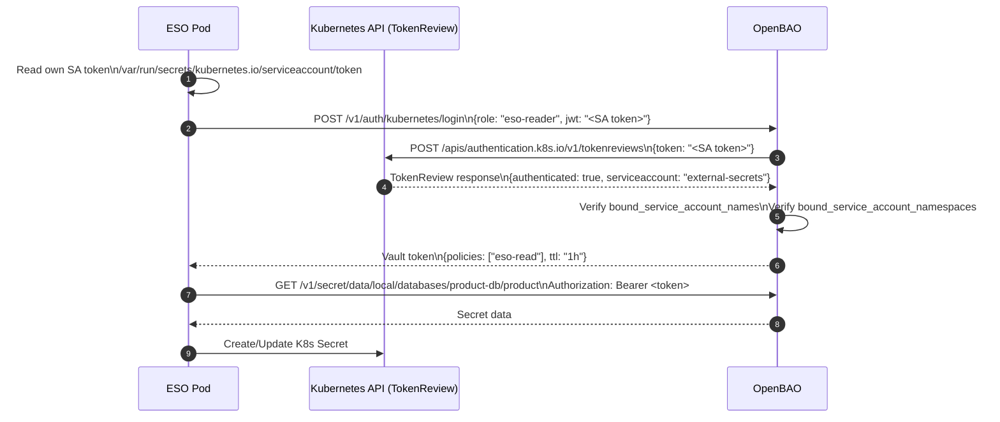

> ⚠️ **Reviewer-JWT pitfall (commit `fb14349`)** — When configuring `auth/kubernetes/config`, **omit** `token_reviewer_jwt` and set `disable_local_ca_jwt=false`. OpenBAO will then call `TokenReview` using its own pod's auto-rotated SA token (long-lived projected token, refreshed by kubelet).
>
> If you instead pass `token_reviewer_jwt=@/var/run/secrets/.../token` from the bootstrap Job's pod, that token is bound by `BoundServiceAccountTokenVolume` to ~1 h. After it expires every login fails with `permission denied` and ESO breaks platform-wide. See [Reviewer JWT auth failure](./runbooks/reviewer-jwt-auth-failure.md) for the runtime recovery procedure.

### OIDC Auth — staff SSO (deployed, ADR-062)

One identity for every infra tool: the same staff-realm token model Grafana
uses. The server-side discovery fetch reaches the PUBLIC issuer host through
the in-cluster hairpin (CoreDNS rewrite → `edge` Service), trusted via the
trust-manager `homelab-ca-bundle` — because OpenBAO's single
`oidc_discovery_url` must equal the token issuer and cannot split URLs the way
Grafana does. Config is written by the `openbao-oidc-config` Job (the second
[ADR-025] pattern-A configurator — k8s auth, no root token), one Flux wave
after the edge is serving.

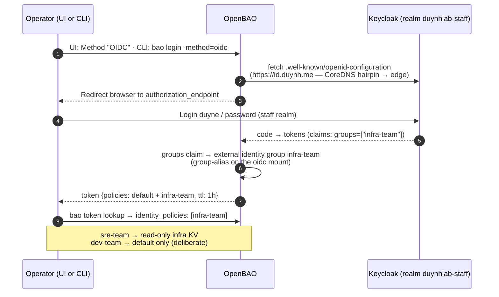

---

## 5. Secret Engines

### 5.1 KV v2 — Static Secrets

Used for credentials the database engine does not rotate: S3 backup keys,
infra admin logins, and the database migrator, `db_authz`, `vault_rotator`,
Temporal and Keycloak passwords.

**Path structure** (unchanged from current Vault convention):

```
secret/{environment}/{category}/{service}/{resource}
```

| Environment | KV path prefix | Use |
|-------------|----------------|-----|
| `local` | `secret/local/` | Kind cluster |
| `staging` | `secret/staging/` | Staging environment |
| `prod` | `secret/prod/` | EKS / GKE production |

**Current KV paths** (seeded at bootstrap). Each service has one
`secret/local/databases/<cluster>/<svc>-migrator` entry, random per cluster
([Database authorization](../databases/authorization.md#naming)); its runtime
password is not in KV but in the static role `database/static-creds/<svc>-runtime`
(§5.2). `product-db/product` remains only for the NOLOGIN bootstrap role
`product`.

| Path | Keys | Consumer |
|------|------|---------|
| `secret/local/databases/platform-db/user-migrator` | `username`, `password` | `user_migrator` login (migrate init container) — random per cluster |
| `secret/local/databases/platform-db/shipping-migrator` | `username`, `password` | `shipping_migrator` login — random per cluster |
| `secret/local/databases/platform-db/notification-migrator` | `username`, `password` | `notification_migrator` login — random per cluster. The runtime's password is the static role `database/static-creds/notification-runtime` |
| `secret/local/databases/platform-db/review-migrator` | `username`, `password` | `review_migrator` login (migrate init container) — random per cluster |
| `secret/local/databases/platform-db/temporal` | `username`, `password` | platform-db temporal owner (Temporal server) |
| `secret/local/databases/platform-db/keycloak` | `username`, `password` | Keycloak persistence role — RFC-0012 triplet in ns `platform` (`platform-db/services/keycloak.yaml`) + copy in ns `identity` (`platform-db-keycloak-secret-identity-ns.yaml`) |
| `secret/local/databases/platform-db/vault-rotator` | `username`, `password` | OpenBAO database-engine administrator — random per cluster; projected to `platform-db-vault-rotator-secret` for CNPG and the configurator Job |
| `secret/local/databases/platform-db/db-authz` | `username`, `password` | `db_authz` login (role catalog Job, pgroles) — random per cluster |
| `secret/local/databases/product-db/db-authz` | `username`, `password` | `db_authz` login (role catalog Job, pgroles) — random per cluster |
| `secret/local/databases/product-db/product` | `username`, `password` | bootstrap role `product` (NOLOGIN, no `pg_hba` line) — `product-db-secret`, CNPG `passwordSecret` only |
| `secret/local/databases/product-db/vault-rotator` | `username`, `password` | OpenBAO database-engine administrator for product-db — random per cluster; projected to `product-db-vault-rotator-secret` for CNPG and the configurator Job |
| `secret/local/databases/product-db/product-migrator` | `username`, `password` | `product_migrator` login (migrate init container, role catalog Job) — random per cluster |
| `secret/local/databases/product-db/cart-migrator` | `username`, `password` | `cart_migrator` login (migrate init container, role catalog Job) — random per cluster + copy in ns `cart` |
| `secret/local/databases/product-db/order-migrator` | `username`, `password` | `order_migrator` login (migrate init container, role catalog Job) — random per cluster + copy in ns `order` |
| `secret/local/databases/product-db/checkout-migrator` | `username`, `password` | `checkout_migrator` login (migrate init container, role catalog Job) — random per cluster + copy in ns `checkout` |
| `secret/local/databases/product-db/payment-migrator` | `username`, `password` | `payment_migrator` login (migrate init container, role catalog Job) — random per cluster + copy in ns `payment` |
| `secret/local/databases/product-db/inventory-migrator` | `username`, `password` | `inventory_migrator` login (migrate init container, role catalog Job) — random per cluster + copy in ns `inventory` |
| `secret/local/services/payment/webhook-hmac` | `secret` | payment ↔ mockpay webhook HMAC (shared signing key) — `payment-webhook-hmac` ExternalSecret, ns `payment` only (both workloads run there) |
| `secret/local/auth/jwt-signing` | `private_key`, `public_key` | **orphaned** — zero consumers since auth-service retired (see note below); recorded cleanup candidate |
| `secret/local/infra/rustfs/root` | `access_key`, `secret_key` | RustFS root creds — `rustfs-credentials` Secret in ns `rustfs` (`controllers/storage/rustfs/external-secret.yaml`); client use is limited to the bucket/identity setup Job and CronJob, plus ClickHouse's cold tier until its freeze lifts (`cluster-external-secrets/clickhouse-rustfs.yaml`) |
| `secret/local/infra/rustfs/cnpg` | `access_key_id`, `secret_access_key` | IAM user `cnpgbackup`, bucket `pg-backups-cnpg` — Barman S3 for all CloudNativePG clusters (`cluster-external-secrets/pg-backup-rustfs-cnpg.yaml`) |
| `secret/local/infra/rustfs/pyroscope` | `access_key_id`, `secret_access_key` | IAM user `pyroscope`, bucket `pyroscope-profiles` (`cluster-external-secrets/pyroscope-rustfs.yaml`) |
| `secret/local/infra/rustfs/clickhouse` | `access_key_id`, `secret_access_key` | IAM user `clickhouse`, bucket `clickhouse-otel` — provisioned by the setup Job; not yet consumed (ClickHouse stays on root until its freeze lifts) |
| `secret/local/infra/rustfs/peerdb` | `access_key_id`, `secret_access_key` | IAM user `peerdb`, bucket `analytics-service-cdc` — PeerDB staging (`cluster-external-secrets/peerdb-rustfs.yaml`). All four consumer paths are also copied into `rustfs-consumer-credentials` (ns `rustfs`) for the setup scripts |
| `secret/local/infra/clickhouse/admin` | `username`, `password` | ClickHouse `default` user + Collector exporter + Grafana datasource (`cluster-external-secrets/clickhouse.yaml`) |
| `secret/local/infra/keycloak/admin` | `username`, `password` | Keycloak bootstrap admin — `keycloak-bootstrap-admin` ExternalSecret, ns `identity` (`controllers/keycloak/external-secret.yaml`) |
| `secret/local/infra/cloudflare/api-token` ⚠️ | `api_token` | cert-manager `letsencrypt-{staging,prod}` ClusterIssuers (DNS-01 solver) — **prod only**; on local Kind `platform-edge-tls` is `homelab-ca`-issued |

> **Note — `secret/local/services/payment/webhook-hmac`**: follows the standard 4-level `secret/{env}/{category}/{service}/{resource}` structure and is covered by the existing `eso-read` `local/services/*` grant. (It was briefly seeded at the 3-level `secret/local/payment/webhook-hmac`, which sat outside every `eso-read` prefix; renaming it into `local/services/*` fixed both the convention and the RBAC scope.)

> ⚠️ **Local vs prod**: on **local Kind** `openbao-bootstrap` **now seeds a dev placeholder** (`dev-cloudflare-placeholder`) so the `cloudflare-api-token` ExternalSecret syncs and doesn't block `secrets-local` (DNS-01 fails locally, which is fine — `platform-edge-tls` is `homelab-ca`-issued, planned). On **prod** the real token is **operator-supplied** and **not** in Git — re-seed after every fresh cluster — see [OpenBAO initial setup](./runbooks/openbao-initial-setup.md#step-6--seed-bootstrap-only-cloudflare-token-operator).

> **Note — `secret/local/auth/jwt-signing`**: the bootstrap still seeds this RS256
> keypair, but auth-service is retired and its `auth-jwt-signing` ExternalSecret was
> deleted (PR #760) — the path has **zero consumers** today. Edge JWT verification is
> Keycloak `remoteJWKS` (no provisioned key material). Removing the seed is a recorded
> cleanup candidate.

### 5.2 Database Secrets Engine — Dynamic Credentials

> **✅ Deployed — pattern-A static roles on both clusters** ([ADR-025](../proposals/adr/ADR-025-pgdog-passthrough-dynamic-db-creds/) records the pattern choice, [ADR-089](../proposals/adr/ADR-089-postgresql-access-contract/) the one-writer rule; [RFC-0008](../proposals/rfc/RFC-0008/) the roadmap).
> The database secrets engine is **enabled** and rotates all ten service runtime
> logins: four on platform-db and six on product-db. Everything below describing
> *per-request dynamic* roles is still **planned**; migrators, `db_authz`, Temporal and
> Keycloak stay on KV v2 static credentials.

**What is deployed today.** The engine rotates the passwords of *fixed* PostgreSQL
roles instead of minting per-request users:

- The bootstrap pre-provisions the pieces the engine needs without root: the
  `db-configurator` policy + Kubernetes-auth role (bound to SA
  `openbao-db-configurator` in ns `platform` and ns `product`) and `eso-read`
  grants on `database/static-creds/<svc>-runtime` for all ten runtimes
  (`openbao-bootstrap/configmap.yaml`).
- One `openbao-db-config` Job per cluster
  (`configs/databases/clusters/{platform-db,product-db}/openbao-db-config.yaml`),
  each in its cluster's namespace so it reads its own `vault_rotator` Secret and
  neither cluster can block the other. They run in the **databases wave** — after
  the cluster is up, because `database/config` validates the live PG connection,
  which the bootstrap (secrets wave) cannot. Each logs in via Kubernetes auth (no
  root token), enables the engine, reads its PostgreSQL administrator credential
  from the ESO-managed `<cluster>-vault-rotator-secret`, writes
  `database/config/<cluster>` (postgresql plugin, `sslmode=require`,
  `allowed_roles` its `<svc>-runtime` roles), and creates one static role per
  runtime login with `rotation_period=720h`. `vault_rotator` holds `ADMIN` on
  each runtime role (bootstrap SQL in `instance.yaml`), which is all
  `ALTER ROLE … PASSWORD` needs.
- ESO reads the rotated credential through a **second ClusterSecretStore `openbao-db`**
  (`configs/secrets/cluster-secret-store-db.yaml`): the default `openbao` store is
  pinned to the KV v2 mount, so this store uses `version: "v1"` with no `path` to read
  the raw engine path `database/static-creds/<svc>-runtime` verbatim (KV-v2 semantics
  would insert `/data/` and 403).
- `<cluster>-<svc>-runtime-secret` ExternalSecrets (the cluster's namespace and
  the service's namespace, `refreshInterval: 15s`) materialise it. The service mounts the Secret as
  a directory and reads `DB_PASSWORD_FILE` on every new connection; its container has
  no `DB_PASSWORD` env. The `DatabaseRole` has no `passwordSecret`, so OpenBAO is the
  only writer.
- **Rotation window.** OpenBAO changes the password in PostgreSQL at once; a pod
  sees it after the ESO refresh (≤ 15 s) plus the kubelet's Secret-volume sync (up to
  its sync period, 1 m by default). Open connections are unaffected; a *new*
  connection inside that window fails authentication. Measured numbers live in the
  ADR-089 history.

The diagram draws platform-db. product-db is the same shape in namespace
`product`: its own `vault_rotator`, `openbao-db-config` Job and
`database/config/product-db` with six static roles.

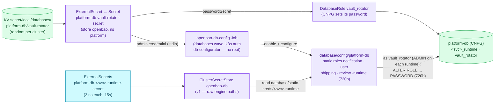

The rest of this section is the **planned** end-state: the engine generating
short-lived, unique PostgreSQL credentials on demand, so no static application
passwords need exist.

#### How It Works (per-request dynamic creds — planned)

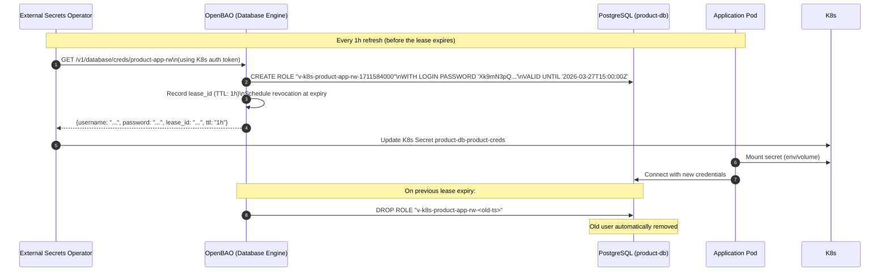

#### Database Connection Configuration (planned)

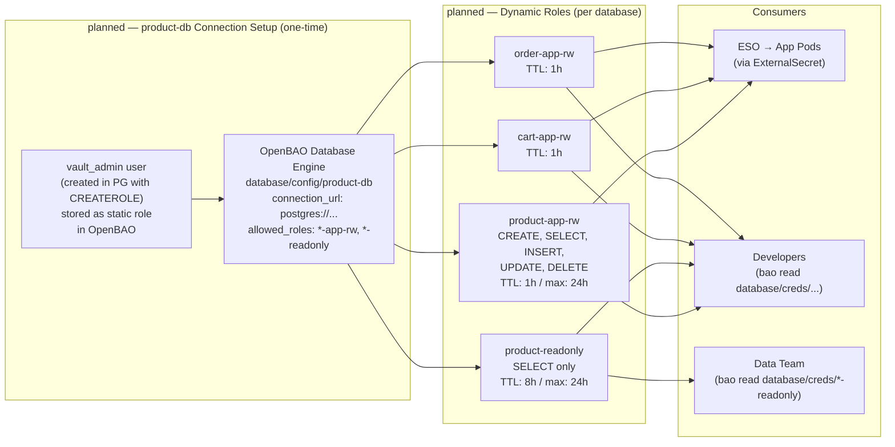

#### Role SQL Templates

**Read-Write role** (application service):
```sql
-- Creation statement (executed by OpenBAO when credential requested)
CREATE ROLE "{{name}}" WITH LOGIN PASSWORD '{{password}}' VALID UNTIL '{{expiration}}';
GRANT CONNECT ON DATABASE product TO "{{name}}";
GRANT USAGE ON SCHEMA public TO "{{name}}";
GRANT SELECT, INSERT, UPDATE, DELETE ON ALL TABLES IN SCHEMA public TO "{{name}}";
ALTER DEFAULT PRIVILEGES IN SCHEMA public
  GRANT SELECT, INSERT, UPDATE, DELETE ON TABLES TO "{{name}}";

-- Revocation statement (executed by OpenBAO on lease expiry)
REVOKE ALL PRIVILEGES ON ALL TABLES IN SCHEMA public FROM "{{name}}";
DROP ROLE IF EXISTS "{{name}}";
```

**Read-only role** (data team / analytics):
```sql
-- Creation statement
CREATE ROLE "{{name}}" WITH LOGIN PASSWORD '{{password}}' VALID UNTIL '{{expiration}}';
GRANT CONNECT ON DATABASE product TO "{{name}}";
GRANT USAGE ON SCHEMA public TO "{{name}}";
GRANT SELECT ON ALL TABLES IN SCHEMA public TO "{{name}}";
ALTER DEFAULT PRIVILEGES IN SCHEMA public GRANT SELECT ON TABLES TO "{{name}}";

-- Revocation statement
REVOKE ALL PRIVILEGES ON ALL TABLES IN SCHEMA public FROM "{{name}}";
DROP ROLE IF EXISTS "{{name}}";
```

---

## 6. Database Credential Workflows

> **Current state.** No database password is in Git: migrator, `db_authz`,
> `vault_rotator`, Temporal and Keycloak passwords are random per cluster in KV v2,
> and OpenBAO rotates all ten service runtime passwords through static roles
> (§5.2). Per-request dynamic application users (§6.2, §6.3 runtime part, §10) are
> still **planned**.

### 6.1 Original problems and how they were closed

Historical: the problems below are the pre-RFC-0012 state that motivated this
design. The right column says what is deployed today and what is still planned.

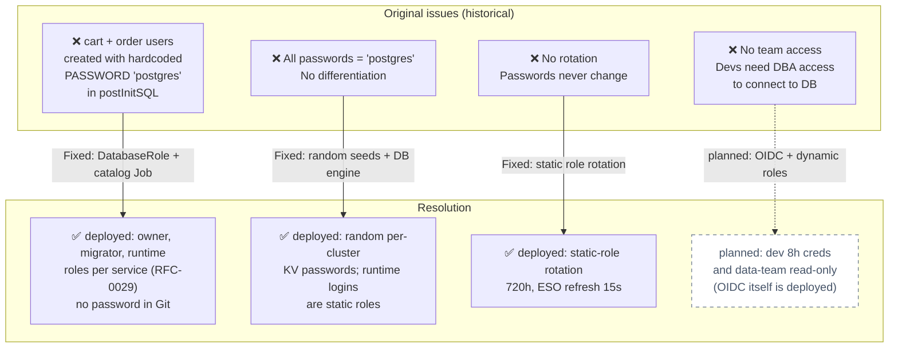

### 6.2 Database User Architecture (planned end-state)

**Planned** user model. Today the application user is the fixed
`<svc>_runtime` login whose password a static role rotates (§5.2), and the
owner is a `NOLOGIN` `<svc>_owner` that the migrator becomes at login
([authorization](../databases/authorization.md)).

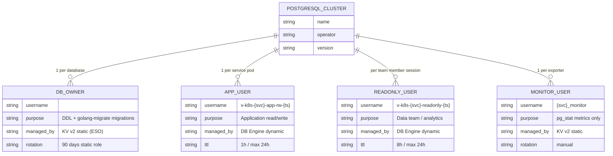

### 6.3 CloudNativePG (product-db) — Credential Flow

This sequence answers how a product-db runtime password is created and
rotated today. platform-db follows the same steps in namespace `platform`.

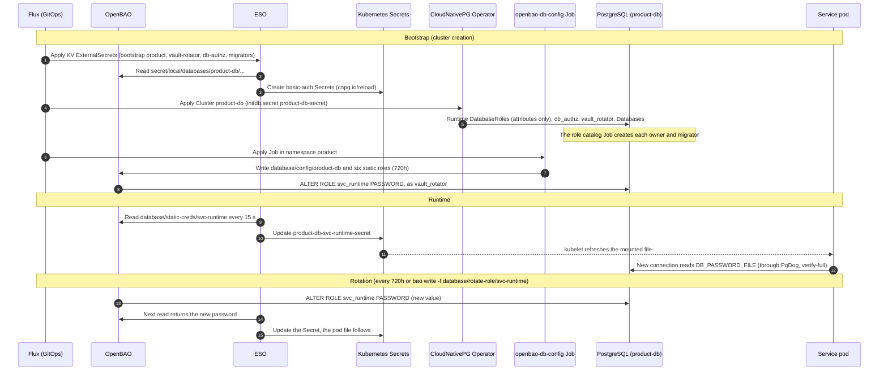

### 6.4 CloudNativePG (`platform-db`, `product-db`) — Credential Strategy

Every cluster now runs on **CloudNativePG**, so credentials follow the same
pattern everywhere: runtime passwords come from the database engine's static
roles, migrator, `db_authz`, `vault_rotator`, Temporal and Keycloak passwords from
OpenBAO KV v2, all synced by ESO. Each service's runtime role and database are
declared in its **RFC-0012 file** (`ExternalSecret`s + `DatabaseRole` + `Database`)
that the operator applies; the owner and migrator roles come from the role catalog
Job. There are no operator-generated credential secrets to reconcile against.

> **Historical:** the retired Zalando operator managed its own K8s secrets
> (`{user}.{cluster}.credentials.postgresql.acid.zalan.do`). The former `auth-db`,
> `shared-db`, and `temporal-db` clusters were consolidated into **`platform-db`**
> (RFC-0018). The `shared-db/*` compat paths were retired when the platform-db
> services moved to the RFC-0029 roles; Temporal uses `platform-db/temporal`.

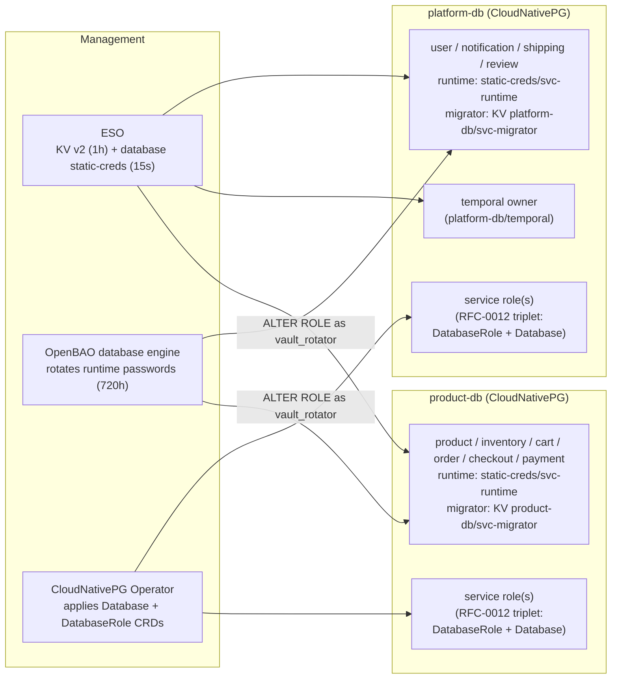

---

## 7. ESO Integration

### ClusterSecretStore (target shape — TLS is planned, RFC-0020 Slice 1)

> **Deployed reality:** the local store uses `server: "http://openbao.openbao.svc.cluster.local:8200"`
> with no `caBundle` (`kubernetes/infra/configs/secrets/cluster-secret-store.yaml` — OpenBAO runs
> `tlsDisable: true` locally). The `https` + `caBundle` shape below is the
> [RFC-0020](../proposals/rfc/RFC-0020/) Slice 1 target (listener TLS from `homelab-ca`; RFC-0008 owns the rest of the hardening).
> Multi-env isolation is by **KV path prefix** (`secret/local/…`), not an OpenBAO namespace —
> OpenBAO (OSS) has no Enterprise-style namespaces feature.

```yaml
apiVersion: external-secrets.io/v1
kind: ClusterSecretStore
metadata:
  name: openbao
spec:
  provider:
    vault:
      server: "https://openbao.openbao.svc.cluster.local:8200"  # planned (RFC-0020 Slice 1); http:// today
      path: "secret"
      version: "v2"
      caBundle: <base64-ca-cert>   # cert-manager issued CA (planned with TLS)
      auth:
        kubernetes:
          mountPath: "kubernetes"
          role: "eso-reader"
          serviceAccountRef:
            name: external-secrets
            namespace: external-secrets-system
```

### ExternalSecret Pattern (Static KV)

```yaml
apiVersion: external-secrets.io/v1
kind: ExternalSecret
metadata:
  name: product-db-secret
  namespace: product
spec:
  refreshInterval: 1h
  secretStoreRef:
    name: openbao
    kind: ClusterSecretStore
  target:
    name: product-db-secret
    creationPolicy: Owner
    deletionPolicy: Retain
    template:
      type: kubernetes.io/basic-auth   # CNPG requires basic-auth for passwordSecret
      metadata:
        labels:
          cnpg.io/reload: "true"    # Triggers CNPG to reload on rotation
  data:
    - secretKey: username
      remoteRef:
        key: secret/data/local/databases/product-db/product
        property: username
    - secretKey: password
      remoteRef:
        key: secret/data/local/databases/product-db/product
        property: password
```

### ESO Sync Flow

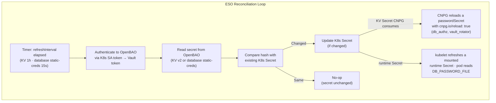

---

## 8. Policies

Policies follow the principle of **least privilege**. No wildcard access in production.

### Policy Hierarchy

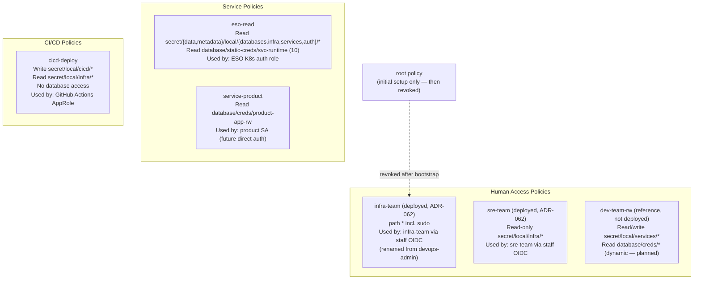

### Policy Syntax Example

```hcl
# eso-read: ESO service account policy (scoped paths, not wildcard)
path "secret/data/local/databases/*" {
  capabilities = ["read", "list"]
}
path "secret/metadata/local/databases/*" {
  capabilities = ["read", "list"]
}
path "secret/data/local/infra/*" {
  capabilities = ["read", "list"]
}
path "secret/metadata/local/infra/*" {
  capabilities = ["read", "list"]
}
path "secret/data/local/services/*" {
  capabilities = ["read", "list"]
}
path "secret/metadata/local/services/*" {
  capabilities = ["read", "list"]
}
# auth/* — grant remains, but the seeded jwt-signing path is orphaned (auth-service retired)
path "secret/data/local/auth/*" {
  capabilities = ["read", "list"]
}
path "secret/metadata/local/auth/*" {
  capabilities = ["read", "list"]
}
# Database engine static roles (ADR-025, ADR-089): one read grant per runtime,
# ten in all (notification, user, shipping, review, product, inventory, cart,
# order, checkout, payment)
path "database/static-creds/notification-runtime" {
  capabilities = ["read"]
}
# ... one block per remaining <svc>-runtime

# dev-team-rw: Developer policy with identity templating
path "secret/data/local/services/{{identity.entity.name}}/*" {
  capabilities = ["create", "read", "update", "delete", "list"]
}
path "database/creds/*-app-rw" {
  capabilities = ["read"]
}
path "database/creds/*-readonly" {
  capabilities = ["read"]
}
```

---

## 9. Multi-Environment (KV Path Prefixes)

OpenBAO OSS has **no namespaces** (that is an Enterprise feature — consistent with §7). Multiple environments share a single instance, isolated by **KV v2 path prefixes** under one `secret/` mount (`secret/{environment}/…`) plus scoped policies. A single ESO `ClusterSecretStore` (`openbao`) targets that mount.

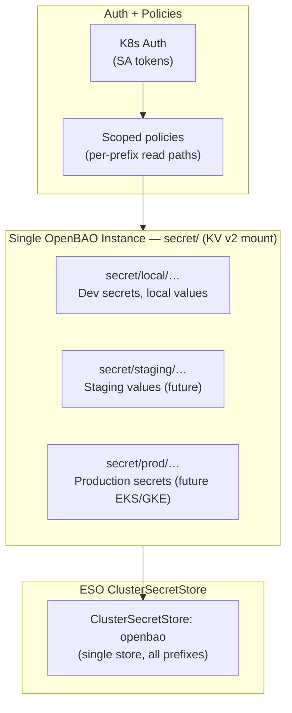

---

## 10. Lease, Renewal, and Revocation

Every dynamic credential in OpenBAO has a **lease** — a time-bounded grant to the secret.

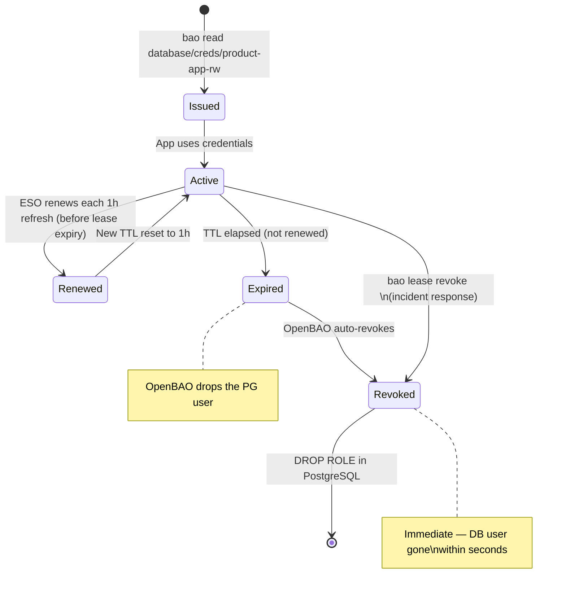

### Lease Commands

```bash
# List all active leases for a role
bao list sys/leases/lookup/database/creds/product-app-rw/

# Inspect a specific lease
bao lease lookup database/creds/product-app-rw/<lease-id>

# Renew a lease manually (normally done by ESO)
bao lease renew database/creds/product-app-rw/<lease-id>

# Revoke a single lease (compromised credential)
bao lease revoke database/creds/product-app-rw/<lease-id>

# Revoke ALL leases for a role (incident response — all apps get new creds on next refresh)
bao lease revoke -prefix database/creds/product-app-rw/
```

---

## 11. Password Policies

A custom password policy can enforce strength requirements for dynamically
generated credentials. **Reference — not deployed:** no manifest writes
`db-strong` and no role sets `password_policy`. Today the ten runtime static
roles use OpenBAO's default generator (letters, digits, `-`).

> [!WARNING]
> Do not wire this policy (or any symbol set with `%`, `@`, `#`, `&`, `=`,
> `+`, `/`, `:` or a space) to a database role until every service builds
> its Postgres DSN with `url.UserPassword`. Nine services still paste the raw
> password into `postgresql://user:password@…`, so such a password corrupts
> the DSN. With pgx ≥ 5.11, malformed percent-encoding is a parse error, and
> the service cannot connect. Tracked in
> [#1107 G1](https://github.com/duynhlab/homelab/issues/1107).

```hcl
# Policy: db-strong (reference only; not applied to any role)
length = 32

rule "charset" {
  charset   = "abcdefghijklmnopqrstuvwxyz"
  min-chars = 4
}
rule "charset" {
  charset   = "ABCDEFGHIJKLMNOPQRSTUVWXYZ"
  min-chars = 4
}
rule "charset" {
  charset   = "0123456789"
  min-chars = 4
}
rule "charset" {
  charset   = "!@#%^&*()-_=+"
  min-chars = 2
}
```

Apply to a database role:
```bash
bao write database/roles/product-app-rw \
  db_name=product-db \
  password_policy="db-strong" \
  creation_statements="..." \
  default_ttl="1h" \
  max_ttl="24h"
```

---

---

## Audit and telemetry

**Audit.** The server config declares one audit device:

```hcl
audit "file" "to-stdout" {
  options { file_path = "stdout" }
}
```

- Every request and every response is one JSON line on stdout. Only the active
  node writes (standbys ignore the stanza), so a line is never duplicated across
  pods. Secret values and tokens are HMAC-ed before writing: a KV read shows
  `password: hmac-sha256:…`, never the value.
- It is declared, not API-created. OpenBAO refuses API-created audit devices by
  default (`unsafe_allow_api_audit_creation = false`), and the root token is
  revoked anyway. The bootstrap Job's old `bao audit enable file` had therefore
  never worked: it failed silently behind an "already enabled" message, and until
  2026-09-29 the server had **no audit device at all**.
- Vector ships the lines with every other pod log to VictoriaLogs and to
  ClickHouse (`otel.otel_logs`, see [`vector.md`](../observability/logging/vector.md)).
  In ClickHouse the main fields are lifted into `LogAttributes`:

  ```sql
  SELECT LogAttributes['event.name']              AS event,
         LogAttributes['openbao.request.path']     AS path,
         LogAttributes['openbao.request.operation'] AS op,
         LogAttributes['openbao.auth.display_name'] AS who,
         count()
  FROM otel.otel_logs
  WHERE ServiceName = 'openbao' AND LogAttributes['event.name'] LIKE 'openbao.audit.%'
  GROUP BY event, path, op, who ORDER BY count() DESC;
  ```

  The full record stays in `Body` (`JSONExtractString(Body, 'request', 'path')`).

**Telemetry.** `telemetry { prometheus_retention_time = "12h" }` plus
`unauthenticated_metrics_access` on the listener expose `vault_*` metrics at
`/v1/sys/metrics?format=prometheus`; the chart's ServiceMonitor (enabled) lets
vmagent scrape them (≈260 series names, `vault_core_*`, `vault_audit_*`,
`vault_raft_*`, `vault_token_*`, …). The chart points the ServiceMonitor at the
`openbao-active` Service, so the series describe the node that serves requests.
Retention must outlive `usage_gauge_period` (10m): the usage gauges
(`vault_secret_kv_count`, `vault_token_count`, identity counts) are emitted once
per period, and with a 30s retention they disappeared between scrapes, which left
the dashboard's KV, token and entity panels empty.

**What the dashboard shows empty, and why (checked 2026-09-30).** The board is
the chart's own (`serverTelemetry.grafanaDashboard`, chart 0.30.0), imported
into the `Secrets` folder. The KV (`vault_secret_kv_count`) and token panels
populate. Three things stay blank, none of them a scrape fault:
- **Consul Requests** (`vault_consul_*`): storage here is integrated Raft, so no
  Consul metric exists. The `vault_raft_*` families carry the equivalent signal.
- **Policy Set** (`vault_policy_set_policy_count`) and the **create/delete**
  series in *Path Info* (`vault_route_create_*`, `vault_route_delete_*`):
  OpenBao registers a counter on its first event, and policies are only written
  by the one-shot bootstrap. After a restart these series stay absent until the
  next write.
- *Path Info* itself works. Its `mountpoint` variable strips the trailing `/`
  from `mount_point="secret/"`, so the panels query `vault_route_read_secret__count`.

## Operations And Runbooks

Operational commands are kept out of this architecture document so the learning material stays readable. Use these task-focused runbooks:

| Task | Runbook |
|---|---|
| Bootstrap a fresh local OpenBAO deployment | [Initial setup](./runbooks/openbao-initial-setup.md) |
| Recover sealed OpenBAO pods or a stuck `secrets-local` reconciliation | [Unseal and stuck reconciliation](./runbooks/openbao-unseal.md) |
| Diagnose ESO sync failures | [ESO sync failure](./runbooks/eso-sync-failure.md) |
| Recover the 1-hour Kubernetes reviewer JWT failure | [Reviewer JWT auth failure](./runbooks/reviewer-jwt-auth-failure.md) |
| Save or restore a Raft snapshot | [Raft snapshot and restore](./runbooks/raft-snapshot-restore.md) |
| Rotate static KV v2 secrets | [Rotate static secret](./runbooks/rotate-static-secret.md) |
| Add/write a KV secret on a LIVE cluster (root is revoked) | [Add secret — break-glass](./runbooks/add-secret-live-cluster.md) |
| Revoke credentials after compromise | [Revoke compromised credential](./runbooks/revoke-compromised-credential.md) |

## 16. File Reference

### Infrastructure Files

| File | Purpose |
|------|---------|
| `kubernetes/infra/controllers/secrets/openbao/helmrelease.yaml` | OpenBAO HA Helm chart (awskms seal via floci) |
| `kubernetes/infra/controllers/secrets/floci/` | floci KMS emulator — Deployment, `floci-kms-init` Job, NetworkPolicy |
| `kubernetes/infra/controllers/secrets/external-secrets/helmrelease.yaml` | ESO HelmRelease |
| `kubernetes/infra/configs/secrets/openbao-bootstrap/` | Init scripts (phased) |
| `kubernetes/infra/configs/secrets/cluster-secret-store.yaml` | ClusterSecretStore (openbao — KV v2 mount) |
| `kubernetes/infra/configs/secrets/cluster-secret-store-db.yaml` | ClusterSecretStore (openbao-db — raw `database/` engine paths, v1 semantics) |
| `kubernetes/infra/configs/secrets/payment-webhook-external-secrets.yaml` | `payment-webhook-hmac` ExternalSecret (ns payment) |
| `kubernetes/infra/configs/databases/clusters/{platform-db,product-db}/openbao-db-config.yaml` | `openbao-db-config` Job + ServiceAccount per cluster — enables the DB engine, writes `database/config/<cluster>` and the cluster's runtime static roles (ADR-025, ADR-089) |
| `kubernetes/infra/configs/databases/clusters/{platform-db,product-db}/vault-rotator.yaml` | ESO credential projection + CNPG `DatabaseRole` for each cluster's database-engine administrator |
| `kubernetes/infra/configs/secrets/cluster-external-secrets/` | ClusterExternalSecret definitions |
| `kubernetes/infra/configs/secrets/cluster-external-secrets/cloudflare.yaml` | `ExternalSecret` (per-namespace) for cert-manager DNS-01 — file lives in CES dir but is `kind: ExternalSecret` since cert-manager only needs the Secret in one namespace |
| `kubernetes/infra/configs/databases/clusters/*/secrets/` | Per-cluster ExternalSecret definitions |

### Helm Sources

| File | Purpose |
|------|---------|
| `kubernetes/clusters/local/sources/helm/openbao.yaml` | OpenBAO Helm repository |
| `kubernetes/clusters/local/sources/helm/external-secrets.yaml` | ESO Helm repository |

---

## 17. Migration from Vault Dev Mode

### Phase Checklist

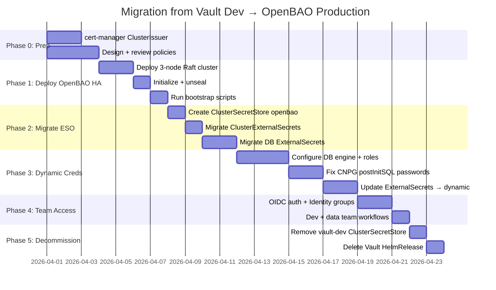

---

## 18. Related Documentation

- [RFC-0008 — Production secrets hardening](../proposals/rfc/RFC-0008/) (+ [research.md](../proposals/rfc/RFC-0008/research.md) — deep dive, auto-unseal PoC, DB redesign)
- [Secrets hub](./README.md#secret-organization) — ESO patterns, path conventions, secret catalog
- [cert-manager](./cert-manager.md) — Certificate issuers and `platform-edge-tls` wildcard pipeline
- [Trust Distribution](./cert-manager.md#11-trust-manager--distributing-the-homelab-ca-bundle) — trust-manager `homelab-ca-bundle` distribution
- [Secrets proposals](../proposals/) — ADR-004/005 (audit, HA) + RFC backlog (rotation, PushSecret, hardening)
- [OpenBAO Documentation](https://openbao.org/docs)
- [OpenBAO Helm Chart](https://openbao.org/docs/platform/k8s/helm)
- [External Secrets Operator](https://external-secrets.io/)
- [CloudNativePG External Secrets Integration](https://cloudnative-pg.io/docs/1.28/cncf-projects/external-secrets)
